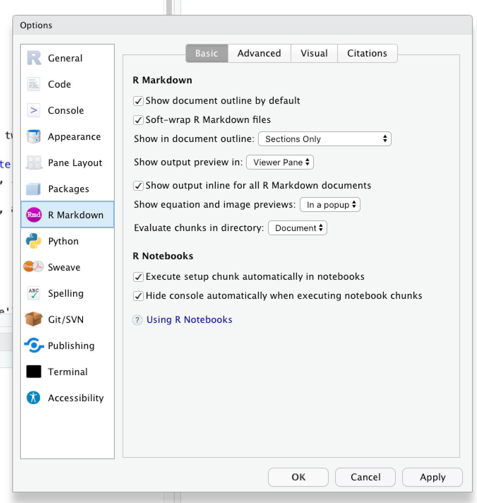

```{r setup, include=FALSE}
knitr::opts_chunk$set(echo = TRUE)
```

# At the beginning

- Ask attendants about their level: 
  - if they have worked with R before
  - if they know the `{tidyverse}` or base-R
  - if they know other languages (Python, etc.)

- Make a guided tour of Rstudio 
  - Show them where the contents lie
  - Show them the File navigator
  

# Show the setup 

- It is more comfortable to work with a setup that allows the rendering of the html 
in the `Viewer` pane. 
- To do that, one has to set the `show output preview` to `Viewer pane` in the settings. 
- One can show this to the attendants as follows: 


