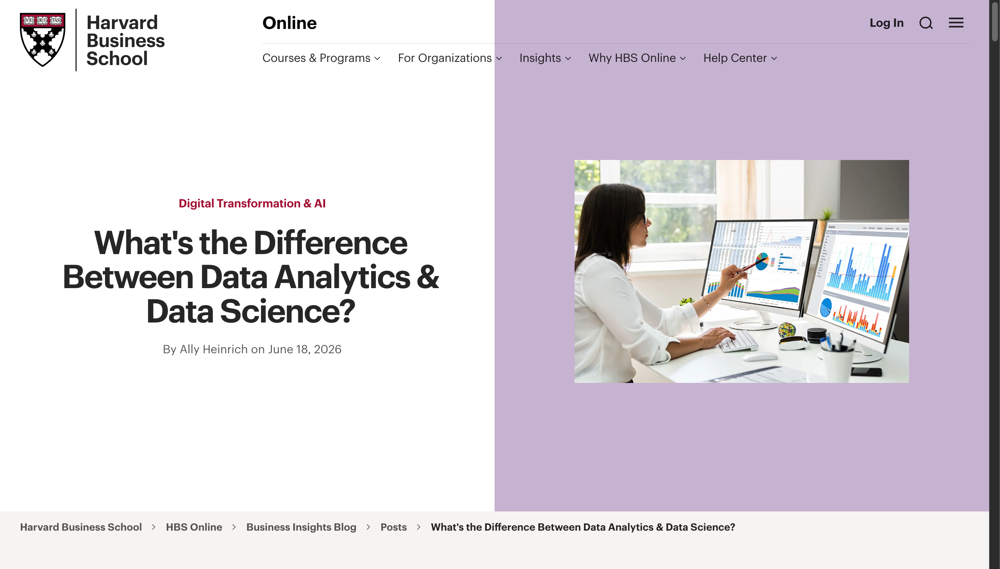
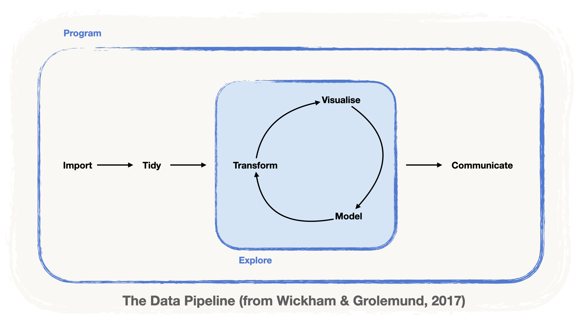
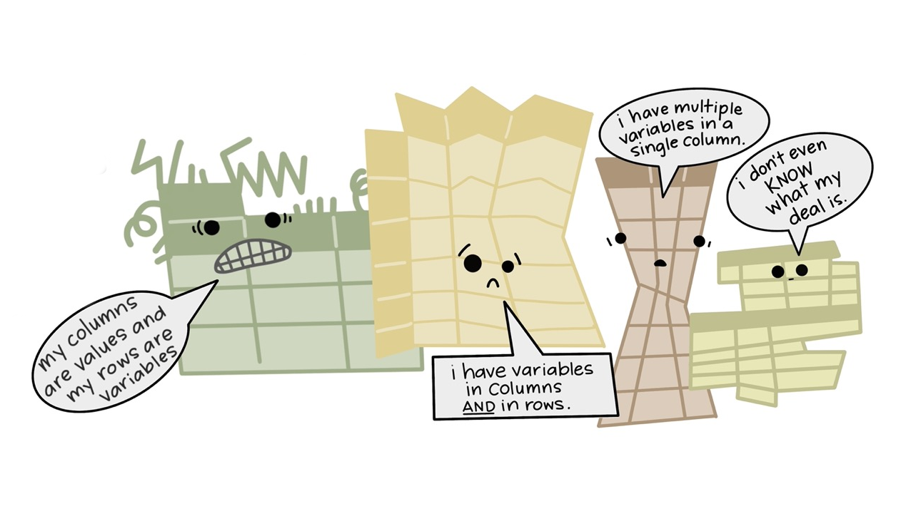
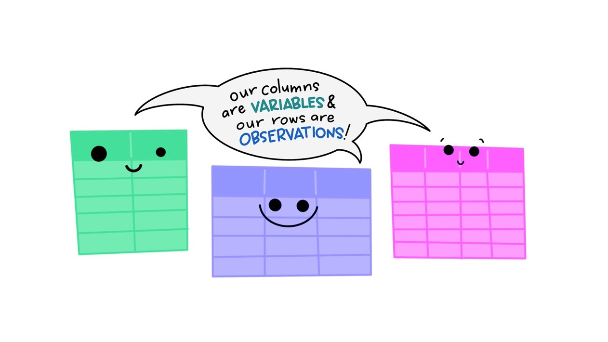
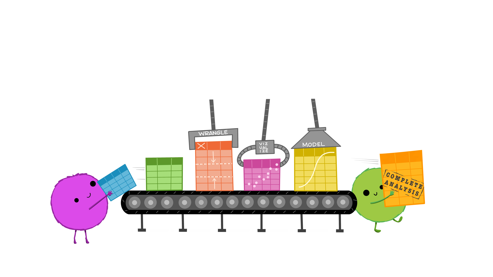
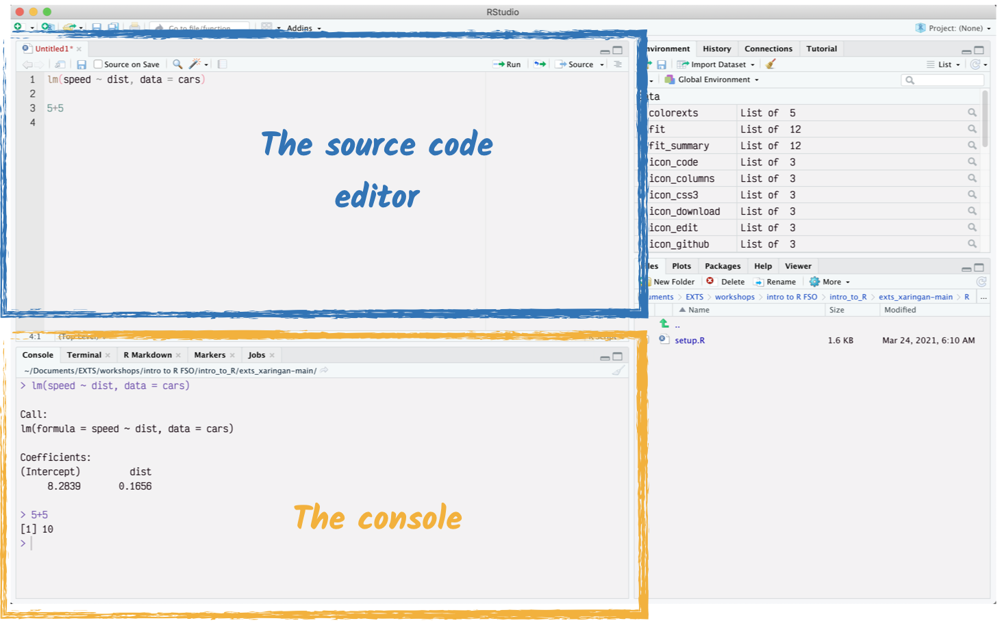

```{r setup, include = FALSE, message = FALSE, warning = FALSE}
knitr::opts_chunk$set(
  echo = TRUE,
  message = FALSE,
  warning = FALSE,
  fig.align = 'center',
  fig.height = 5)
```

```{r r_setup, include = FALSE}
library(tidyverse)
```

# 📊 What is Data Science?

## A **_Practical_** definition

This is the first question you may have in mind when approaching the topic of Data Science. We think that a first answer to this question comes from a practical standpoint, i.e. from what Data Science _does_. To cite a [post by Ally Heinrich on the Harvard Business School blog](https://online.hbs.edu/blog/post/data-analytics-vs-data-science) (emphasis ours):

{fig-alt="A screenshot of the HBS blog post title" fig-align="center" width="90%"}

> Data science centers on **collecting, preparing, modeling, and analyzing data** to build predictive capabilities and solve complex problems.
>
> As [HBS Professor Karim] Lakhani notes in Data Science and AI for Decision Making, data science “focuses on **transforming raw data** into **practical understanding** that **informs decisions**."
>
> To achieve this, data scientists leverage a combination of technical tools and methodologies [...]

## In Theory

In theory, data science means using an **intersection** of **practices** and **skills** to answer a research **question** that involves **data**. Three skill sets meet:

-   **computer science**, to collect, store and process the data with code,
-   **mathematics and statistics**, to model the data and quantify uncertainty,
-   **domain expertise**, to ask the right questions and interpret the answers.

None of them is enough on its own: data science sits where all three overlap.

{fig-alt="The three overlapping circles of data science: computer science, mathematics and statistics, and domain expertise. Data science sits where all three meet." fig-align="center" width="80%"}

## In Practice

In practice, a Data Science project requires **mastering** the **Data pipeline**, i.e. the sequence of steps that takes you from raw data to insights:

-   📥 **Import**: *Load* data into our analysis tool
-   🧹 **Tidy**: *Clean* and *Transform* the data
-   🔍 **Understand**: Via *Visualisations*, *Models*
-   📄 **Communicate**: *Report* your insights

This workshop follows these steps: you will write your analyses in **notebooks**, which help you communicate, then **import**, **wrangle** (tidy and transform) and **visualise** data.

## The Data Pipeline

If we put it in a chart, the pipeline looks like this:

{fig-alt="The data pipeline as a flow: import, then tidy, then a loop of transform, visualise and model, then communicate." fig-align="center" width="90%"}

Notice that transforming, visualising and modelling form a **loop**: understanding data rarely happens in one go. A plot raises a new question, which calls for a new transformation, and so on, until you have something worth communicating.

# What is R?

## A brief overview

**R** is an open-source **programming language** designed for **statistical computing**. It is free to use and runs on Windows, macOS and Linux.

Its strength comes from being **highly extensible through `{packages}`**, which can be **developed by anyone**. A package is a **collection of functions** that expands what R can do: there are packages to read almost any file format, to fit statistical models, to draw plots, to write reports...

## **R** as your **workbench**

You can think of R as your workbench, where:

-   **Data** is the **material** you're working with (metal, or wood),
-   **Functions** are the **tools** you use to transform the material (saws, hammers, pliers),
-   **Packages** are the **toolboxes** that contain a bunch of useful tools.

## `{tidyverse}`: Another flavour of R

Base **R** is **powerful**, but a bit **hard to learn**. This is because of many factors, which include:

-   Functions with the same name exist in different packages, which yields errors and calls for careful *namespacing*.
-   The output of a function does not easily become the input of another, especially when they come from different packages, so the data constantly needs transforming.

At the core of the last problem is the fact that `lists` are the preferred data structure. They are very flexible, but that freedom comes at the price of these inconsistencies: every package, and every developer, may have **their own way of organising data**.

{fig-alt="Cartoon of four messy tables, each messy in its own way: one has values in its columns and variables in its rows, one has variables in both columns and rows, one has several variables in a single column, and the last one doesn't even know what its deal is." fig-align="center" width="80%"}

Enter the **`{tidyverse}`**, "an *opinionated* collection of packages". By *opinionated*, we mean that it establishes rules for developing R code and data science tasks. One of these rules is that the data has to be **organised in a single, consistent way**, called **"tidy" data**:

-   each **variable** forms a **column**,
-   each **observation** forms a **row**,
-   each **cell** is a **single measurement**.

{fig-alt="Hadley Wickham's definition, 'Tidy data is a standard way of mapping the meaning of a dataset to its structure', with the three rules of tidy data: each variable forms a column, each observation forms a row, each cell is a single measurement, next to a small example table." fig-align="center" width="80%"}

Because all tidy datasets follow the same rules, they all look alike, and the same tools work on all of them:

{fig-alt="Cartoon of three happy tidy tables saying together: our columns are variables and our rows are observations!" fig-align="center" width="80%"}

::: aside
::: {.tiny}
Illustrations from the [Openscapes](https://www.openscapes.org) blog [Tidy Data for reproducibility, efficiency, and collaboration](https://www.openscapes.org/blog/2020/10/12/tidy-data/) by Julia Lowndes and Allison Horst
:::
:::

# Why R and `{tidyverse}`?

With the `{tidyverse}` collection, it is **easy to master the Data Pipeline** within R! Every package expects tidy data and returns tidy data, so the output of one step is directly the input of the next:

{fig-alt="A cartoon of the data pipeline. How every step produces tidy data that is consumed by the next stage until a final shareable result." fig-align="center" width="80%"}

::: aside
::: {.tiny}
Illustrations from the [Openscapes](https://www.openscapes.org) blog [Tidy Data for reproducibility, efficiency, and collaboration](https://www.openscapes.org/blog/2020/10/12/tidy-data/) by Julia Lowndes and Allison Horst
:::
:::

There is a `{tidyverse}` package for each step of the pipeline. These are the ones you will use in this workshop:

{fig-alt="The data pipeline again, with the tidyverse package used at each step: readr to import, tidyr and dplyr to tidy and transform, ggplot2 to visualise, and R Markdown to communicate." fig-align="center" width="90%"}

# Prework Refresh

## The Rstudio IDE

Before today, you started a Renku session and met the RStudio IDE (*Integrated Development Environment*). Its two most important panes are:

-   The **Console**: where R evaluates what you type, one line at a time.
-   The **Source editor**: where you *save* the code you want to keep.

{fig-alt="The Rstudio interface highlighting the source editor and the console" fig-align="center" width="90%"}

## What you already set up

In the prework, you also met two basic elements of R code:

-   **Variables**, assigned with `<-`, e.g.

```r
x <- 5
```

-   **Comments**, written after a `#`, which R does not evaluate. They are notes for the humans reading the code:

```r
> # Code that does not evaluate
> print("Code that does evaluate")
[1] "Code that does evaluate"
```

# Beyond the Prework

Let's go a step further and explore how **R** and the `{tidyverse}` handle:

-   🗄️ Datasets
-   🧰 Using packages
-   ⁉️ Documentation
-   ▶️️ The Pipe operator

## 🗄️ Datasets

To work with data in R, **assign the dataset** to a **variable**. Here, `read_csv()` reads the file `rolling_stones.csv` in the `data` folder, and `<-` stores its contents in the variable `rolling_stones_data`:

```{r eval=FALSE}
#| label: read-rolling-stones
rolling_stones_data <- read_csv("data/rolling_stones.csv")
```

The dataset now lives in your session, and you can look at it, e.g. its first row:

```{r echo=FALSE}
#| label: preview-rolling-stones
rolling_stones_data <- readr::read_csv("data/rolling_stones.csv")

dplyr::slice_head(rolling_stones_data)
```

Notice the abbreviations under the column names, such as `<chr>` (text), `<dbl>` (numbers) and, in the last column, `<lgl>` (`TRUE`/`FALSE`): **every column has a type**. We will come back to types throughout the workshop.

## 🗄️ Datasets in variables

You can **use more than one dataset** in your session, by **storing them in different variables**:

```{r eval=FALSE}
#| label: read-two-datasets
# reading a dataset: rolling_stones
rolling_stones_data <- read_csv("data/rolling_stones.csv")

# reading another dataset: sales
sales_data <- read_tsv("data/sales_data.tsv", skip = 3)
```

The sales data is *tab*-separated, hence `read_tsv()`, and its first three lines are a report header, which `skip = 3` jumps over. You will learn these functions in the Data Import module.

## 🗄️ Data Formats

In this workshop, we focus on **data that comes in tables**, like in **MS Excel**. But R supports many **different data structures**, through dedicated **packages**:

-   **structured** databases, like an **SQL** database,
-   **semi-structured** formats, such as **json** and **xml** files,
-   **raw text** and **html code**,
-   even **STATA, SAS and SPSS data**.

In short: we are not limited by a particular data format when using **R**.

## 🧰 Packages

We said that **R** is highly extensible through *packages*. They work like the *plugins* of Excel, Photoshop or your web browser: whatever you need to do, chances are "there's a package for that".

In a project, we only use the tools we need. Thus, we **only attach** the packages **we need**. (After all, nobody likes a messy workbench!)

## 🧰 Installing and Attaching R Packages

To **use** the functions of a package, we need to do **two things**:

1.  **Install** the package. We only have to do this **once** on a computer, so **do not include this** in your **source code**:

``` r
# install the package dplyr
install.packages("dplyr")
```

2.  **Attach** the package. You need to do this in **each session**, so **include this** in your **source code**:

``` r
# attach the package dplyr
library(dplyr)
```

::: callout-note
On Renku, the packages of this workshop are already installed: you only need to attach them.
:::

## 🧰 Example: using `dplyr::slice_head()`

The function `slice_head()` allows us to view **the first line(s)** of a dataset. It is part of the package `{dplyr}`: the notation `dplyr::slice_head()` makes this explicit. Let's attach `{dplyr}` and use `slice_head()` on the `cars` dataset, which comes with R:

```{r}
#| label: slice-head-cars
# attaching the package
library(dplyr)

# using the function slice_head() on the dataset cars
slice_head(cars)
```

**Success!**

## ⁉ Asking for help

:::: {.columns}
::: {.column width="50%"}
If you want to know what a function does, all you need to do is type:

1.  a question mark `?`
2.  the name of the function you want to know more about

For instance:

``` r
?slice_head()
```

The documentation opens in the **Help** pane. It describes what the function does, its arguments, and usually ends with examples you can copy.
:::

::: {.column width="50%"}
{fig-alt="The RStudio Help pane showing the documentation page for a function, with its description, usage and arguments." fig-align="center"}
:::
::::

## ▶️ The *Pipe* operator of the `{tidyverse}`

The *pipe* `%>%` allows us to **write code *sequentially***, which makes complex calls **easy to read and write**. It **"feeds" the left-hand side** as the **first argument** of the next function.

For example, let's plot the density of the variable `speed` in the `cars` dataset. Without the pipe, the calls are *nested* and must be read from the inside out; with the pipe, they read from left to right:

``` r
# nested
plot(density(cars$speed))

# with the pipe
cars %>% pull(speed) %>% density() %>% plot()
```

The second line can be "read" as:

> "*take the dataset `cars` **then** `pull()` the variable `speed` **then** compute the `density()` **then** build a `plot()`.*"

To type the pipe, use the shortcut <kbd>Shift</kbd> + <kbd>Ctrl</kbd> + <kbd>M</kbd> (<kbd>Shift</kbd> + <kbd>Cmd</kbd> + <kbd>M</kbd> on a Mac).

## ▶️ `%>%` or `|>`?

Since version 4.1, R also has a **native pipe** `|>`, built into the language.

``` r
cars %>% pull(speed) %>% density() %>% plot() # the {tidyverse} pipe
cars |> pull(speed) |> density() |> plot()    # the native pipe
```

-   For everyday use, they **do the same thing**, and you will meet both in code online.
-   In this workshop, we use `%>%`.

::: callout-tip
## Which pipe does the shortcut insert?

In RStudio, go to *Tools* → *Global Options* → *Code* and look for *Use native pipe operator, \|\> (requires R 4.1+)*. Unticked, the shortcut inserts `%>%`; ticked, it inserts `|>`. The workshop project is set to `%>%`.
:::

# What's next? {.handout-only}

The next topics follow the data pipeline:

-   [Working with **R Notebooks**](../02-working-with-r-markdown/handout.html)
-   [**Importing** Data](../03-importing-data/handout.html)
-   [Data **Wrangling**](../04-data-wrangling/handout.html)
-   [Data **Visualisation**](../05-data-visualisation/handout.html)

# 💾 Extra info: Saving today's work

## 💾 Saving one file

Your Renku session is **temporary**: before it ends, **download** the files you want to keep to your computer.

Most of your work is in **one file**: the exercise notebook.

-   In the **Files** pane, go to `workshop-content/_exercises/`.
-   **Tick the box** next to `exercise-notebook.qmd`.
-   Click on **More** ⚙️ → **Export...** → **Download**.

::: callout-tip
Tick **one file at a time**. Exporting a whole folder fails on Renku.
:::

## 💾 Saving all scripts at once

To download **all your notebooks and scripts** (`.qmd`, `.Rmd` and `.R`) at once, first pack them into a single archive. Type in the **Console**:

```{r}
#| label: pack-my-work
#| eval: false
tar("my-work.tar.gz",
    files = list.files("workshop-content",
                       pattern = "[.](qmd|Rmd|R)$",
                       recursive = TRUE, full.names = TRUE),
    compression = "gzip", tar = "internal")
```

Then download `my-work.tar.gz` as described above. On your computer, **double-click** it to unpack it (macOS and Windows 11).

::: callout-important
Rendered pages and their support files can be recreated by rendering again.
:::
