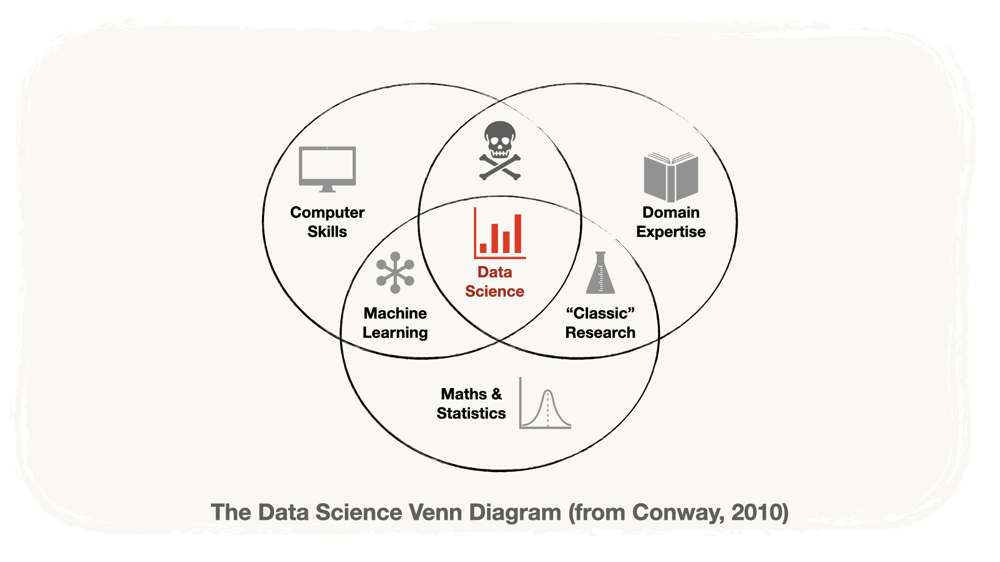
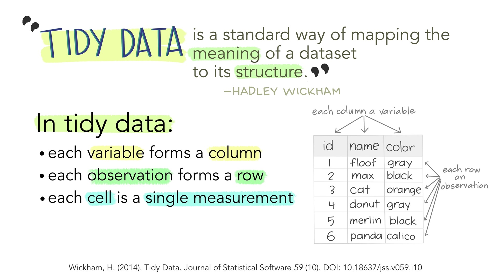
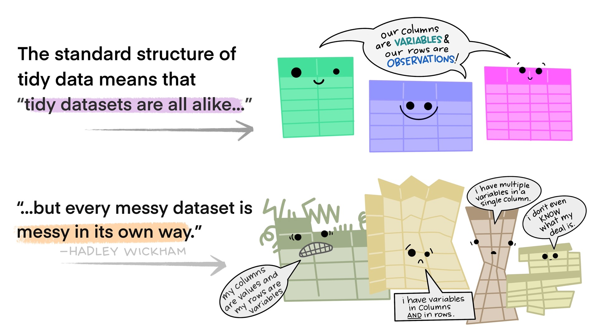
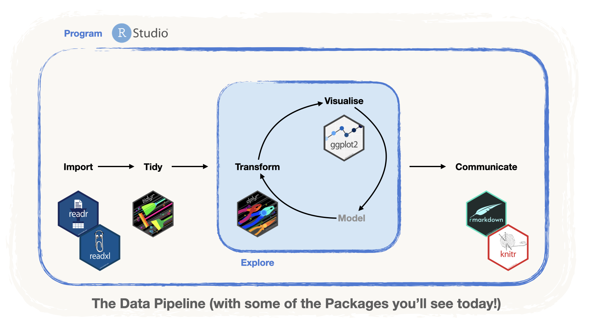
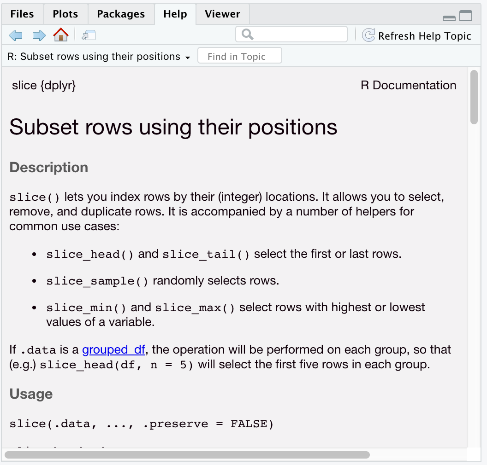

```{r setup, include = FALSE, message = FALSE, warning = FALSE}
knitr::opts_chunk$set(
  echo = TRUE,
  message = FALSE,
  warning = FALSE,
  fig.align = 'center',
  fig.height = 5)
```

```{r r_setup, include = FALSE}
library(tidyverse)
```

# 📊 What is Data Science? {.subsection background-color="#425556"}

## In Theory {.subsubsection background-color="#00A79F"}

. . .

### Using an **intersection** of **practices** and **skills**

### to answer a research **question** that involves **data**

## {.center}

{fig-alt="The three overlapping circles of data science: computer science, mathematics and statistics, and domain expertise. Data science sits where all three meet." fig-align="center" width="80%"}

## In Practice {.subsubsection background-color="#00A79F"}

. . .

### **mastering** the **Data pipeline**

## The Data pipeline {.smaller}

:::::: {.columns}
::::: {.column width="50%"}

:::: {.content-box-oil}
[📥 **Import**]{.box-title}

::: {.content-box-white}
[*Load* data into our analysis tool]{.box-body}
:::
::::

:::: {.content-box-oil}
[🧹 **Tidy**]{.box-title}

::: {.content-box-white}
[*Clean* and *Transform* the data]{.box-body}
:::
::::

:::::

::::: {.column width="50%"}

:::: {.content-box-oil}
[🔍 **Understand**]{.box-title}

::: {.content-box-white}
[Via *Visualisations*, *Models*]{.box-body}
:::
::::

:::: {.content-box-oil}
[📄 **Communicate**]{.box-title}

::: {.content-box-white}
[*Report* your insights]{.box-body}
:::
::::

:::::
::::::

## {.center}

{fig-alt="The data pipeline as a flow: import, then tidy, then a loop of transform, visualise and model, then communicate." fig-align="center" width="90%"}

# What is R? {.subsection background-color="#425556"}

## A brief overview

::: {.content-box-marine}
**R** is an open source **programming language** designed for **statistical computing**
:::

::: {.content-box-marine}
**R** is **highly extensible through `{packages}`** that can be **developed by anyone**.
:::

::: {.content-box-marine}
**Packages** are **collections of functions** that expand the functionality of R.
:::

## **R** as your **workbench**.

-   **Data**: the **materials** you're working with (metal, or wood)

-   **Functions**: the **tools** you use to transform the materials (saw, hammers, pliers)

-   **Packages**: the **toolboxes** that contain a bunch of useful tools.

## `{tidyverse}`: Another flavour of R. {background-image="img/tidyverse-logo.png" background-size="150px" background-position="90% 90%"}

::: {.content-box-marine}
Base **R** is **powerful** but a bit **hard to learn**
:::

-   One of the main problems: **many different ways to organise data**.

::: {.notes}
-   functions have same names, they don't communicate well with each other
-   the output of one does not become easily the input of another (especially if they come from different packages)
-   `lists` are the preferred data source
-   "Freedom comes at a price" lists are powerful but can lead to those inconsistencies
:::

. . .

::: {.content-box-marine}
Enter the **`{tidyverse}`**, "an *opinionated* collection of packages"
:::

-   The Data is **organised in single, consistent way**: **"tidy" data**.

::: {.notes}
-   "opinionated" they are directive, i.e. they come with a set of rules and guidelines
:::

## {.center}

{fig-alt="A tidy data frame drawn as a friendly table: every column is a variable, every row is an observation, every cell is a single value." fig-align="center" width="80%"}

::: aside
::: {.tiny}
Illustrations from the [Openscapes](https://www.openscapes.org) blog [Tidy Data for reproducibility, efficiency, and collaboration](https://www.openscapes.org/blog/2020/10/12/tidy-data/) by Julia Lowndes and Allison Horst
:::
:::

## {.center}

{fig-alt="Cartoon showing that tidy datasets all look alike and can be combined easily, while every messy dataset is messy in its own way." fig-align="center" width="80%"}

::: aside
::: {.tiny}
Illustrations from the [Openscapes](https://www.openscapes.org) blog [Tidy Data for reproducibility, efficiency, and collaboration](https://www.openscapes.org/blog/2020/10/12/tidy-data/) by Julia Lowndes and Allison Horst
:::
:::

# Why R and `{tidyverse}`? {.subsection background-color="#425556"}

# With the `{tidyverse}` collection, it is **easy to master the Data Pipeline** within R! {.subsection background-color="#425556"}

## {.center}

{fig-alt="The data pipeline again, with the tidyverse package used at each step: readr to import, tidyr and dplyr to tidy and transform, ggplot2 to visualise, and R Markdown to communicate." fig-align="center" width="90%"}

# Prework Refresh {.subsection background-color="#425556"}

## What you already set up

::: {.content-box-marine}
Before today you started a **Renku** session and met the **RStudio IDE**.
:::

-   The **Console** — where R evaluates what you type, one line at a time.

-   The **Source editor** — where you *save* the code you want to keep.

-   **Variables**, assigned with `<-`, to store results and reuse them.

-   **Comments**, written after a `#`, which R does not evaluate.

. . .

::: {.content-box-marine}
Today we build on all four. If any of them feels shaky, say so now.
:::

# 💾 Saving today's work with `git` {.subsection background-color="#425556"}

## 💾 Saving today's work with `git`

To **save today's work from Renku**, we'll use `Gitlab` and some `git` commands.

::: {.content-box-marine}
`git` is a system that **tracks the changes** you make to your **scripts**. It's a **log** of **modifications**.
:::

. . .

Go into the `Terminal` Tab of the RStudio IDE (next to `Console` tab)

To take a "snapshot" of your work type:

-   `git add .` + <kbd>Enter</kbd> to **add all the recent changes** to your files to the tracking system.

. . .

-   `git commit -m "your commit message" --no-verify` + <kbd>Enter</kbd> to **register** the changes.
    -   `"your commit message"` is the "title" of your changes, e.g. `"Solution to Exercise 1"`

. . .

-   `git push` + <kbd>Enter</kbd>
    -   to **send** the changes to `GitLab`

And from `GitLab`, we can download your modifications at the end of the day!

# Beyond the Prework {.subsection background-color="#425556"}

## Let's go beyond the Prework

### 🗄️ Datasets

### 🧰 Using packages

### ⁉️ Asking for Help!

### ▶️️ The Pipe operator

## 🗄️ Datasets in variables

To work with data in R, **assign the dataset** to a **variable**

```{r eval=FALSE}
rolling_stones_data <- read_csv("data/rolling_stones.csv")
```

```{r echo=FALSE}
rolling_stones_data <- readr::read_csv("data/rolling_stones.csv")

dplyr::slice_head(rolling_stones_data)
```

. . .

You can **use more than one dataset** in your session, by **storing them in different variables**

```{r eval=FALSE}
# reading a dataset: rolling_stones
rolling_stones_data <- read_csv("data/rolling_stones.csv")

# reading another dataset: sales
sales_data <- read_tsv("data/sales_data.tsv", skip = 3)
```

::: {.notes}
Here, talk about data types:

-   `slice_head()` gives you the first row of a dataset
-   you see here the `chr`, `numeric` etc.? : It means that every column has a *type*
:::

## 🗄️ Data Formats

::: {.content-box-marine}
In this workshop, we will focus on **data that comes in tables**, like **MS Excel**.
:::

. . .

But, in R you can work with **many different data structures**, such as:

-   **structured** databases, like an **SQL** database

-   **unstructured** databases, such as **json** and **xml** files

-   **raw text** and **html code**

-   even **STATA, SAS and SPSS data**!

. . .

::: {.content-box-marine}
We are not limited by a particular data format when using **R**
:::

## 🧰 Packages {background-image="img/dplyr-logo.png" background-size="200px" background-position="90% 90%"}

::: {.content-box-marine}
We said that **R** is highly extensible through *packages*.
:::

-   In a project we only use the tools we need.

-   Thus, we **only attach** the packages **we need**.

(After all, nobody likes a messy workbench!)

::: {.notes}
-   Mention Excel, photoshop, browser *plugins*
-   "There's a package for that"
:::

## 🧰 Installing and Attaching R Packages {.smaller}

To **use** the functions in a package, we need to do **two things**:

:::::: {.columns}
::::: {.column width="50%"}

:::: {.content-box-oil}
[1. **Install** the package]{.box-title}

::: {.content-box-white}
[We only have to do this **once**.]{.box-body}

[⚠️ **Do not include this** in your **source code!**]{.box-body}

``` r
# install the package dplyr
install.packages("dplyr")
```
:::
::::

:::::

::::: {.column width="50%"}

:::: {.content-box-oil}
[2. **Attach** the package]{.box-title}

::: {.content-box-white}
[This you need to do in **each session**.]{.box-body}

[⚠️ **Include this** in your **source code!**]{.box-body}

``` r
# attach the package dplyr
library(dplyr)
```
:::
::::

:::::
::::::

## 🧰 Example: using `dplyr::slice_head()`

-   The function `slice_head()` allows us to view **the first line(s)** of a dataset.

-   This function `slice_head()` is part of the Package `{dplyr}`.

-   Let's use it on the `cars` dataset.

. . .

```{r}
# attaching the package
library(dplyr)

# using the function slice_head() on the dataset cars
slice_head(cars)
```

**Success!!**

## ⁉ Asking for help

:::: {.columns}
::: {.column width="50%"}
If you want to know what a function does, all you need to do is type:

1.  a question mark `?`

2.  the name of the function you want to know more about

For instance:

``` r
?slice_head()
```
:::

::: {.column width="50%"}
{fig-alt="The RStudio Help pane showing the documentation page for a function, with its description, usage and arguments." fig-align="center"}
:::
::::

## ▶️ The *Pipe* operator of the `{tidyverse}`

::: {.content-box-marine}
Allows us to **write code *sequentially*** which makes it **easy to read and write** complex calls.
:::

. . .

**Example:** Plotting the density of the variable `speed` in the `cars` dataset

``` r
# nested
plot(density(cars$speed))

# with the pipe
cars %>% pull(speed) %>% density() %>% plot()
```

. . .

Which can be "read" as

::: {.incremental}
-   "*take the dataset `cars`...*"

-   "*... **then** `pull()` the variable `speed`...*"

-   "*... **then** compute the `density()`...*"

-   "*...**then** build a `plot()`.*"
:::

## ▶️ The *Pipe* operator of the `{tidyverse}`

::: {.content-box-marine}
The *pipe* `%>%` **"feeds" the left-hand side** as the **first argument** of the next function.
:::

Use the shortcut: <kbd>Shift</kbd> + <kbd>Ctrl</kbd> + <kbd>M</kbd>

# Questions? {.subsection background-color="#425556"}

## On to the next topics! {.subsection background-color="#425556"}

. . .

### Working with **R Notebooks**

### **Importing** Data

### Data **Wrangling**

### Data **Visualisation**
