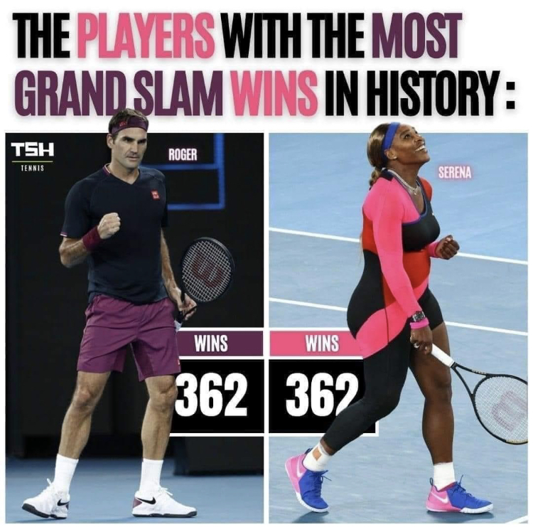

```{r include=FALSE}
# Set options for all chunks:

knitr::opts_chunk$set(
	message = FALSE,
	warning = FALSE
)

```


```{r}
# Load packages:

library(knitr)
library(tidyverse)
library(janitor)

```


```{r}
# Select of one female tennis player and one male tennis player:

female_player <- "Serena Williams"
# female_player <- "Martina Navratilova"
# female_player <- "Steffi Graf"
# female_player <- "Chris Evert"

male_player <- "Roger Federer"
# male_player <- "Novak Djokovic"
# male_player <- "Rafael Nadal"
# male_player <- "Jimmy Connors"


# Date of last data update:

update_date <- "March 2021"

```


# Introduction

This press release was issued in February 2021, a few days after the Australian Open finals. It was quickly and widely reported by many media around the world. **Could we easily check if Roger and Serena have won 362 matches each in grand slam tournaments?**


```{r fig.cap="", out.width = "45%", fig.align="center"}
# Include a picture in the report:



```


# The Data

We can answer this question because we know where to find a very complete, detailed and reliable data source on tennis.


## Credit where credit is due

The datasets we will be using are carefully assembled by [Jeff Sackmann](https://github.com/JeffSackmann) and is freely available on the internet in the form of github repositories.
For reference, you can find the sources for the full women and men data respectively here:

* [https://github.com/JeffSackmann/tennis_wta](https://github.com/JeffSackmann/tennis_wta)
* [https://github.com/JeffSackmann/tennis_atp](https://github.com/JeffSackmann/tennis_atp)

For this first notebook, we have already done all the pre-processing so we can cut straight to the chase.


## Import the data

The data can be found in the `data` folder.
There is a file for the men (`atp_grand_slam_data.csv`) and one for the women (`wta_grand_slam_data.csv`).


```{r}
# Import atp and wta data:

# atp_grand_slam_data <- read_csv("../../data/tennis_data/atp_grand_slam_data.csv")
atp_grand_slam_data <- read_csv("https://raw.githubusercontent.com/gruggeri/tennis_atp/master/atp_grand_slam_data.csv")

# wta_grand_slam_data <- read_csv("../../data/tennis_data/wta_grand_slam_data.csv")
wta_grand_slam_data <- read_csv("https://raw.githubusercontent.com/gruggeri/tennis_wta/master/wta_grand_slam_data.csv")

```

## Preliminary data exploration

```{r}
# Define the number of bottom and top rows to be displayed:

n_bottom <- 7
n_top <- 3

```


Here are the `r n_bottom` bottom rows of `wta_grand_slam_data`:

```{r}
# Show bottom rows of atp_grand_slam_data:

slice_tail(wta_grand_slam_data, n = n_bottom)

```


And here are the `r n_top` top rows of `wta_grand_slam_data`: 

```{r}
# Show top rows of atp_grand_slam_data:

slice_head(wta_grand_slam_data, n = n_top)

```


```{r eval=FALSE, include=FALSE}
# Check imported data sets:

atp_grand_slam_data %>% tabyl(year, tourney_level)
# atp_grand_slam_data %>% filter(year == 2021, round == "F")

wta_grand_slam_data %>% tabyl(year, tourney_level)
# wta_grand_slam_data %>% filter(year == 2021, round == "F")

```


# Who are the top 20 players?

## Female tennis players

The following table displays the 20 female tennis players with the highest number of Grand Slam wins from 1968 to `r update_date`.  

```{r}
# Compute counts for female tennis players:

female_counts <- wta_grand_slam_data %>% 
  count(winner_name, name = "n_won") %>% 
  mutate(winner_name = fct_reorder(winner_name, n_won)) %>% 
  slice_max(order_by = n_won, n = 20)

female_counts

```
We can better assess the above table using a barplot.

```{r}
# Draw barplot for female tennis players:

ggplot(data = female_counts,
       mapping = aes(x = n_won, y = winner_name)) +
  geom_col() +
  labs(title = "Top 20 female tennis players",
       x = "Number of Grand Slam wins",
       y = "",
       caption = "source: https://github.com/JeffSackmann")  +
  theme_minimal()

```

```{r}
# Compute the number of wins for female player:

female_n_wins <- wta_grand_slam_data %>% 
  count(winner_name, name = "n_won") %>% 
  filter(winner_name == female_player) %>% 
  pull(n_won)

```


Based on tennis data from 1968 to `r update_date`, the total number of Grand Slam wins for `r female_player` is `r female_n_wins`.


## Male tennis players

The following table displays the 20 male tennis players with the highest number of Grand Slam wins from 1968 to February 2021.  

```{r}
# Compute counts for male tennis players:

male_counts <- atp_grand_slam_data %>% 
  count(winner_name, name = "n_won") %>% 
  mutate(winner_name = fct_reorder(winner_name, n_won)) %>% 
  slice_max(order_by = n_won, n = 20)

male_counts

```

We can better assess the above table using a barplot.

```{r}
# Draw barplot for male tennis players:

ggplot(data = male_counts,
       mapping = aes(x = n_won, y = winner_name)) +
  geom_col() +
  labs(title = "Top 20 male tennis players",
       x = "Number of Grand Slam wins",
       y = "",
       caption = "source: https://github.com/JeffSackmann")  +
  theme_minimal()

```


```{r}
# # Compute the number of wins for male player:

male_n_wins <- atp_grand_slam_data %>% 
  count(winner_name, name = "n_won") %>% 
  filter(winner_name == male_player) %>% 
  pull(n_won)

```


Based on tennis data from 1968 to `r update_date`, the total number of Grand Slam wins for `r male_player` is `r male_n_wins`.


# Grand Slam wins per year and per tournament

## Grand Slam wins for `r female_player`

The following table provides the number of Grand Slam wins per year (rows) and Grand Slam tournament (columns) from 1968 to `r update_date`. The last column gives the total number of Grand Slam wins per year, and the last row gives the total number of Grand Slam wins per tournament.

```{r}
# Compute counts per year for selected female player:

female_player_wins <- wta_grand_slam_data %>% 
  filter(winner_name == female_player) %>% 
  mutate(year = as.character(year)) %>% 
  tabyl(year, tourney_name) %>% 
  adorn_totals(c("row", "col"))

female_player_wins

```


```{r}
# Draw lineplot for selected female player:

female_player_wins %>% 
  filter(year != "Total") %>% 
  ggplot(mapping = aes(x = as.numeric(year), y = Total)) +
  geom_hline(yintercept = 28, colour = "Blue") +
  geom_point() +
  geom_line() +
  ylim(0, 30) +
  labs(title = str_glue("Grand Slam wins per year for {female_player}"),
       subtitle = str_glue("Total Grand Slam wins: {female_n_wins}"),
       x = "Year",
       y = "Number of Grand Slam wins",
       caption = "source: https://github.com/JeffSackmann")  +
  theme_minimal()
  
```


```{r eval=FALSE, include=FALSE}
# Check number of Grand Slam tournaments won per female player:

wta_grand_slam_data %>% 
  filter(round == "F") %>% 
  count(winner_name, year) %>% 
  filter(n >= 3) %>% 
  arrange(desc(n), desc(year))

```


## Grand Slam wins for `r male_player`

The following table provides the number of Grand Slam wins per year (rows) and Grand Slam tournament (columns) from 1968 to `r update_date`. The last column gives the total number of Grand Slam wins per year, and the last row gives the total number of Grand Slam wins per tournament.

```{r}
# Compute counts per year for selected male player:

male_player_wins <- atp_grand_slam_data %>% 
  filter(winner_name == male_player) %>% 
  mutate(year = as.character(year)) %>% 
  tabyl(year, tourney_name) %>% 
  adorn_totals(c("row", "col"))

male_player_wins

```


```{r}
# Draw lineplot for selected male player:

male_player_wins %>% 
  filter(year != "Total") %>% 
  ggplot(mapping = aes(x = as.numeric(year), y = Total)) +
  geom_hline(yintercept = 28, colour = "Blue") +
  geom_point() +
  geom_line() +
  ylim(0, 30) +
  labs(title = str_glue("Grand Slam wins per year for {male_player}"),
       subtitle = str_glue("Total Grand Slam wins: {male_n_wins}"),
       x = "Year",
       y = "Number of Grand Slam wins",
       caption = "source: https://github.com/JeffSackmann")  +
  theme_minimal()
  
```


```{r eval=FALSE, include=FALSE}
# Check number of Grand Slam tournaments won per female and male player:

wta_grand_slam_data %>% 
  filter(round == "F") %>% 
  count(winner_name, year) %>% 
  filter(n >= 3) %>% 
  arrange(desc(n), desc(year))

atp_grand_slam_data %>% 
  filter(round == "F") %>% 
  count(winner_name, year) %>% 
  filter(n >= 3) %>% 
  arrange(desc(n), desc(year))

```


```{r eval=FALSE, include=FALSE}
# Export Grand Slam wins table for both Serena and Roger:

if (female_player == "Serena Williams")
  write_csv(female_player_wins, "data/serena_wins.csv")

if (male_player == "Roger Federer")
  write_csv(male_player_wins, "data/roger_wins.csv")

```

