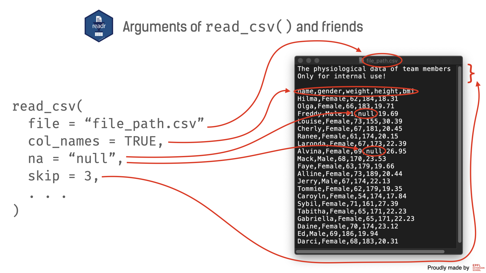
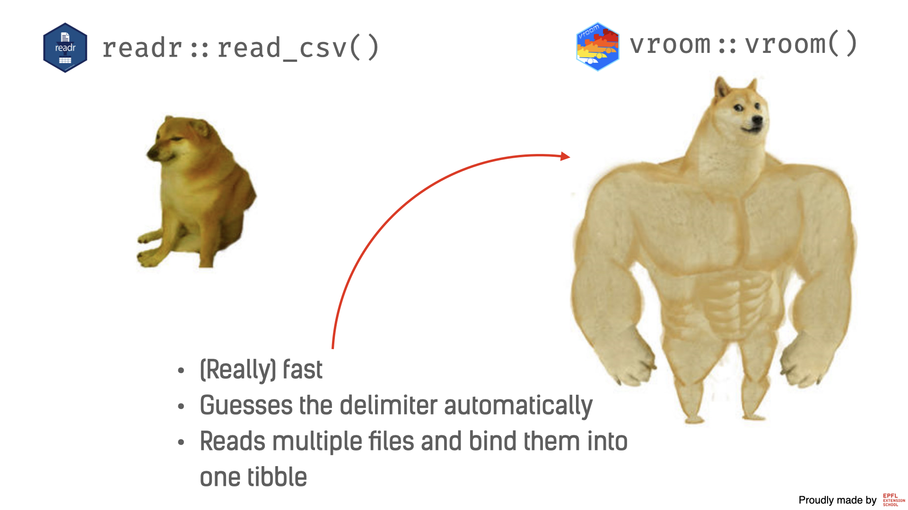

```{r, echo=FALSE, message=FALSE, warning=FALSE}
library(tidyverse)
library(knitr)
```

---
**Disclaimer:** The data used in this unit were simulated and have nothing to do with the real-world.
---

So far, we have seen how to generate tibbles manually. That is, we had to copy and paste the data from the resource into the R script. This approach works fine if we have a couple of data points (referred to as observations). However, it gets cumbersome if we need to work with something closer to the real-world problem in R. In the following sections, we will focus on how to get the data into R (so-called data import), and how to produce the data from R (data export). For now, we will focus on how to import/export data that has been saved in delimited files.

---

Since the origin of computers, the natural way of storing the data was to keep it in a **file**. Texts, images, songs, movies, and so on, are stored in files. From now on, we mostly will focus on tabular or rectangular data. One of the common ways to store this data is to keep it in so-called delimited files. 

The idea of delimited files is very simple: they separate the data entries with a specific delimiter character, such as comma (`,`), for instance, or character tabulation (tab for short). These delimited characters give names for the two most wide-spreader file types, namely CSV (comma-separated values) and TSV (tab-separated values). Let's consider the first couple of rows of the following dataset:

```{r, echo=FALSE, message=FALSE}
team_csv <- read_csv("data/team.csv")
team_csv %>% slice(1:2) %>% kable(row.names = FALSE)
```

can be stored in a CSV file, the first couple of rows of which looks like that

```{r, comment=NA, echo=FALSE}
team_csv <- read_lines(file = "data/team.csv")
team_csv[1:3] %>% str_c(collapse = "\n") %>% cat()
```

or even in a TSV file:

```{r, comment=NA, echo=FALSE}
team_tsv <- read_lines(file = "data/team.tsv")
team_tsv[1:3] %>% str_c(collapse = "\n") %>% cat()
```

```{r, echo=FALSE}
knitr::include_graphics("slides/slides.001.png")
```

### `read_csv()`

Imagine you have such a CSV file. Actually, you do not have to imagine, there is a file on your machine called `team.csv`. We encourage you to inspect this file by opening it in TextEdit (if you use macOS) or Notepad (if you use Windows). Indeed, the file is too large to copy-paste into the R directly. Luckily, R has dozens of functions that allow importing such files (in R jargon, importing files is called reading). We will consider functions from the `{readr}` package, which is a part of `{tidyverse}`. These functions are fast, reliable, and have a very consistent syntax. Each function name starts with the verb `read` followed by the underscore `_`, and finally appended with the delimiter type. For example, function `read_csv()` will read CSV files, and the function `read_tsv()` will read the TSV files, respectively. 

Obviously, without our help, the function would not know which file to import. And that is why we need to provide the path to the file. In our case, this is `"data/team.csv"` (please do not worry for now if you are concerned that we provide a short version of the path). If you execute `read_csv("data/team.csv")` in the console, R will print the data. But that's not something that we wanted to do -- we want to capture this data into an object (in other words, assign it to the object). That is why, most of the time, your pattern would be similar to what follows next: 

```{r, eval = FALSE}
name_of_object <- read_csv("path_to_file")
```

Let's try to apply this pattern to the `team.csv` file. Since the function `read_csv()` comes from the `{readr}` package, we need to load it first. The code would look like that:

```{r, eval=TRUE, message=FALSE}
library(readr)

team <- read_csv("data/team.csv")
```

Let's see how our data look like:

```{r}
team
```

#### Column names 

By default, `read_csv()` uses the first row of the file as column names (e.g., `name`, `gender`, and so on, in the example above). Sometimes, however, the first row of the file is data itself, rather than the column names. There is a dedicated argument `col_names` that defines how to treat the first row. If the first row does not contain names, then it should be set to `FALSE`. 

The content of the file `team_wo_header.csv` on your computer looks as follows:

```{r, comment=NA, echo=FALSE}
team_wo_header_csv <- read_lines(file = "data/team_wo_header.csv")
team_wo_header_csv[1:4] %>% str_c(collapse = "\n") %>% cat()
```

meaning it does not have a header (i.e., column names). Let's read this file and set `col_names` to `FALSE`:


```{r, message=FALSE}
team_wo_header <- read_csv("data/team_wo_header.csv", col_names = FALSE)

team_wo_header
```

R auto-generates names for columns: `X1`, `X2`, etc. If you have a separate file with column names, you can add them afterward. 

#### Missing values

Sometimes, when CSV files are generated by other software, the missing values can be decoded differently from what R would expect. For example, if missing values are denoted by the `"null"` string, R won't recognize it as missing values, but rather consider as an ordinary string of character `"null"`. Let's have a look: 

```{r, comment=NA, echo=FALSE}
team_missing_csv <- read_lines(file = "data/team_missing.csv")
team_missing_csv[1:4] %>% str_c(collapse = "\n") %>% cat()
```

Applying `read_csv()` as is, would lead to wrong column types and wrong interpretation of `"null"`:

```{r, message=FALSE}
team_missing <- read_csv("data/team_missing.csv")
team_missing
```

Fear not, `read_csv()` has an argument `na` to specify strings that would be interpreted as missing values. Setting `na` to `"null"` would solve this issue: 

```{r, message=FALSE}
team_missing <- read_csv("data/team_missing.csv", na = "null")
team_missing
```

#### `skip`

The CSV files do not always have the extension `.csv` and sometimes they are saved as `.txt` files. This is not a problem for `read_csv()`, since all it cares about is the content of files and not their extensions. In addition, these files might have the data description in the first lines (so-called meta-data or data about data). When importing the data into tibble, these lines of meta-data should be skipped, and the name of the argument that controls how many rows to skip is, surprise, `skip`. Therefore, to read this file

```{r, comment=NA, echo=FALSE}
team_missing_csv <- read_lines(file = "data/team_meta.txt")
team_missing_csv[1:7] %>% str_c(collapse = "\n") %>% cat()
```

we will need to skip three first rows

```{r, message=FALSE}
team_meta <- read_csv("data/team_meta.txt", skip = 3)
team_meta
```

#### Other arguments 

There obviously other useful arguments that allow controlling the importing process. As a reminder, you can always read the help of the function by `?read_csv`. One of such arguments is `locale`. If you have a CSV file with special letters from French or German (or any other language), you can set `locale` to `locale(encoding = "latin1")` to enable `latin1` encoding (most European languages have full coverage). Compare the output of the following code chunks:

```{r, message=FALSE}
cities <- read_csv("data/cities.csv")
cities
```

```{r, message=FALSE}
cities <- read_csv("data/cities.csv", locale = locale(encoding = "latin1"))
cities
```

The nice thing about `{readr}` is that all above-mentioned arguments are available in other functions that we will consider further, namely `read_csv2()`, `read_tsv()`, and `read_delim()`.

**Trick:** After you have typed the name of the function and both parentheses, you can move your cursor inside the parentheses and press <kbd>Tab</kbd>. The function's argument list will pop up, and you can select the one that you need and even read a small description. 

```{r, echo=FALSE}

```

### `read_csv2()`

Since the function `read_csv()` uses comma (`,`) as a delimiter, the decimal mark is automatically assumed to be a dot `.`. Otherwise, there is no way to distinguish which comma separates data entries, and which one signifies the decimal point. In the countries that use commas as decimal points, the delimiter is typically a semicolon (`;`). An example of such a file can be seen below:

```{r, comment=NA, echo=FALSE}
team_csv2 <- read_lines(file = "data/team2.csv")
team_csv2[1:4] %>% str_c(collapse = "\n") %>% cat()
```

There is a twin sibling of `read_csv()` -- `read_csv2()`, which is designed exactly for such cases: 

```{r, message=FALSE}
team2 <- read_csv2("data/team2.csv")
team_missing
```

### `read_tsv()`

TSV is the second most popular format for data files, so popular it deserves a stand-alone function. Let's read the file that we have seen at the beginning of this unit: 

```{r, message=FALSE}
team <- read_tsv("data/team.tsv")
team
```

### `read_delim()`

Finally, this text would not be complete without mentioning a more generic function -- `read_delim()`. This function gives you full freedom to customize and control the import of delimited files. 

The wild example below uses an asterisk as the delimiter:

```{r, comment=NA, echo=FALSE}
team_star <- read_lines(file = "data/team_delim.dstr")
team_star[1:4] %>% str_c(collapse = "\n") %>% cat()
```

We simply utilize `delim` argument of `read_delim()` function.

```{r, message=FALSE}
team_delim <- read_delim("data/team_delim.dstr", delim = "*")
team_delim
```

### Absolute vs relative paths

You have probably noticed that we used quite short paths for files that did not include your personal folder structure. This actually is extremely beneficial, because if you'd like to share your code with your collaborator, they do not have to change any paths. For example, rather than having `"/Users/jack/Documents/projects/answers/data/team.csv"`, we can refer to this file as `"data/team.csv"`. 

Unfortunately, it works only with R Markdown files or if you have created an RStudio project. If you work with regular R scripts, you will need either to provide a full path of the file or first, set a working directory of R to the desired folder, and only then specify a relative path to this folder. In this workshop we will use R Markdown files extensively, that is why you would not need to provide a full path to the file but rather a relative one.

### Bonus: `clean_names()`

Very often the column names of the imported dataset won't have a very convenient format. For example, column names can contain spaces, special symbols such as `(`, etc. In this case, it is not very convenient to refer to these columns, and one has to wrap column names into a pair of "`" (backticks): 

```{r, message=FALSE}
team_bad_names <- read_csv("data/team_bad_names.csv")
team_bad_names
```

```{r, message=FALSE}
team_bad_names$`Weight (in kg)`
```

Fortunately, we do not have to worry about that because we have an extremely useful function `clean_names()` from the `{janitor}` package. This function will remove spaces and all other special symbols and covert all letters to lower case. (In this workshop, we will follow the convention to keep variable and column names in lower case.) 

The argument of this function is the tibble, so that we can pass an imported tibble directly into it. As usual, before using a function from a package, we need to load the package first. 

```{r, message=FALSE}
library(janitor)

team_bad_names <- read_csv("data/team_bad_names.csv") %>% clean_names()
team_bad_names
```

```{r, message=FALSE}
team_bad_names$first_name
```

So far so good, but what's this `%>%` strange expression? It is called a pipe and we will cover it in the next chapter. For now, you can interpret it as "then". So, in plain English, the sequence of commands can be interpreted as: read CSV (`read_csv()`) and "then" clean names (`clean_names()`). The main advantage of `{tidyverse}` is that even if you are not familiar with programming, it is very easy to guess what exactly we do. 


### `{vroom}`: `{readr}` on steroids

Previously we considered only toy examples -- the datasets were very small and it took a blink of an eye to read them. Things are different in the real world, sometimes we have datasets that can exceed several hundreds of megabytes or even gigabytes. As one wise man (Jim Hester) said: "Life is too short to read slow", and then he developed `{vroom}` package. The main function the `vroom()` from this package allows reading delimited files much faster than any competitors from other packages. (If you wonder why the author uses identical names for the package and for the function, try to pronounce `vroom::vroom()` out loud.) 

During this workshop, we will focus on tennis data. This dataset is much closer to real-world problems than we have seen before because of its size and structure. The data available from the GitHub repository `tennis_atp` of `JeffSackmann`, and we first download it and then use `{vroom}` to read the data into R: 

1. Visit this [web-page](https://github.com/JeffSackmann/tennis_atp) and click on the green button `Code`. Then, you need to select `Download ZIP` and download the data into folder `data` (see the illustration below).

2. Unzip this file by clicking on it to times. 

3. You need to remove all files that starts with `atp_matches_doubles`, `atp_matches_futures`, `atp_matches_qual_chall_1979`, `atp_players`, `atp_rankings`; files  `README.md`, `matches_data_dictionary.txt` and the folder `examples`. In other words, you should keep only the files that have the following name pattern: `atp_matches_xxxx.csv`, where `xxxx` is the year. Normally, they should be top 54 files.

Let's read one of the files, for instance, `atp_matches_1968.csv` with `vroom()`:

```{r, message=FALSE}
library(vroom)

matches_1968 <- vroom("data/tennis_atp-master/atp_matches_1968.csv")

matches_1968
```

Looks like it did the trick, even though we specified just the path to the file. By the way, both `vroom()` and `read_csv()` could read directly from the file's URL. For example, if you open this [link](https://github.com/JeffSackmann/tennis_atp), click on `atp_matches_1968.csv`, and the button `Raw`, the content of `atp_matches_1968.csv` will be displayed. Now, we can copy the URL (from the address bar of your browser), and paste it instead of the path to the local file:

```{r, message=FALSE}
library(vroom)

matches_1968 <- vroom("https://raw.githubusercontent.com/JeffSackmann/tennis_atp/master/atp_matches_1968.csv")

matches_1968
```

Actually, there are many additional features of `vroom()` when compared to `read_csv()`. For example, in the previous example `vroom()` was able to guess a delimiter by itself. There is another extremely useful feature that we will discover in a second.

The tennis data is split into multiple files, depending on the year of the tournament. There are in total 54 files covering each year between 1968 and 2021. To read each and every file, one would need to write 54 lines of a very similar code, something like this:

```{r, eval=FALSE}
matches_1968 <- read_rds("data/tennis_atp-master/atp_matches_1968.csv")
matches_1969 <- read_rds("data/tennis_atp-master/atp_matches_1969.csv")
matches_1970 <- read_rds("data/tennis_atp-master/atp_matches_1970.csv")
...
```

Not fun, right? Well, the killing feature of `vroom()` is that you can provide multiple file paths, and `vroom()` not only read all of them but also combine them into one tibble.

```{r, message=FALSE}
tennis_files <- list.files("data/tennis_atp-master", full.names = TRUE)

matches <- vroom(tennis_files)
```

To get all files from the `data/tennis_atp-master` directory, we used `list.files()` function (it is a built-in R function).  If we peek at what's inside, we will see a vector of full paths to these files:

```{r}
tennis_files
```

**Note:** If you use this feature, you need to ensure that all files have the same structure and it does make sense to combine them.

You might wonder why we did not introduce `vroom()` in the first place, and why we still are using `read_csv()` and friends. The answer is simple: more often than not the performance of `read_csv()` would be more than enough. Further, `{readr}` functions might be preferred due to their conventional names. It is enough to have a quick look at the name of the function to guess what exactly it does, when in the case of `vroom()`, one has to inspect also arguments carefully. There are also other technical things in which we won't dive deep. Finally, the `read_csv()` will soon use the engine of `vroom()`, so that it will be as fast as `vroom()` keeping consistent syntax. 

```{r, echo=FALSE}

```

### Exercises

#### Exercise #1

In this exercise, we will read a small delimited file with famous `mtcars` data. To successfully read the data into R, we will take a step by step approach by answering several questions: 

1. Open the file `mtcars.txt`. Can you guess the delimiter of the file? Which function can be used to read such a delimited file? 

**Answer:** The delimiter is `;`. We can use `read_csv2()` or `read_delim()` from `{readr}`; or `{vroom}`'s `vroom()`.

2. Does the data start from the first line or is there any meta-data? Which argument can we use to start reading from further lines? 

**Answer:** No, the data contain two lines of meta information, and they should be skipped. We need to use the `skip` argument and set it to `3` (one extra empty line).

3. Read the file and tell what is the value of `mpg` of the second row.

**Answer:** `21`

```{r}
mtcars2 <- read_csv2("data/mtcars.txt", skip = 3)
mtcars2
```

#### Exercise #2

In the example of the `{vroom}` package, you have seen an example of reading Association of Tennis Professionals data. We have similarly structured data of the Women's Tennis Association, which can be obtained from this [repository](https://github.com/JeffSackmann/tennis_wta). Use a similar approach to read all the files into one tibble:

1. Download ZIP from [https://github.com/JeffSackmann/tennis_wta](https://github.com/JeffSackmann/tennis_wta) and save it in the folder `data`.

2. Unzip this file.

3. Remove all files except files that have name the `wta_matches_xxx.csv`, where `xxxx` is a year between 1948 and 2021. You should have 74 files. 

4. Create a vector of all file names in the `data/tennis_wta-master` folder by using `list.files()`.

```{r, message=FALSE}
tennis_files <- list.files(path = "data/tennis_wta-master", full.names = TRUE)
```

5. Read the content of files by `vroom()`.

```{r, message=FALSE}
matches <- vroom(tennis_files)
```

### Exporting delimited files 

If we can get our data in, then probably, we can get our data out. And that's the right way of thinking -- `{readr}` and `{vroom}` provide functions to write data into file, namely `write_csv()` and `vroom_write()`. Both functions rely on two major arguments:

- `x`: the tibble object that you want to export
- `file` (for `write_csv()`) and `path` (for `vroom_write()`): the file path to which the data will be exported

There are dozens of other documents that allow controlling the delimiter, the code for missing values, and all other arguments that have been covered already in `read_csv()`. Further, there is one writing-specific parameter `append`: if you need not overwrite the file, but append the new data to the file (in other words, continue writing to the same file), you need to set it to `TRUE`. The default `FALSE` value means that we will overwrite the file.

Let's look at saving `mtcars` to a file. Our lines of code would look like this:

```{r, eval=FALSE}
write_csv(mtcars, "data/mtcars.csv")
```

Why do we actually need to save tibbles to files? It is very common to have raw data that is not cleaned or transformed properly. It takes time to wrangle the data, and it makes sense to save the clean and tidy data after all transformation, so that you won't spend any second on wrangling in the future and can load directly the clean data. 

---

As a final word, CSV files are the most common file format to share small- and mid-sized data (up to several Gb). The main advantage is that CSV files are software-agnostic. That means regardless of the software you use, it should be possible to read such files. It is especially important if you work in a team that uses several different tools and programming languages.
