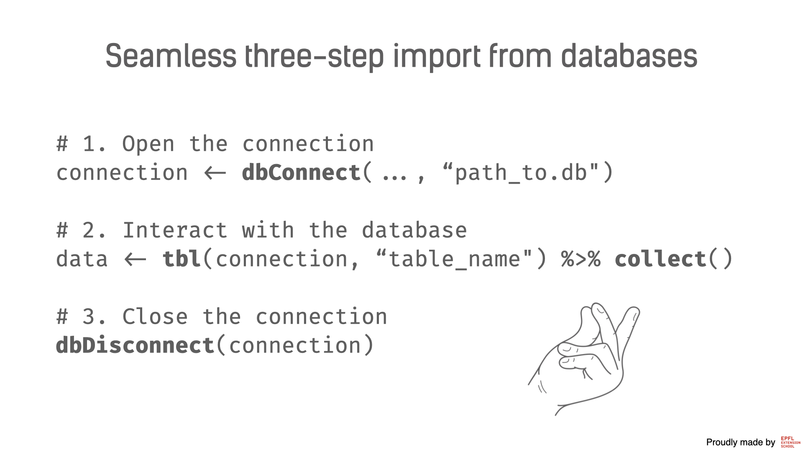

Reading data from data bases
================
Iegor Rudnytskyi

<!-- Excel and delimited files are designed for storing either small or mid-sized datasets. The large datasets are normally stored in databases and have  -->

You will very rarely see large datasets stored in Excel or delimited
files. Instead, they are normally stored in relational databases. There
are plenty of so-called database management systems – a piece of
software that allows communicating with databases. For example, you
might hear of such database management systems as MySQL, MS SQL Server,
MongoDB, etc. Luckily, R has a package that allows connecting to
different databases with the same syntax. In this unit, we dive deep
into how to import the data from databases into R.

### `{DBI}`

The package `{DBI}` could be the oldest package in this section: its
core structure was implemented in 2003. The main idea of the package is
to provide a common interface for various databases. By interface, we
mean the way you interact and communicate with databases. In other
words, regardless of the database you want to work with, your steps and
used functions will be the same (or almost the same). It is possible due
to a specific design: we will deal only with the front-end, and we do
not have to worry about what happens behind the curtain – the back-end.
The back-end is those packages that are directly deal with databases,
e.g., `{RSQLite}` for SQLite, `{RPostgres}` for PostgreSQL, etc. But we
do not need to be familiar with all of these packages since they are
used only by `{DBI}`.

There are three major steps in the process of interacting with the
database:

1.  Open the connection to the database
2.  Interact with databases (i.e., retrieve table names, collect/harvest
    tables with data, etc.)
3.  Close the connection

Let’s cover each step of this process.

#### 1. Open the connection

The function to set the connection with the database is `dbConnect()`.
It is probably the only function that would require some tweaks in
arguments, if you are working with different databases. We will focus on
SQLite, but a similar logic can be applied to other types. SQLite stores
the entire database as a single file, and if you are a macOS user, you
do not need to install any software to interact with it.

Before we start, we need to install both the front-end `{DBI}` **and the
back-end** `{RSQLite}`. For other databases, you will need to install
other back-ends.

``` r
install.packages("DBI")
install.packages("RSQLite")
```

We also will load them both before we use them:

``` r
library(DBI)
library(RSQLite)
```

Now, we need to set up the connection. The function that we will use is
`dbConnect()`. The first argument of this function is always a so-called
driver. The driver is the object that defines what kind of database will
be used. In our case, it is `SQLite()`, but if you would use MySQL, it
should be `MySQL()` from `{RMySQL}`, etc.

The second argument in our case is a path to the file that contains the
database. For other databases, you will probably need to provide other
things, like `host`, `port`, etc. But let’s get back to our SQLite case:

``` r
connection <- dbConnect(
  SQLite(), 
  "data/company.db"
)
```

Hey, we have just established a connection between two distinct tools,
isn’t that cool?

#### 2. Interact with databases

The connection has been set, but so far we do not have the data in our
hands (or better say R’s hands). The connection is simply a channel
through which R can communicate with the database. Like a telephone
cable that connects you and the person on the other side of the phone.
Now it is time to talk with the database.

The database is not just a single table, but a collection of tables. You
can think about tables as of R tibbles, they are very similar concepts.
These tables have their own names and can be accessed by R by their
names. Therefore, the first natural thing to do is to check which tables
we have in the database:

``` r
dbListTables(connection)
```

    ## [1] "customers" "team"

Once you have these names, it is time to read the content of tables into
R. We will show you only the crude approach for now, which can be
applied to relatively small non-industrial databases. You need to use a
slightly different method when dealing with large tables, and we will
come back to this in the data wrangling part. For now, we will operate
with two functions: `tbl()` and `collect()`.

``` r
customers <- tbl(connection, "customers") %>% collect()
```

They have to be called consecutively (i.e., via the pipe), so that the
result of `tbl()` is passed to `collect()`. As in the case of
`dbListTables()`, the first argument is the connection between R and
database. Then, we have to specify which table from the database we want
to work with (it should be provided as a character vector). The function
`tbl()` will create a new connection (yes, another one), but this time
directly with the database table. When we specifying `collect()` – we
directly import this table into R memory.

By the way, `customers` on the left before `<-` can be anything, it is
just a name of the variable. It does not have to coincide necessarily
with the name of the table in the database, but this is a good idea to
name it similarly.

When this command is executed, you can treat `customers` as a normal
tibble.

#### 3. Close the connection

It is important to close the connection, once we retrieve all the data
we wanted to. It is like using your stove: you switch it on, boil some
water, and then switch it off. The stove has two or four burners, so
there is a limited number of persons can use it at the same time. So
switching it off is necessary because you will give access to the stove
to the other member of your household. The same happens with the
database – it has a limited bandwidth and a limited number of users.

You can easily close the connection with the following command:

``` r
dbDisconnect(connection)
```

Once you closed the connection, you cannot use it anymore to get load
tables to R. If you want to continue interacting with the database, you
will need to establish a brand new connection.



<!-- The former one allows creating the connection to the table (yes, this connec) -->
<!-- The `{DBI}` package was designed as a tool for communication between R and databases.  -->

### Exercises

In this set of exercises, we will cover all three steps that have seen
before. We will import the data from the database dedicated to Futurama
(a popular sci-fi adult cartoon from the 2000s). You can find the
database file `futurama.db` in the `data` folder.

In the data science world, it is very common not to have any prior
information about the data you will work with, for instance, the
architecture of the database.

<!-- We will try to replicate these circumstances.  -->

-   Connect to the database. We wrote a small example and you just need
    to fill in the blank spots that are denoted by `________`.

``` r
library(________)
library(________)


connection <- dbConnect(
  SQLite(),
  "________"
)
```

**Solution:**

``` r
library(DBI)
library(RSQLite)


connection <- dbConnect(
  SQLite(),
  "data/futurama.db"
)
```

-   Print out the names of the tables in the database. How many tables
    do we have?

**Solution:**

``` r
dbListTables(connection)
```

    ## [1] "episodes"    "transcripts"

``` r
dbListTables(connection) %>% length()
```

    ## [1] 2

-   What was the very first word pronounced in this series? To answer
    this question, you need to look at the content of each table and
    guess which one we need to use.

**Hint:** The first word will be in the first row of the transcripts.

**Solution:**

``` r
episodes <- tbl(connection, "episodes") %>% collect()
episodes
```

    ## # A tibble: 140 x 8
    ##    season episode episode_in_season title     director_s    writer_s    air_date
    ##     <dbl>   <dbl>             <dbl> <chr>     <chr>         <chr>       <chr>   
    ##  1      1       1                 1 Space Pi… Rich Moore &… David X. C… (1999-0…
    ##  2      1       2                 2 The Seri… Peter Avanzi… Ken Keeler  (1999-0…
    ##  3      1       3                 3 I, Roomm… Bret Haaland  Eric Horst… (1999-0…
    ##  4      1       4                 4 Love's L… Brian Sheesl… Brian Kell… (1999-0…
    ##  5      1       5                 5 Fear of … Peter Avanzi… Evan Gore … (1999-0…
    ##  6      1       6                 6 A Fishfu… Ron Hughart … Patric M. … (1999-0…
    ##  7      1       7                 7 My Three… Jeffrey Lync… J. Stewart… (1999-0…
    ##  8      1       8                 8 A Big Pi… Susan Dietter Lewis Mort… (1999-0…
    ##  9      1       9                 9 Hell Is … Rich Moore    Eric Kaplan (1999-0…
    ## 10      1      10                10 A Flight… Peter Avanzi… Eric Horst… (1999-0…
    ## # … with 130 more rows, and 1 more variable: opening_line <chr>

``` r
transcripts <- tbl(connection, "transcripts") %>% collect()
transcripts
```

    ## # A tibble: 23,812 x 4
    ##    season episode       character line                                          
    ##     <dbl> <chr>         <chr>     <chr>                                         
    ##  1      1 Space Pilot … Fry       Space. It seems to go on and on forever. But …
    ##  2      1 Space Pilot … Fry       And that's how you play the game!             
    ##  3      1 Space Pilot … Boy       You stink, loser!                             
    ##  4      1 Space Pilot … Panucci   Hey, Fry. Pizza goin' out! C'mon!!            
    ##  5      1 Space Pilot … Fry       Michelle, baby! Where you going?              
    ##  6      1 Space Pilot … Michelle  It's not working out, Fry. I put your stuff o…
    ##  7      1 Space Pilot … Fry       I hate my life, I hate my life, I hate my lif…
    ##  8      1 Space Pilot … Bike Thi… Happy new year!                               
    ##  9      1 Space Pilot … Fry       Hello? Pizza delivery for, uh ... ... Icy Wie…
    ## 10      1 Space Pilot … Crowd     Ten!                                          
    ## # … with 23,802 more rows

The word is Space..

-   Another useful skill that we will train right now is to look for a
    function, even if you do not know its name. If a package you work
    with is more or less consistent, you can hope to find this function
    without googling.

Let’s try to retrieve the column names without importing the full table
(e.g., it could be too large). A couple of facts that can help you to
guess the function name: (1) Since we want to retrieve a list of column
names, we could hope to have a similar function name to
`dbListTables()`; (2) columns are called fields in database context; (3)
many functions from `{DBI}` start with `db`. One more useful hint: you
can type a couple of first letters of the function in the console and
press <kbd>Tab</kbd>.

When you have guessed the name of the function, you can type
`?name_of_function` to see its documentation. Please read it carefully
and try to apply this function to one of the tables of your choice.

**Solution:**

``` r
?dbListFields
```

``` r
dbListFields(connection, "episodes")
```

    ## [1] "season"            "episode"           "episode_in_season"
    ## [4] "title"             "director_s"        "writer_s"         
    ## [7] "air_date"          "opening_line"

-   Close the database connection.

**Solution:**

``` r
dbDisconnect(connection)
```

------------------------------------------------------------------------

As a final word, we did not dive deep into database and R communication.
However, even with this simple set of tools, you can import tables from
databases.
