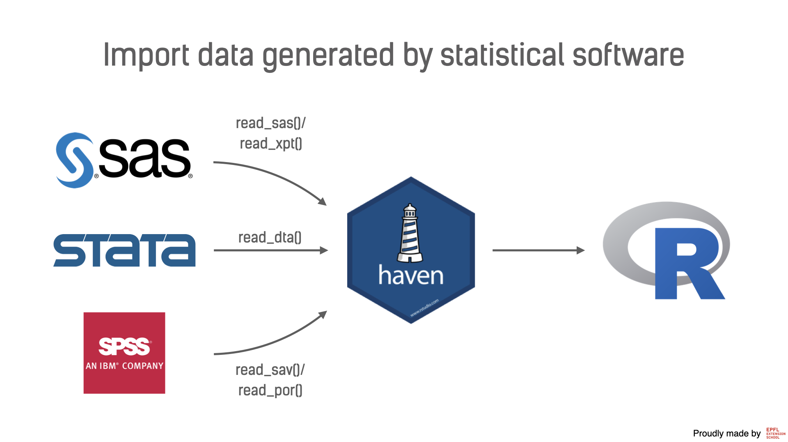

Statistcal software’s data formats
================
Iegor Rudnytskyi

The data also might come in the file format that was generated with
statistical software, such as SAS, SPSS, or Stata. This software used to
be (for some cases, even still is) extremely popular among government
institutions, pharmaceutical companies, and scientific research labs. As
is, R cannot read legacy files produces by listed programs. However,
there is a nice package called `{haven}` that allows reading and writing
`.sas7bdat`, `.sas7bcat`, `.sav`, `.por`, `.dta`, and other extensions.

Below, we provide a summary table of which function to use:

| File extenssion | Software | Function    |
|:----------------|:---------|:------------|
| .sas7bdat       | SAS      | read\_sas() |
| .sas7bcat       | SAS      | read\_sas() |
| .xpt            | SAS      | read\_xpt() |
| .sav            | SPSS     | read\_sav() |
| .por            | SPSS     | read\_por() |
| .dta            | Stata    | read\_dta() |

As usual, the basic example will be based on something simple, e.g.,
`mtcars`:

``` r
library(haven)

write_sas(mtcars, "data/mtcars.sas7bdat")

mtcars2 <- read_sas("data/mtcars.sas7bdat")
```



Since these file types are very specific, we won’t cover each and every
argument. The nice thing about `{tidyverse}` is that it is well
documented, and in case if you need a particular feature, you can always
read the documentation.
