```{r setup, include = FALSE, message = FALSE, warning = FALSE}
knitr::opts_chunk$set(
  echo = TRUE,
  message = FALSE,
  warning = FALSE,
  fig.align = 'center',
  fig.height = 5)

# keep wide tibbles (e.g. the 120-column Excel sheet) on one slide
options(pillar.max_extra_cols = 0)
```

```{r r_setup, include = FALSE}
library(tidyverse)
```

# 📥 Getting the data in {.subsection background-color="#425556"}

## Import: the first step of the pipeline

```{r, echo=FALSE, out.width="70%", fig.alt="The data science pipeline: import, then tidy, then a loop of transform, visualise and model, then communicate. The import step is highlighted: data import is the first step of the pipeline."}
#| label: img-data-import
knitr::include_graphics("images/fig-data-import.png")
```

## In this unit

How to get **tabular data** into R:

-   📄 **Delimited** text files: CSV, TSV, ...
-   📗 **Excel** workbooks
-   📊 Files from **statistical software**: SAS, SPSS, Stata

and the **arguments** that work around the usual caveats.

. . .

::: callout-note
## Disclaimer

Some data used in this unit is simulated.
:::

::: {.notes}
Ask participants whether they work (or will have to work) with Excel or SAS files. If not, don't go too much into the details of the Excel example.
:::

# 📄 Delimited files {.subsection background-color="#425556"}

## A table in a text file

Data entries are stored as a **table** in a **text file**.

-   One row of the table per line
-   Columns separated by a **delimiter** 

| separator | format  | example |
|-----------|---------|-----------|
| comma `,` | **C**omma-**S**eparated **V**alues  | `data.csv` |
| comma `,` | **C**omma-**S**eparated **V**alues  | `data.csv` |
| semicolon `;` | **T**ab-**S**eparated **V**alues | `data.tsv` |     

## {.center}

```{r, echo=FALSE, out.width="70%", fig.alt="The same small table (name, gender, weight, height, bmi) saved in two text formats: team.csv, where the values are separated by commas, and team.tsv, where they are separated by tabs."}
#| label: img-delimiters
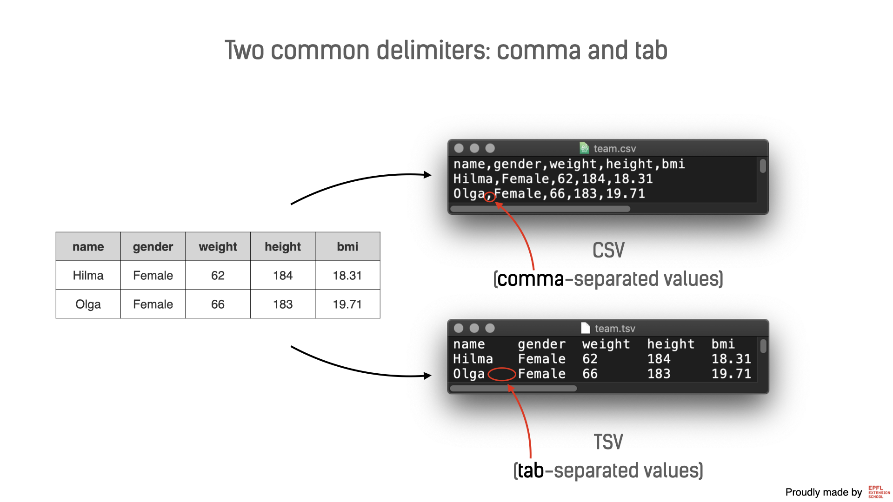
```

## The CSV format

::: {.content-box-marine}
CSV is the most common format for sharing data.
:::

-   Can store **data of all sizes** (small, mid-sized, up to several GB)
-   **Software-agnostic**: any tool can open it
-   Especially useful when you **work in a team**

## `read_csv()` reads a CSV file into R

-   From `{readr}`, part of the `{tidyverse}`
-   Give it the **path to the file**, on your computer or on the web
-   **Store the result** in an object

```{r, eval = FALSE}
#| label: read-csv-template
name_of_object <- read_csv("path_to_file")
```

## Example: reading `team.csv` {auto-animate=true}

👉 First, open `data/team.csv` and have a look at it.

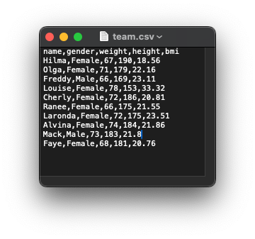{fig.alt="A screenshot of the the team.csv file" fig-align="center"}

## Example: reading `team.csv` {auto-animate=true}

👉 Use `readr::read_csv()`. Assign it to a variable

:::: {.columns}
::: {.column width="30%"}

{fig.alt="A screenshot of the the team.csv file" fig-align="center"}
:::

::: {.column width="70%"}

```{r}
#| label: slides-read-team
# attach readr
library(readr)

# load the data
team <- read_csv("data/team.csv")
```

:::
::::

## Example: reading `team.csv` {auto-animate=true}

👉 Print the object to have a look

:::: {.columns}
::: {.column width="30%"}

{fig.alt="A screenshot of the the team.csv file" fig-align="center"}
:::

::: {.column width="70%"}

```{r}
#| label: print-team
# attach readr
library(readr)

# load the data
team <- read_csv("data/team.csv")

# print the data
team
```
:::
::::


# A few useful arguments of `read_csv()`


## Where your file is: the `file` path

- The first argument is the path to your file. The argument is called `file`.

> Where (on your computer or elsewhere) is the file you want to import?

- It accepts the path towards your csv **as a string** 
- Can be a local path (`data/team.csv`) or a URL. 

. . .

:::{.callout-tip}

## Relative vs Absolute paths

In Quarto / R Markdown, your paths can start from the **document's folder**. This is called a relative path.
<!-- 
```
|___your_document.qmd
|___data/
    |___team.csv
```
-->

- ✅ `"data/team.csv"`
- ❌ `"/Users/jack/Documents/my/unique/folders/data/team.csv"`

Relative paths work on **any computer**. You can share the folder as it is. 

:::

. . . 

:::{.callout-warning}

In R scripts and in the console, **paths start from the *working directory***

:::


## CSV/TSV Data can be messy too!

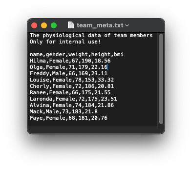{fig.alt="A screenshot of the the team_meta.csv file containing the data and some pitfalls of this type of data" fig-align="center"}


## {.center}
```{r, echo=FALSE, out.width="80%", fig.alt="A call to read_csv() with the arguments file, col_names, na and skip, each linked by an arrow to what it controls in a CSV file: the file name, the header row with the column names, the 'null' values to treat as missing, and the three lines of notes above the data to skip."}
#| label: img-read-csv-arguments
knitr::include_graphics("images/1-read_csv.png")
```

## When the first row is data: `col_names = FALSE` {auto-animate="true"}

::: {.callout-warning}

## The problem

- Some data may come without column names
:::

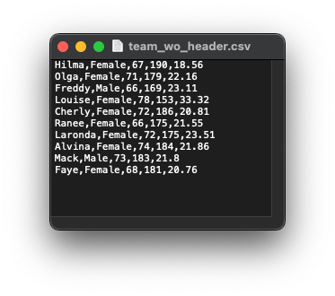{fig.alt="The file team_wo_header as shown in textedit" fig-align="center"}

## When the first row is data: `col_names = FALSE` {auto-animate="true"}

::: {.callout-warning}

## The problem

- Some data may come without column names
- By default, `read_csv()` names the columns after **the first row**.
:::

:::: {.columns}
::: {.column width="30%"}

{fig.alt="The file team_wo_header as shown in textedit"}

:::

::: {.column width="70%"}


```{r}
#| label: raw-team-wo-header
team_wo_header <- read_csv("data/team_wo_header.csv")

team_wo_header %>% head()
```
:::
::::

## When the first row is data: `col_names = FALSE` {auto-animate="true"}


::: {.callout-tip}

## The Solution

- Set `col_names = FALSE`
- R names the columns `X1`, `X2`, ...

:::

:::: {.columns}
::: {.column width="30%"}

{fig.alt="The file team_wo_header as shown in textedit"}

:::

::: {.column width="70%"}

```{r}
#| label: read-team-wo-header
#| code-line-numbers: "2"
team_wo_header <- read_csv("data/team_wo_header.csv", 
                           col_names = FALSE)

team_wo_header %>% head()
```

:::

::::


## Declare the missing values: `na = "null"` {auto-animate="true"}

::: {.callout-warning}

## The problem

- Other programs may write missing values differently (e.g. `null`)
:::

<!-- TODO: add screenshot -->
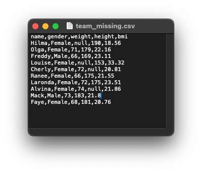{fig.alt="The file team_missing.csv as shown in a text editor" fig-align="center"}

## Declare the missing values: `na = "null"` {auto-animate="true"}

::: {.callout-warning}

## The problem

- Other programs may write missing values differently (e.g. `null`)
- `read_csv()` reads `null` as text, so **whole columns become text**
:::

:::: {.columns}
::: {.column width="30%"}

<!-- TODO: add screenshot -->
{fig.alt="The file team_missing.csv as shown in a text editor"}

:::

::: {.column width="70%"}

```{r}
#| label: read-team-missing
team_missing <- read_csv("data/team_missing.csv")
team_missing
```
:::
::::

## Declare the missing values: `na = "null"` {auto-animate="true"}

::: {.callout-tip}

## The Solution

- Set `na = "null"`
- `null` is now read as `NA`

:::

:::: {.columns}
::: {.column width="30%"}

<!-- TODO: add screenshot -->
{fig.alt="The file team_missing.csv as shown in a text editor"}

:::

::: {.column width="70%"}

```{r}
#| label: read-team-missing-na
#| code-line-numbers: "2"
team_missing <- read_csv("data/team_missing.csv", 
                         na = "null")
team_missing
```
:::
::::

## Jump over the metadata: `skip = 3` {auto-animate="true"}

::: {.callout-warning}

## The problem

- Some text files start with a **description of the data** (metadata)
:::

<!-- TODO: add screenshot -->
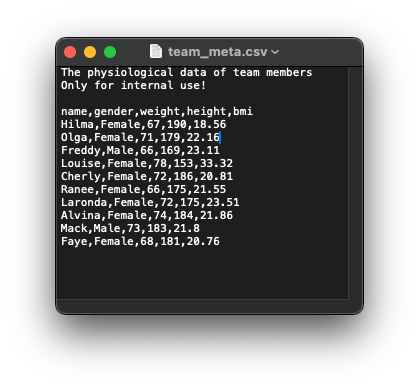{fig.alt="The file team_meta.csv as shown in a text editor" fig-align="center"}

## Jump over the metadata: `skip = 3` {auto-animate="true"}

::: {.callout-warning}

## The problem

- Some text files start with a **description of the data** (metadata)
- Reading as-is mixes the metadata into the data
:::

:::: {.columns}
::: {.column width="30%"}

<!-- TODO: add screenshot -->
{fig.alt="The file team_meta.csv as shown in a text editor"}

:::

::: {.column width="70%"}

```{r}
#| label: read-team-meta-default
team_meta <- read_csv("data/team_meta.csv")
team_meta
```
:::
::::

## Jump over the metadata: `skip = 3` {auto-animate="true"}

::: {.callout-tip}

## The Solution

- Set `skip = 3`
- `skip` tells `read_csv()` how many lines to jump over

:::

:::: {.columns}
::: {.column width="30%"}

<!-- TODO: add screenshot -->
{fig.alt="The file team_meta.csv as shown in a text editor"}

:::

::: {.column width="70%"}

```{r}
#| label: read-team-meta
#| code-line-numbers: "2"
team_meta <- read_csv("data/team_meta.csv", 
                      skip = 3)
team_meta
```
:::
::::

## Handle special characters: `locale` {auto-animate="true"}

::: {.callout-warning}

## The problem

- Accents and umlauts (French, German, ...) can come out garbled
:::

<!-- TODO: add screenshot -->
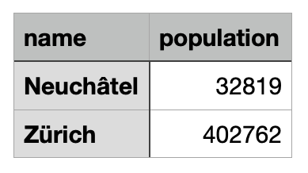{fig.alt="The file cities.csv as shown in a text editor" fig-align="center"}

## Handle special characters: `locale` {auto-animate="true"}

::: {.callout-warning}

## The problem

- Accents and umlauts (French, German, ...) can come out garbled
- `read_csv()` guesses the wrong **encoding**
:::

:::: {.columns}
::: {.column width="30%"}

<!-- TODO: add screenshot -->
{fig.alt="The file cities.csv as shown in a text editor"}

:::

::: {.column width="70%"}

```{r}
#| label: read-cities
#| error: true
cities <- read_csv("data/cities.csv")
cities
```
:::
::::

## Handle special characters: `locale` {auto-animate="true"}

::: {.callout-tip}

## The Solution

- Set `locale = locale(encoding = "latin1")`
- Ensures that the encoding is the right one

:::

:::: {.columns}
::: {.column width="30%"}

<!-- TODO: add screenshot -->
{fig.alt="The file cities.csv as shown in a text editor"}

:::

::: {.column width="70%"}

```{r}
#| label: read-cities-latin1
#| code-line-numbers: "3"
cities <- read_csv(
  "data/cities.csv",
  locale = locale(encoding = "latin1"))
cities
```
:::
::::

## 💡 Use the ~~force~~ <kbd>Tab</kbd>

::: callout-tip
Forgot an argument's name? Put the cursor inside the parentheses and press <kbd>Tab</kbd>.
:::


::: {.notes}

Demo this

:::


## Other delimiters, same arguments

- Countries with a **decimal comma** use `;` as a delimiter → `read_csv2()`
- Tabs → `read_tsv()`, any other delimiter → `read_delim()`
- They all take the **same arguments** as `read_csv()`

```{r, echo=FALSE}
#| label: table-readr-functions
tribble(
  ~ `Function`, ~ `Delimiter`, ~ `Default decimal`,
  "`read_csv()`", "`,` (comma)", "`.` (dot)",
  "`read_csv2()`", "`;` (semicolon)", "`,` (comma)",
  "`read_tsv()`", "Tab", "`.` (dot)",
  "`read_delim()`", "Custom", "`.` (dot)",
) %>%
  knitr::kable()
```

# 📗 Excel files {.subsection background-color="#425556"}

## `{readxl}` reads Excel workbooks

- Installed with the `{tidyverse}`, but **not attached** by `library(tidyverse)`

. . . 

```{r}
#| label: attach-readxl
library(readxl)
```

. . . 

- Provides the following functions: 

| function | extension | 
|----------|-----------| 
| `read_xls()` | `.xls` | 
| `read_xlsx()` | `.xlsx`|
| `read_excel()`| guesses the extension | 


## Example: reading `team.xlsx` {auto-animate="true"}

👉 First, open `data/team.xlsx` in Excel and look at how it is structured.

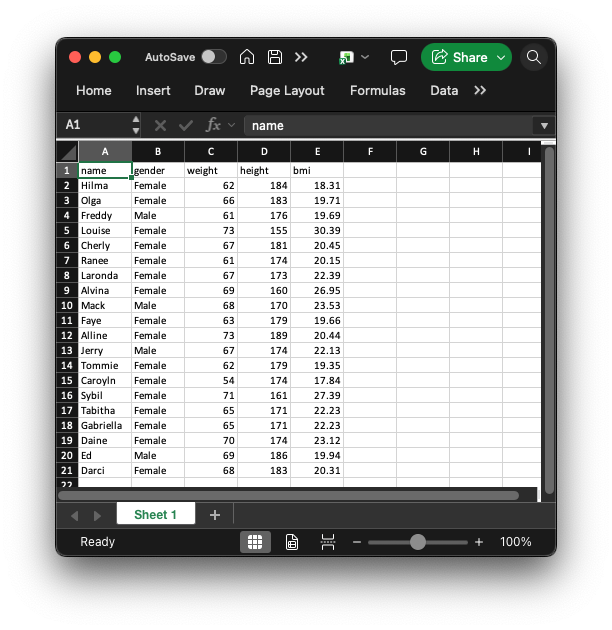{fig.alt="A screenshot of the the team.xlsx file" fig-align="center"}


## Example: reading `team.xlsx` {auto-animate=true}

👉 Import and print the object to have a look

:::: {.columns}
::: {.column width="30%"}

{fig.alt="A screenshot of the the team.xlsx file" fig-align="center"}
:::

::: {.column width="70%"}

```{r}
#| label: read-team-xlsx
team <- read_xlsx("data/team.xlsx")
team
```

:::
::::

## Excel files are even messier!

👉 Open `data/je-e-06.02.00.01.02.xlsx` in Excel and see it for yourself!


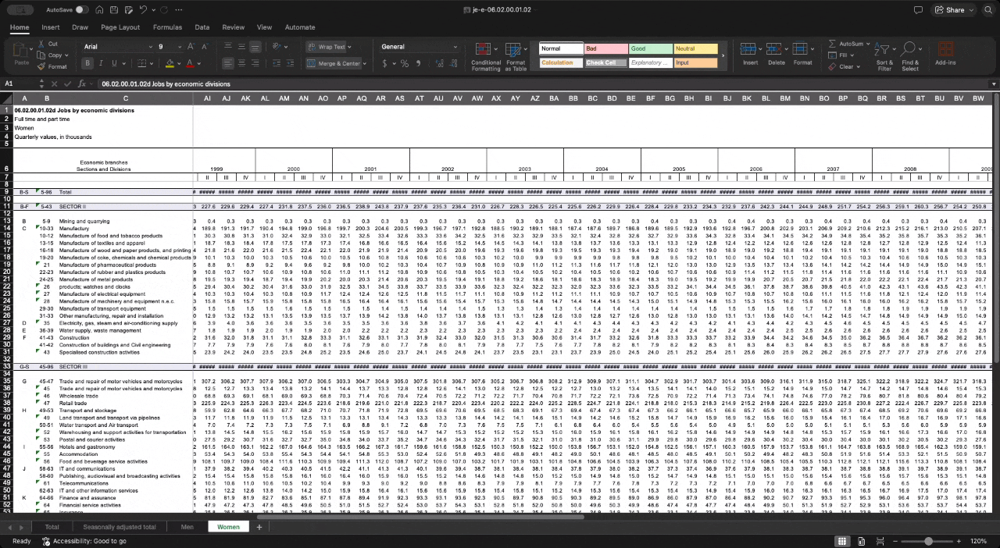{fig-align="center"}


::: {.notes}
-   A **workbook** with several **sheets**
-   The table sits somewhere in the middle of the cells
:::

## 


```{r, echo=FALSE, out.width="70%", fig.alt="A call to read_excel() with the arguments file, sheet, range and col_names, each linked by an arrow to what it controls in an Excel workbook: the file name, the second sheet, the cell range C3:G23 that holds the table, and its header row."}
#| label: img-read-excel-arguments
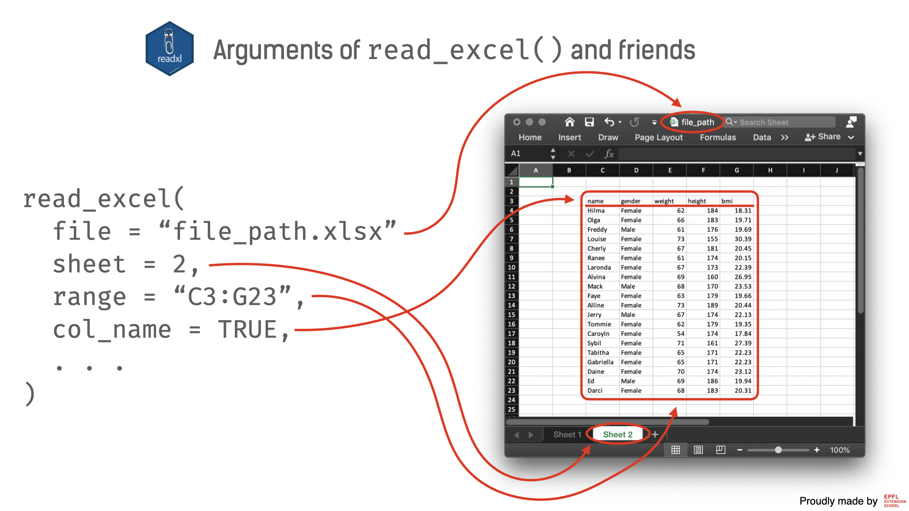
```


## Which sheet to import: `sheet`:  {auto-animate="true"}

::: {.callout-warning}
## The problem
- Excel files (workbooks) can have many _sheets_ 
:::

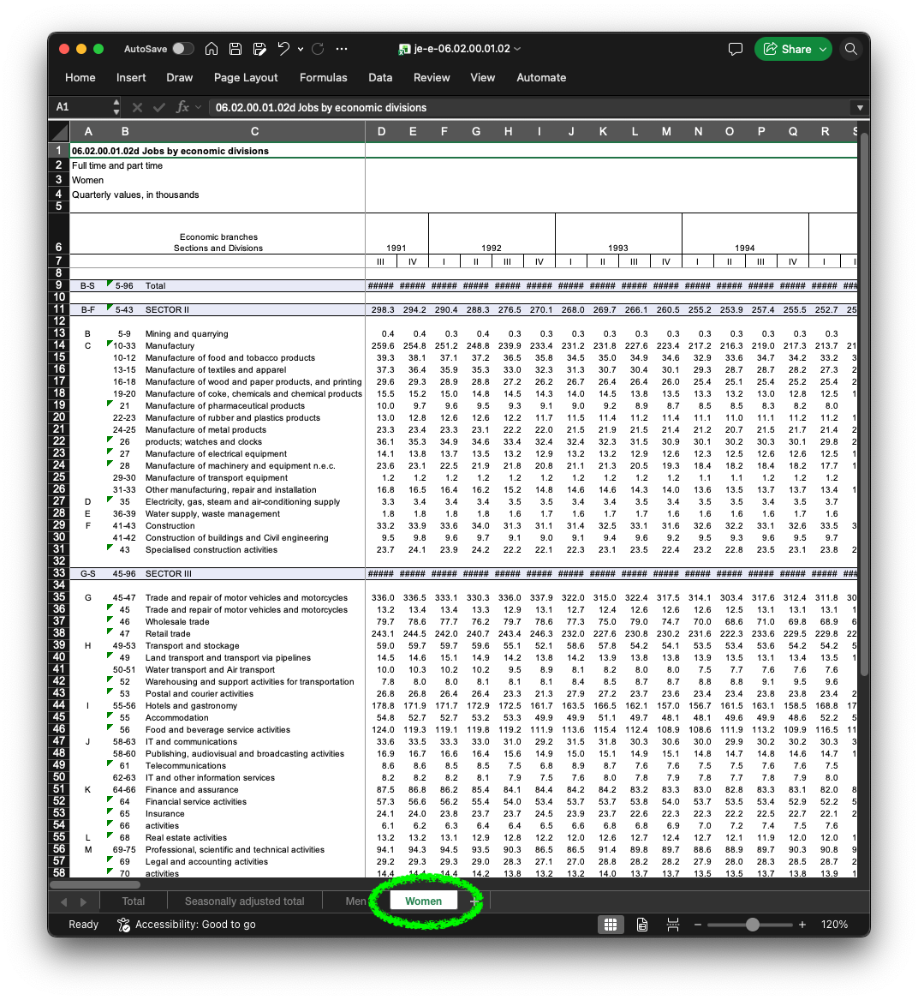{fig-align="center"}


## Which sheet to import: `sheet`:  {auto-animate="true" .smaller}

::: {.callout-warning}
## The problem

- Excel files (workbooks) can have many _sheets_ 
- By default `{readxl}` functions import the **first** sheet
:::

{fig-align="center"}

## Which sheet to import: `sheet`:  {auto-animate="true".smaller}

::: {.callout-tip}
## The solution

- Use the `sheet` argument
- Indicate the **name** (`sheet = "Women"`), or the **position** (`sheet = 4`)
:::


:::: {.columns}
::: {.column width="30%"}

{fig-align="center"}
:::

::: {.column width="70%"}

```{r}
#| label: read-women-sheet
#| code-line-numbers: "2"
women_jobs <- read_xlsx("data/je-e-06.02.00.01.02.xlsx",
  sheet = "Women"
)

women_jobs %>% head()
```

::: callout-important
## Wait!

The data has been imported, but it isn't usable yet.
:::

:::
::::


## Which cells to import: `range` {auto-animate="true"}

::: {.callout-warning}
## The problem

- The table doesn't start at the top-left of the sheet 
- The data is all over the sheet: `skip` isn't enough
:::

```{r}
#| label: slides-read-women-range-problem
#| echo: false
women_jobs <- read_xlsx(
  "data/je-e-06.02.00.01.02.xlsx",
  sheet = "Women"
)

women_jobs %>% head()
```

## Which cells to import: `range` {auto-animate="true" .smaller}

::: {.callout-warning}
## The problem

- The table doesn't start at the top-left of the sheet 
- The data is all over the sheet: `skip` isn't enough
- We may be interested in only a subset of cells (ranging from "A9" to, say "DP72")
:::

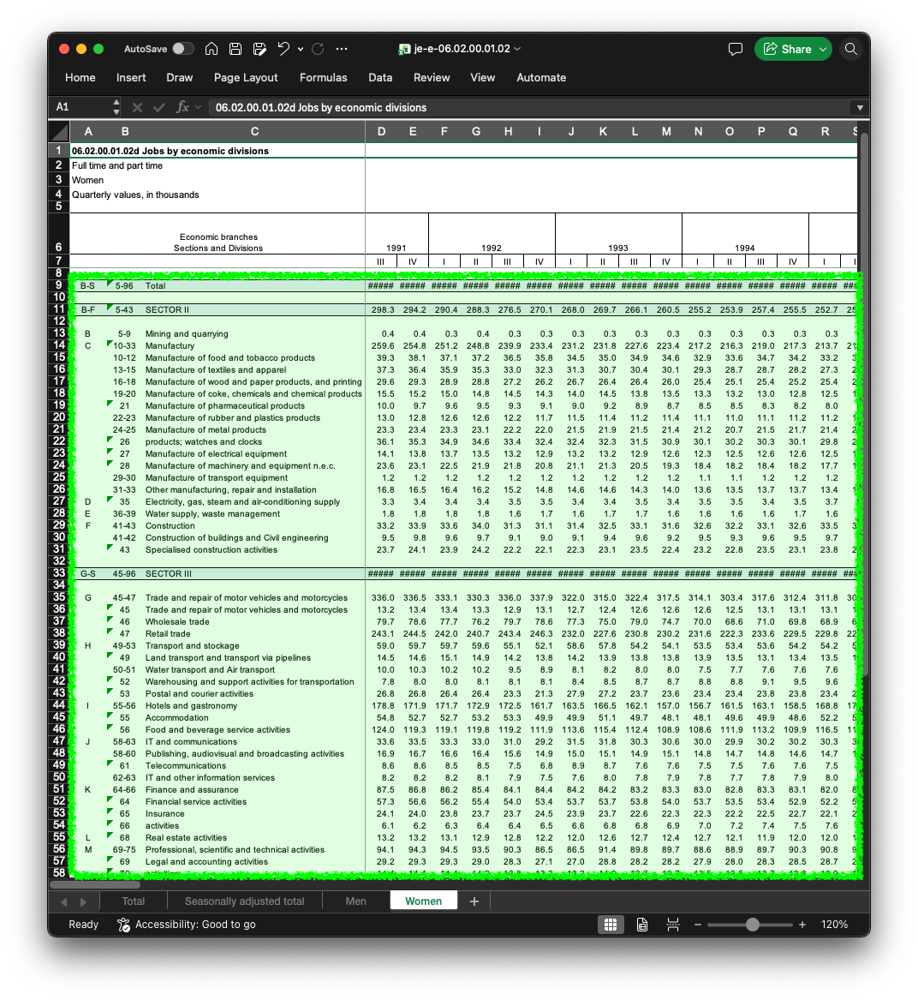{fig-align="center"}

## Which cells to import: `range` {auto-animate="true" .smaller}

::: {.callout-tip}
## The solution

- Use the `range` argument
- Give the **upper-left** and **lower-right** cells: `range = "A9:DP72"`
:::

:::: {.columns}
::: {.column width="30%"}

{fig-align="center"}
:::

::: {.column width="70%"}

```{r}
#| label: read-women-range
#| code-line-numbers: "4"
women_jobs <- read_xlsx(
  "data/je-e-06.02.00.01.02.xlsx",
  sheet = "Women",
  range = "A9:DP72"
)

women_jobs
```
:::

. . .

::: callout-important
## Almost there!
but the **column names contain values**
:::

::::


## `col_names = FALSE` to the rescue! {.smaller auto-animate="true"}

::: {.callout-tip}
## The solution
`col_names = FALSE`, again 
:::

```{r}
#| label: read-women-col-names
#| code-line-numbers: "4"
women_jobs <- read_xlsx("data/je-e-06.02.00.01.02.xlsx",
  sheet = "Women",
  range = "A9:DP72",
  col_names = FALSE
)

women_jobs
```

. . . 

::: callout-important
## Notice the name choice

Unlike `readr::read_csv`, `{readxl}` renames columns as `...1`, `...2`, etc.

:::

# 📊 Files from statistical software {.subsection background-color="#425556"}

## `{haven}` reads SAS, SPSS and Stata files

-   One function per file type: `read_sas()`, `read_sav()`, `read_dta()`, ...

```{r, echo=FALSE, out.width="70%", fig.alt="The {haven} package imports files from statistical software into R: read_sas() and read_xpt() for SAS, read_dta() for Stata, read_sav() and read_por() for SPSS."}
#| label: img-haven
knitr::include_graphics("images/3-other.png")
```

## Example: reading a SAS file

```{r}
#| label: read-mtcars-sas
library(haven)

mtcars_data <- read_sas("data/mtcars.sas7bdat")

mtcars_data
```

More arguments? See the documentation: `?read_sas`

# Exercise {.subsection background-color="#425556"}

## Exercise Time!

::: callout-important
## Time to work!

Open the exercise notebook `_exercises/exercise-notebook.qmd` and do **[Exercise 1](../_exercises/exercise-notebook.html#exercise-1)**.

See you there!
:::
