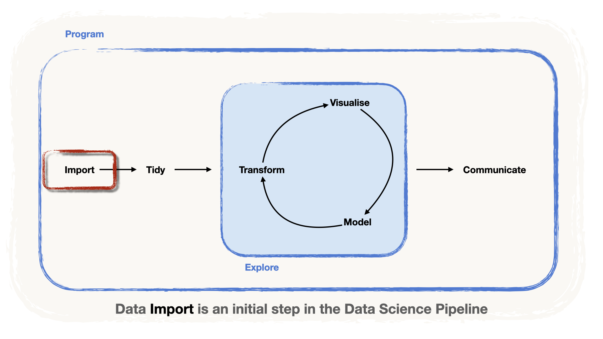

```{css, echo=FALSE}
.blackbox {
  padding: 0.5em;
  background: white;
  color: black;
  border: 1px solid black;
  border-radius: 10px;
  text-align: center;
}
```

```{r, echo=FALSE, message=FALSE, warning=FALSE}
library(tidyverse)
library(knitr)
knitr::opts_chunk$set(message = FALSE, warning = FALSE)
```

In terms of the data science pipeline, the whole data science project starts with **getting the data into our software**.

```{r, echo=FALSE}

```

In this, unit, we will exemplify **how to get the data into R**, i.e. in the so-called **data import** step

-   We will consider **two particular cases**: *Delimited* files and *MS Excel workbooks*.

-   Both are examples of **tabular data** (i.e. data that comes in tables).

-   We will touch upon some **caveats** and illustrate **arguments** of the importing functions that allow us to bypass them.

-   We will also **illustrate the importation of other file types**

# Delimited files

::: callout-note
**Disclaimer:** Some data used in this section are simulated.
:::

In delimited files, the data entries are contained in a **text file** containing a **table**

Columns are defined by a specific **delimiter character**, e.g.

-   as a comma (`,`),

-   a semicolon (`;`)

-   a character tabulation () (tab for short).

The characters give **names** for the two most wide-spread file types:

-   CSV (**C**omma-**S**eparated **V**alues) and

-   TSV (**T**ab-**S**eparated **V**alues):

```{r, echo=FALSE}
knitr::include_graphics("illustrations/1-delim.png")
```

CSV files are the **most common file format for sharing small-and mid-sized data** (up to several Gb).

-   The main advantage is that they are **software-agnostic**

-   It is especially important if you work in a team!

## Reading CSV Files

A file on your machine called `team.csv` is in the folder `data`.

-   Inspect this file by opening it.

R has dozens of functions that allow importing such files

-   We will consider functions from the `{readr}` package, (part of `{tidyverse}`).

-   The function `read_csv()` will read CSV files.

We need to provide the **path to the file** in your computer (or even in the web!)

-   In our case, this is `"data/team.csv"`.

-   It is convenient to **store the data into an environmental variable / object**

```{r, eval = FALSE}
name_of_object <- read_csv("path_to_file")
```

##### Example: reading `team.csv` {.unnumbered}

```{r, eval=TRUE}
library(readr)

team <- read_csv("data/team.csv")
```

-   Let's print the content of the object containing the data:

```{r}
team
```

### Absolute vs relative paths

Rmarkdown works with **relative** paths, which makes writing file paths easier.

-   As you can see, our `.Rmd` document lies in a folder containing a `/data` folder, where our `team.csv` file is found.

-   The `path` to the file `team.csv` can be **defined *relative* to the position of our `.Rmd`**, i.e. `"/data/team.csv"`, as opposed to, say, `"/Users/jack/Documents/your/unique/folder/structure/data/team.csv"`.

-   This is extremely beneficial because especially if you're **working with a collaborator!**

-   **Warning!** This feature works only mainly with R Markdown files

### Useful Arguments

Here's a breakdown of the main arguments other than the path.

```{r, echo=FALSE}
knitr::include_graphics("illustrations/1-read_csv.png")
```

::: callout-tip
<div>

If you don't remember exactly the name of an argument you can move your cursor inside the parentheses and hit <kbd>Tab</kbd>.

The function's argument list will pop up, and you can select the one you need and even read a short description.

</div>
:::

::: panel-tabset
#### Column names

By default, `read_csv()` considers **the first row** as the **column names**

-   However, sometimes, the file's **first row is data**.

-   `col_names`, defines **how to treat the first row**.

-   If **the first row does not contain the column names** we set `col_names = FALSE`

##### Example: reading `team_wo_header.csv` {.unnumbered}

The file `team_wo_header.csv` does not have a header:

```{r, comment=NA, echo=FALSE}
team_wo_header_csv <- read_lines(file = "data/team_wo_header.csv")
team_wo_header_csv[1:4] %>% str_c(collapse = "\n") %>% cat()
```

-   To read this file and set `col_names = FALSE`

-   R auto-generates column names: `X1` , `X2` , etc.

```{r}
team_wo_header <- 
  read_csv(
    "data/team_wo_header.csv", 
    col_names = FALSE)

team_wo_header
```

#### Missing values

In R, the **missing values are denoted as `NA`**.

-   However, other programs have other ways of declaring a missing value, e.g. `null`

-   When imported with `read_csv()` thew will be read as **strings of characters `"null"`**.

-   Setting `na="null"` solves this issue

##### Example: reading `team_missing.csv` {.unnumbered}

Take a look at the `team_missing.csv` dataset

```{r, comment=NA, echo=FALSE}
team_missing_csv <- read_lines(file = "data/team_missing.csv")
team_missing_csv[1:4] %>% str_c(collapse = "\n") %>% cat()
```

-   When reading this file, `read_csv()` inteprets `"null"` as character.
-   All the columns are imported as characters (even if they have numbers!)

```{r}
team_missing <- read_csv("data/team_missing.csv")
team_missing
```

-   Setting `na="null"` is a lifesaver in this case:

```{r}
team_missing <- read_csv("data/team_missing.csv", na = "null")
team_missing
```

#### Skipping lines

Essentially, `.csv` files are text files, hence sometimes stored as `.txt`

-   In some cases text files have the **data description in the first lines**

-   This is sometimes alled "meta-data".

-   When importing the data into tibble, **these lines of meta-data must be skipped**,

-   This can be done with the argument `skip`.

##### Example: reading `team_meta.txt` {.unnumbered}

The file `team_meta.txt` has some lines with metadata.

```{r, comment=NA, echo=FALSE}
team_missing_csv <- read_lines(file = "data/team_meta.txt")
team_missing_csv[1:7] %>% str_c(collapse = "\n") %>% cat()
```

Therefore we will need to skip **the first three rows**

```{r}
team_meta <- read_csv("data/team_meta.txt", skip = 3)
team_meta
```

#### Special characters

Helps you avoid encoding issues.

-   Especially useful when you have a CSV file in **languages with special characters** (e.g. French, German, etc)

-   Setting `locale` to `locale(encoding = "latin1")` enables `latin1` encoding.

-   This allows the importing of the special characters

##### Example: Reading `cities.csv` {.unnumbered}

Compare the output of the following code chunks:

```{r}
cities <- read_csv("data/cities.csv")
cities
```

```{r}
cities <- read_csv("data/cities.csv", locale = locale(encoding = "latin1"))
cities
```
:::

Another nicety of `{readr}` is that all these arguments are available in other functions of the package, namely `read_csv2()`, `read_tsv()`, and `read_delim()`.

## Other delimiters

Since `read_csv()` uses a comma (`,`) as a delimiter, the **decimal mark is automatically assumed to be a dot `.`**

Otherwise the system would get confused between decimal marks and separations!

-   In countries where there's a **decimal comma**, the **delimiter is typically a semicolon (`;`)**.

-   There is a twin sibling of `read_csv()` -- `read_csv2()`, designed to read files with the `;` delimiter.

-   There are two other functions namely `read_tsv()` and `read_delim()`.

------------------------------------------------------------------------

See the table below for a summary of the `{readr}` functions and their accepted delimiters.

```{r, echo=FALSE}
tribble(
  ~ `Function`, ~ `Delimiter`, ~ `Default decimal`,
  "`read_csv()`", "`,` (comma)", "`.` (dot)",
  "`read_csv2()`", "`;` (semicolon)", "`,` (comma)",
  "`read_tsv()`", "Tab", "`.` (dot)",
  "`read_delim()`", "Custom", "`.` (dot)",
) %>%
  kable()
```

# Excel files

Since MS Excel could be the most popular format for storing small datasets, we will learn **how to import data from Excel files**, often denoted with `.xls` or `.xlsx` extensions.

## `{readxl}`

We will focus on `{readxl}` package which is a part of `{tidyverse}`.

-   Even though `{readxl}` is a part of `{tidyverse}`, it is not included into its core part.

-   If you're in a new system, you might want to install it in your system.

``` r
install.packages("readxl")
```

::: callout-warning
## Note

You don't have to do this on Renku, as it has been installed already!
:::

Once it is installed, we can *attach it*:

```{r}
library(readxl)
```

-   To read the data from Excel into R, we use several functions:

    -   `read_xls()` for `.xls`

    -   `read_xlsx()` for `.xlsx` and

    -   `read_excel()` that guesses the file format automatically.

-   Naturally, the **first argument** of the function is the **file `path`**

##### Example: Reading `team.xlsx` {.unnumbered}

-   Open the file `team.xlsx` (with MS Excel) and have a look at how it is structured.

-   After this, let's import it into R and assign its contents to the variable `team`

```{r}
team <- read_xlsx("data/team.xlsx")
team
```

::: callout-caution
## Excel files can be a mess!

Excel files are not always that clean and tidy.\
\
For instance, check the file `je-e-06.02.00.01.02.xlsx` . As you can see, it's an **Excel Workbook** containing many **sheets** and the data is stored over many **cells**.
:::

At the end of this section, you should be able to get any data that you need from this Excel file.

But first, let's scroll over the useful arguments:

```{r, echo = FALSE}
knitr::include_graphics("illustrations/2-excel.png")
```

::: panel-tabset
## Import sheets

-   The Excel file can have multiple sheets.

-   The argument **`sheet`** controls which **sheet should be imported**.

-   It can be passed as:

    -   the **name of the sheet**, e.g. `sheet = "name of the sheet"` or

    -   as **the sheet's position** in the workbook e.g., `sheet = 2`.

-   By default, `read_xlsx()` will import the **first sheet**

##### Example: Reading the sheet **`"Women"`** from `je-e-06.02.00.01.02.xlsx` {.unnumbered}

```{r}
women_jobs <- read_xlsx(
  "data/je-e-06.02.00.01.02.xlsx",
  sheet = "Women"
)

women_jobs
```

::: callout-important
## Note

The data has been imported, but there are still steps needed to make it usable.
:::

## Import cells in a range

In the previous example, the reason why specifying the `sheet` is not enough is **that we have data all over the place**, and it is not easy where the data is located.

-   Skipping lines (with `skip`) wouldn't be enough!
-   With the argument `range`we can refer to a **rectangular cell range** by specifying its upper left and lower right cell separated by a colon (`:`).
    -   For instance, say `range=B2:K14` will import data in the rectangle defined by cells B2 and K14.

##### Example: Importing the cells from A9 to DP72 {.unnumbered}

-   Let's go back to our file `je-e-06.02.00.01.02.xlsx`.

-   We can modify our initial expression to accommodate a particular range, say between `A9 and DP72`

```{r}
women_jobs <- read_xlsx(
  "data/je-e-06.02.00.01.02.xlsx",
  sheet = "Women",
  range = "A9:DP72"
)

women_jobs
```

::: {.callout-important collapse="true"}
## Almost there!

We are one step closer, but the **column names contain values**.

The last step is to set a familiar argument, `col_names=FALSE`

```{r, echo=TRUE}
women_jobs <- read_xlsx(
  "data/je-e-06.02.00.01.02.xlsx",
  sheet = "Women",
  range = "A9:DP72", 
  col_names = FALSE, 
)

women_jobs
```
:::
:::

# Files generated by statistical software

-   The data also might come in the file format that was generated with statistical software (e.g. SAS, SPSS, or Stata)

-   Data from these programs can be imported via the `{haven}` package

-   It allows importing and writing from and to `.sas7bdat`, `.sas7bcat`, `.sav`, `.por`, `.dta` files.

Below, we provide a summary table of which function to use:

```{r, echo=FALSE}
tribble(
  ~ `File extenssion`, ~ `Software`, ~ `Function`,
  "`.sas7bdat`", "SAS", "`read_sas()`",
  "`.sas7bcat`", "SAS", "`read_sas()`",
  "`.xpt`", "SAS", "`read_xpt()`",
  "`.sav`", "SPSS", "`read_sav()`",
  "`.por`", "SPSS", "`read_por()`",
  "`.dta`", "Stata", "`read_dta()`"
) %>%
  kable()
```

```{r, echo=FALSE}
knitr::include_graphics("illustrations/3-other.png")
```

##### Example: Importing SAS files {.unnumbered}

For instance, let's see how to import the files of SAS data output with `read_sas()`.

```{r}
library(haven)

mtcars_data <- read_sas("data/mtcars.sas7bdat")

mtcars_data
```

-   Since these file types are very specific, we won't cover each and every argument.

-   However, you can always read the documentation!!

## Exercise Time!

::: callout-important
## Time to work!

Open the exercise notebook `_exercises/exercise-notebook.qmd` and do **[Exercise 1](../_exercises/exercise-notebook.html#exercise-1)**. See you there!
:::
