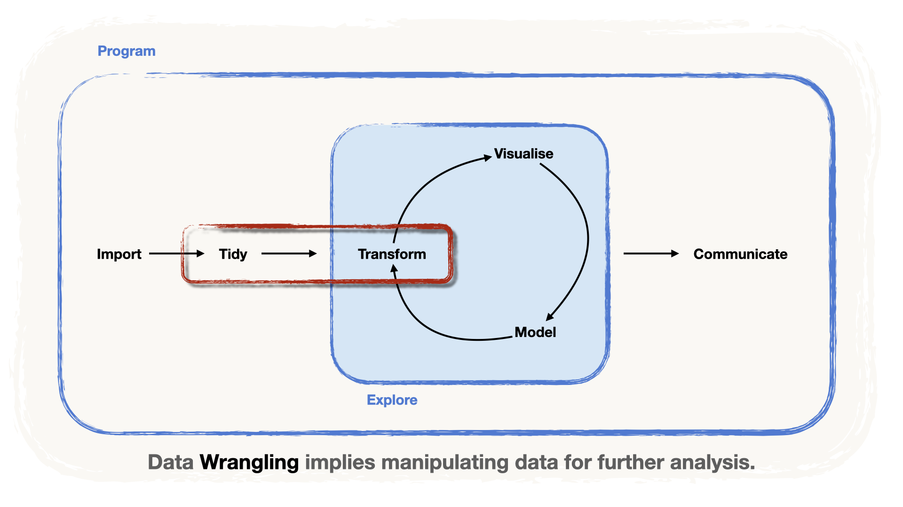
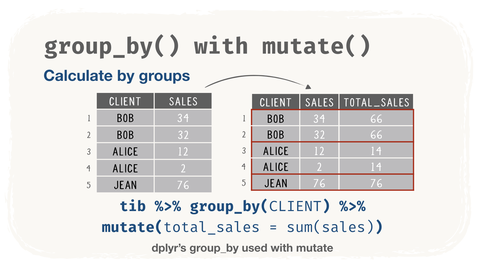
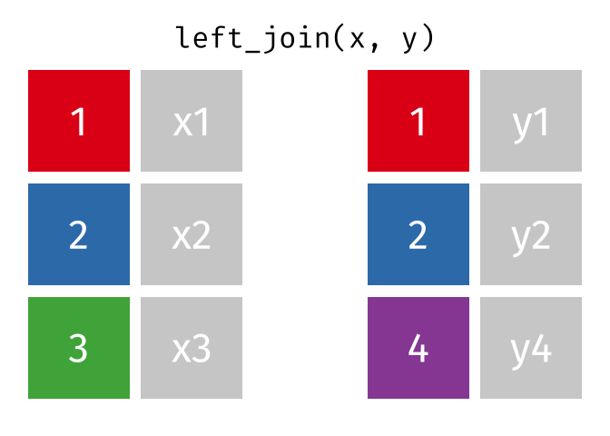
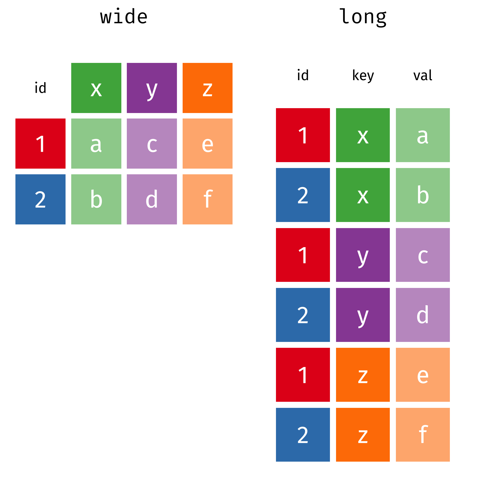
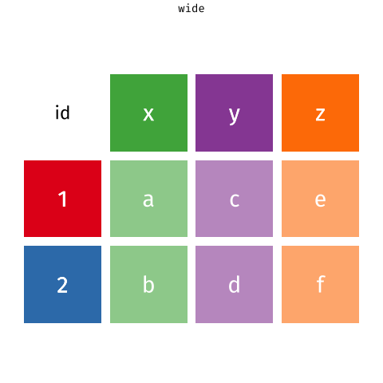

<!-- Translation of handout.qmd. Don't change the structure here: change handout.qmd, then port the changes (see README.md, "Translations"). -->

```{r setup, include = FALSE, message = FALSE, warning = FALSE}
knitr::opts_chunk$set(
  echo = TRUE,
  message = FALSE,
  warning = FALSE,
  fig.align = 'center',
  fig.width = 16/2,
  fig.height = 9/2,
  cache = FALSE)

```

```{r packs_load, include = FALSE}
library(tidyverse)
library(janitor)
library(DT)
```

{fig-alt="Die Data-Science-Pipeline mit hervorgehobenen Schritten «Aufbereiten» und «Transformieren»: Data Wrangling umfasst beide." width="80%" fig-align="center"}

Der zweite Schritt in der Pipeline von Data Scientists ist das **Aufbereiten** (*Tidy*), d. h. die Daten «bereinigen» und für die Analyse vorbereiten. In der Philosophie des `{tidyverse}` gehört dazu auch, die Daten in **aufgeräumte Tabellen** umzuwandeln, die sogenannten `tibbles`.

Um in der Analysephase Erkenntnisse zu gewinnen, muss man die Daten **transformieren** (*Transform*) können. Beide Aufgaben erfordern **Datenmanipulation**, oft **Data Wrangling** genannt.

Einige grundlegende Aufgaben des Data Wrangling sind:

-   **eine Spalte** aus einer Tabelle **auswählen**,
-   Spalten einer Tabelle **transformieren und/oder hinzufügen**,
-   filtern, d. h. **eine Auswahl von Zeilen treffen**,
-   **die Zeilen** nach den Werten einer oder mehrerer Spalten **ordnen**,
-   nach den Werten einer oder mehrerer Spalten **gruppieren**, um innerhalb der Gruppen zu analysieren,
-   **zusammenfassende Statistiken** berechnen (Lage, Streuung, Quantile usw.).

In R, genauer im `{tidyverse}`, manipuliert man Daten mit den Werkzeugen der Pakete `{dplyr}` und `{tidyr}`. Doch diese Pakete bieten mehr als Werkzeuge: eine ganze **Grammatik der Datenmanipulation**.

# Eine Grammatik der Datenmanipulation {#DataManip}

Das Paket `{dplyr}` bietet eine Reihe von Funktionen oder *Verben*, mit denen wir Daten **bändigen**, so wie wir mit einer Zange Drähte biegen. Diese Darstellung steckt sogar im Logo!

:::: {.columns}
::: {.column width="25%"}
```{r, echo = FALSE, fig.cap='Die Zange von `{dplyr}` hilft uns, unsere Daten zu bändigen!', fig.align='center', out.width = "90%", fig.alt="Das sechseckige Logo des Pakets dplyr: eine Zange."}
#| label: img-dplyr-logo
knitr::include_graphics(path = "images/hex-dplyr.png")
```
:::

::: {.column width="75%"}
| Verb | Verwendung |
|:-----------------:|-----------------------------------------------------|
| `select()` | **eine Auswahl von Spalten** aus einem `tibble` **wählen** |
| `mutate()` | Spalten des `tibble` **transformieren und hinzufügen** |
| `filter()` | **eine Auswahl von Zeilen** treffen |
| `arrange()` | **die Zeilen ordnen** nach den Werten einer oder mehrerer Spalten |
| `group_by()` | nach den Werten einer oder mehrerer Spalten **gruppieren**, um innerhalb der Gruppen zu rechnen |
| `summarise()/summarize()` | ein neues `tibble` mit **zusammenfassenden Statistiken** für eine Auswahl von Spalten erstellen |
:::
::::

::: callout-important
## Warum «Verben»?

Diese Funktionen heissen *Verben*, weil sie sich dank des **Pipe**-Operators **nacheinander schreiben** lassen, denn:

-   Ihr **erstes Argument** ist der **Name des Datensatzes**
-   Die **übrigen Argumente** sind die **Namen der Spalten**

Zum Beispiel:

``` r
select(dataset, column_1, column_2)

# ist gleichbedeutend mit:

dataset %>% select(column_1, column_2)

# Sie sehen: Es liest sich wie ein Satz!
```

Der ganze **Grammatik**-Aspekt kommt von diesem Programmierstil, der an natürliche Sprache erinnert!
:::

## Daten inspizieren

Direkt nach dem Import ist es nützlich, die Daten zu **inspizieren**, um zu wissen,

-   welche Spalten unser Datensatz enthält,
-   welche *Typen* unsere Spalten haben, d. h. ob sie bestehen aus
    -   Zahlen (`integers` oder Dezimalzahlen, dargestellt als `double` oder `numeric`),
    -   Zeichenketten (Buchstaben oder Buchstabenfolgen, die Wörter bilden, wie eben `"words"`),
    -   logischen Werten (`TRUE` oder `FALSE`),
    -   fehlenden Beobachtungen (in R als `NA` bezeichnet),
    -   Datums- bzw. Zeitangaben.

Für die Beispiele verwenden wir den WTA-Datensatz, den Sie mit `read_csv()` importieren können.

::: callout-note

Beachten Sie:

1.  Der `path` zeigt auf den gemeinsamen Ordner `data` des Workshops, eine Ebene höher (`../data/`)
2.  Der `path` wird mit dem Pipe-Operator (`%>%`) an `read_csv()` *übergeben*
:::

```{r}
#| label: read-wta

# 1. das Paket laden
library(readr)   

# 2. die Daten einem Objekt zuweisen
wta_data <-

  # 3. den Pfad über die Pipe übergeben
  "../data/wta_grand_slam_data.csv" %>%
  
  # 4. die Funktion readr::read_csv() verwenden
  read_csv(

  # 5. alle Spalten als character einlesen
    col_types = cols(.default = "c")
    )

wta_data
```

::: {.callout-tip collapse="true"}
## Eine Bemerkung zu den zusätzlichen Argumenten

Wie Sie sehen, haben wir ein zusätzliches Argument angegeben, um Importfehler zu vermeiden:

-   Wir setzen das Argument `col_types = cols(.default = "c")`, wobei `"c"` für `character` steht.
-   Denn `read_csv()` «errät» den Typ jeder Spalte (`numeric`, `character` usw.), indem es **die ersten 1000 Zeilen liest**.
-   Da es **in einigen Spalten viele fehlende Beobachtungen** gibt, könnte das beim Import zu Fehlern führen.
:::

### Einen Ausschnitt ansehen

Es ist immer nützlich, die **ersten Zeilen** unserer Daten anzusehen, um zu prüfen, ob sie richtig importiert wurden. In R zeigt die Funktion `slice_head()` die **erste Zeile** an:

```{r}
#| label: handout-slice-head-wta
slice_head(wta_data)
```

Für mehr Zeilen setzen wir das Argument `n` auf einen Wert (z. B. `n = 6`):

```{r}
#| label: handout-slice-head-wta-6
slice_head(wta_data, n = 6)
```

Unsere Daten wurden offenbar richtig importiert!

### Einen Überblick gewinnen

Eine **Übersicht des Inhalts** liefert die Funktion `glimpse()`:

```{r}
#| label: glimpse-wta
glimpse(wta_data)
```

Wie Sie sehen:

-   Es gibt viele (`r ncol(wta_data)`) Spalten,
-   die meisten Spaltennamen beginnen mit einem beschreibenden Präfix.

Hier eine Übersicht der Spaltenpräfixe, die wir im Folgenden verwenden.

| Spalte / Präfix | Inhalt |
|:-----------------:|:----------------------------------------------------|
| `year` | Jahr des Turniers, in dem das Match stattfand |
| `tourney_*` | Angaben zum Turnier (`id`, `name`, `surface`, ...) |
| `match_num` | Nummer des Matches **innerhalb eines Turniers** |
| `winner_*` | Angaben zur Siegerin eines Matches (`id`, `name`, `hand`, ...) |
| `loser_*` | Angaben zur Verliererin eines Matches (`id`, `name`, `hand`, ...) |

### Das Gesamtbild

Alternativ erhalten wir mit der Funktion `vis_dat()` aus dem Paket `{visdat}` eine *grafische* Übersicht:

-   Die **Farben** zeigen die **Typen** der Spalten (character, numeric, date...).
-   Das **Grau** markiert **fehlende Beobachtungen**.

```{r, fig.cap = "Der WTA-Datensatz aus der Vogelperspektive mit `vis_dat()`"}
#| label: vis-dat-wta
#| fig-alt: "vis_dat()-Grafik der WTA-Daten: ein senkrechtes Band pro Spalte, alle in der Farbe für character, mit grauen Blöcken für fehlende Werte, die in einigen Spalten häufig sind."
# 1. das Paket visdat laden
library(visdat)

wta_data %>%

# 2. visdat::vis_dat() verwenden
  vis_dat(
    # 3. Warnungen zu grossen Daten vermeiden
    warn_large_data = FALSE
    )
```

## Spalten auswählen mit `select()`

Die Funktion `select()` hilft beim **Auswählen von Spalten**. Wir können **eine Spalte über ihren Namen auswählen**, etwa die Spalte `year`:

```{r, eval = FALSE}
#| label: handout-select-year
wta_data %>%
  select(year)
```

Um mehrere Spalten auszuwählen, übergeben wir ihre Namen an `select()`. Angenommen, wir wollen sehen, **wer im Lauf der Jahre gegen wen gespielt hat**:

```{r, eval = FALSE}
#| label: select-columns
wta_data %>%
  select(
    year, 
    winner_name, 
    loser_name)
```

Wir können auch die Spalten auswählen, **deren Namen eine Bedingung erfüllen**. Dazu dienen sogenannte **Auswahlhilfen** (*selection helpers*).

-   Verwenden wir zum Beispiel `starts_with()`, um alle Spalten auszuwählen, die mit den Präfixen `winner` und `loser` **beginnen**.
-   Damit es noch klarer wird, inspizieren wir das Ergebnis mit `vis_dat()`.

```{r}
#| label: select-helpers
#| fig-alt: "vis_dat()-Grafik der ausgewählten Spalten: year, dann die Spalten winner_ und loser_, alle vom Typ character."

wta_data %>%
  select(year, 
    starts_with("winner"), 
    starts_with("loser")) %>%
  vis_dat(warn_large_data = FALSE)
```

::: {.callout-tip collapse="true"}
## Weitere Auswahlhilfen

Die meisten anderen Auswahlhilfen haben fast selbsterklärende Namen, z. B.

| Auswahlhilfe | Anwendungsfall |
|:----------------:|:-----------------------------------------------------|
| `ends_with()` | wählt nach einem Suffix aus |
| `contains()` | wenn wir Spalten suchen, die ein bestimmtes Wort oder eine Zeichenkette enthalten |
| `matches()` | wählt nach **Mustern, sogenannten regulären Ausdrücken**, aus (siehe [die R-Dokumentation zu regulären Ausdrücken](https://stat.ethz.ch/R-manual/R-devel/library/base/html/regex.html)) |
| `num_range()` | wählt nummerierte Spalten in einem Bereich aus, z. B. `x10`, `x11`, ..., `x15` mit `num_range("x", 10:15)` |

Weitere Auswahlhilfen arbeiten mit Vektoren von Spaltennamen, etwa `all_of()` und `any_of()`, und schliesslich `where()`, das nach einer Funktion auswählt.
:::

## Spalten transformieren mit `mutate()`

Mit dem Verb `mutate()` können wir **neue Spalten erstellen** oder **bestehende transformieren**.

-   Zum Beispiel haben wir alle Spalten des Datensatzes als `character` importiert, aber **`year` sollte numerisch** und **`tourney_date` ein Datum sein**.
-   Wir **ändern Spaltentypen**, indem wir **die Spalten** in einem Aufruf von `mutate()` mit einer Umwandlungsfunktion **neu schreiben**: hier `as.numeric()` und `ymd()` aus dem Paket `{lubridate}`.
-   Damit es klarer wird, verwenden wir wieder `vis_dat()`. Beachten Sie, dass der Typ der Spalte `year` von `character` zu `numeric` gewechselt hat und die Spalte `tourney_date` zu `Date`.

```{r}
#| label: handout-attach-lubridate
library(lubridate)
```

```{r}
#| label: mutate-types
wta_data <-
  wta_data %>%
  mutate(
    year = as.numeric(year),
    tourney_date = ymd(tourney_date))
```

```{r}
#| label: handout-mutate-types-check
#| fig-alt: "vis_dat()-Grafik der ausgewählten Spalten nach mutate(): year ist jetzt numerisch und tourney_date ein Datum, die anderen Spalten sind weiterhin character."
wta_data %>%
  select(year, starts_with("winner"), starts_with("tourney")) %>%
  vis_dat(warn_large_data = FALSE)
```

::: callout-important
## Änderungen an einer Tabelle dauerhaft machen

Beachten Sie, dass wir die geänderte Tabelle `wta_data` *zugewiesen* und damit **die ursprüngliche Tabelle mit unseren Änderungen überschrieben** haben. So werden **die Änderungen dauerhaft**.

Diese Pipe **verändert** den Inhalt von `data` **nicht dauerhaft**:

``` r
data %>% 
  mutate(...)
```

Diese Pipe **verändert** den Inhalt von `data` **dauerhaft**:

``` r
data <- 
  data %>% 
  mutate(...) 
```
:::

## Zeilen filtern mit `filter()`

Mit der Funktion `filter()` **bilden wir Teilmengen eines Tibbles nach logischen Bedingungen**. Diese Bedingungen gelten für die Werte einer Spalte, und `filter()` **behält die Zeilen, die die Bedingung erfüllen**.

Angenommen, uns interessieren die Matches, die die grosse Serena Williams gewonnen hat. Mit `filter()` behalten wir die Zeilen, die die Bedingung `winner_name == "Serena Williams"` erfüllen:

```{r}
#| label: filter-serena
wta_data %>%
  select(year, tourney_name, winner_name) %>%
  filter(winner_name == "Serena Williams")
```

::: callout-important
## Zuweisung (`=`) vs. Vergleich (`==`)

-   **Für den Vergleich haben wir das doppelte Gleichheitszeichen `==` verwendet**.
-   So entsteht keine Verwechslung mit der Zuweisung (z. B. mit dem, was wir in `mutate()` tun).
:::

Natürlich können wir **mehrere Bedingungen** angeben, **für dieselbe Spalte oder für andere**. `filter()` behält dann die Zeilen, die alle Bedingungen gleichzeitig erfüllen.

-   Nehmen wir an, wir wollen Serenas Leistung an den australischen Turnieren analysieren.
-   Mit `str_detect()` aus dem Paket `{stringr}` wählen wir alle Zeilen aus, in denen `tourney_name` das Muster `"Australian"` enthält: `str_detect()` gibt `TRUE` zurück, wenn der Wert von `tourney_name` das Muster `"Australian"` enthält.
-   Zum Schluss zeigt `select()` die relevanten Spalten.

```{r}
#| label: filter-serena-australian
# 1. stringr laden
library(stringr)

wta_data %>%
  filter(
    # 2. erste Bedingung: die Siegerin
    winner_name == "Serena Williams",
    # 3. zweite Bedingung: das Turnier
    str_detect(
      tourney_name,
      pattern = "Australian")) %>%

# 4. einige Spalten behalten
  select(year, tourney_name, winner_name)
```

::: {.callout-tip collapse="true"}
## Logische Bedingungen schreiben

Hier ein kurzer Überblick, wie man in R logische Bedingungen schreibt:

| Logische Bedingung | Symbol |
|:------------------------------:|:--------:|
| *A gleich B* | `A == B` |
| *A kleiner als B* | `A < B` |
| *A kleiner oder gleich B* | `A <= B` |
| *A grösser als B* | `A > B` |
| *A grösser oder gleich B* | `A >= B` |

Bedingungen lassen sich auch mit «und» und «oder» zu längeren Ausdrücken verbinden:

| Logische Bedingung | Syntax |
|:-----------------------------:|:-------------------------:|
| *Bedingung 1 UND Bedingung 2* | `ConditionA & ConditionB` |
| *Bedingung 1 ODER Bedingung 2* | `ConditionA | ConditionB` |

Eine sehr praktische Abkürzung für mehrere `OR`-Bedingungen ist schliesslich der Operator `%in%`, der einen Wert mit dem Inhalt eines Vektors vergleicht. Zum Beispiel:

    A == B | A == C | A == D

ist gleichbedeutend mit:

    A %in% c(B, C, D)
:::

## Beobachtungen sortieren mit `arrange()`

Mit dem Verb `arrange()` können Sie **Beobachtungen** nach den Werten von Spalten Ihres Datensatzes **ordnen**. Ist die Sortierspalte von **einem Zahlentyp**, werden die Beobachtungen **numerisch aufsteigend** geordnet:

```{r}
#| label: arrange-year
wta_data %>%
  select(year, winner_name, tourney_name) %>%
  arrange(year)
```

Ist die Sortierspalte vom **Typ `character`**, werden die Beobachtungen alphabetisch geordnet:

```{r}
#| label: handout-arrange-winner-name
wta_data %>%
  select(year, winner_name, tourney_name) %>%
  arrange(winner_name)
```

Wir können die Beobachtungen auch nach mehreren Spalten ordnen. Die Reihenfolge, in der wir die Spalten an `arrange()` übergeben, ist wichtig: `{dplyr}` ordnet **zuerst** nach der zuerst übergebenen Spalte, dann nach der zweiten:

```{r}
#| label: arrange-two-columns
wta_data %>%
  select(year, winner_name, tourney_name) %>%
  arrange(year, winner_name)
```

Standardmässig **sortiert `arrange()` Beobachtungen *aufsteigend***. Absteigend sortieren wir, indem wir die Sortierspalte in `desc()` einschliessen:

```{r}
#| label: arrange-desc
wta_data %>%
  select(year, winner_name, tourney_name) %>%
  arrange(year, desc(winner_name))
```

## Zeit für eine Übung!

::: callout-important
## An die Arbeit!

Öffnen Sie das Übungs-Notebook `_exercises/exercise-notebook.qmd` und lösen Sie **[Übung 2](../_exercises/exercise-notebook.html#exercise-2)**. Bis gleich!
:::

## Zusammenfassende Statistiken mit `summarise()`

Die Funktion `summarise()` erstellt einen neuen Datensatz, der **Zusammenfassungen der gewünschten Spalten enthält**.

-   Angenommen, uns interessiert, **wie viele Matches** **Serena Williams** an den **australischen** Turnieren **gewonnen hat**.
-   Sobald die Zeilen mit `filter()` gefiltert sind, können wir mit der Zählfunktion `n()`, die **die Anzahl Zeilen berechnet**, **die Matches zählen**:

```{r}
#| label: summarise-serena-australian
wta_data %>%

# 1. Serenas Siege in Australien behalten
  filter(
    winner_name == "Serena Williams",
    str_detect(
      tourney_name,
      pattern = "Australian")) %>%

# 2. die Zeilen zählen
  summarise(number_of_wins = n())
```

Neben `n()` berechnen weitere nützliche Funktionen andere Zusammenfassungen:

| Kennzahl | Funktionen |
|:-----------------:|:-------------------------------|
| Lage | `mean()`, `median()` |
| Streuung | `sd()`, `IQR()`, `mad()` |
| Spannweite | `min()`, `max()`, `quantile()` |
| Summe | `sum()` |
| Position | `first()`, `last()`, `nth()` |
| Anzahl | `n()`, `n_distinct()` |
| Logisch | `any()`, `all()` |

## Gruppen bilden mit `group_by()`

Manche Analysen erfordern, dass wir **die Daten** vor dem Rechnen nach **einer oder mehreren *Gruppierungsspalten* gruppieren**. Das geht mit `group_by()`. Gruppieren wir den Datensatz zum Beispiel nach `winner_name`:

```{r}
#| label: group-by-winner
wta_data %>%
  group_by(winner_name)
```

-   Die Ausgabe in der Konsole (oder in der Vorschau) **zeigt die Gruppierungsspalte**.
-   Ab jetzt erfolgen **alle Berechnungen innerhalb der Gruppen, die durch die Werte der Spalte festgelegt sind** (mehr dazu im nächsten Abschnitt!).

Um eine Gruppierung aufzuheben, verwenden Sie das Verb `ungroup()`:

```{r}
#| label: handout-ungroup-winner
wta_data %>%
  group_by(winner_name) %>%
  ungroup()
```

## Zusammenfassungen innerhalb von Gruppen mit `group_by()` `%>%` `summarise()`

Wie gesagt, werden **nach einem Aufruf von `group_by()`** **alle nachfolgenden Berechnungen und einige Manipulationen** **innerhalb der Gruppen ausgeführt**. Das passt bestens zu `summarise()`, das dann **zusammenfassende Statistiken für die Gruppen** erstellt, die durch die Werte der Spalte festgelegt sind!

Zur Veranschaulichung zählen wir die **Anzahl Siege** **jeder Spielerin** (nicht nur von Serena!):

-   Zuerst rufen wir `group_by(winner_name)` auf.
-   Dann **zählen** **`summarise()`** und **`n()`** **die Zeilen innerhalb der Gruppen**, die durch die Werte der Spalte `winner_name` festgelegt sind.
-   Das ergibt hier, wie oft jeder `winner_name` im Datensatz vorkommt.

```{r}
#| label: wins-per-player
wta_data %>%
  group_by(winner_name) %>%
  summarise(
    number_of_wins = n(),
    .groups = "drop")
```

::: callout-note
## Was bewirkt `.groups = "drop"`?

Es weist `summarise()` an, eine Tabelle **ohne Gruppierung** zurückzugeben, genau so, als hätten wir am Ende `ungroup()` angefügt. Gewöhnen Sie sich das an: Eine vergessene Gruppierung sorgt bei späteren Berechnungen oft für Überraschungen.
:::

Um zu sehen, **wer am meisten gewonnen hat**, sortieren wir das Ergebnis mit `arrange()` und `desc()` absteigend:

```{r}
#| label: wins-ranking
wta_data %>%
  group_by(winner_name) %>%
  summarise(
    number_of_wins = n(),
    .groups = "drop") %>%
  arrange(desc(number_of_wins))
```

::: {.callout-tip collapse="true"}
## Eine Abkürzung zum Zählen: `count()`

Zeilen innerhalb von Gruppen zu zählen ist so häufig, dass `{dplyr}` dafür eine Abkürzung hat. `count()` gruppiert, zählt und hebt die Gruppierung in einem Schritt wieder auf:

```{r}
#| label: handout-count-wins-per-player
wta_data %>%
  count(winner_name, name = "number_of_wins")
```
:::

::: {.callout-tip collapse="true"}
## `group_by()` funktioniert auch mit `mutate()`

Nach `group_by()` rechnet auch `mutate()` **innerhalb der Gruppen**. Anders als `summarise()` **behält es alle Zeilen**: Jede Zeile erhält das Ergebnis ihrer Gruppe.

{fig-alt="Die Karte zu group_by() mit mutate(): Die fünf Verkaufszeilen der Kunden Bob, Alice und Jean bleiben erhalten und bekommen eine Spalte total_sales, mit 66 in beiden Bob-Zeilen, 14 in beiden Alice-Zeilen und 76 für Jean." width="70%" fig-align="center"}
:::

Wir können nach mehreren Spalten gruppieren. Sehen wir uns an, **wie viele Matches** **jede Spielerin** in **jedem Turnier** gewonnen hat. Dafür brauchen wir `group_by(winner_name, tourney_name)`:

```{r}
#| label: wins-per-player-tourney
wta_data %>%
  group_by(winner_name, tourney_name) %>%
  summarise(
    number_of_wins = n(),
    .groups = "drop")
```

### Zeit für eine Übung! {.unnumbered}

::: callout-important
## An die Arbeit!

Öffnen Sie das Übungs-Notebook `_exercises/exercise-notebook.qmd` und lösen Sie **[Übung 3](../_exercises/exercise-notebook.html#exercise-3)**. Bis gleich!
:::

# Daten zusammenführen

In der Praxis **sind Informationen oft auf viele miteinander verknüpfte Datensätze verteilt**. Dann müssen wir **einige dieser Datensätze zusammenführen**, um die für eine Aufgabe nötigen Informationen zu erhalten.

Die **wichtigsten** Arten des Zusammenführens sind das **Stapeln** (*binding*) und das **Verbinden** (*joining*). In R stehen uns dafür die *Verben* von `{dplyr}` zur Verfügung.

| Verb | Verwendung |
|:-----------------:|-----------------------------------------------------|
| `bind_rows()` | führt zwei Tibbles zusammen, indem es sie **stapelt** (eines über dem anderen) |
| `*_join()` | **verbindet** Tibbles über **ihre gemeinsamen Spalten** (*Verbindungsschlüssel*) |

Erstellen wir drei Spielzeug-Datensätze, um diese Verfahren zu verstehen. Der folgende Code erzeugt Tabellen mit den Spalten `id`, `var_1`, `var_2` und `var_3`:

```{r}
#| label: toy-datasets
data_1 <- tibble(id = 1:3, var_1 = c(15, 13, 39))
data_2 <- tibble(id = c(4, 5), var_1 = 10)
data_3 <- tibble(id = 1:3, var_2 = c(10, 12, 14), var_3 = c(45, 20, 2))
```

Geben wir sie aus, um ihren Inhalt zu sehen:

::::: {.columns}
:::: {.column width="33%"}
```{r}
#| label: print-data-1
data_1
```
::::

:::: {.column width="33%"}
```{r}
#| label: print-data-2
data_2
```
::::

:::: {.column width="33%"}
```{r}
#| label: print-data-3
data_3
```
::::
:::::

## Datensätze *stapeln* mit `bind_rows()`

Haben zwei Tabellen **dieselben Spalten**, aber **unterschiedliche Informationen**, können wir sie **durch «Stapeln» zusammenführen**, eine über der anderen.

-   In R mit `{dplyr}` verwenden wir dafür das *Verb* `bind_rows()`.
-   In einer Pipe kommt die **linke Seite der Pipe** **über** das **Argument auf der rechten Seite**.
-   Zum Beispiel haben die Datensätze `data_1` und `data_2` dieselben Spaltennamen, aber unterschiedliche Informationen (Werte für `id` und `var_1`). Also können wir sie mit `bind_rows()` zusammenführen:

```{r}
#| label: bind-rows-data
data_1 %>%
  bind_rows(data_2)
```

Wie Sie sehen, stehen die Werte von `data_1` über den Werten von `data_2`.

## Datensätze *verbinden* mit `left_join()`

Beschreiben zwei Datensätze dagegen **dieselben Zeilen**, haben aber **unterschiedliche Spalten**, ist es manchmal nützlich, sie durch **«Anhängen» ihrer Spalten** zusammenzuführen.

In R mit `{dplyr}` verwenden wir dafür die *Verben* zum Verbinden mit dem Suffix `*_join`, z. B. `right_join()`, `left_join()`, `full_join()`.

::: {.callout-warning collapse="true"}
## Moment! Gibt es nicht ein `bind_cols()`?

Doch, das gibt es! Aber diese Funktion stellt **nicht sicher, dass die Zeilen zusammenpassen**. Ein Beispiel zeigt einige der Probleme.

-   Zum Beispiel enthält `data_3` dieselben ids wie `data_1`, also können wir die Werte der Spalten `var_2` und `var_3` anhängen, um einen vollständigeren Datensatz zu erhalten.

```{r}
#| label: handout-bind-cols-data
data_1 %>%
  bind_cols(select(data_3, starts_with("var")))
```

Erfolg! ... oder etwa nicht?

`bind_cols()` hat einige Nachteile:

1.  **Es prüft nicht, ob die Zeilen übereinstimmen**.

Schon eine einfache Vertauschung in einem der Datensätze oder nicht übereinstimmende Zeilen führen zu Problemen.

    -   Sehen wir uns an, was passiert, wenn die Daten in `data_3` vertauscht sind, z. B. absteigend nach `id`.
    -   Das Zusammenführen mit `bind_cols()` ergibt ein inkonsistentes Ergebnis!

```{r}
#| label: handout-permute-data-3
data_3 <- data_3 %>% arrange(desc(id))
```

```{r}
#| label: handout-bind-cols-permuted
data_1 %>%
  bind_cols(select(data_3, starts_with("var")))
```

2.  Die Tibbles, die Sie zusammenführen wollen, **müssen gleich viele Zeilen haben**.
    -   Angenommen, wir wollen unsere drei Datensätze zusammenführen, um alle Informationen in einem Tibble zu haben.
    -   Die ersten beiden lassen sich mit `bind_rows()` zusammenführen.
    -   Versuchen wir aber (fälschlicherweise!), das (vertauschte!) `data_3` anzuhängen, erhalten wir eine Fehlermeldung.
    -   Denn der erste Datensatz hat 5 Zeilen und der zweite 3!

```{r, error=TRUE}
#| label: handout-bind-cols-error
data_1 %>%
  bind_rows(data_2) %>%
  bind_cols(data_3)
```

Mit den `*_join`-Verben von `{dplyr}` stellen wir sicher, dass die Zeilen zusammenpassen.
:::

Die `*_join`-Verben führen zwei Datensätze zusammen und **stellen die Übereinstimmung der Zeilen sicher**, indem sie sich **auf die gemeinsame(n) Spalte(n)** stützen, die sogenannten **Verbindungsschlüssel**. In R mit `{dplyr}` verwenden wir das Verb `left_join()`.

-   In der Animation unten sehen wir zwei Datensätze, `x` und `y`.
-   Sie haben die erste Spalte und einige ihrer Elemente gemeinsam.
-   Beim Verbinden werden die nicht gemeinsamen Spalten von `y` an `x` angehängt, wobei die Zeilen über ihre gemeinsamen Elemente zugeordnet werden.

{fig-alt="Animation von left_join(x, y): Die Zeilen von y werden über die gemeinsame Schlüsselspalte den Zeilen von x zugeordnet, die Spalten von y werden an x angehängt, und die Zeilen von x ohne Entsprechung erhalten fehlende Werte." width="45%" fig-align="center"}

**Quelle:** Tidy Animated Verbs von [Garrick Aden-Buie](https://github.com/gadenbuie/tidyexplain)

::: callout-important
## Warum «left» in `left_join()`?

Die Besonderheit von `left_join()` ist, dass es neben den gemeinsamen Elementen auch **die nicht gemeinsamen Elemente des ersten Tibbles behält**, d. h. des Tibbles auf der *linken Seite*.
:::

**Standardmässig** erfolgt der Join über **alle gemeinsamen Spalten der Datensätze**. Mit dem Argument `by` kann man jedoch **eine Auswahl der Verbindungsspalten angeben**.

-   Verbinden wir unsere drei Datensätze mit der gemeinsamen Spalte `id` als **Verbindungsschlüssel**. Es funktioniert!
-   Neuere Versionen von `{dplyr}` akzeptieren auch `by = join_by(id)`, das Ihnen in fremdem Code begegnen kann.

```{r}
#| label: left-join-id
data_1 %>%

# 1. die ersten beiden Tabellen stapeln
  bind_rows(data_2) %>%

# 2. data_3 anhängen, Zuordnung über id
  left_join(data_3, by = "id")
```

Sehen wir uns an, was bei einem nicht gemeinsamen Element passiert. Wir fügen `data_3` eine Beobachtung mit `id = 8` hinzu (die es in `data_1` nicht gibt) und erhalten so `data_4`:

:::: {.columns}
::: {.column width="50%"}
```{r}
#| label: data-4
data_4 <-
  bind_rows(
    data_3,
    tibble(id = 8, var_2 = 3, var_3 = 12))
data_4
```
:::

::: {.column width="50%"}
Mit `left_join()` erhalten wir:

```{r}
#| label: left-join-unmatched
data_1 %>%
  left_join(data_4, by = "id")
```
:::
::::

# Daten pivotieren

In Tabellen können Daten in zwei Formen vorliegen:

-   **langes** Format: Alle Spalten bezeichnen *Variablen*. Es eignet sich für die **Analyse** (Berechnungen und Visualisierungen).
-   **breites** Format: Manche Spalten sind nach Werten einer kategorialen *Variablen* benannt. Es dient vor allem der Darstellung von Tabellen in Berichten.

```{r, echo = FALSE, fig.cap='Daten im breiten vs. im langen Format', fig.align='center', out.width = "70%", fig.alt="Dieselben Daten als breite Tabelle, mit einer Spalte id und je einer Spalte für x, y und z, und als lange Tabelle mit drei Spalten: id, key (mit x, y oder z) und val."}
#| label: img-wide-long

```

In R mit `{tidyr}` pivotieren wir eine Tabelle mit zwei Funktionen: `pivot_longer()` und `pivot_wider()`. Die Animation unten zeigt, wie das Pivotieren funktioniert.

:::: {.columns}
::: {.column width="25%"}
```{r, echo = FALSE, fig.cap='Die Besen von `{tidyr}` helfen uns, unsere Daten aufzuräumen!', fig.align='center', out.width = "90%", fig.alt="Das sechseckige Logo des Pakets tidyr: Besen."}
#| label: img-tidyr-logo
knitr::include_graphics(path = "images/hex-tidyr.png")
```
:::

::: {.column width="75%"}
{fig-alt="Animation einer breiten Tabelle, die mit pivot_longer() in eine lange Tabelle umgewandelt wird und mit pivot_wider() wieder in eine breite." width="480"}

Quelle: Tidy Animated Verbs von [Garrick Aden-Buie](https://github.com/gadenbuie/tidyexplain), angepasst von [Mara Averick](https://twitter.com/dataandme)
:::
::::

## In die lange Form pivotieren mit `pivot_longer()`

`pivot_longer()` hat drei Hauptargumente:

| Argument | Verwendung |
|:----------------:|:-----------------------------------------------------|
| `cols` | die **Spalten, die** in eine einzige Spalte **umgewandelt werden** |
| `names_to` | der **Name einer neuen Spalte**, in der die **Namen der ausgewählten Spalten** gespeichert werden |
| `values_to` | der **Name der Spalte**, in der wir **die Werte** speichern |

Dieser Fall tritt auf, wenn wir **viele Messungen über die Zeit** haben.

Veranschaulichen wir das mit `data_5_wide`, einer behelfsmässigen Tabelle mit der Leistung einer Reihe von Maschinenprototypen, beobachtet zu drei Zeitpunkten: `t_1`, `t_2`, `t_3`.

:::: {.columns}
::: {.column width="45%"}
```{r}
#| label: data-5-wide
data_5_wide <-
  tibble(
    prototype = 1:5 ,
    t_1 = c(12,1,3,4,5),
    t_2 = c(13,0,3,6,3),
    t_3 = c(14,-1,3,8,1))
data_5_wide
```
:::

::: {.column width="55%"}
*Pivotieren* wir dieses Tibble in die *lange Form*, indem wir

-   die Namen der Zeitpunkte in eine einzige Spalte setzen: `timepoint`,
-   den Inhalt der Zeilen in eine einzige Spalte setzen: `performance`.

```{r}
#| label: pivot-longer
data_5_long <-
  data_5_wide %>%
  pivot_longer(
    # 1. alle Spalten ausser prototype
    cols = -c(prototype),
    # 2. wohin die alten Namen kommen
    names_to = "timepoint",
    # 3. wohin die Werte kommen
    values_to = "performance"
  )

data_5_long
```
:::
::::

**\[optional\]** Mit zwei optionalen Argumenten erhalten wir ein saubereres Ergebnis:

```{r}
#| label: pivot-longer-clean
data_5_long <-
  data_5_wide %>%
  pivot_longer(
    cols = -c(prototype),
    names_to = "timepoint",
    values_to = "performance",
    # 1. das Präfix `t_` entfernen
    names_prefix = "t_",
    # 2. die Zeitpunkte zu ganzen Zahlen machen
    names_transform = list(
      timepoint = as.integer)
  )

data_5_long
```

**Tibbles in langer Form** sind **praktisch** für **Berechnungen und Visualisierungen**. Berechnen wir zum Beispiel die durchschnittliche Leistung jedes Prototyps:

```{r}
#| label: average-performance
data_5_long %>%
  group_by(prototype) %>%
  summarise(
    average_performance = mean(performance),
    .groups = "drop")
```

## In die breite Form pivotieren mit `pivot_wider()`

Gewissermassen führt `pivot_wider()` die umgekehrte Operation von `pivot_longer()` aus. Die Idee ist, die Werte einer Spalte «*auszubreiten*» und als Spaltennamen (bzw. Spalten) zu verwenden.

Neben den Daten (`data`), die über eine Pipe übergeben werden können, sind die Hauptargumente:

| Argument | Verwendung |
|:-----------------:|:----------------------------------------------------|
| `names_from` | die Spalte, deren Inhalt zu den Namen der neuen Spalten wird |
| `values_from` | die Spalte, aus der die Funktion die Werte für die neuen Spalten *holt* |

Tibbles in breiter Form eignen sich für die **Darstellung**, vor allem in schriftlichen Berichten! Sehen wir uns dazu ein (behelfsmässiges) Beispiel an. Stellen Sie sich eine Tabelle mit den **durchschnittlichen Erträgen** einer **Reihe von Kulturen** nach verschiedenen **Anbaumethoden** vor.

:::: {.columns}
::: {.column width="50%"}
```{r}
#| label: data-6-long
data_6_long <-
  tibble(
    crop = c(rep("wheat", 3), rep("corn", 3), rep("quinoa",3)),
    practice = rep(c("Type 1", "Type 2", "Type 3"), 3),
    yield = c(12,65,85,98, 65, 45, 72, 67, 59)
    )
data_6_long
```
:::

::: {.column width="50%"}
Für einen schriftlichen Bericht ist das wegen der wiederholten Werte in den Spalten `crop` und `practice` nicht sehr kompakt. Mit `pivot_wider()`, das die Spaltennamen aus `practice` und die Werte aus `yield` nimmt, wird die Tabelle kompakter:

```{r}
#| label: pivot-wider
data_6_long %>%
  pivot_wider(
    # 1. die Namen der neuen Spalten
    names_from = practice,
    # 2. die Werte der neuen Spalten
    values_from = yield)
```
:::
::::

> Diese Tabelle ist bereit für die Präsentation!

Wir können sie an `kbl()` übergeben und mit `{kableExtra}` noch schöner darstellen:

```{r}
#| label: handout-pivot-wider-kable
library(kableExtra)
data_6_long %>%
  pivot_wider(names_from = practice, values_from = yield) %>%
  kbl(caption = "Tabelle 1: Erträge der Kulturen nach Anbaumethode") %>%
  kable_classic(full_width = F, html_font = "Cambria")
```

### Zeit für eine Übung! {.unnumbered}

::: callout-important
## An die Arbeit!

Öffnen Sie das Übungs-Notebook `_exercises/exercise-notebook.qmd` und lösen Sie **[Übung 4](../_exercises/exercise-notebook.html#exercise-4) und [Übung 5](../_exercises/exercise-notebook.html#exercise-5)**. Bis gleich!
:::
