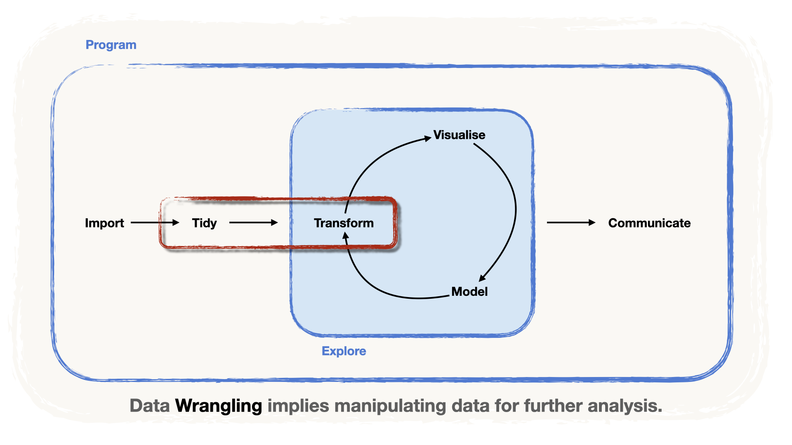
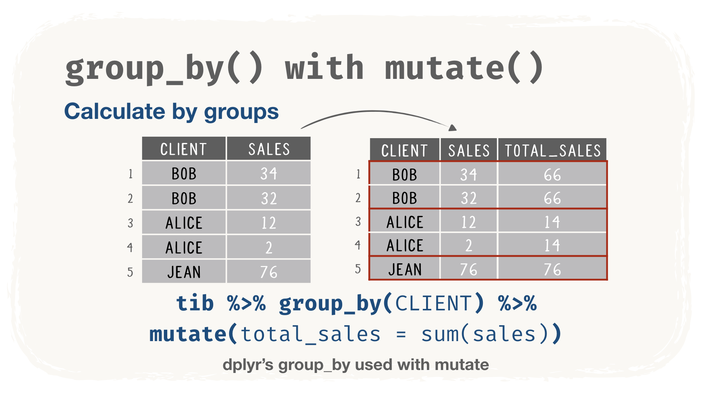
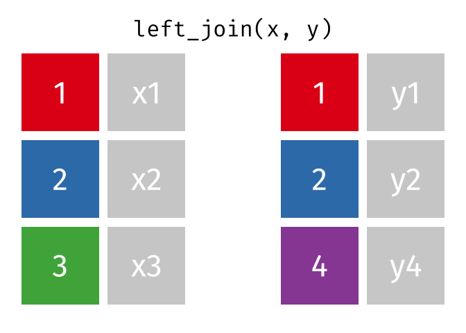
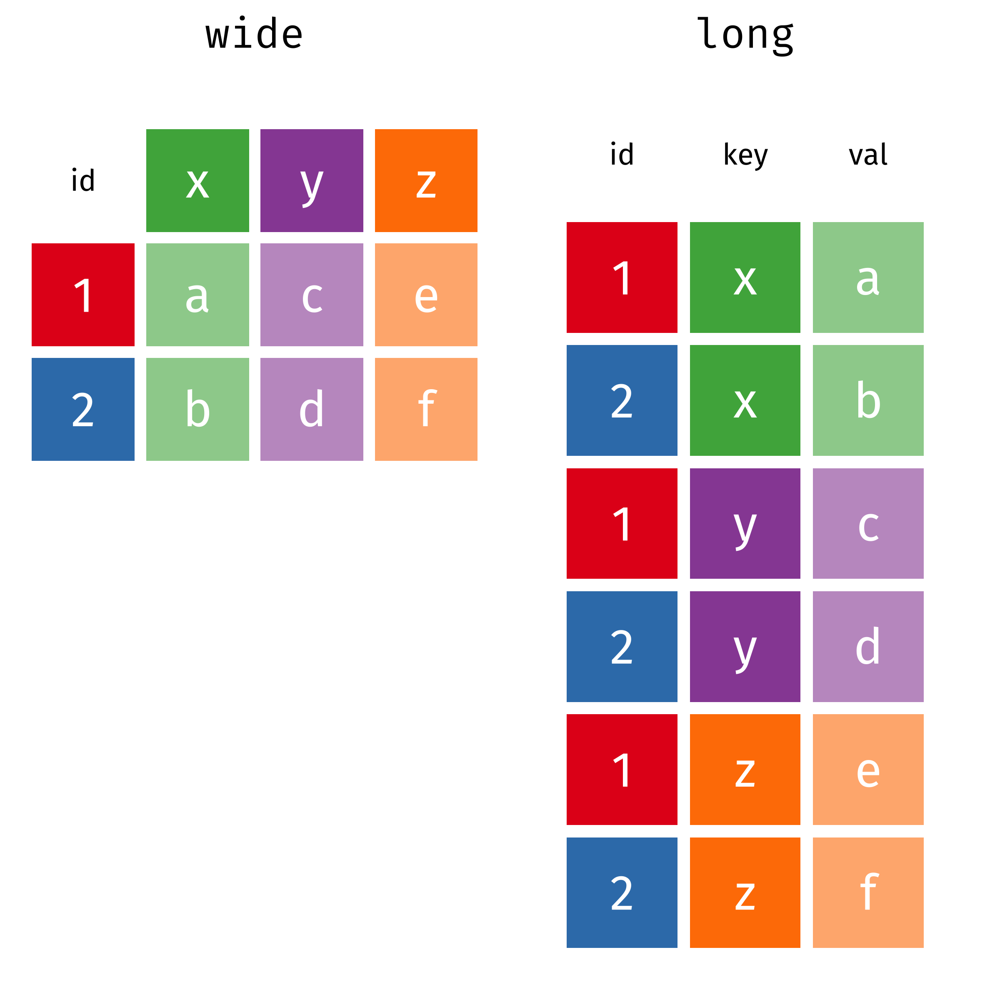
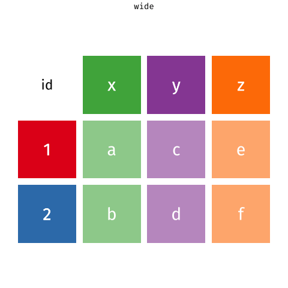

<!-- Translation of handout.qmd. Don't change the structure here: change handout.qmd, then port the changes (see README.md, "Translations"). -->

```{r setup, include = FALSE, message = FALSE, warning = FALSE}
knitr::opts_chunk$set(
  echo = TRUE,
  message = FALSE,
  warning = FALSE,
  fig.align = 'center',
  fig.width = 16/2,
  fig.height = 9/2,
  cache = FALSE)

```

```{r packs_load, include = FALSE}
library(tidyverse)
library(janitor)
library(DT)
```

{fig-alt="Le pipeline de la data science, avec les étapes « préparer » et « transformer » mises en évidence : le data wrangling couvre les deux." width="80%" fig-align="center"}

La deuxième étape du pipeline d'un·e data scientist est de **préparer** (*Tidy*) les données, c.-à-d. de les « nettoyer » et de les rendre prêtes pour l'analyse. Dans la philosophie du `{tidyverse}`, cela implique aussi de **transformer** les données en **tables bien rangées** appelées `tibbles`.

Pour tirer des enseignements lors de l'analyse, il faut pouvoir **transformer** (*Transform*) les données. Ces deux tâches demandent de **manipuler les données**, ce qu'on appelle souvent le **data wrangling**.

Voici quelques tâches de base du data wrangling :

-   **choisir une colonne** d'une table,
-   **transformer et/ou ajouter des colonnes** à une table,
-   filtrer, c.-à-d. **choisir un ensemble de lignes**,
-   **trier les lignes** selon les valeurs d'une ou plusieurs colonnes,
-   **regrouper** selon les valeurs d'une ou plusieurs colonnes, pour analyser au sein des groupes,
-   calculer des **statistiques descriptives** (tendance centrale, dispersion, quantiles, etc.).

En R, et plus précisément dans le `{tidyverse}`, on manipule les données avec les outils des packages `{dplyr}` et `{tidyr}`. Mais plus que des outils, ces packages offrent toute une **grammaire pour manipuler les données**.

# Une grammaire de la manipulation de données {#DataManip}

Le package `{dplyr}` offre une série de fonctions, ou *verbes*, qui nous aident à **manipuler** les données comme on manipulerait des fils avec une pince. On retrouve même cette image dans le logo !

:::: {.columns}
::: {.column width="25%"}
```{r, echo = FALSE, fig.cap='La pince de `{dplyr}` nous aidera à manipuler nos données !', fig.align='center', out.width = "90%", fig.alt="Le logo hexagonal du package dplyr : une pince."}
#| label: img-dplyr-logo
knitr::include_graphics(path = "images/hex-dplyr.png")
```
:::

::: {.column width="75%"}
| Verbe | Usage |
|:-----------------:|-----------------------------------------------------|
| `select()` | **choisir un ensemble de colonnes** d'un `tibble` |
| `mutate()` | **transformer et ajouter des colonnes** au `tibble` |
| `filter()` | **choisir un ensemble de lignes** |
| `arrange()` | **trier les lignes** selon les valeurs d'une ou plusieurs colonnes |
| `group_by()` | **regrouper** selon les valeurs d'une ou plusieurs colonnes pour calculer au sein des groupes |
| `summarise()/summarize()` | créer un nouveau `tibble` de **statistiques descriptives** pour un ensemble de colonnes |
:::
::::

::: callout-important
## Pourquoi des « verbes » ?

Ces fonctions sont appelées *verbes* parce que, grâce à l'opérateur **pipe**, on peut les **écrire à la suite**, puisque :

-   Leur **premier argument** est le **nom du jeu de données**
-   Les **autres arguments** sont les **noms des colonnes**

Par exemple :

``` r
select(dataset, column_1, column_2)

# équivaut à :

dataset %>% select(column_1, column_2)

# vous voyez : cela se lit comme une phrase !
```

Tout l'aspect **grammaire** vient de cette façon de programmer proche du langage naturel !
:::

## Inspecter les données

Juste après l'import, il est utile d'**inspecter** les données, pour savoir :

-   quelles colonnes contient notre jeu de données,
-   de quels *types* sont nos colonnes, c.-à-d. si elles contiennent
    -   des nombres (`integers` ou décimaux, représentés comme `double` ou `numeric`),
    -   des chaînes de caractères (des lettres, ou des suites de lettres qui forment des mots, comme `"words"`),
    -   des valeurs logiques (`TRUE` ou `FALSE`),
    -   des observations manquantes (notées `NA` en R),
    -   des dates ou des dates-heures.

Pour les illustrations, nous utilisons le jeu de données WTA, que vous pouvez importer avec `read_csv()`.

::: callout-note

Remarquez que :

1.  le `path` pointe vers le dossier `data` commun du workshop, un niveau au-dessus (`../data/`)
2.  le `path` est *passé* à `read_csv()` avec l'opérateur pipe (`%>%`)
:::

```{r}
#| label: read-wta

# 1. charger le package
library(readr)   

# 2. assigner les données à un objet
wta_data <-

  # 3. passer le chemin par le pipe
  "../data/wta_grand_slam_data.csv" %>%
  
  # 4. utiliser la fonction readr::read_csv()
  read_csv(

  # 5. lire toutes les colonnes comme character
    col_types = cols(.default = "c")
    )

wta_data
```

::: {.callout-tip collapse="true"}
## Une remarque sur les arguments supplémentaires

Vous voyez que nous avons ajouté un argument supplémentaire pour éviter les erreurs d'import :

-   Nous fixons l'argument `col_types = cols(.default = "c")`, où `"c"` signifie `character`.
-   En effet, `read_csv()` « devine » le type de chaque colonne (`numeric`, `character`, etc.) en **analysant les 1000 premières lignes**.
-   Comme **certaines colonnes ont beaucoup d'observations manquantes**, cela pourrait provoquer des erreurs à l'import.
:::

### Voir un extrait

Il est toujours utile de voir les **premières lignes** de nos données, pour vérifier qu'elles sont bien importées. En R, la fonction `slice_head()` affiche la **première ligne** :

```{r}
#| label: handout-slice-head-wta
slice_head(wta_data)
```

Pour afficher plus de lignes, on donne une valeur à l'argument `n` (p. ex. `n = 6`) :

```{r}
#| label: handout-slice-head-wta-6
slice_head(wta_data, n = 6)
```

Nos données semblent bien importées !

### Avoir un aperçu

La fonction `glimpse()` donne un **résumé du contenu** :

```{r}
#| label: glimpse-wta
glimpse(wta_data)
```

Comme vous le voyez :

-   il y a beaucoup de colonnes (`r ncol(wta_data)`),
-   la plupart des noms de colonnes commencent par un préfixe descriptif.

Voici le détail des préfixes de colonnes que nous utilisons dans la suite.

| colonne / préfixe | Contenu |
|:-----------------:|:----------------------------------------------------|
| `year` | Année du tournoi où le match a eu lieu |
| `tourney_*` | Informations sur le tournoi (`id`, `name`, `surface`, ...) |
| `match_num` | Numéro du match **au sein d'un tournoi** |
| `winner_*` | Informations sur la gagnante d'un match (`id`, `name`, `hand`, ...) |
| `loser_*` | Informations sur la perdante d'un match (`id`, `name`, `hand`, ...) |

### Avoir une vue d'ensemble

On peut aussi obtenir une vue *graphique* avec la fonction `vis_dat()` du package `{visdat}` :

-   Les **couleurs** indiquent les **types** des colonnes (character, numeric, date...).
-   Le **gris** signale les **observations manquantes**.

```{r, fig.cap = "Le jeu de données WTA vu d'ensemble avec `vis_dat()`"}
#| label: vis-dat-wta
#| fig-alt: "Graphique vis_dat() des données WTA : une bande verticale par colonne, toutes de la couleur de character, avec des blocs gris pour les valeurs manquantes, fréquentes dans certaines colonnes."
# 1. charger le package visdat
library(visdat)

wta_data %>%

# 2. utiliser visdat::vis_dat()
  vis_dat(
    # 3. éviter les avertissements sur les données volumineuses
    warn_large_data = FALSE
    )
```

## Choisir des colonnes avec `select()`

La fonction `select()` aide à **choisir des colonnes**. On peut **choisir une colonne par son nom**, comme la colonne `year` :

```{r, eval = FALSE}
#| label: handout-select-year
wta_data %>%
  select(year)
```

Pour choisir plusieurs colonnes, on passe leurs noms à `select()`. Disons que nous voulons voir **qui a joué contre qui** au fil des années :

```{r, eval = FALSE}
#| label: select-columns
wta_data %>%
  select(
    year, 
    winner_name, 
    loser_name)
```

On peut aussi choisir les colonnes **dont le nom remplit une condition**. On utilise pour cela des **fonctions d'aide à la sélection** (*selection helpers*).

-   Par exemple, utilisons `starts_with()` pour choisir toutes les colonnes qui **commencent par** les préfixes `winner` et `loser`.
-   Pour que ce soit encore plus clair, inspectons le résultat avec `vis_dat()`.

```{r}
#| label: select-helpers
#| fig-alt: "Graphique vis_dat() des colonnes sélectionnées : year, puis les colonnes winner_ et loser_, toutes de type character."

wta_data %>%
  select(year, 
    starts_with("winner"), 
    starts_with("loser")) %>%
  vis_dat(warn_large_data = FALSE)
```

::: {.callout-tip collapse="true"}
## Autres fonctions d'aide à la sélection

La plupart des autres fonctions d'aide ont des noms presque explicites, p. ex.

| Fonction d'aide | Cas d'usage |
|:----------------:|:-----------------------------------------------------|
| `ends_with()` | sélectionne selon un suffixe |
| `contains()` | quand on cherche des colonnes qui contiennent un mot ou une chaîne donnés |
| `matches()` | sélectionne selon des **motifs appelés expressions régulières** (voir [la documentation de R sur les expressions régulières](https://stat.ethz.ch/R-manual/R-devel/library/base/html/regex.html)) |
| `num_range()` | sélectionne des colonnes numérotées dans un intervalle, p. ex. `x10`, `x11`, ..., `x15` avec `num_range("x", 10:15)` |

D'autres fonctions d'aide s'appliquent à des vecteurs de noms de colonnes, comme `all_of()` et `any_of()`, et enfin `where()`, qui sélectionne selon une fonction.
:::

## Transformer des colonnes avec `mutate()`

Le verbe `mutate()` permet de **créer de nouvelles colonnes** ou de **transformer des colonnes existantes**.

-   Par exemple, nous avons importé toutes les colonnes comme `character`, mais **`year` devrait être numérique** et **`tourney_date` une date**.
-   On **change le type des colonnes** en **réécrivant les colonnes** dans un appel à `mutate()`, avec une fonction de conversion : ici, `as.numeric()` et `ymd()` du package `{lubridate}`.
-   Là encore, pour plus de clarté, nous utilisons `vis_dat()`. Remarquez que le type de la colonne `year` est passé de `character` à `numeric`, et que la colonne `tourney_date` est devenue `Date`.

```{r}
#| label: handout-attach-lubridate
library(lubridate)
```

```{r}
#| label: mutate-types
wta_data <-
  wta_data %>%
  mutate(
    year = as.numeric(year),
    tourney_date = ymd(tourney_date))
```

```{r}
#| label: handout-mutate-types-check
#| fig-alt: "Graphique vis_dat() des colonnes sélectionnées après mutate() : year est maintenant numérique et tourney_date une date, les autres colonnes sont toujours de type character."
wta_data %>%
  select(year, starts_with("winner"), starts_with("tourney")) %>%
  vis_dat(warn_large_data = FALSE)
```

::: callout-important
## Rendre permanents les changements d'une table

Remarquez que nous avons *assigné* la table modifiée à `wta_data`, ce qui **réécrit la table d'origine avec nos modifications**. C'est ce qui **rend les modifications permanentes**.

Ce pipe **ne modifie pas** le contenu de `data` **de façon permanente** :

``` r
data %>% 
  mutate(...)
```

Ce pipe **modifie** le contenu de `data` **de façon permanente** :

``` r
data <- 
  data %>% 
  mutate(...) 
```
:::

## Filtrer des lignes avec `filter()`

La fonction `filter()` sert à **créer des sous-ensembles d'un tibble selon des conditions logiques**. Ces conditions portent sur les valeurs d'une colonne, et `filter()` **garde les lignes qui remplissent la condition**.

Disons, par exemple, que nous nous intéressons aux matchs gagnés par la grande Serena Williams. On peut utiliser `filter()` pour garder les lignes qui remplissent la condition `winner_name == "Serena Williams"` :

```{r}
#| label: filter-serena
wta_data %>%
  select(year, tourney_name, winner_name) %>%
  filter(winner_name == "Serena Williams")
```

::: callout-important
## Assignation (`=`) vs comparaison (`==`)

-   **Pour la comparaison, nous avons utilisé le double signe égal `==`**.
-   Cela évite toute ambiguïté avec l'assignation (p. ex. ce que nous faisons avec `mutate()`).
:::

Bien sûr, on peut **ajouter plusieurs conditions**, sur **la même colonne ou sur d'autres**. `filter()` garde alors les lignes qui remplissent toutes les conditions à la fois.

-   Supposons que nous voulions analyser les performances de Serena aux tournois australiens.
-   On peut sélectionner toutes les lignes où `tourney_name` contient le motif `"Australian"` avec `str_detect()` du package `{stringr}` : `str_detect()` renvoie `TRUE` quand la valeur de `tourney_name` contient le motif `"Australian"`.
-   Nous terminons avec `select()`, pour voir les colonnes utiles.

```{r}
#| label: filter-serena-australian
# 1. charger stringr
library(stringr)

wta_data %>%
  filter(
    # 2. première condition : la gagnante
    winner_name == "Serena Williams",
    # 3. deuxième condition : le tournoi
    str_detect(
      tourney_name,
      pattern = "Australian")) %>%

# 4. garder quelques colonnes
  select(year, tourney_name, winner_name)
```

::: {.callout-tip collapse="true"}
## Comment écrire des conditions logiques

Voici un bref aperçu de l'écriture des conditions logiques en R :

| Condition logique | Symbole |
|:------------------------------:|:--------:|
| *A égal à B* | `A == B` |
| *A inférieur à B* | `A < B` |
| *A inférieur ou égal à B* | `A <= B` |
| *A supérieur à B* | `A > B` |
| *A supérieur ou égal à B* | `A >= B` |

On peut aussi combiner des conditions en expressions plus longues avec « et » et « ou » :

| Condition logique | Syntaxe |
|:-----------------------------:|:-------------------------:|
| *Condition 1 ET condition 2* | `ConditionA & ConditionB` |
| *Condition 1 OU condition 2* | `ConditionA | ConditionB` |

Enfin, un raccourci très pratique pour plusieurs conditions `OR` est l'opérateur `%in%`, qui compare une valeur au contenu d'un vecteur. Par exemple :

    A == B | A == C | A == D

équivaut à :

    A %in% c(B, C, D)
:::

## Trier les observations avec `arrange()`

Le verbe `arrange()` permet de **trier les observations** selon les valeurs de colonnes de votre jeu de données. Si la colonne de tri est de **type numérique**, les observations sont triées par **ordre numérique croissant** :

```{r}
#| label: arrange-year
wta_data %>%
  select(year, winner_name, tourney_name) %>%
  arrange(year)
```

Si la colonne de tri est de **type `character`**, les observations sont triées par ordre alphabétique :

```{r}
#| label: handout-arrange-winner-name
wta_data %>%
  select(year, winner_name, tourney_name) %>%
  arrange(winner_name)
```

On peut aussi trier les observations selon plusieurs colonnes. L'ordre dans lequel on passe les colonnes à `arrange()` compte : `{dplyr}` trie **d'abord** selon la première colonne passée, puis selon la deuxième :

```{r}
#| label: arrange-two-columns
wta_data %>%
  select(year, winner_name, tourney_name) %>%
  arrange(year, winner_name)
```

Par défaut, **`arrange()` trie les observations par ordre *croissant***. Pour trier par ordre *décroissant*, on entoure la colonne de tri de `desc()` :

```{r}
#| label: arrange-desc
wta_data %>%
  select(year, winner_name, tourney_name) %>%
  arrange(year, desc(winner_name))
```

## C'est l'heure de l'exercice !

::: callout-important
## Au travail !

Ouvrez le notebook d'exercices `_exercises/exercise-notebook.qmd` et faites l'**[exercice 2](../_exercises/exercise-notebook.html#exercise-2)**. À tout de suite !
:::

## Produire des statistiques descriptives avec `summarise()`

La fonction `summarise()` crée un nouveau jeu de données qui **contient des résumés des colonnes demandées**.

-   Disons que nous nous intéressons au **nombre de matchs gagnés** par **Serena Williams** aux tournois **australiens**.
-   Une fois les lignes filtrées avec `filter()`, on peut **compter les matchs** avec la fonction de comptage `n()`, qui **calcule le nombre de lignes** :

```{r}
#| label: summarise-serena-australian
wta_data %>%

# 1. garder les victoires de Serena en Australie
  filter(
    winner_name == "Serena Williams",
    str_detect(
      tourney_name,
      pattern = "Australian")) %>%

# 2. compter les lignes
  summarise(number_of_wins = n())
```

En plus de `n()`, d'autres fonctions utiles calculent d'autres résumés :

| Statistique | Fonctions |
|:-----------------:|:-------------------------------|
| Tendance centrale | `mean()`, `median()` |
| Dispersion | `sd()`, `IQR()`, `mad()` |
| Étendue | `min()`, `max()`, `quantile()` |
| Total | `sum()` |
| Position | `first()`, `last()`, `nth()` |
| Comptage | `n()`, `n_distinct()` |
| Logique | `any()`, `all()` |

## Créer des groupes avec `group_by()`

Certaines analyses demandent de **regrouper les données** selon **une ou plusieurs colonnes de *regroupement*** avant de calculer. On le fait avec `group_by()`. Par exemple, regroupons le jeu de données par `winner_name` :

```{r}
#| label: group-by-winner
wta_data %>%
  group_by(winner_name)
```

-   L'affichage dans la console (ou l'aperçu) **révèle la colonne de regroupement**.
-   Désormais, **tous les calculs** se font **au sein des groupes définis par les valeurs de la colonne** (plus de détails dans la section suivante !).

Pour supprimer un regroupement, utilisez le verbe `ungroup()` :

```{r}
#| label: handout-ungroup-winner
wta_data %>%
  group_by(winner_name) %>%
  ungroup()
```

## Calculer des résumés par groupe avec `group_by()` `%>%` `summarise()`

Comme nous l'avons dit, **après un appel à `group_by()`**, **tous les calculs et certaines manipulations qui suivent** sont **effectués au sein des groupes**. Cela se combine très bien avec `summarise()`, qui crée alors des **statistiques descriptives pour les groupes** définis par les valeurs de la colonne !

Pour illustrer, comptons le **nombre de victoires** de **chaque joueuse** (pas seulement Serena !) :

-   D'abord, on appelle `group_by(winner_name)`.
-   Ensuite, **`summarise()`** et **`n()`** **comptent les lignes au sein des groupes** définis par les valeurs de la colonne `winner_name`.
-   Ici, cela donne le nombre de fois où chaque `winner_name` apparaît dans le jeu de données.

```{r}
#| label: wins-per-player
wta_data %>%
  group_by(winner_name) %>%
  summarise(
    number_of_wins = n(),
    .groups = "drop")
```

::: callout-note
## Que fait `.groups = "drop"` ?

Il demande à `summarise()` de renvoyer une table **sans aucun regroupement**, exactement comme si nous avions ajouté `ungroup()` à la fin. Prenez-en l'habitude : un regroupement oublié est une source fréquente de surprises dans les calculs suivants.
:::

Pour voir **qui a le plus gagné**, nous trions le résultat par ordre décroissant avec `arrange()` et `desc()` :

```{r}
#| label: wins-ranking
wta_data %>%
  group_by(winner_name) %>%
  summarise(
    number_of_wins = n(),
    .groups = "drop") %>%
  arrange(desc(number_of_wins))
```

::: {.callout-tip collapse="true"}
## Un raccourci pour compter : `count()`

Compter les lignes au sein des groupes est si courant que `{dplyr}` a un raccourci pour cela. `count()` regroupe, compte et dégroupe en une seule étape :

```{r}
#| label: handout-count-wins-per-player
wta_data %>%
  count(winner_name, name = "number_of_wins")
```
:::

::: {.callout-tip collapse="true"}
## `group_by()` fonctionne aussi avec `mutate()`

Après `group_by()`, `mutate()` calcule aussi **au sein des groupes**. Contrairement à `summarise()`, il **garde toutes les lignes** : chaque ligne reçoit le résultat de son groupe.

{fig-alt="La fiche de group_by() avec mutate() : les cinq lignes de ventes des clients Bob, Alice et Jean sont conservées et reçoivent une colonne total_sales, qui vaut 66 pour les deux lignes de Bob, 14 pour les deux lignes d'Alice et 76 pour Jean." width="70%" fig-align="center"}
:::

On peut regrouper selon plusieurs colonnes. Voyons **combien de matchs** **chaque joueuse** a gagnés dans **chaque tournoi**. Pour cela, il nous faut `group_by(winner_name, tourney_name)` :

```{r}
#| label: wins-per-player-tourney
wta_data %>%
  group_by(winner_name, tourney_name) %>%
  summarise(
    number_of_wins = n(),
    .groups = "drop")
```

### C'est l'heure de l'exercice ! {.unnumbered}

::: callout-important
## Au travail !

Ouvrez le notebook d'exercices `_exercises/exercise-notebook.qmd` et faites l'**[exercice 3](../_exercises/exercise-notebook.html#exercise-3)**. À tout de suite !
:::

# Fusionner des données

Dans la réalité, **l'information peut être répartie dans plusieurs jeux de données liés entre eux**. Il faut alors **fusionner certains de ces jeux de données** pour obtenir l'information nécessaire à une tâche donnée.

Les procédures de fusion **les plus importantes** sont l'**empilement** (*binding*) et la **jointure** (*joining*). En R, on peut s'appuyer sur les *verbes* d'empilement et de jointure de `{dplyr}`.

| Verbe | Usage |
|:-----------------:|-----------------------------------------------------|
| `bind_rows()` | fusionne deux tibbles en les **empilant** (l'un au-dessus de l'autre) |
| `*_join()` | **attache** des tibbles par **leurs colonnes communes** (*clés* de jointure) |

Créons trois jeux de données jouets pour comprendre ces procédures. Le code suivant génère des tables avec les colonnes `id`, `var_1`, `var_2` et `var_3` :

```{r}
#| label: toy-datasets
data_1 <- tibble(id = 1:3, var_1 = c(15, 13, 39))
data_2 <- tibble(id = c(4, 5), var_1 = 10)
data_3 <- tibble(id = 1:3, var_2 = c(10, 12, 14), var_3 = c(45, 20, 2))
```

Affichons-les pour voir leur contenu :

::::: {.columns}
:::: {.column width="33%"}
```{r}
#| label: print-data-1
data_1
```
::::

:::: {.column width="33%"}
```{r}
#| label: print-data-2
data_2
```
::::

:::: {.column width="33%"}
```{r}
#| label: print-data-3
data_3
```
::::
:::::

## *Empiler* des jeux de données avec `bind_rows()`

Quand deux tables ont les **mêmes colonnes** mais des **informations différentes**, on peut les **fusionner en les « empilant »**, l'une au-dessus de l'autre.

-   En R, avec `{dplyr}`, on utilise le *verbe* `bind_rows()`.
-   Dans un pipe, le **côté gauche du pipe** est placé **au-dessus** de l'**argument de droite**.
-   Par exemple, les jeux de données `data_1` et `data_2` ont les mêmes noms de colonnes, mais des informations différentes (valeurs de `id` et `var_1`). On peut donc les fusionner avec `bind_rows()` :

```{r}
#| label: bind-rows-data
data_1 %>%
  bind_rows(data_2)
```

Comme vous le voyez, les valeurs de `data_1` sont au-dessus de celles de `data_2`.

## *Joindre* des jeux de données avec `left_join()`

Si, au contraire, deux jeux de données **décrivent les mêmes lignes** mais ont des **colonnes différentes**, il est parfois utile de les fusionner en **« attachant » leurs colonnes**.

En R, avec `{dplyr}`, on utilise les *verbes* de jointure, qui ont le suffixe `*_join`, p. ex. `right_join()`, `left_join()`, `full_join()`.

::: {.callout-warning collapse="true"}
## Attendez ! Il n'y a pas un `bind_cols()` ?

Si, il existe ! Mais cette fonction ne garantit pas la **cohérence des lignes**. Un exemple illustre certains des problèmes.

-   Par exemple, `data_3` contient les mêmes ids que `data_1` : on peut donc attacher les valeurs des colonnes `var_2` et `var_3` pour avoir un jeu de données plus complet.

```{r}
#| label: handout-bind-cols-data
data_1 %>%
  bind_cols(select(data_3, starts_with("var")))
```

Réussi ! ... ou pas ?

`bind_cols()` a quelques inconvénients :

1.  **Il ne vérifie pas la conformité des lignes**.

Par exemple, une simple permutation dans l'un des jeux de données, ou un défaut de conformité des lignes, pose problème.

    -   Voyons ce qui se passe quand les données de `data_3` sont permutées, p. ex. dans l'ordre décroissant de `id`.
    -   La fusion avec `bind_cols()` donne un résultat incohérent !

```{r}
#| label: handout-permute-data-3
data_3 <- data_3 %>% arrange(desc(id))
```

```{r}
#| label: handout-bind-cols-permuted
data_1 %>%
  bind_cols(select(data_3, starts_with("var")))
```

2.  Les tibbles à fusionner **doivent avoir le même nombre de lignes**.
    -   Supposons que nous voulions fusionner nos trois jeux de données pour avoir toute l'information dans un seul tibble.
    -   Les deux premiers peuvent être fusionnés avec `bind_rows()`.
    -   Mais quand on essaie (à tort !) de fusionner `data_3` (permuté !), on obtient un message d'erreur.
    -   C'est parce que le premier jeu de données a 5 lignes et le second 3 !

```{r, error=TRUE}
#| label: handout-bind-cols-error
data_1 %>%
  bind_rows(data_2) %>%
  bind_cols(data_3)
```

Avec les verbes `*_join` de `{dplyr}`, on garantit la cohérence des lignes.
:::

Les verbes `*_join` fusionnent deux jeux de données et **garantissent la cohérence des lignes** en **s'appuyant sur la ou les colonnes communes**, appelées **clés de jointure**. En R, avec `{dplyr}`, nous utilisons le verbe `left_join()`.

-   Dans l'animation ci-dessous, nous avons deux jeux de données, `x` et `y`.
-   Ils partagent la première colonne et certains de ses éléments.
-   Lors de la jointure, les colonnes non communes de `y` sont attachées à `x`, en associant les lignes par leurs éléments communs.

{fig-alt="Animation de left_join(x, y) : les lignes de y sont associées aux lignes de x par leur colonne clé commune, les colonnes de y sont attachées à x, et les lignes de x sans correspondance reçoivent des valeurs manquantes." width="45%" fig-align="center"}

**Source :** Tidy Animated Verbs de [Garrick Aden-Buie](https://github.com/gadenbuie/tidyexplain)

::: callout-important
## Pourquoi « left » dans `left_join()` ?

La particularité de `left_join()` est qu'en plus de joindre les éléments communs, il **conserve les éléments non communs du premier tibble**, c.-à-d. le tibble *de gauche*.
:::

**Par défaut**, la jointure utilise **toutes les colonnes communes aux jeux de données**. On peut cependant **préciser un sous-ensemble de colonnes de jointure** avec l'argument `by`.

-   Essayons de joindre nos trois jeux de données avec la colonne commune `id` comme **clé de jointure**. Ça marche !
-   Les versions récentes de `{dplyr}` acceptent aussi `by = join_by(id)`, que vous croiserez peut-être dans le code d'autres personnes.

```{r}
#| label: left-join-id
data_1 %>%

# 1. empiler les deux premières tables
  bind_rows(data_2) %>%

# 2. attacher data_3, en associant par id
  left_join(data_3, by = "id")
```

Voyons ce qui se passe avec un élément non commun. Nous ajoutons à `data_3` une observation avec `id = 8` (absente de `data_1`), ce qui crée `data_4` :

:::: {.columns}
::: {.column width="50%"}
```{r}
#| label: data-4
data_4 <-
  bind_rows(
    data_3,
    tibble(id = 8, var_2 = 3, var_3 = 12))
data_4
```
:::

::: {.column width="50%"}
En appliquant `left_join()`, on obtient :

```{r}
#| label: left-join-unmatched
data_1 %>%
  left_join(data_4, by = "id")
```
:::
::::

# Pivoter des données

Dans des tables, les données peuvent se présenter de deux façons :

-   le format **long**, où toutes les colonnes désignent des *variables*. Il est utile pour l'**analyse** (calculs et visualisations).
-   le format **large**, où certaines colonnes portent le nom de valeurs d'une *variable* catégorielle. Il sert surtout à afficher des tables dans vos rapports.

```{r, echo = FALSE, fig.cap='Données au format large vs. au format long', fig.align='center', out.width = "70%", fig.alt="Les mêmes données sous forme de table large, avec une colonne id et une colonne pour chacun de x, y et z, et sous forme de table longue à trois colonnes : id, key (qui contient x, y ou z) et val."}
#| label: img-wide-long

```

En R, avec `{tidyr}`, on pivote une table avec deux fonctions : `pivot_longer()` et `pivot_wider()`. L'animation ci-dessous montre comment fonctionne le pivotement.

:::: {.columns}
::: {.column width="25%"}
```{r, echo = FALSE, fig.cap='Les balais de `{tidyr}` nous aideront à ranger nos données !', fig.align='center', out.width = "90%", fig.alt="Le logo hexagonal du package tidyr : des balais."}
#| label: img-tidyr-logo
knitr::include_graphics(path = "images/hex-tidyr.png")
```
:::

::: {.column width="75%"}
{fig-alt="Animation d'une table large transformée en table longue avec pivot_longer(), puis de nouveau en table large avec pivot_wider()." width="480"}

Source : Tidy Animated Verbs de [Garrick Aden-Buie](https://github.com/gadenbuie/tidyexplain), modifié par [Mara Averick](https://twitter.com/dataandme)
:::
::::

## Pivoter au format long avec `pivot_longer()`

`pivot_longer()` a trois arguments principaux :

| Argument | Usage |
|:----------------:|:-----------------------------------------------------|
| `cols` | les **colonnes à convertir** en une seule colonne |
| `names_to` | le **nom d'une nouvelle colonne**, où sont stockés les **noms des colonnes sélectionnées** |
| `values_to` | le **nom de la colonne** où l'on stocke **les valeurs** |

Ce cas se présente quand on a **beaucoup de mesures effectuées au fil du temps**.

Illustrons cela avec `data_5_wide`, une table de fortune qui contient la performance d'une série de prototypes de machines observés à trois instants : `t_1`, `t_2`, `t_3`.

:::: {.columns}
::: {.column width="45%"}
```{r}
#| label: data-5-wide
data_5_wide <-
  tibble(
    prototype = 1:5 ,
    t_1 = c(12,1,3,4,5),
    t_2 = c(13,0,3,6,3),
    t_3 = c(14,-1,3,8,1))
data_5_wide
```
:::

::: {.column width="55%"}
*Pivotons* ce tibble au *format long*, en

-   mettant les noms des instants dans une seule colonne : `timepoint`,
-   plaçant le contenu des lignes dans une seule colonne : `performance`.

```{r}
#| label: pivot-longer
data_5_long <-
  data_5_wide %>%
  pivot_longer(
    # 1. toutes les colonnes sauf prototype
    cols = -c(prototype),
    # 2. où vont les anciens noms
    names_to = "timepoint",
    # 3. où vont les valeurs
    values_to = "performance"
  )

data_5_long
```
:::
::::

**\[facultatif\]** On peut ajouter deux arguments facultatifs pour un résultat plus propre :

```{r}
#| label: pivot-longer-clean
data_5_long <-
  data_5_wide %>%
  pivot_longer(
    cols = -c(prototype),
    names_to = "timepoint",
    values_to = "performance",
    # 1. retirer le préfixe `t_`
    names_prefix = "t_",
    # 2. convertir les instants en entiers
    names_transform = list(
      timepoint = as.integer)
  )

data_5_long
```

Les **tibbles au format long** sont **pratiques** pour les **calculs et les visualisations**. Par exemple, calculons la performance moyenne de chaque prototype :

```{r}
#| label: average-performance
data_5_long %>%
  group_by(prototype) %>%
  summarise(
    average_performance = mean(performance),
    .groups = "drop")
```

## Pivoter au format large avec `pivot_wider()`

D'une certaine façon, `pivot_wider()` fait l'opération inverse de `pivot_longer()`. L'idée est d'« *étaler* » les valeurs d'une colonne et de les utiliser comme noms de colonnes (ou comme colonnes).

En plus de `data`, qui peut être passé par un pipe, ses principaux arguments sont :

| Argument | Usage |
|:-----------------:|:----------------------------------------------------|
| `names_from` | la colonne dont le contenu devient le nom des nouvelles colonnes |
| `values_from` | la colonne où la fonction *va chercher* les valeurs des nouvelles colonnes |

Les tibbles au format large sont utiles pour la **présentation**, surtout dans les rapports écrits ! Pour illustrer, prenons l'exemple (de fortune) suivant. Imaginez une table qui contient les **rendements moyens** d'une **série de cultures** selon différents types de **pratiques agricoles**.

:::: {.columns}
::: {.column width="50%"}
```{r}
#| label: data-6-long
data_6_long <-
  tibble(
    crop = c(rep("wheat", 3), rep("corn", 3), rep("quinoa",3)),
    practice = rep(c("Type 1", "Type 2", "Type 3"), 3),
    yield = c(12,65,85,98, 65, 45, 72, 67, 59)
    )
data_6_long
```
:::

::: {.column width="50%"}
Pour un rapport écrit, ce n'est pas très concis, à cause des valeurs répétées dans les colonnes `crop` et `practice`. Avec `pivot_wider()`, qui prend les noms de colonnes dans `practice` et les valeurs dans `yield`, la table devient plus concise :

```{r}
#| label: pivot-wider
data_6_long %>%
  pivot_wider(
    # 1. les noms des nouvelles colonnes
    names_from = practice,
    # 2. les valeurs des nouvelles colonnes
    values_from = yield)
```
:::
::::

> Cette table est prête à être présentée !

On peut la passer à `kbl()` et profiter de `{kableExtra}` pour un rendu encore meilleur :

```{r}
#| label: handout-pivot-wider-kable
library(kableExtra)
data_6_long %>%
  pivot_wider(names_from = practice, values_from = yield) %>%
  kbl(caption = "Tableau 1 : rendements des cultures selon les pratiques agricoles") %>%
  kable_classic(full_width = F, html_font = "Cambria")
```

### C'est l'heure de l'exercice ! {.unnumbered}

::: callout-important
## Au travail !

Ouvrez le notebook d'exercices `_exercises/exercise-notebook.qmd` et faites les **[exercices 4](../_exercises/exercise-notebook.html#exercise-4) et [5](../_exercises/exercise-notebook.html#exercise-5)**. À tout de suite !
:::
