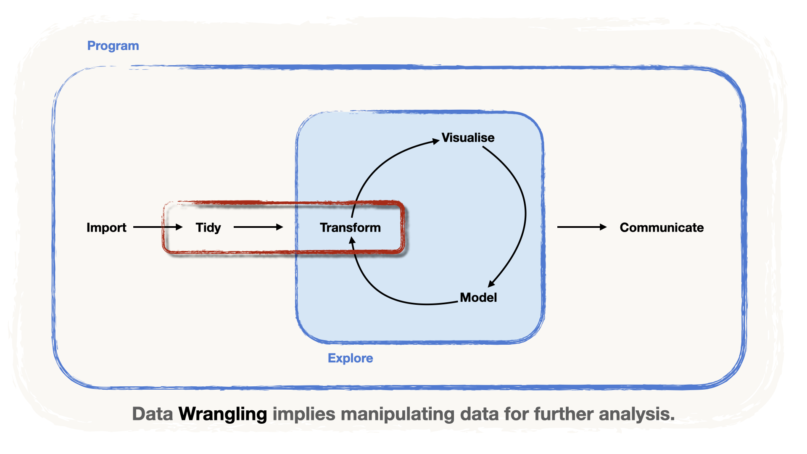
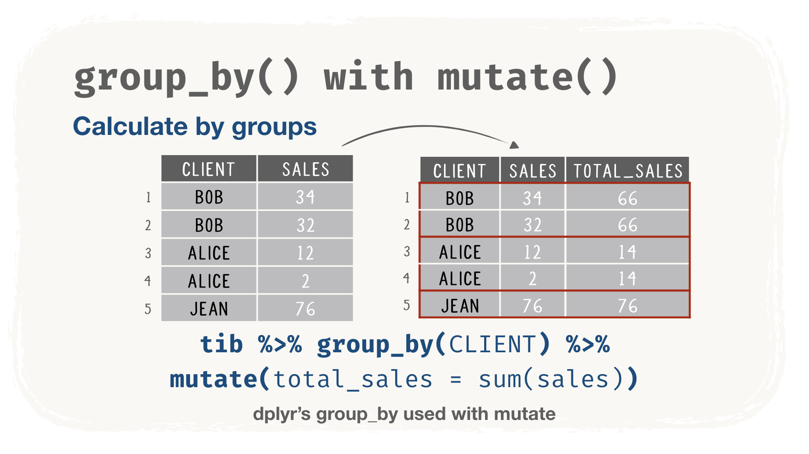
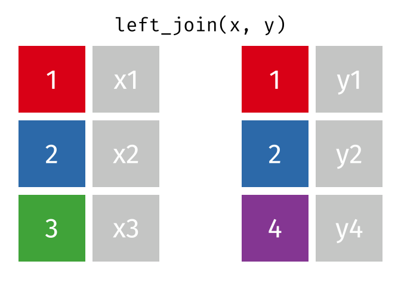
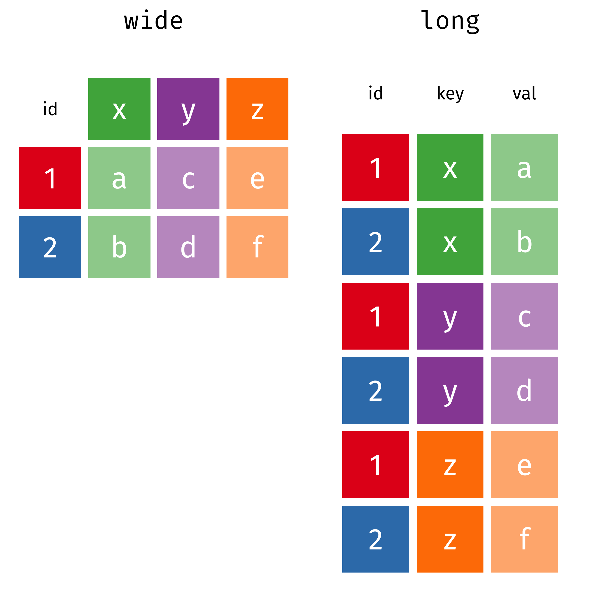

```{r setup, include = FALSE, message = FALSE, warning = FALSE}
knitr::opts_chunk$set(
  echo = TRUE,
  message = FALSE,
  warning = FALSE,
  fig.align = 'center',
  fig.width = 16/2,
  fig.height = 9/2,
  cache = FALSE)

```

```{r packs_load, include = FALSE}
library(tidyverse)
library(janitor)
library(DT)
```

{fig-alt="The data science pipeline, with the Tidy and Transform steps highlighted: data wrangling covers both." width="80%" fig-align="center"}

The second step in a data scientist's pipeline is to **Tidy**, i.e. "clean" the data and prepare it for analysis. In the `{tidyverse}` philosophy, this also involves **transforming** the data into **tidy tables** called `tibbles`.

To get insight during the analysis stage, one needs to be able to **Transform** the data. Both of these tasks involve the **manipulation of data**, a task often called **Data Wrangling**.

Some basic Data Wrangling tasks are:

-   **picking a column** from a table,
-   **transforming and/or adding columns** to a table,
-   subsetting, i.e. **picking a set of rows**,
-   **ordering the rows** according to the values of a (set of) column(s),
-   **grouping** according to the values of a (set of) column(s), to perform analyses within the groups,
-   computing **summary statistics** (centrality, dispersion, quantiles, etc.).

In R, and more specifically in the `{tidyverse}`, data manipulation is performed with the tools of the packages `{dplyr}` and `{tidyr}`. But more than tools, these packages provide a whole **grammar to manipulate data**.

# A Grammar for Data Manipulation {#DataManip}

The package `{dplyr}` offers a series of functions, or *verbs*, that help us **wrangle** data the same way we would use pliers to wrangle wires. This representation is even in the logo!

:::: {.columns}
::: {.column width="25%"}
```{r, echo = FALSE, fig.cap='The pliers of `{dplyr}` will help us wrangle our data!', fig.align='center', out.width = "90%", fig.alt="The hexagonal logo of the dplyr package: a pair of pliers."}
#| label: img-dplyr-logo
knitr::include_graphics(path = "images/hex-dplyr.png")
```
:::

::: {.column width="75%"}
|           Verb            | Use                                                                                                 |
|:-----------------:|-----------------------------------------------------|
|        `select()`         | **pick a set of columns** from a `tibble`                                                           |
|        `mutate()`         | **transform and add columns** to the `tibble`                                                       |
|        `filter()`         | **pick a set of rows**                                                                              |
|        `arrange()`        | **order the rows** according to the values of a (set of) column(s)                                  |
|       `group_by()`        | **group** according to the values of a (set of) column(s) to perform calculations within the groups |
| `summarise()/summarize()` | create a new `tibble` containing **summary statistics** for a set of columns                        |
:::
::::

::: callout-important
## Why "verbs"?

These functions are called *verbs* because, thanks to the **pipe** operator, they can be **written sequentially**, since:

-   Their **first argument** is the **name of the dataset**
-   The **remaining arguments** are the **names of the columns**

For example:

``` r
select(dataset, column_1, column_2)

# Is equivalent to:

dataset %>% select(column_1, column_2)

# you see that it reads like a sentence!
```

The whole **grammar** aspect comes from this natural-language-like approach to programming!
:::

## Inspecting Data

Right after importation, it is useful to **inspect** the data, to know:

-   what columns are contained in our dataset,
-   what *types* our columns are, i.e. whether they are composed of
    -   numbers (`integers` or decimals, represented as `double` or `numeric`),
    -   strings (letters, or strings of letters that amount to words like, well, `"words"`),
    -   logical values (`TRUE` or `FALSE`),
    -   missing observations (denoted as `NA` in R),
    -   dates/date times.

For the illustrations, we rely on the WTA dataset, which you can import with `read_csv()`.

::: callout-note

Notice that:

1.  The `path` points to the shared `data` folder of the workshop, one level up (`../data/`)
2.  The `path` is *fed* to `read_csv()` using the pipe operator (`%>%`)
:::

```{r}
#| label: read-wta

# 1. attach the package
library(readr)   

# 2. assign data to an object
wta_data <-

  # 3. give the path through the pipe
  "../data/wta_grand_slam_data.csv" %>%
  
  # 4. use the function readr::read_csv()
  read_csv(

  # 5. set all columns as character
    col_types = cols(.default = "c")
    )

wta_data
```

::: {.callout-tip collapse="true"}
## A note on the extra arguments

You see that we have added an extra argument to avoid importing errors:

-   We're setting the argument `col_types = cols(.default = "c")`, where `"c"` stands for `character`.
-   This is because `read_csv()` "guesses" the type of each column (`numeric`, `character`, etc.) by **parsing the first 1000 lines**.
-   Since we have **a lot of missing observations in some columns**, this could yield errors when importing.
:::

### Getting a slice

It's always useful to see the **first rows** of our data, to check whether they are well imported. In R, we get a printed view of the **first row** with the function `slice_head()`:

```{r}
#| label: handout-slice-head-wta
slice_head(wta_data)
```

If we want to print more rows, we can set the argument `n` to a value (e.g. `n = 6`):

```{r}
#| label: handout-slice-head-wta-6
slice_head(wta_data, n = 6)
```

Our data has been well imported, it appears!

### Getting a glimpse

We can get a **summary of the contents** with the function `glimpse()`:

```{r}
#| label: glimpse-wta
glimpse(wta_data)
```

As you can see:

-   there are many (`r ncol(wta_data)`) columns,
-   most of the column names start with a descriptive prefix.

Here's a breakdown of the column prefixes that we use in what follows.

| column / prefix | Content                                                                        |
|:-----------------:|:----------------------------------------------------|
|     `year`      | Year of the tournament the match took place                                    |
|   `tourney_*`   | Information related to the tournament (`id`, `name`, `surface`, ...)           |
|   `match_num`   | Number of match **within a tournament**                                        |
|   `winner_*`    | Information related to the winner of a given match (`id`, `name`, `hand`, ...) |
|    `loser_*`    | Information related to the loser of a given match (`id`, `name`, `hand`, ...)  |

### Getting the full picture

Alternatively, we can get a *graphical* view with the function `vis_dat()` from the package `{visdat}`:

-   The **colours** display the **types** of the columns (character, numeric, date...).
-   The **grey** denotes **missing observations**.

```{r, fig.cap = "A bird's-eye view of the WTA dataset using `vis_dat()`"}
#| label: vis-dat-wta
#| fig-alt: "vis_dat() plot of the WTA data: one vertical band per column, all coloured as character, with grey blocks marking missing values, which are frequent in some columns."
# 1. attach the package visdat
library(visdat)

wta_data %>%

# 2. use visdat::vis_dat()
  vis_dat(
    # 3. avoid warnings about large data
    warn_large_data = FALSE
    )
```

## Picking columns with `select()`

The function `select()` helps **picking columns**. We can **pick one column by its name**, such as the column `year`:

```{r, eval = FALSE}
#| label: handout-select-year
wta_data %>%
  select(year)
```

To select more than one column, we pass their names to `select()`. Say we want to see **who played against whom** over the years:

```{r, eval = FALSE}
#| label: select-columns
wta_data %>%
  select(year, winner_name, loser_name)
```

We can also pick the columns **whose names fulfil a condition**. This is done by means of so-called **selection helpers**.

-   For instance, let's use `starts_with()` to pick all the columns that **start with** the prefixes `winner` and `loser`.
-   To make things even clearer, let's inspect the result with `vis_dat()`.

```{r}
#| label: select-helpers
#| fig-alt: "vis_dat() plot of the selected columns: year, then the winner_ and loser_ columns, all of type character."

wta_data %>%
  select(year, 
    starts_with("winner"), 
    starts_with("loser")) %>%
  vis_dat(warn_large_data = FALSE)
```

::: {.callout-tip collapse="true"}
## Other Selection Helpers

Most of the other selection helpers have almost self-explanatory names, e.g.

| Selection Helper | Use case                                                                                                                       |
|:----------------:|:-----------------------------------------------------|
|  `ends_with()`   | selects according to a suffix                                                                                                  |
|   `contains()`   | when we are looking for columns that contain a literal word or string                                                          |
|   `matches()`    | selects according to **patterns known as regular expressions** (see [R's documentation on regular expressions](https://stat.ethz.ch/R-manual/R-devel/library/base/html/regex.html)) |
|  `num_range()`   | selects columns numbered in a range, e.g. `x10`, `x11`, ..., `x15` with `num_range("x", 10:15)`                                 |

Other selection helpers apply to vectors of column names, such as `all_of()` and `any_of()`, and finally `where()`, which selects according to a function.
:::

## Transforming columns with `mutate()`

The `mutate()` verb allows us to **create new columns** or **transform existing ones**.

-   For instance, we imported all the columns of the dataset as `character`, but **`year` should be numerical** and **`tourney_date` should be a date**.
-   We **change column types** by **rewriting the columns** within a call to `mutate()`, with a transforming function: here, `as.numeric()` and `ymd()` from the package `{lubridate}`.
-   Again, to make things clearer, we use `vis_dat()`. Notice that the type of the column `year` has switched from `character` to `numeric`, and the column `tourney_date` has changed to `Date`.

```{r}
#| label: handout-attach-lubridate
library(lubridate)
```

```{r}
#| label: mutate-types
wta_data <-
  wta_data %>%
  mutate(
    year = as.numeric(year),
    tourney_date = ymd(tourney_date))
```

```{r}
#| label: handout-mutate-types-check
#| fig-alt: "vis_dat() plot of the selected columns after mutate(): year is now numeric and tourney_date is a date, the other columns are still character."
wta_data %>%
  select(year, starts_with("winner"), starts_with("tourney")) %>%
  vis_dat(warn_large_data = FALSE)
```

::: callout-important
## Making permanent changes to a table

Notice that we have *assigned* the modified table to `wta_data`, thereby **rewriting the original table with our modifications**. This is to **make the modifications permanent**.

The following pipe **does not modify** the contents of `data` **permanently**:

``` r
data %>% 
  mutate(...)
```

The following pipe **does modify** the contents of `data` **permanently**:

``` r
data <- 
  data %>% 
  mutate(...) 
```
:::

## Sub-setting rows with `filter()`

We use the `filter()` function to **create subsets of a tibble according to logical conditions**. These conditions apply to the values contained in a column, and `filter()` **keeps the rows fulfilling the condition**.

Say, for example, that we are interested in the matches won by the great Serena Williams. We can use `filter()` to keep the rows that fulfil the condition `winner_name == "Serena Williams"`:

```{r}
#| label: filter-serena
wta_data %>%
  select(year, tourney_name, winner_name) %>%
  filter(winner_name == "Serena Williams")
```

::: callout-important
## Assignment (`=`) vs Comparison (`==`)

-   **For the comparison, we've used the double equal sign `==`**.
-   This is to avoid ambiguities with assignment (e.g. what we do with `mutate()`).
:::

Naturally, we can **add several conditions**, on the **same column or on others**. `filter()` then keeps the rows fulfilling all the conditions simultaneously.

-   Let's suppose we are interested in analysing Serena's performance at the Australian tournaments.
-   We can select all the rows where `tourney_name` contains the pattern `"Australian"` with `str_detect()` from the package `{stringr}`: `str_detect()` returns `TRUE` when the value of `tourney_name` contains the pattern `"Australian"`.
-   We finish with `select()`, to see the relevant columns.

```{r}
#| label: filter-serena-australian
# 1. attach stringr
library(stringr)

wta_data %>%
  filter(
    # 2. first condition: the winner
    winner_name == "Serena Williams",
    # 3. second condition: the tournament
    str_detect(
      tourney_name,
      pattern = "Australian")) %>%

# 4. keep a few columns
  select(year, tourney_name, winner_name)
```

::: {.callout-tip collapse="true"}
## How to write logical conditions

Here's a quick rundown on how to write logical conditions in R:

|       Logical Condition        |  Symbol  |
|:------------------------------:|:--------:|
|         *A equal to B*         | `A == B` |
|        *A less than B*         | `A < B`  |
|   *A less than or equal to B*  | `A <= B` |
|       *A greater than B*       | `A > B`  |
|   *A greater or equal to B*    | `A >= B` |

One can also combine conditions into longer statements with "and" and "or":

|       Logical Condition       |          Syntax           |
|:-----------------------------:|:-------------------------:|
| *Condition 1 AND Condition 2* | `ConditionA & ConditionB` |
| *Condition 1 OR Condition 2*  | `ConditionA | ConditionB` |

Finally, a very handy shortcut for multiple `OR` conditions is the `%in%` operator, which compares a value to the contents of a vector. For instance:

    A == B | A == C | A == D

is equivalent to:

    A %in% c(B, C, D)
:::

## Sort observations with `arrange()`

The verb `arrange()` allows you to **order observations** according to the values of columns of your dataset. If the ordering column is of **any number type**, the observations are ordered in **increasing numerical order**:

```{r}
#| label: arrange-year
wta_data %>%
  select(year, winner_name, tourney_name) %>%
  arrange(year)
```

If the ordering column is of **type `character`**, the observations are arranged in alphabetical order:

```{r}
#| label: handout-arrange-winner-name
wta_data %>%
  select(year, winner_name, tourney_name) %>%
  arrange(winner_name)
```

We can also order the observations according to more than one column. The order in which we pass the columns to `arrange()` matters: `{dplyr}` orders **first** according to the column we pass first, then by the second:

```{r}
#| label: arrange-two-columns
wta_data %>%
  select(year, winner_name, tourney_name) %>%
  arrange(year, winner_name)
```

By default, **`arrange()` sorts observations in *ascending* order**. We can order in *descending* order by wrapping the ordering column in `desc()`:

```{r}
#| label: arrange-desc
wta_data %>%
  select(year, winner_name, tourney_name) %>%
  arrange(year, desc(winner_name))
```

## Exercise Time!

::: callout-important
## Time to work!

Open the exercise notebook `_exercises/exercise-notebook.qmd` and do **[Exercise 2](../_exercises/exercise-notebook.html#exercise-2)**. See you there!
:::

## Producing summary statistics with `summarise()`

The function `summarise()` creates a new dataset that **contains summaries of the required columns**.

-   Let's say that we are interested in the **number of matches won** by **Serena Williams** in the **Australian** tournaments.
-   Once the rows are filtered with `filter()`, we can **count the number of matches** with the counting function `n()`, which **computes the number of rows**:

```{r}
#| label: summarise-serena-australian
wta_data %>%

# 1. keep Serena's Australian wins
  filter(
    winner_name == "Serena Williams",
    str_detect(
      tourney_name,
      pattern = "Australian")) %>%

# 2. count the rows
  summarise(number_of_wins = n())
```

Aside from `n()`, other useful functions calculate various other summaries:

| Summary Statistic | Functions                      |
|:-----------------:|:-------------------------------|
|      Center       | `mean()`, `median()`           |
|      Spread       | `sd()`, `IQR()`, `mad()`       |
|       Range       | `min()`, `max()`, `quantile()` |
|       Total       | `sum()`                        |
|     Position      | `first()`, `last()`, `nth()`   |
|       Count       | `n()`, `n_distinct()`          |
|      Logical      | `any()`, `all()`               |

## Creating groups with `group_by()`

Some analyses require that we **group the data** according to **one or several *grouping* columns** before performing calculations. This can be achieved with `group_by()`. For instance, let's group the dataset by `winner_name`:

```{r}
#| label: group-by-winner
wta_data %>%
  group_by(winner_name)
```

-   The output in the console (or the preview) **reveals the grouping column**.
-   From now on, **all computations** are done **within the groups defined by the column values** (more on that in the next section!).

To remove a grouping structure, use the verb `ungroup()`:

```{r}
#| label: handout-ungroup-winner
wta_data %>%
  group_by(winner_name) %>%
  ungroup()
```

## Computing summaries within groups with `group_by()` `%>%` `summarise()`

As we said previously, **after a call to `group_by()`**, **all the computations and some manipulations that come afterwards** are **carried out within the groups**. This ties in neatly with `summarise()`, which then creates **summary statistics for the groups** defined by the values of the column!

For illustration, let's count the **number of wins** of **every player** (not just Serena!):

-   First, we call `group_by(winner_name)`.
-   Then, **`summarise()`** and **`n()`** **count the rows within the groups** defined by the values of the column `winner_name`.
-   In this case, this yields the number of times each `winner_name` appears in the dataset.

```{r}
#| label: wins-per-player
wta_data %>%
  group_by(winner_name) %>%
  summarise(
    number_of_wins = n(),
    .groups = "drop")
```

::: callout-note
## What does `.groups = "drop"` do?

It tells `summarise()` to return a table **without any grouping**, exactly as if we had added `ungroup()` at the end. Get into the habit: a grouping that you forgot about is a common source of surprises in later computations.
:::

To see **who won the most**, we sort the result in descending order with `arrange()` and `desc()`:

```{r}
#| label: wins-ranking
wta_data %>%
  group_by(winner_name) %>%
  summarise(
    number_of_wins = n(),
    .groups = "drop") %>%
  arrange(desc(number_of_wins))
```

::: {.callout-tip collapse="true"}
## A shortcut for counting: `count()`

Counting the rows within groups is so common that `{dplyr}` has a shortcut for it. `count()` groups, counts and ungroups in one step:

```{r}
#| label: handout-count-wins-per-player
wta_data %>%
  count(winner_name, name = "number_of_wins")
```
:::

::: {.callout-tip collapse="true"}
## `group_by()` also works with `mutate()`

After `group_by()`, `mutate()` computes **within the groups** too. Unlike `summarise()`, it **keeps all the rows**: each row gets the result of its group.

{fig-alt="The card for group_by() with mutate(): five sales rows for clients Bob, Alice and Jean keep their rows and gain a total_sales column, holding 66 for both Bob rows, 14 for both Alice rows and 76 for Jean." width="70%" fig-align="center"}
:::

We can group by more than one column. Let's see **how many matches** were won by **each player** in **each tournament**. For this, we need `group_by(winner_name, tourney_name)`:

```{r}
#| label: wins-per-player-tourney
wta_data %>%
  group_by(winner_name, tourney_name) %>%
  summarise(
    number_of_wins = n(),
    .groups = "drop")
```

### Exercise Time! {.unnumbered}

::: callout-important
## Time to work!

Open the exercise notebook `_exercises/exercise-notebook.qmd` and do **[Exercise 3](../_exercises/exercise-notebook.html#exercise-3)**. See you there!
:::

# Merging Data

In real situations, **information can be stored in many datasets linked to each other**. In those cases, we need to **merge some of these datasets** to get the information we need for a given task.

The **most important** merging procedures are **binding** and **joining**. In R, we can rely on the binding and joining *verbs* of `{dplyr}`.

|     Verb      | Use                                                                          |
|:-----------------:|-----------------------------------------------------|
| `bind_rows()` | merges two tibbles by **stacking them up** (one on top of the other)         |
|  `*_join()`   | **attaches** tibbles by **the columns they have in common** (joining *keys*) |

Let's create three toy datasets to understand these procedures. The following code generates some tables, with the columns `id`, `var_1`, `var_2` and `var_3`:

```{r}
#| label: toy-datasets
data_1 <- tibble(id = 1:3, var_1 = c(15, 13, 39))
data_2 <- tibble(id = c(4, 5), var_1 = 10)
data_3 <- tibble(id = 1:3, var_2 = c(10, 12, 14), var_3 = c(45, 20, 2))
```

Let's print them to see their contents:

::::: {.columns}
:::: {.column width="33%"}
```{r}
#| label: print-data-1
data_1
```
::::

:::: {.column width="33%"}
```{r}
#| label: print-data-2
data_2
```
::::

:::: {.column width="33%"}
```{r}
#| label: print-data-3
data_3
```
::::
:::::

## *Stacking* data sets with `bind_rows()`

When two tables have the **same columns** but **different information**, they can be **merged by "stacking them up"**, one on top of the other.

-   In R and with `{dplyr}`, we can use the *verb* `bind_rows()`.
-   If we use it within a pipe, the **left-hand side of the pipe** is placed **on top** of the **right-hand side argument**.
-   For instance, the datasets `data_1` and `data_2` have the same column names, but different information (values for `id` and `var_1`). Hence, we can merge them with `bind_rows()`:

```{r}
#| label: bind-rows-data
data_1 %>%
  bind_rows(data_2)
```

As you can see, the values of `data_1` are on top of the values of `data_2`.

## *Joining* data sets with `left_join()`

If, on the other hand, two datasets **describe the same rows** but have **different columns**, it is sometimes useful to merge them by **"attaching" their columns**.

In R and with `{dplyr}`, we can use the joining *verbs*, which have the suffix `*_join`, e.g. `right_join()`, `left_join()`, `full_join()`.

::: {.callout-warning collapse="true"}
## Wait! Isn't there a `bind_cols()`?

Yes there is! But it's a function that does not ensure **row consistency**. We can illustrate some of the problems with an example.

-   For example, `data_3` contains the same ids as `data_1`, hence we can attach the values of the columns `var_2` and `var_3` to have a more complete dataset.

```{r}
#| label: handout-bind-cols-data
data_1 %>%
  bind_cols(select(data_3, starts_with("var")))
```

Success! ... or is it?

There are a couple of drawbacks when using `bind_cols()`:

1.  **It does not verify the conformity of the rows**.

    For instance, a simple permutation in one of the datasets, or a lack of conformity in terms of rows, entails problems.

    -   Let's see what happens when the data in `data_3` is permuted, e.g. in the descending order of `id`.
    -   Carrying out the merge with `bind_cols()` yields an inconsistent result!

```{r}
#| label: handout-permute-data-3
data_3 <- data_3 %>% arrange(desc(id))
```

```{r}
#| label: handout-bind-cols-permuted
data_1 %>%
  bind_cols(select(data_3, starts_with("var")))
```

2.  The tibbles you want to merge **must have the same number of rows**.
    -   Suppose we want to merge our three datasets to have all the information in one tibble.
    -   The first two can be merged using `bind_rows()`.
    -   Yet, when we attempt (wrongly!) to merge (the permuted!) `data_3`, we get an error message.
    -   This is because we have 5 rows in the first dataset and 3 in the second!

```{r, error=TRUE}
#| label: handout-bind-cols-error
data_1 %>%
  bind_rows(data_2) %>%
  bind_cols(data_3)
```

Using the `*_join` verbs of `{dplyr}`, we ensure the consistency of the rows.
:::

The `*_join` verbs merge two datasets and **ensure row consistency** by **relying on the common column(s)**, also known as **the joining key(s)**. In R and with `{dplyr}`, we use the `left_join()` verb.

-   In the animation below, we have two datasets, `x` and `y`.
-   They share the first column and some elements within it.
-   When joined, the non-shared columns of `y` are attached to `x`, matching the rows by their shared elements.

{fig-alt="Animation of left_join(x, y): the rows of y are matched to the rows of x by their shared key column, the columns of y are attached to x, and the rows of x without a match get missing values." width="45%" fig-align="center"}

**Source:** [Garrick Aden-Buie's](https://github.com/gadenbuie/tidyexplain) Tidy Animated Verbs

::: callout-important
## Why the "left" in `left_join()`?

A call to `left_join()` has the particularity that, other than joining the common elements, it also **preserves the non-shared elements of the first tibble**, i.e. the *left-hand side* tibble.
:::

**By default**, the join is performed using **all the columns shared by the datasets**. That said, one can **specify a subset of columns to join on** with the `by` argument.

-   Let's try joining our three datasets using the common column `id` as the **joining key**. It works!
-   Recent versions of `{dplyr}` also accept `by = join_by(id)`, which you may meet in other people's code.

```{r}
#| label: left-join-id
data_1 %>%

# 1. stack the first two tables
  bind_rows(data_2) %>%

# 2. attach data_3, matching on id
  left_join(data_3, by = "id")
```

Let's see what happens when there's a non-common element. We add an observation with `id = 8` (not present in `data_1`) to `data_3`, thereby creating `data_4`:

:::: {.columns}
::: {.column width="50%"}
```{r}
#| label: data-4
data_4 <-
  bind_rows(
    data_3,
    tibble(id = 8, var_2 = 3, var_3 = 12))
data_4
```
:::

::: {.column width="50%"}
When applying `left_join()`, we obtain:

```{r}
#| label: left-join-unmatched
data_1 %>%
  left_join(data_4, by = "id")
```
:::
::::

# Pivoting Data

When distributed in tables, data can come in two ways:

-   **long** format, where all columns denote *variables*. These are useful for **analysis** (computations and visualisations).
-   **wide** format, where some columns are named after values of a categorical *variable*. They are mostly used to display tables in your reports.

```{r, echo = FALSE, fig.cap='Wide-format vs. long-format data', fig.align='center', out.width = "70%", fig.alt="The same data as a wide table, with an id column and one column each for x, y and z, and as a long table with three columns: id, key (holding x, y or z) and val."}
#| label: img-wide-long

```

In R and with `{tidyr}`, we pivot a table with two functions: `pivot_longer()` and `pivot_wider()`. In the animation below, we can see how pivoting works.

:::: {.columns}
::: {.column width="25%"}
```{r, echo = FALSE, fig.cap='The brooms of `{tidyr}` will help us tidy our data!', fig.align='center', out.width = "90%", fig.alt="The hexagonal logo of the tidyr package: brooms."}
#| label: img-tidyr-logo
knitr::include_graphics(path = "images/hex-tidyr.png")
```
:::

::: {.column width="75%"}
{fig-alt="Animation of a wide table turned into a long table with pivot_longer(), and back into a wide table with pivot_wider()." width="480"}

Source: [Garrick Aden-Buie's](https://github.com/gadenbuie/tidyexplain) Tidy Animated Verbs, modified by [Mara Averick](https://twitter.com/dataandme)
:::
::::

## Pivoting into long-form with `pivot_longer()`

`pivot_longer()` has three main arguments:

|  Argument   | Use                                                                                    |
|:----------------:|:-----------------------------------------------------|
|   `cols`    | the **columns to convert** into a single column                                        |
| `names_to`  | the **name of a new column**, where the **names of the selected columns** are stored   |
| `values_to` | the **name of the column** where we store **the values**                               |

This scenario happens when we have **many measurements carried out through time**.

Let's illustrate this with `data_5_wide`, a makeshift table containing the performance of a series of machine prototypes observed at three timepoints: `t_1`, `t_2`, `t_3`.

:::: {.columns}
::: {.column width="45%"}
```{r}
#| label: data-5-wide
data_5_wide <-
  tibble(
    prototype = 1:5 ,
    t_1 = c(12,1,3,4,5),
    t_2 = c(13,0,3,6,3),
    t_3 = c(14,-1,3,8,1))
data_5_wide
```
:::

::: {.column width="55%"}
Let's *pivot* this tibble into *long form*, by

-   putting the timepoint names into a single column: `timepoint`,
-   placing the contents of the rows into a single column: `performance`.

```{r}
#| label: pivot-longer
data_5_long <-
  data_5_wide %>%
  pivot_longer(
    # 1. all the columns but prototype
    cols = -c(prototype),
    # 2. where the old names go
    names_to = "timepoint",
    # 3. where the values go
    values_to = "performance"
  )

data_5_long
```
:::
::::

**\[optional\]** We can add a couple of optional arguments for a cleaner result:

```{r}
#| label: pivot-longer-clean
data_5_long <-
  data_5_wide %>%
  pivot_longer(
    cols = -c(prototype),
    names_to = "timepoint",
    values_to = "performance",
    # 1. remove the `t_` prefix
    names_prefix = "t_",
    # 2. make the timepoints integers
    names_transform = list(
      timepoint = as.integer)
  )

data_5_long
```

**Long-form tibbles** are **practical** for **computations and visualisations**. For instance, let's compute the average performance of every prototype:

```{r}
#| label: average-performance
data_5_long %>%
  group_by(prototype) %>%
  summarise(
    average_performance = mean(performance),
    .groups = "drop")
```

## Pivoting into wide-form with `pivot_wider()`

In a way, `pivot_wider()` performs the opposite operation to `pivot_longer()`. The idea is to "*spread*" the values of a column and use them as column names (or columns).

Other than the `data`, which can be passed via a pipe, its main arguments are:

|   Argument    | Use                                                                            |
|:-----------------:|:----------------------------------------------------|
| `names_from`  | the column whose contents become the names of the new columns                  |
| `values_from` | the column from which the function *fetches* the values for the new columns    |

Wide-form tibbles are useful for **presentation** purposes, especially in written reports! For illustration, let's look at the following (makeshift) example. Imagine that you're presented with a table containing the **average yields** of a **series of crops** according to various types of **agricultural practices**.

:::: {.columns}
::: {.column width="50%"}
```{r}
#| label: data-6-long
data_6_long <-
  tibble(
    crop = c(rep("wheat", 3), rep("corn", 3), rep("quinoa",3)),
    practice = rep(c("Type 1", "Type 2", "Type 3"), 3),
    yield = c(12,65,85,98, 65, 45, 72, 67, 59)
    )
data_6_long
```
:::

::: {.column width="50%"}
This does not look very succinct for a written report, due to the repetition of the values in the columns `crop` and `practice`. Using `pivot_wider()`, taking the column names from `practice` and the values from `yield`, makes for a more succinct table:

```{r}
#| label: pivot-wider
data_6_long %>%
  pivot_wider(
    # 1. the names of the new columns
    names_from = practice,
    # 2. the values of the new columns
    values_from = yield)
```
:::
::::

> This table is presentation-ready!

We can pass it to `kbl()` and take advantage of `{kableExtra}` for an even better rendering:

```{r}
#| label: handout-pivot-wider-kable
library(kableExtra)
data_6_long %>%
  pivot_wider(names_from = practice, values_from = yield) %>%
  kbl(caption = "Table 1: Yields of crops according to agricultural practices") %>%
  kable_classic(full_width = F, html_font = "Cambria")
```

### Exercise Time! {.unnumbered}

::: callout-important
## Time to work!

Open the exercise notebook `_exercises/exercise-notebook.qmd` and do **[Exercise 4](../_exercises/exercise-notebook.html#exercise-4) and [Exercise 5](../_exercises/exercise-notebook.html#exercise-5)**. See you there!
:::
