<!-- Translation of presentation.qmd. Don't change the structure here: change presentation.qmd, then port the changes (see README.md, "Translations"). -->

```{r setup, include = FALSE, message = FALSE, warning = FALSE}
knitr::opts_chunk$set(
  echo = TRUE,
  message = FALSE,
  warning = FALSE,
  fig.align = 'center',
  fig.width = 16/2,
  fig.height = 9/2,
  cache = FALSE)

# breite Tibbles (z. B. die WTA-Daten mit 45 Spalten) auf einer Folie halten
options(pillar.max_extra_cols = 0)
```

```{r packs_load, include = FALSE}
library(tidyverse)
library(janitor)
library(DT)
```

# Daten aufbereiten und transformieren {.subsection .slides-only background-color="#425556"}

## *Data Wrangling*: unverzichtbar zum Aufbereiten und Transformieren der Daten {auto-animate="true"}


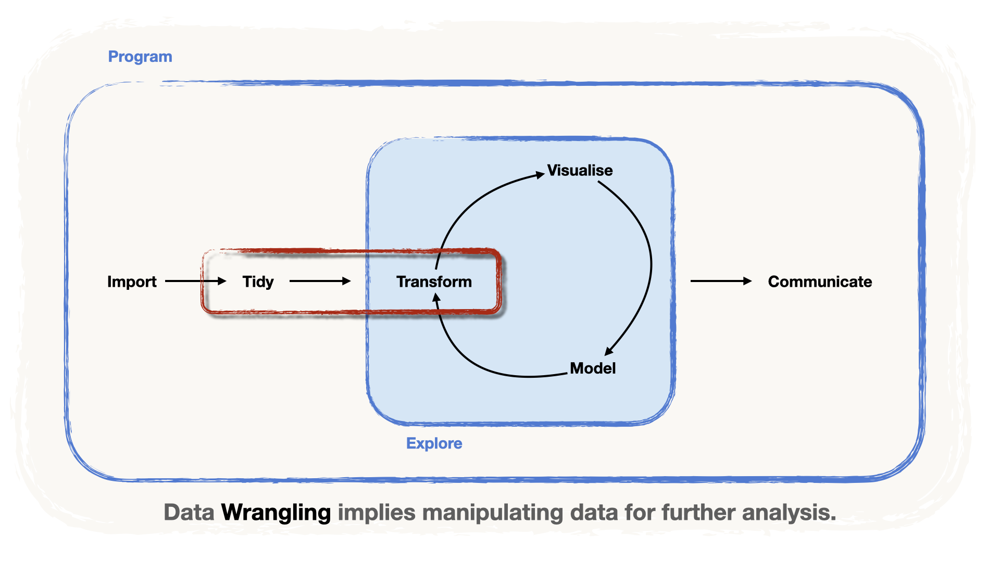{fig-alt="Die Data-Science-Pipeline mit hervorgehobenen Schritten «Aufbereiten» und «Transformieren»: Data Wrangling umfasst beide." width="70%" fig-align="center"}

## *Data Wrangling*: unverzichtbar zum Aufbereiten und Transformieren der Daten {auto-animate="true"}


{fig-alt="Die Data-Science-Pipeline mit hervorgehobenen Schritten «Aufbereiten» und «Transformieren»: Data Wrangling umfasst beide." width="60%" fig-align="center"}

::: {.incremental}
- **Aufbereiten** (*Tidy*): die Daten «bereinigen» und für die **Analyse** bereit machen
- Dann schrittweise **transformieren** (*Transform*), um unser **Verständnis** zu verfeinern
:::

::: {.fragment}

::: {.content-box-marine}
Beide Aufgaben erfordern Datenmanipulation, auch **Data Wrangling** genannt.
:::

:::

## In dieser Einheit

::: {.incremental}
- **Die Grammatik der Datenmanipulation**:
  - Die `{tidyverse}`-Funktionen zum Aufbereiten von Daten
  - Zusammenfassende Statistiken berechnen:
    - für den ganzen Datensatz
    - nach Gruppen
- **Zusammenführen**: mehrere Datensätze kombinieren
- **Umformen**: die Daten umformen, um Erkenntnisse zu gewinnen oder die Analyse vorzubereiten
:::

# Eine Grammatik der Datenmanipulation {#DataManip .subsection background-color="#425556"}

## Eine Grammatik der Datenmanipulation {.center}

::: {.content-box-marine}
Da wir mit **tabellarischen Daten** arbeiten, lassen sich die möglichen Manipulationen auf eine Reihe systematischer Aufgaben zurückführen
:::

## Spalten aus der Tabelle **auswählen**

👉 Einen Datensatz nur mit den Spalten `C1` und `C3` erstellen

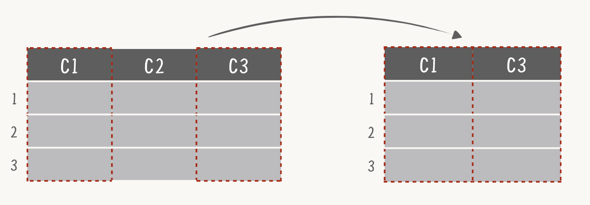{fig-alt="Eine Tabelle mit den Spalten C1, C2 und C3 wird zu einer Tabelle mit nur C1 und C3." fig-align="center" width="70%"}

## Spalten **transformieren** oder **hinzufügen**

👉 Eine Spalte `C3 = 2*C1` hinzufügen

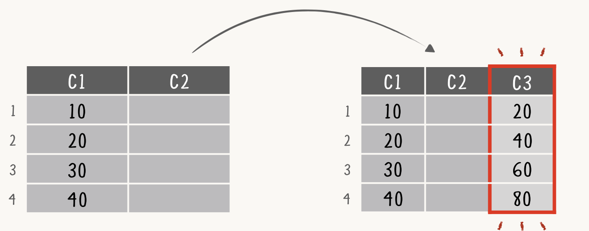{fig-alt="Eine Tabelle mit den Spalten C1 und C2 erhält eine hervorgehobene Spalte C3 mit dem Doppelten der Werte von C1." fig-align="center" width="70%"}

## **Zeilen filtern** nach einem Wert in einer Spalte

👉 Nur die Zeilen behalten, in denen `C1 == "DOG"`

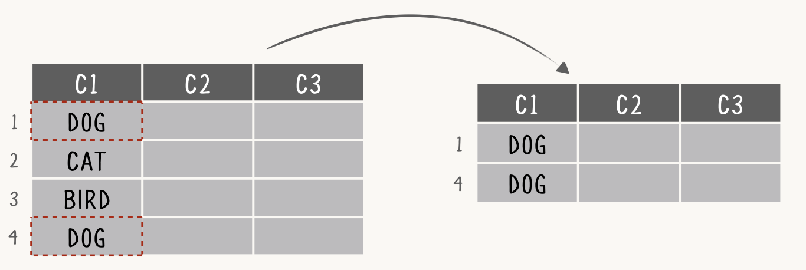{fig-alt="Eine Tabelle mit den C1-Werten DOG, CAT, BIRD und DOG wird zu einer Tabelle mit nur den beiden DOG-Zeilen." fig-align="center" width="70%"}

## Die Zeilen **ordnen**

👉 Die Zeilen nach den Werten von `C3` sortieren

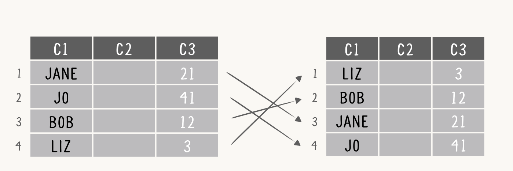{fig-alt="Vier Zeilen mit den C3-Werten 21, 41, 12 und 3 werden so umgeordnet, dass C3 aufsteigt: 3, 12, 21, 41." fig-align="center" width="70%"}

## **Zusammenfassende Statistiken** berechnen


👉 Die **Summe der Spalte `sales`** über den ganzen Datensatz

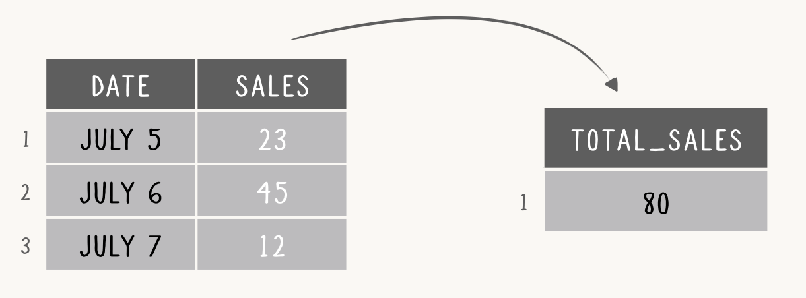{fig-alt="Eine Tabelle mit drei Tagen und Verkäufen von 23, 45 und 12 wird zu einer einzigen Zeile: total_sales, 80." fig-align="center" width="70%"}


## **Gruppierte** **Statistiken** berechnen

👉 Die Summe von `sales` **pro `client`**.

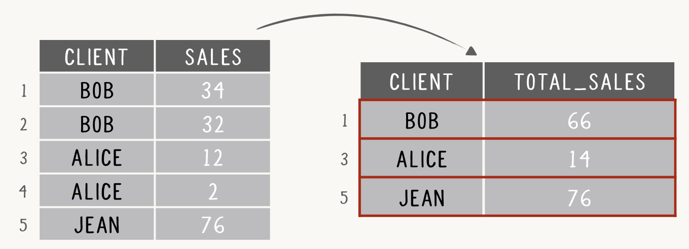{fig-alt="Fünf Verkaufszeilen der Kunden Bob, Alice und Jean werden zu einer Zeile pro Kunde mit ihrem Gesamtumsatz: 66, 14 und 76." fig-align="center" width="70%"}

Der `client` wird zum **Gruppierungsfaktor**.

## Eine Grammatik der Datenmanipulation {.center .smaller auto-animate="true"}

::: {.content-box-marine}
Da wir mit **tabellarischen Daten** arbeiten, lassen sich die möglichen Manipulationen auf eine Reihe systematischer Aufgaben zurückführen
:::

| Verwendung |
|-----------------------------------------------------| 
| **eine Auswahl von Spalten** aus einer Tabelle **wählen** |
| Spalten der Tabelle **transformieren und hinzufügen** |
| **Zeilen filtern** nach den Werten einer Spalte |
| **die Zeilen ordnen** nach den Werten einer oder mehrerer Spalten |
| nach den Werten einer oder mehrerer Spalten **gruppieren**, um innerhalb der Gruppen zu rechnen |
| eine neue Tabelle mit **zusammenfassenden Statistiken** für eine Auswahl von Spalten erstellen |

. . . 

::: {.content-box-marine}
`{dplyr}` und `{tidyr}` sind Pakete, die eine ganze **Grammatik** zur Datenmanipulation bieten.
:::


## Eine Grammatik der Datenmanipulation {.center .smaller auto-animate="true"}

::: {.content-box-marine}
`{dplyr}` und `{tidyr}` sind Pakete, die eine ganze **Grammatik** zur Datenmanipulation bieten.
:::


:::: {.columns}

::: {.column width="25%"}

```{r, echo = FALSE, fig.cap="Diese Zange hilft uns, unsere Daten zu bändigen!", fig.align='center', out.width = "90%", fig.alt="Das sechseckige Logo des Pakets dplyr: eine Zange."}
#| label: img-dplyr-logo
knitr::include_graphics(path = "images/hex-dplyr.png")
```
:::

::: {.column width="75%"}

| Verb | Verwendung |
|:-----------------:|-----------------------------------------------------| 
| `select()` | **eine Auswahl von Spalten** aus einer Tabelle **wählen** |
| `mutate()` | Spalten der Tabelle **transformieren und hinzufügen** |
| `filter()` | **Zeilen filtern** nach den Werten einer Spalte |
| `arrange()` | **die Zeilen ordnen** nach den Werten einer oder mehrerer Spalten |
| `group_by()` | nach den Werten einer oder mehrerer Spalten **gruppieren**, um innerhalb der Gruppen zu rechnen |
| `summarise()` | eine neue Tabelle mit **zusammenfassenden Statistiken** für eine Auswahl von Spalten erstellen |

:::


::::

## `{dplyr}`: Warum _Verben_?

Alle `{dplyr}`-Funktionen haben eine gemeinsame Struktur

-   Ihr **erstes Argument** ist der **Datensatz**.
-   Die **weiteren Argumente** betreffen die **Spalten**, mit denen wir arbeiten

. . . 

::: {.content-box-marine}
Mit dem **Pipe**-Operator lassen sich die Befehle **wie Sätze verketten**:
:::

``` r
select(dataset, column_1, column_2)

# ist gleichbedeutend mit:

dataset %>% select(column_1, column_2)

# Sie sehen: Es liest sich wie ein Satz!
```

# 🎾 Üben wir an einem echten Datensatz {.slides-only background-image="images/jim-sung-eQuMbR-0mco-unsplash.jpg" background-position="cover" background-opacity="0.4"}

## 🎾 Der WTA-Datensatz

- `../data/wta_grand_slam_data.csv` enthält die Daten des Frauentennis.
- eine Zeile pro **Grand-Slam-Match**.

Importieren Sie sie mit `{readr}`:
```{r}
#| label: read-wta
#| output-location: column-fragment

# 1. das Paket laden
library(readr)   

# 2. die Daten einem Objekt zuweisen
wta_data <-

  # 3. den Pfad über die Pipe übergeben
  "../data/wta_grand_slam_data.csv" %>%
  
  # 4. die Funktion readr::read_csv() verwenden
  read_csv(

  # 5. alle Spalten als character einlesen
    col_types = cols(.default = "c")
    )

wta_data
```

::: {.notes}

3) Der Pfad geht **eine Ebene nach oben**, in den Ordner `data` (`../data/`), und wird mit der Pipe `%>%` an `read_csv()` *übergeben*
5) um jede Spalte als Text zu importieren (`"c"` für `character`). Denn `read_csv()` *errät* die Typen anhand der ersten 1000 Zeilen. Bei Spalten mit vielen `NA` kann das danebengehen
:::

## 🎾 Die Spalten der WTA-Daten

`r ncol(wta_data)` Spalten, nach **Präfix** gruppiert:

| Spalte / Präfix | Inhalt |
|:-----------------:|:----------------------------------------------------|
| `year` | Jahr des Turniers, in dem das Match stattfand |
| `tourney_*` | Angaben zum Turnier (`id`, `name`, `surface`, ...) |
| `match_num` | Nummer des Matches **innerhalb eines Turniers** |
| `winner_*` | Angaben zur Siegerin eines Matches (`id`, `name`, `hand`, ...) |
| `loser_*` | Angaben zur Verliererin eines Matches (`id`, `name`, `hand`, ...) |

## 🔎 Daten inspizieren


::: {.content-box-marine}
Direkt nach dem Import lohnt es sich immer, den Datensatz zu **inspizieren**.
:::

::: fragment

- **Welche Spalten** der Datensatz enthält
-  Ihre **Typen** (Zahlen, Text, Datumswerte, ...)
-  Wo die **fehlenden Werte** (`NA`) sind
-  und alle anderen Eigenheiten (oder Probleme!) der Daten

:::

::: fragment
::: {.callout-tip}

## Einige Werkzeuge zum Inspizieren

::: {.incremental}
- Die ersten Zeilen ansehen mit `head()` oder `dplyr::slice_head()`
- Eine Übersicht des Inhalts mit `dplyr::glimpse()`
- Eine grafische Darstellung mit `visdat::vis_dat()`
:::

:::
:::

## 🔎 Ein Blick mit `dplyr::glimpse()` {.scrollable}

-   Eine Zeile pro Spalte: **Name**, **Typ** und die ersten Werte

```{r}
#| label: glimpse-wta
#| output-location: fragment
glimpse(wta_data)
```


## 🔎 Das Gesamtbild mit `visdat::vis_dat()`

-   **Farben**: die **Typen** der Spalten · **Grau**: **fehlende** Werte

```{r, fig.cap = "Der WTA-Datensatz aus der Vogelperspektive mit `visdat::vis_dat()`"}
#| label: vis-dat-wta
#| fig-alt: "vis_dat()-Grafik der WTA-Daten: ein senkrechtes Band pro Spalte, alle in der Farbe für character, mit grauen Blöcken für fehlende Werte, die in einigen Spalten häufig sind."
#| output-location: column-fragment
# 1. das Paket visdat laden
library(visdat)

wta_data %>%

# 2. visdat::vis_dat() verwenden
  vis_dat(
    # 3. Warnungen zu grossen Daten vermeiden
    warn_large_data = FALSE
    )
```

# Die Verben von `{dplyr}` in Aktion {.subsection .slides-only background-color="#425556"}

## Spalten auswählen mit `select()`

::: {.content-box-marine}
`dplyr::select()` wählt **eine** oder **mehrere** Spalten über ihren Namen aus
:::

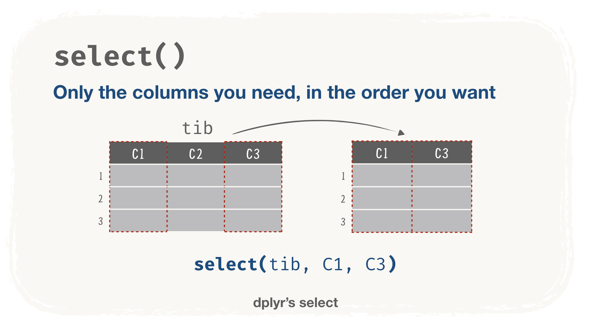{fig-alt="Die Karte zu select(): select(tib, C1, C3) behält von einer Tabelle mit drei Spalten nur C1 und C3." fig-align="center" width="80%"}


## Spalten auswählen mit `select()`

👉 Mit `select` sehen, wer im Lauf der Jahre gegen wen gespielt hat

```{r}
#| label: select-columns
#| output-location: column-fragment
wta_data %>%
  select(
    year, 
    winner_name, 
    loser_name)
```

## Auswahlhilfen

::: {.content-box-marine}
Statt alle Namen zu schreiben, wählen wir die Spalten aus, **deren Namen eine Bedingung erfüllen**.
:::

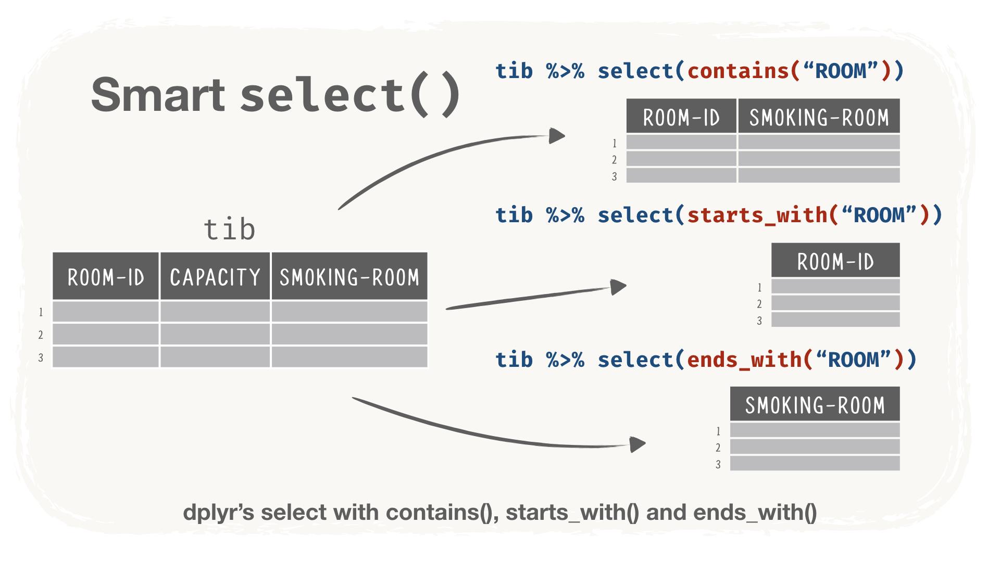{fig-alt="Die Karte zum geschickten select(): Bei einer Tabelle mit den Spalten room-id, capacity und smoking-room behält contains(\"room\") room-id und smoking-room, starts_with(\"room\") behält room-id und ends_with(\"room\") behält smoking-room." fig-align="center" width="80%"}

## Auswahlhilfen

👉 `starts_with("winner")` oder `starts_with("loser")` für alle Angaben zu den Spielerinnen

```{r}
#| label: select-helpers
#| output-location: column-fragment
#| fig-alt: "vis_dat()-Grafik der ausgewählten Spalten: year, dann die Spalten winner_ und loser_, alle vom Typ character."

wta_data %>%
  select(year, 
    starts_with("winner"), 
    starts_with("loser")) %>%
  vis_dat(warn_large_data = FALSE)
```

## Spalten erstellen/transformieren mit `mutate()`

::: {.content-box-marine}
`dplyr::mutate()` zum **Erstellen** oder **Transformieren** von Spalten
:::

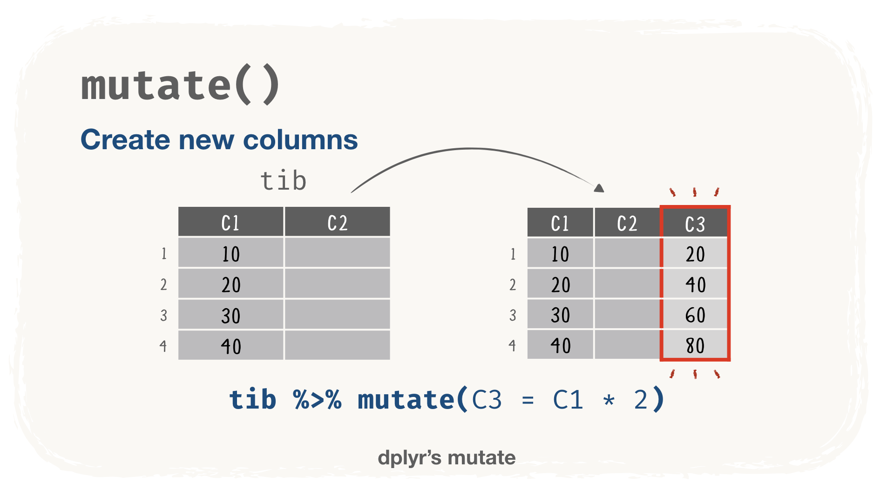{fig-alt="Die Karte zu mutate(): mutate(C3 = C1 * 2) fügt eine hervorgehobene Spalte C3 mit dem Doppelten der Werte von C1 hinzu." fig-align="center" width="80%"}

## Spalten erstellen/transformieren mit `mutate()` {auto-animate="true"}

👉 Wandeln wir `year` → **Zahl** und `tourney_date` → **Datum** um (`ymd()` aus `{lubridate}`)

```{r}
#| label: slides-mutate-before
#| output-location: column-fragment
#| fig-alt: "vis_dat()-Grafik der ausgewählten Spalten vor mutate(): year sowie die Spalten winner_ und tourney_ sind alle vom Typ character."
wta_data %>%
  select(
    year, 
    starts_with("winner"), 
    starts_with("tourney")
    ) %>% 
  vis_dat(warn_large_data = FALSE)
```


## Spalten erstellen/transformieren mit `mutate()` {auto-animate="true"}

👉 Wandeln wir `year` → **Zahl** und `tourney_date` → **Datum** um (`ymd()` aus `{lubridate}`)

```{r}
#| label: slides-mutate-after
#| output-location: column
#| code-line-numbers: "|1,2,10-14"
#| fig-alt: "vis_dat()-Grafik der ausgewählten Spalten nach mutate(): year ist jetzt numerisch und tourney_date ein Datum, die anderen Spalten sind weiterhin character."
# 1. lubridate laden
library(lubridate)

wta_data %>%
  select(
    year, 
    starts_with("winner"), 
    starts_with("tourney")
    ) %>% 
# 2. die Änderungen vornehmen
  mutate(
    year = as.numeric(year),
    tourney_date = ymd(tourney_date)
    ) %>% 
# 3. die Änderungen visualisieren
  vis_dat(warn_large_data = FALSE)
```

## ⚠️ Die Änderungen dauerhaft machen

::: {.content-box-marine}
`mutate()` allein **verändert den Datensatz nicht**.
:::

👉 Diese Pipe **verändert** den Inhalt von `data` **nicht dauerhaft**.

``` r
data %>% 
  mutate(...)
```
. . . 

::: {.content-box-marine}
In R müssen Sie das Ergebnis **(neu) zuweisen**, damit Ihre Änderungen bleiben
:::

👉 Diese Pipe **schon**

``` r
data <- 
  data %>% 
  mutate(...)
```

## ⚠️ Die Änderungen dauerhaft machen

👉 Behalten wir die neuen Spaltentypen: Wir **weisen** das Ergebnis `wta_data` **neu zu**

```{r}
#| label: mutate-types
wta_data <-
  wta_data %>%
  mutate(
    year = as.numeric(year),
    tourney_date = ymd(tourney_date))
```

. . .

Jetzt bleiben die Änderungen für den Rest der Einheit erhalten:

```{r}
#| label: slides-mutate-check
wta_data %>%
  select(year, tourney_date) %>%
  slice_head(n = 3)
```

## Zeilen filtern mit `filter()`

::: {.content-box-marine}
`dplyr::filter()` behält die Zeilen, die **eine logische Bedingung erfüllen**
:::

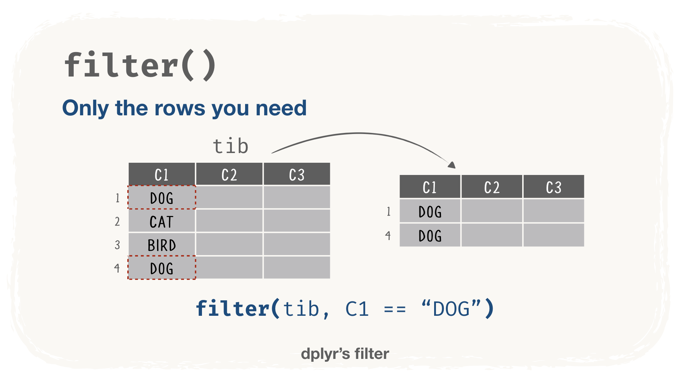{fig-alt="Die Karte zu filter(): filter(tib, C1 == \"DOG\") behält die Zeilen 1 und 4 einer Tabelle mit den C1-Werten DOG, CAT, BIRD und DOG." fig-align="center" width="80%"}

## Zeilen filtern mit `filter()`

👉 Nur die Matches behalten, die Serena Williams gewonnen hat

```{r}
#| label: filter-serena
#| output-location: column-fragment
wta_data %>%
  select(year, tourney_name, winner_name) %>%
  filter(winner_name == "Serena Williams")
```

::: fragment
::: {.content-box-marine}
⚠️ Für den Vergleich braucht es das **doppelte** Gleichheitszeichen `==`. Das einfache `=` weist zu, z. B. in `mutate()`.
:::
:::

## `filter()` mit mehreren Bedingungen

👉 Serenas Siege an den australischen Turnieren: **alle** Bedingungen müssen erfüllt sein

```{r}
#| label: filter-serena-australian
#| output-location: column-fragment
# 1. stringr laden
library(stringr)

wta_data %>%
  filter(
    # 2. erste Bedingung: die Siegerin
    winner_name == "Serena Williams",
    # 3. zweite Bedingung: das Turnier
    str_detect(
      tourney_name,
      pattern = "Australian")) %>%

# 4. einige Spalten behalten
  select(year, tourney_name, winner_name)
```

::: fragment
::: {.callout-tip}
## Weitere Bedingungen

- `<`, `>=`, `&`, `|`, `%in%`
- Eine vollständigere Liste finden Sie im Handout.
:::
:::

::: {.notes}
3) `str_detect()` aus `{stringr}` gibt `TRUE` zurück, wenn der Text **das Muster enthält**. So werden «Australian Open» und «Australian Championships» erfasst.

Das `<` wird in Übung 2 gebraucht.
:::

## Beobachtungen sortieren mit `arrange()`

::: {.content-box-marine}
`dplyr::arrange()` **ordnet die Zeilen** nach den Werten einiger Spalten
:::

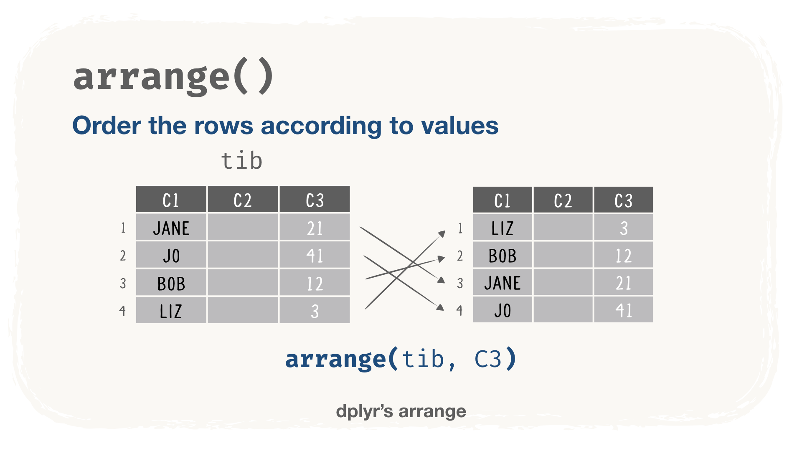{fig-alt="Die Karte zu arrange(): Sortieren nach C3 ordnet die Zeilen einer Tabelle so um, dass die Werte von C3 aufsteigen." fig-align="center" width="80%"}

## Beobachtungen sortieren mit `arrange()`

👉 Welches sind die ältesten Matches im Datensatz?

```{r}
#| label: arrange-year
#| output-location: column-fragment
wta_data %>%
  select(year, winner_name, tourney_name) %>%
  arrange(year)
```

::: {.notes}
Zahlen werden aufsteigend sortiert, Text alphabetisch. `year` ist eine Zahl, weil wir `wta_data` neu zugewiesen haben.
:::

## `arrange()`: mehrere Spalten {auto-animate="true"}

👉 Nach **Jahr** sortieren, dann innerhalb jedes Jahres nach **Siegerin**

```{r}
#| label: arrange-two-columns
#| output-location: column-fragment
wta_data %>%
  select(year, winner_name, tourney_name) %>%
  arrange(year, winner_name)
```

## `arrange()`: mehrere Spalten {auto-animate="true"}

👉 `desc()` kehrt die Reihenfolge um: Siegerinnen von Z bis A innerhalb jedes Jahres

```{r}
#| label: arrange-desc
#| output-location: column-fragment
wta_data %>%
  select(year, winner_name, tourney_name) %>%
  arrange(year, desc(winner_name))
```

## Zeit für eine Übung!

::: callout-important
## An die Arbeit!

Öffnen Sie das Übungs-Notebook `_exercises/exercise-notebook.qmd` und lösen Sie **[Übung 2](../_exercises/exercise-notebook.html#exercise-2)**. Bis gleich!
:::

## Zusammenfassende Statistiken mit `summarise()`

::: {.content-box-marine}
`dplyr::summarise()` erstellt eine **neue Tabelle** mit **Zusammenfassungen** der Spalten
:::

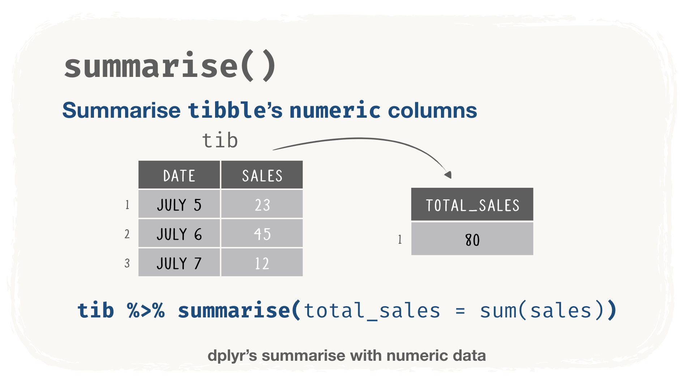{fig-alt="Die Karte zu summarise(): summarise(total_sales = sum(sales)) macht aus drei Zeilen mit Tagesverkäufen (23, 45, 12) eine einzige Zeile mit total_sales 80." fig-align="center" width="80%"}

# Zusammenfassende Statistiken {.subsection .slides-only background-color="#425556"}

## Zusammenfassende Statistiken mit `summarise()`

👉 Wie viele Matches hat Serena in Australien gewonnen? `n()` **zählt die Zeilen**

```{r}
#| label: summarise-serena-australian
#| output-location: column-fragment
wta_data %>%

# 1. Serenas Siege in Australien behalten
  filter(
    winner_name == "Serena Williams",
    str_detect(
      tourney_name,
      pattern = "Australian")) %>%

# 2. die Zeilen zählen
  summarise(number_of_wins = n())
```

## Weitere Zusammenfassungsfunktionen

| Kennzahl | Funktionen |
|:-----------------:|:-------------------------------|
| Lage | `mean()`, `median()` |
| Streuung | `sd()`, `IQR()`, `mad()` |
| Spannweite | `min()`, `max()`, `quantile()` |
| Summe | `sum()` |
| Position | `first()`, `last()`, `nth()` |
| Anzahl | `n()`, `n_distinct()` |
| Logisch | `any()`, `all()` |

## Gruppen bilden mit `group_by()`

::: {.content-box-marine}
`dplyr::group_by()` **gruppiert** die Zeilen nach den Werten einer oder mehrerer Spalten
:::

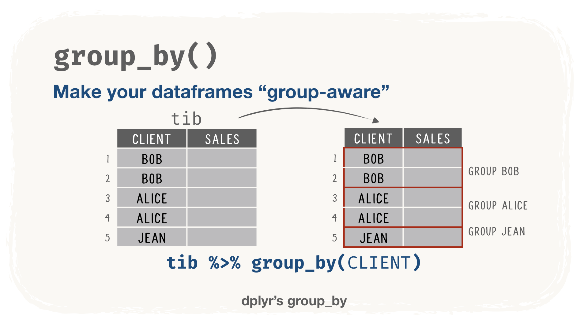{fig-alt="Die Karte zu group_by(): group_by(client) lässt die Tabelle unverändert, teilt sie aber in Gruppen ein, je eine für die Kunden Bob, Alice und Jean." fig-align="center" width="80%"}

## Gruppen bilden mit `group_by()`

👉 Nach Siegerin gruppieren: Achten Sie auf die Zeile `# Groups:`

```{r}
#| label: group-by-winner
#| render: !expr print
#| output-location: fragment
wta_data %>%
  group_by(winner_name)
```

. . . 

::: {.callout-important}
Die Daten sehen gleich aus, aber spätere Berechnungen erfolgen **innerhalb** der Gruppen.
:::

::: {.notes}
Die Daten sehen gleich aus, aber spätere Berechnungen erfolgen **innerhalb** der Gruppen.

`ungroup()` entfernt die Gruppen: siehe Handout.
:::

## `group_by()` `%>%` `summarise()`

::: {.content-box-marine}
`summarise()` nach `group_by()` ergibt **eine Zeile pro Gruppe**
:::

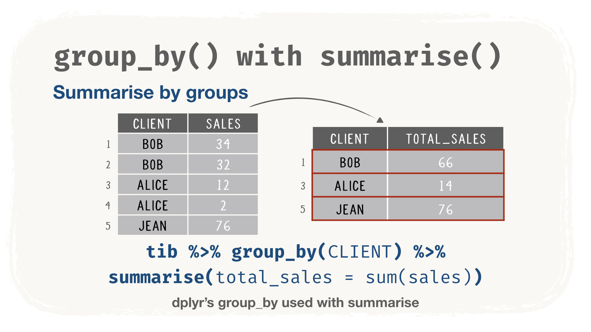{fig-alt="Die Karte zu group_by() mit summarise(): Fünf Verkaufszeilen der Kunden Bob, Alice und Jean werden zu einer Zeile pro Kunde, mit einem Gesamtumsatz von 66, 14 und 76." fig-align="center" width="80%"}

::: {.notes}
Die Abbildung behält die Reihenfolge der Eingabe bei und nummeriert die Ergebniszeilen 1, 3 und 5. In R hat das Ergebnis die Zeilen 1 bis 3, nach Kunde sortiert: Alice, Bob, Jean.
:::

## `group_by()` `%>%` `summarise()`

👉 Die Anzahl Siege **jeder** Spielerin

```{r}
#| label: wins-per-player
#| output-location: column-fragment
wta_data %>%
  group_by(winner_name) %>%
  summarise(
    number_of_wins = n(),
    .groups = "drop")
```

::: {.notes}
`.groups = "drop"` gibt eine Tabelle **ohne Gruppen** zurück, als hätten wir `ungroup()` angefügt. Eine vergessene Gruppierung sorgt oft für Überraschungen!
:::

## `group_by()` `%>%` `summarise()`

👉 Also, **wer hat am meisten gewonnen**? Sortieren Sie das Ergebnis mit `arrange()` und `desc()`

```{r}
#| label: wins-ranking
#| output-location: column-fragment
wta_data %>%
  group_by(winner_name) %>%
  summarise(
    number_of_wins = n(),
    .groups = "drop") %>%
  arrange(desc(number_of_wins))
```

## Nach mehreren Spalten gruppieren

👉 Die Siege **jeder Spielerin** in **jedem Turnier**

```{r}
#| label: wins-per-player-tourney
wta_data %>%
  group_by(winner_name, tourney_name) %>%
  summarise(
    number_of_wins = n(),
    .groups = "drop")
```

## Zeit für eine Übung!

::: callout-important
## An die Arbeit!

Öffnen Sie das Übungs-Notebook `_exercises/exercise-notebook.qmd` und lösen Sie **[Übung 3](../_exercises/exercise-notebook.html#exercise-3)**. Bis gleich!
:::

# Daten zusammenführen {.subsection background-color="#425556"}

## Stapeln und verbinden

::: {.content-box-marine}
Echte Daten sind oft auf **mehrere verknüpfte Tabellen** verteilt: Wir **führen** sie **zusammen**, um die benötigten Informationen zu erhalten
:::

::: {.incremental}
- Tabellen mit denselben Spalten **stapeln**: `bind_rows()`
- Tabellen mit einer gemeinsamen Spalte **verbinden**: die Verben `*_join()`
:::

## Drei Spielzeug-Datensätze

```{r}
#| label: toy-datasets
data_1 <- tibble(id = 1:3, var_1 = c(15, 13, 39))
data_2 <- tibble(id = c(4, 5), var_1 = 10)
data_3 <- tibble(id = 1:3, var_2 = c(10, 12, 14), var_3 = c(45, 20, 2))
```

::::: {.columns}
:::: {.column width="33%"}
```{r}
#| label: print-data-1
data_1
```
::::

:::: {.column width="33%"}
```{r}
#| label: print-data-2
data_2
```
::::

:::: {.column width="33%"}
```{r}
#| label: print-data-3
data_3
```
::::
:::::

## Datensätze *stapeln* mit `bind_rows()`

👉 `data_1` und `data_2`: **dieselben Spalten**, **andere Zeilen**

```{r}
#| label: bind-rows-data
#| output-location: column-fragment
data_1 %>%
  bind_rows(data_2)
```

::: fragment
::: {.content-box-marine}
Die linke Seite der Pipe kommt **nach oben**
:::
:::

## Datensätze *verbinden* mit `left_join()`

::: {.content-box-marine}
`dplyr::left_join()` hängt Spalten an und ordnet die Zeilen über einen **Verbindungsschlüssel** zu
:::

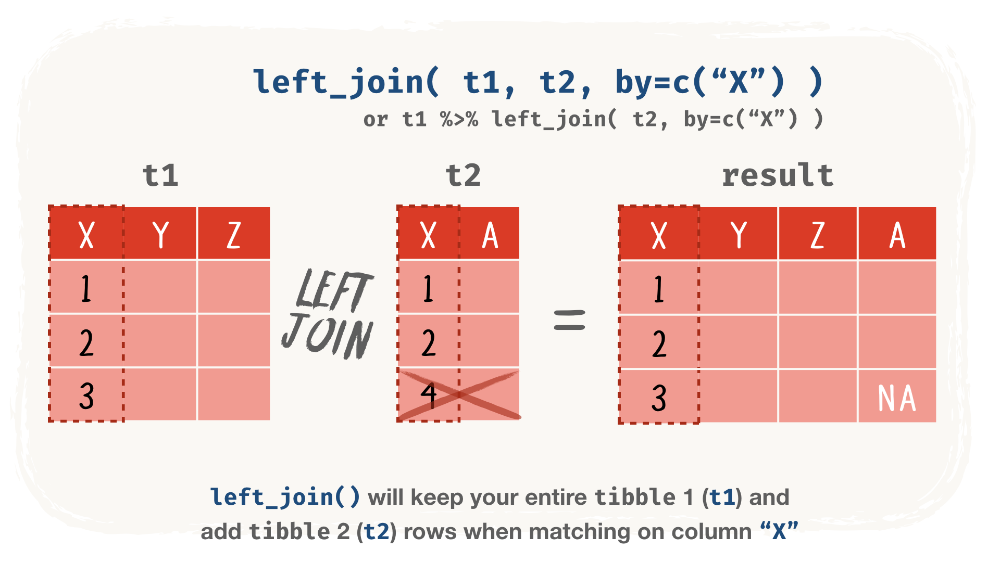{fig-alt="Die Karte zu left_join(): Das Verbinden der Tabellen t1 und t2 über die Spalte X behält alle Zeilen von t1 und fügt die Spalte A aus t2 hinzu. Zeile 4 von t2 hat keine Entsprechung und fällt weg, und Zeile 3 von t1 hat keine Entsprechung in t2 und erhält deshalb NA in der Spalte A." fig-align="center" width="80%"}

## Wie `left_join()` funktioniert

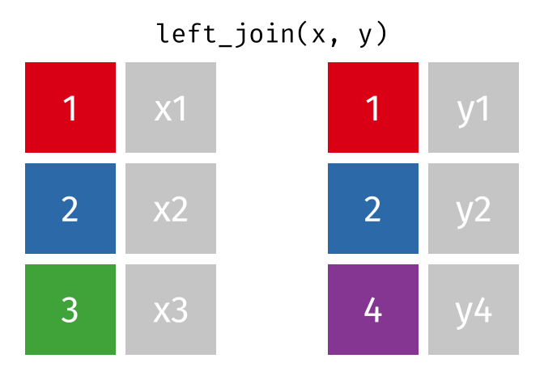{fig-alt="Animation von left_join(x, y): Die Zeilen von y werden über die gemeinsame Schlüsselspalte den Zeilen von x zugeordnet, die Spalten von y werden an x angehängt, und die Zeilen von x ohne Entsprechung erhalten fehlende Werte." width="40%" fig-align="center"}

**Quelle:** Tidy Animated Verbs von [Garrick Aden-Buie](https://github.com/gadenbuie/tidyexplain)

::: fragment
::: {.content-box-marine}
Warum «left»? Es **behält alle Zeilen der ersten** (*linken*) **Tabelle**
:::
:::

## `left_join()` mit einem Verbindungsschlüssel

👉 `data_1` und `data_2` stapeln, dann die Spalten von `data_3` anhängen

```{r}
#| label: left-join-id
#| output-location: column-fragment
data_1 %>%

# 1. die ersten beiden Tabellen stapeln
  bind_rows(data_2) %>%

# 2. data_3 anhängen, Zuordnung über id
  left_join(data_3, by = "id")
```

::: fragment

::: {.content-box-marine}
`data_3` hat keine `id` 4 oder 5: Ihre neuen Spalten sind `NA`.
::: 

:::

::: {.notes}
Standardmässig verwendet der Join **alle** gemeinsamen Spalten. `by` wählt den Schlüssel. Neuere Versionen von `{dplyr}` akzeptieren auch `by = join_by(id)`.

Es gibt auch ein `bind_cols()`, das nicht prüft, ob die Zeilen zusammenpassen: siehe Handout.
:::

## Zeilen der zweiten Tabelle ohne Entsprechung

👉 `data_4`: `data_3` plus eine Zeile mit `id = 8`, die es in `data_1` nicht gibt

:::: {.columns}
::: {.column width="50%"}
```{r}
#| label: data-4
data_4 <-
  bind_rows(
    data_3,
    tibble(id = 8, var_2 = 3, var_3 = 12))
data_4
```
:::

::: {.column width="50%" .fragment}

```{r}
#| label: left-join-unmatched
data_1 %>%
  left_join(data_4, by = "id")
```

:::
::::

:::{.fragment}
::: {.content-box-marine}
`id` 8 ist weg: Nur die Zeilen der **ersten** Tabelle bleiben.
:::
:::

# Daten pivotieren {.subsection background-color="#425556"}

## Lange vs. breite Tabellen

::: {.incremental}
-   **Lang**: Jede Spalte ist eine *Variable* → für die **Analyse** (Berechnungen, Grafiken)
-   **Breit**: Manche Spalten sind nach *Werten* einer Variablen benannt → für die **Darstellung** in Berichten
:::

```{r, echo = FALSE, fig.cap='Daten im breiten vs. im langen Format', fig.align='center', out.width = "70%", fig.alt="Dieselben Daten als breite Tabelle, mit einer Spalte id und je einer Spalte für x, y und z, und als lange Tabelle mit drei Spalten: id, key (mit x, y oder z) und val."}
#| label: img-wide-long
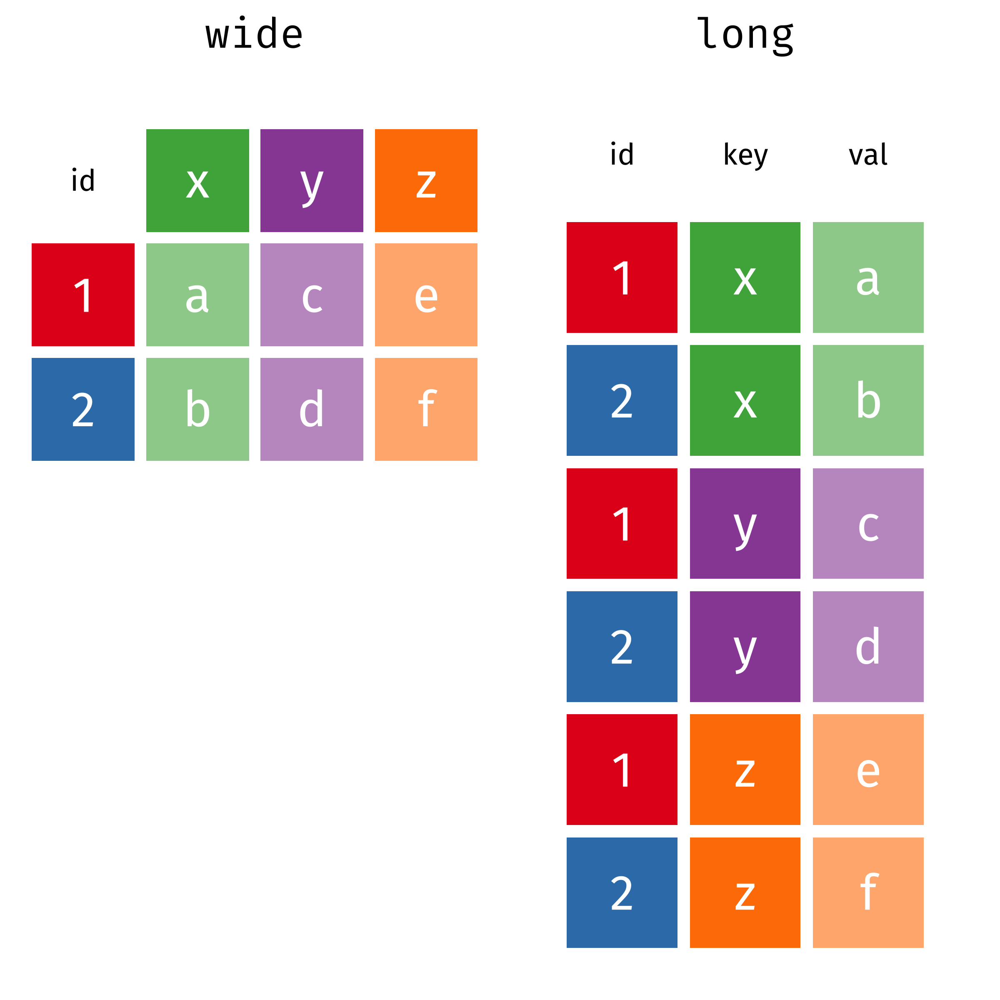
```

## `{tidyr}`: `pivot_longer()` und `pivot_wider()`

:::: {.columns}
::: {.column width="25%"}
```{r, echo = FALSE, fig.cap='Die Besen von `{tidyr}` helfen uns, unsere Daten aufzuräumen!', fig.align='center', out.width = "90%", fig.alt="Das sechseckige Logo des Pakets tidyr: Besen."}
#| label: img-tidyr-logo
knitr::include_graphics(path = "images/hex-tidyr.png")
```
:::

::: {.column width="75%"}
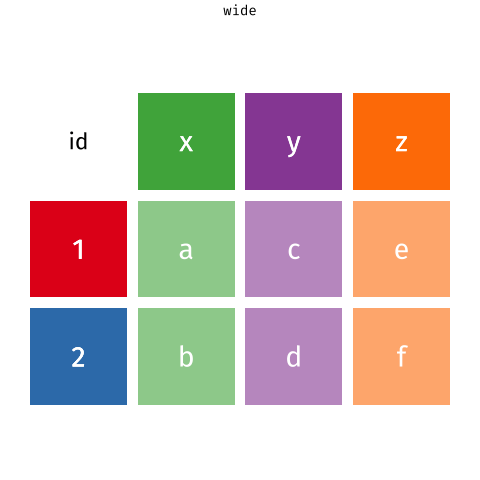{fig-alt="Animation einer breiten Tabelle, die mit pivot_longer() in eine lange Tabelle umgewandelt wird und mit pivot_wider() wieder in eine breite." width="480"}

Quelle: Tidy Animated Verbs von [Garrick Aden-Buie](https://github.com/gadenbuie/tidyexplain), angepasst von [Mara Averick](https://twitter.com/dataandme)
:::
::::

## In die lange Form pivotieren mit `pivot_longer()`

::: {.content-box-marine}
`tidyr::pivot_longer()` wandelt **Spalten in Zeilen** um
:::

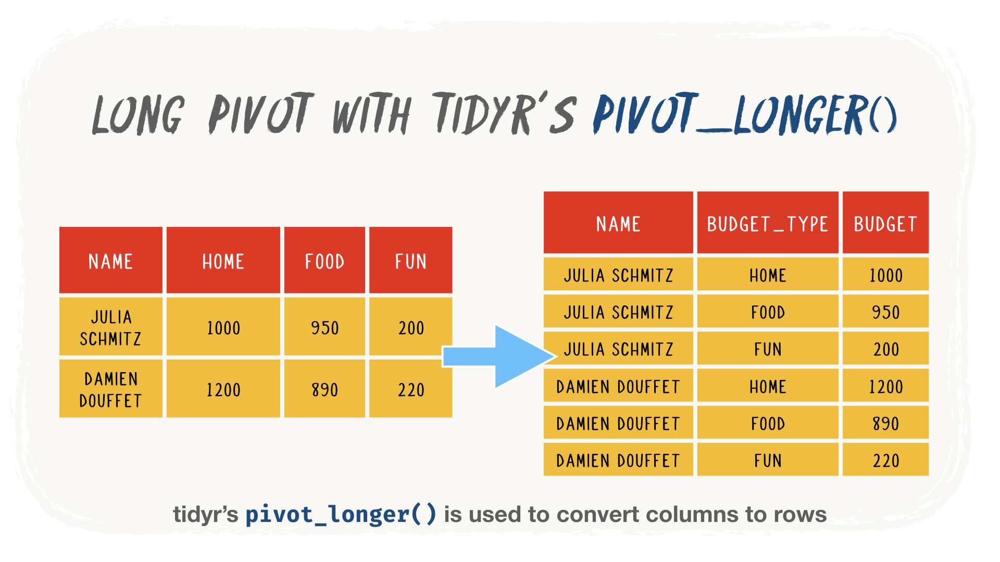{fig-alt="Die Karte zu pivot_longer(): Eine Budgettabelle mit einer Zeile pro Person und den Spalten home, food und fun wird zu einer Tabelle mit einer Zeile pro Person und Budgetart und den Spalten name, budget_type und budget." fig-align="center" width="80%"}

## So schreibt man `pivot_longer()`

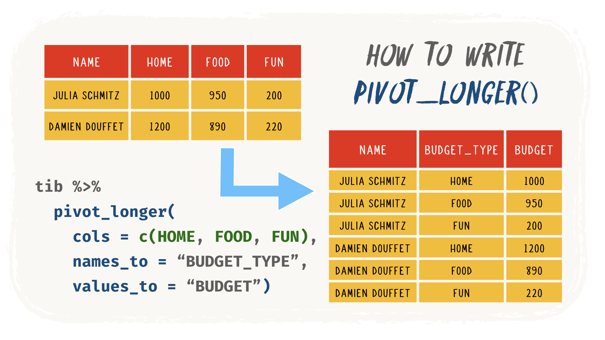{fig-alt="Der Code für das Budgetbeispiel: pivot_longer(cols = c(home, food, fun), names_to = \"budget_type\", values_to = \"budget\"), neben der breiten Tabelle und der daraus entstehenden langen Tabelle." fig-align="center" width="85%"}

## `pivot_longer()`: `cols`

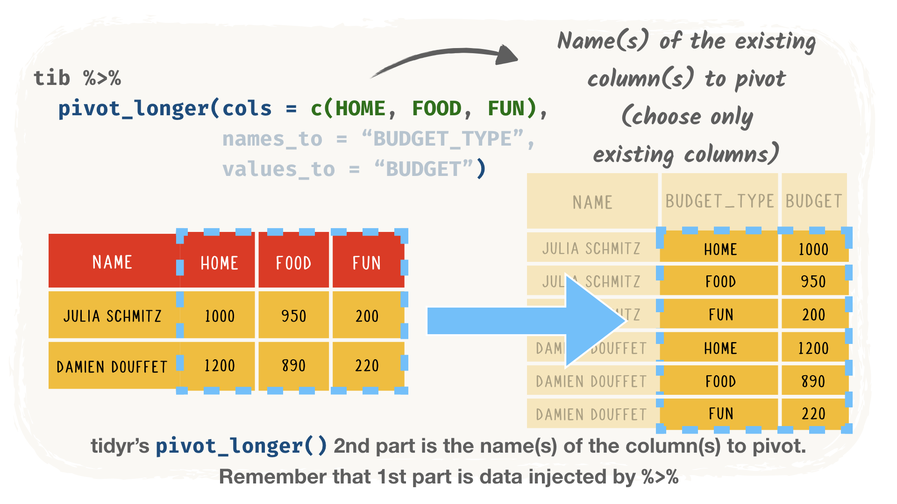{fig-alt="Das Argument cols nennt die bestehenden Spalten, die pivotiert werden: home, food und fun sind in der breiten Tabelle hervorgehoben, und die Spalten budget_type und budget, zu denen sie werden, in der langen Tabelle." fig-align="center" width="85%"}

## `pivot_longer()`: `names_to`

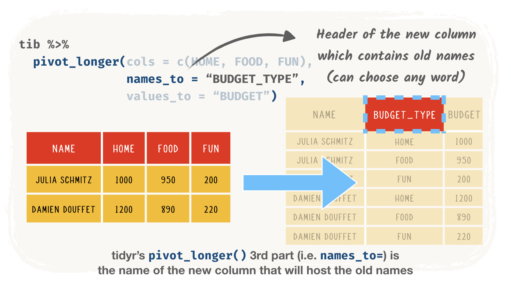{fig-alt="Das Argument names_to ist der Kopf der neuen Spalte mit den alten Spaltennamen und kann ein beliebiges Wort sein: budget_type ist in der langen Tabelle hervorgehoben." fig-align="center" width="85%"}

## `pivot_longer()`: `values_to`

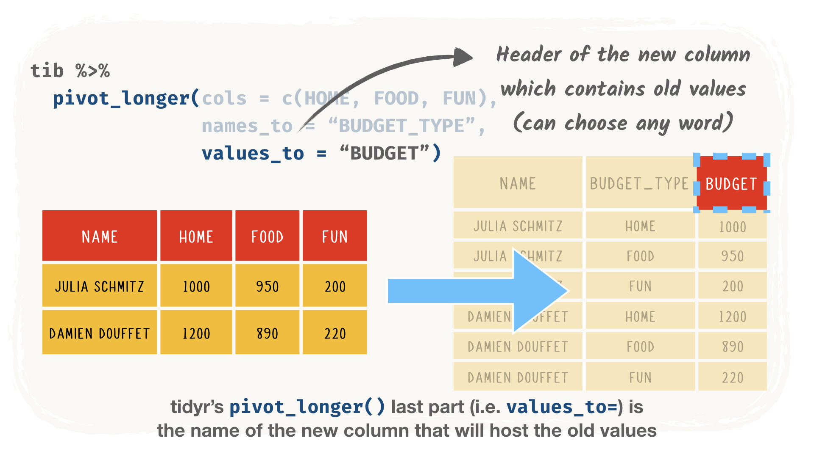{fig-alt="Das Argument values_to ist der Kopf der neuen Spalte mit den alten Werten und kann ein beliebiges Wort sein: budget ist in der langen Tabelle hervorgehoben." fig-align="center" width="85%"}

## `pivot_longer()`: Zusammenfassung

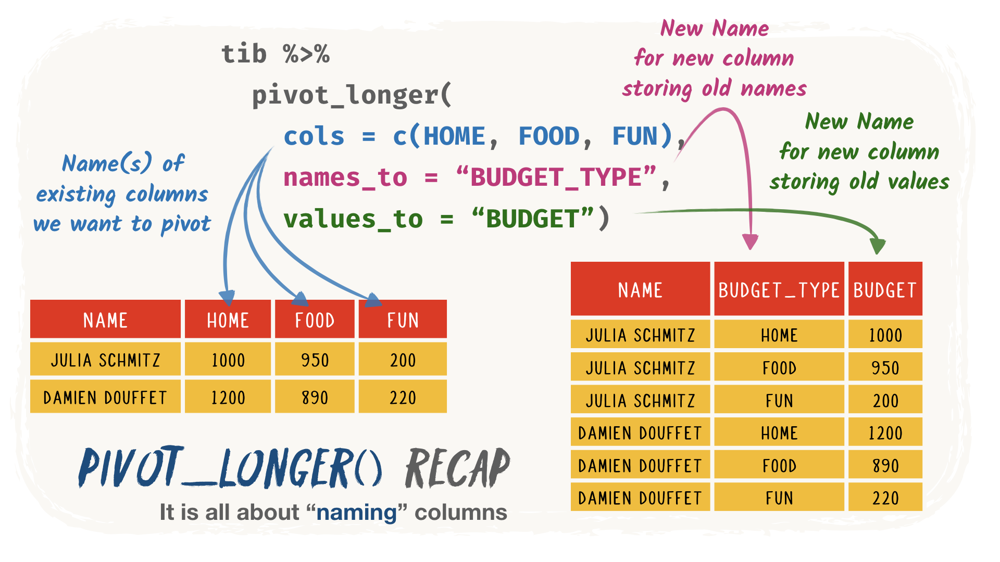{fig-alt="Zusammenfassung von pivot_longer(): Pfeile verbinden cols mit den bestehenden Spalten home, food und fun, names_to mit der neuen Spalte budget_type und values_to mit der neuen Spalte budget." fig-align="center" width="85%"}

## Von breit zu lang

👉 Prototypen, gemessen zu 3 Zeitpunkten: eine Spalte pro Zeitpunkt

```{r}
#| label: data-5-wide
#| output-location: column-fragment
data_5_wide <-
  tibble(
    prototype = 1:5 ,
    t_1 = c(12,1,3,4,5),
    t_2 = c(13,0,3,6,3),
    t_3 = c(14,-1,3,8,1))
data_5_wide
```

## Von breit zu lang

👉 Eine Spalte `timepoint` und eine Spalte `performance`

```{r}
#| label: pivot-longer
#| output-location: column-fragment
data_5_long <-
  data_5_wide %>%
  pivot_longer(
    # 1. alle Spalten ausser prototype
    cols = -c(prototype),
    # 2. wohin die alten Namen kommen
    names_to = "timepoint",
    # 3. wohin die Werte kommen
    values_to = "performance"
  )

data_5_long
```

## Sauberere Zeitpunkte

👉 Das Präfix `t_` entfernen und die Zeitpunkte zu **Zahlen** machen

```{r}
#| label: pivot-longer-clean
#| output-location: column-fragment
data_5_long <-
  data_5_wide %>%
  pivot_longer(
    cols = -c(prototype),
    names_to = "timepoint",
    values_to = "performance",
    # 1. das Präfix `t_` entfernen
    names_prefix = "t_",
    # 2. die Zeitpunkte zu ganzen Zahlen machen
    names_transform = list(
      timepoint = as.integer)
  )

data_5_long
```

::: {.notes}
Die Teilnehmenden brauchen diese beiden Argumente in Übung 5.
:::

## Lange Tabellen sind zum Rechnen gemacht

👉 Die durchschnittliche Leistung jedes Prototyps

```{r}
#| label: average-performance
#| output-location: column-fragment
data_5_long %>%
  group_by(prototype) %>%
  summarise(
    average_performance = mean(performance),
    .groups = "drop")
```

## In die breite Form pivotieren mit `pivot_wider()`

::: {.content-box-marine}
`tidyr::pivot_wider()` macht das Gegenteil: Es wandelt **Zeilen in Spalten** um
:::

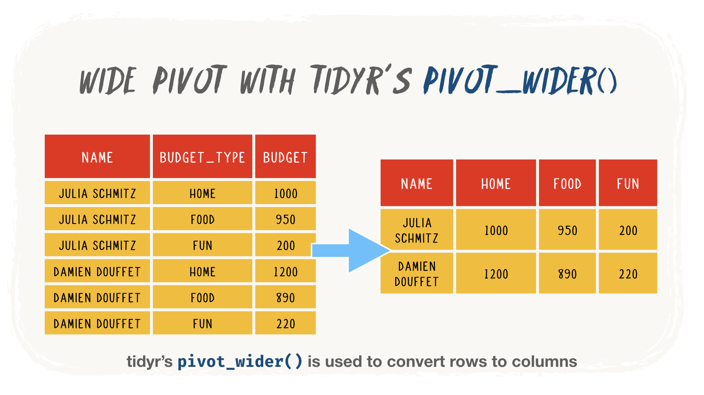{fig-alt="Die Karte zu pivot_wider(): Eine Budgettabelle mit einer Zeile pro Person und Budgetart wird zu einer Tabelle mit einer Zeile pro Person und den Spalten home, food und fun." fig-align="center" width="80%"}

## So schreibt man `pivot_wider()`

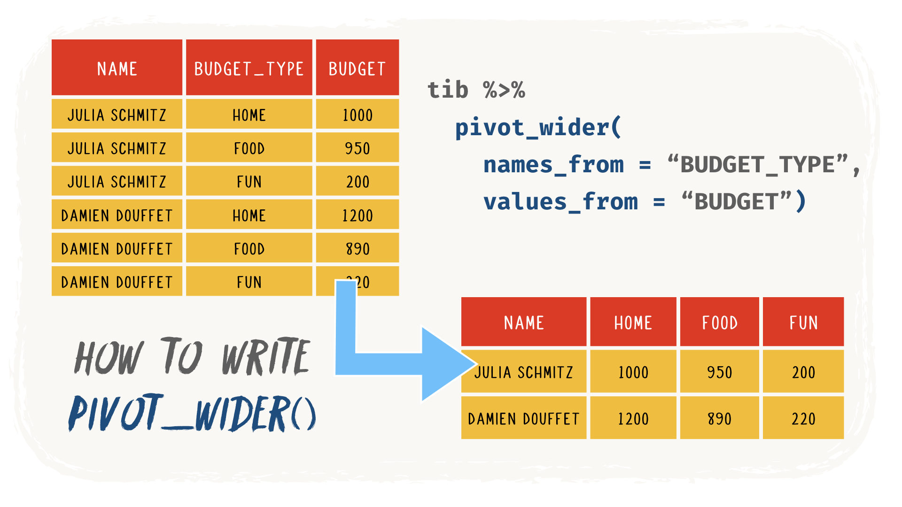{fig-alt="Der Code für das Budgetbeispiel: pivot_wider(names_from = \"budget_type\", values_from = \"budget\"), neben der langen Tabelle und der daraus entstehenden breiten Tabelle." fig-align="center" width="85%"}

## Von lang zu breit

👉 **Erträge** von **Kulturen** nach **Anbaumethode**: Die wiederholten Werte sind schwer zu lesen

```{r}
#| label: data-6-long
data_6_long <-
  tibble(
    crop = c(rep("wheat", 3), rep("corn", 3), rep("quinoa",3)),
    practice = rep(c("Type 1", "Type 2", "Type 3"), 3),
    yield = c(12,65,85,98, 65, 45, 72, 67, 59)
    )
data_6_long
```

## Von lang zu breit

👉 Eine Spalte pro Anbaumethode: bereit für einen Bericht

```{r}
#| label: pivot-wider
#| output-location: column-fragment
data_6_long %>%
  pivot_wider(
    # 1. die Namen der neuen Spalten
    names_from = practice,
    # 2. die Werte der neuen Spalten
    values_from = yield)
```

::: {.notes}
Das Handout zeigt, wie man diese Tabelle mit `{kableExtra}` gestaltet.
:::

## Zeit für eine Übung!

::: {.notes}
Am Ende: auf das Bonusmaterial hinweisen!
:::

::: callout-important
## An die Arbeit!

Öffnen Sie das Übungs-Notebook `_exercises/exercise-notebook.qmd` und lösen Sie **[Übung 4](../_exercises/exercise-notebook.html#exercise-4) und [Übung 5](../_exercises/exercise-notebook.html#exercise-5)**. Bis gleich!
:::
