<!-- Translation of presentation.qmd. Don't change the structure here: change presentation.qmd, then port the changes (see README.md, "Translations"). -->

```{r setup, include = FALSE, message = FALSE, warning = FALSE}
knitr::opts_chunk$set(
  echo = TRUE,
  message = FALSE,
  warning = FALSE,
  fig.align = 'center',
  fig.width = 16/2,
  fig.height = 9/2,
  cache = FALSE)

# garder les tibbles larges (p. ex. les données WTA à 45 colonnes) sur une diapositive
options(pillar.max_extra_cols = 0)
```

```{r packs_load, include = FALSE}
library(tidyverse)
library(janitor)
library(DT)
```

# Préparer et transformer les données {.subsection .slides-only background-color="#425556"}

## *Data wrangling* : indispensable pour préparer et transformer les données {auto-animate="true"}


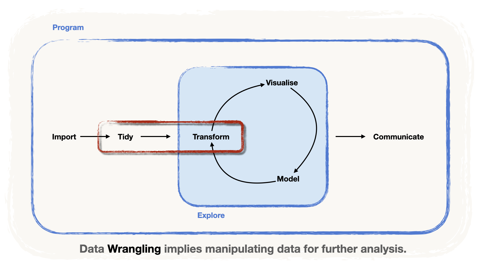{fig-alt="Le pipeline de la data science, avec les étapes « préparer » et « transformer » mises en évidence : le data wrangling couvre les deux." width="70%" fig-align="center"}

## *Data wrangling* : indispensable pour préparer et transformer les données {auto-animate="true"}


{fig-alt="Le pipeline de la data science, avec les étapes « préparer » et « transformer » mises en évidence : le data wrangling couvre les deux." width="60%" fig-align="center"}

::: {.incremental}
- **Préparer** (*Tidy*) : « nettoyer » les données, les rendre prêtes pour l'**analyse**
- Puis **transformer** (*Transform*) pas à pas, pour affiner notre **compréhension**
:::

::: {.fragment}

::: {.content-box-marine}
Les deux tâches demandent de manipuler les données : c'est le **data wrangling**.
:::

:::

## Dans cette unité

::: {.incremental}
- **La grammaire de la manipulation de données** :
  - Les fonctions du `{tidyverse}` pour manipuler les données
  - Calculer des statistiques descriptives :
    - sur tout le jeu de données
    - par groupes
- **Fusionner** : combiner plusieurs jeux de données
- **Remodeler** : changer la forme des données pour mieux les comprendre ou préparer l'analyse
:::

# Une grammaire de la manipulation de données {#DataManip .subsection background-color="#425556"}

## Une grammaire de la manipulation de données {.center}

::: {.content-box-marine}
Comme nous travaillons avec des **données tabulaires**, les manipulations possibles forment un ensemble de tâches systématiques
:::

## **Choisir** des colonnes de la table

👉 Créer un jeu de données avec seulement les colonnes `C1` et `C3`

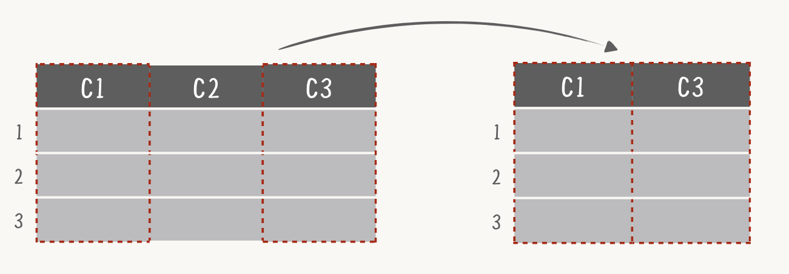{fig-alt="Une table avec les colonnes C1, C2 et C3 devient une table avec seulement C1 et C3." fig-align="center" width="70%"}

## **Transformer** ou **ajouter** des colonnes

👉 Ajouter une colonne `C3 = 2*C1`

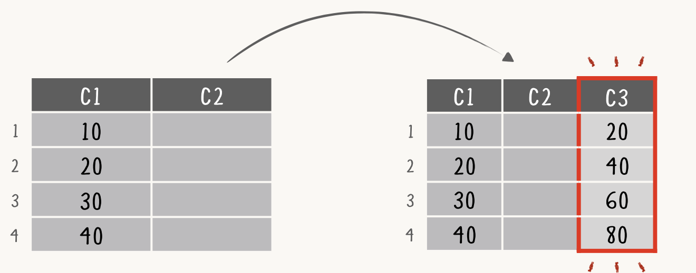{fig-alt="Une table avec les colonnes C1 et C2 reçoit une colonne C3 mise en évidence, qui contient le double des valeurs de C1." fig-align="center" width="70%"}

## **Filtrer des lignes** selon la valeur d'une colonne

👉 Ne garder que les lignes où `C1 == "DOG"`

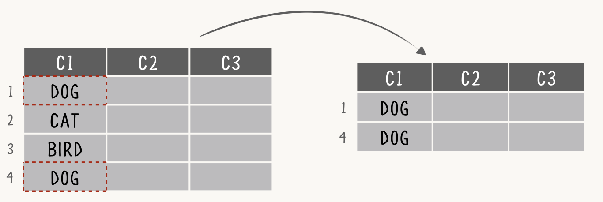{fig-alt="Une table dont les valeurs de C1 sont DOG, CAT, BIRD et DOG devient une table avec seulement les deux lignes DOG." fig-align="center" width="70%"}

## **Trier** les lignes

👉 Trier les lignes selon les valeurs de `C3`

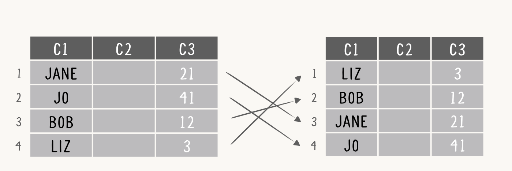{fig-alt="Quatre lignes dont les valeurs de C3 sont 21, 41, 12 et 3 sont réordonnées pour que C3 augmente : 3, 12, 21, 41." fig-align="center" width="70%"}

## Calculer des **statistiques descriptives**


👉 La **somme de la colonne `sales`** sur tout le jeu de données

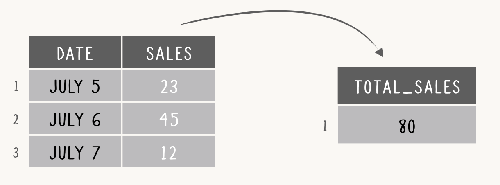{fig-alt="Une table de trois dates avec des ventes de 23, 45 et 12 devient une seule ligne : total_sales, 80." fig-align="center" width="70%"}


## Calculer des **statistiques** **par groupe**

👉 La somme de `sales` **par `client`**.

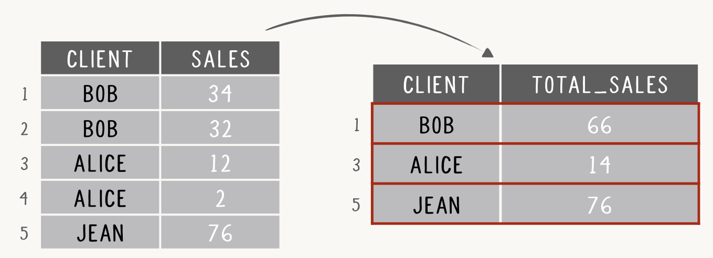{fig-alt="Cinq lignes de ventes des clients Bob, Alice et Jean deviennent une ligne par client avec leurs ventes totales : 66, 14 et 76." fig-align="center" width="70%"}

Le `client` devient le facteur de **regroupement**.

## Une grammaire de la manipulation de données {.center .smaller auto-animate="true"}

::: {.content-box-marine}
Comme nous travaillons avec des **données tabulaires**, les manipulations possibles forment un ensemble de tâches systématiques
:::

| Usage |
|-----------------------------------------------------| 
| **choisir un ensemble de colonnes** d'une table |
| **transformer et ajouter des colonnes** à la table |
| **filtrer les lignes** selon les valeurs d'une colonne |
| **trier les lignes** selon les valeurs d'une ou plusieurs colonnes |
| **regrouper** selon les valeurs d'une ou plusieurs colonnes pour calculer au sein des groupes |
| créer une nouvelle table de **statistiques descriptives** pour un ensemble de colonnes |

. . . 

::: {.content-box-marine}
`{dplyr}` et `{tidyr}` sont des packages qui offrent toute une **grammaire** pour manipuler les données.
:::


## Une grammaire de la manipulation de données {.center .smaller auto-animate="true"}

::: {.content-box-marine}
`{dplyr}` et `{tidyr}` sont des packages qui offrent toute une **grammaire** pour manipuler les données.
:::


:::: {.columns}

::: {.column width="25%"}

```{r, echo = FALSE, fig.cap="Cette pince nous aidera à manipuler nos données !", fig.align='center', out.width = "90%", fig.alt="Le logo hexagonal du package dplyr : une pince."}
#| label: img-dplyr-logo
knitr::include_graphics(path = "images/hex-dplyr.png")
```
:::

::: {.column width="75%"}

| Verbe | Usage |
|:-----------------:|-----------------------------------------------------| 
| `select()` | **choisir un ensemble de colonnes** d'une table |
| `mutate()` | **transformer et ajouter des colonnes** à la table |
| `filter()` | **filtrer les lignes** selon les valeurs d'une colonne |
| `arrange()` | **trier les lignes** selon les valeurs d'une ou plusieurs colonnes |
| `group_by()` | **regrouper** selon les valeurs d'une ou plusieurs colonnes pour calculer au sein des groupes |
| `summarise()` | créer une nouvelle table de **statistiques descriptives** pour un ensemble de colonnes |

:::


::::

## `{dplyr}` : pourquoi des _verbes_ ?

Toutes les fonctions de `{dplyr}` ont une structure commune

-   Leur **premier argument** est le **jeu de données**.
-   Les **autres arguments** concernent les **colonnes** sur lesquelles on travaille

. . . 

::: {.content-box-marine}
Avec l'opérateur **pipe**, les commandes s'**enchaînent comme des phrases** :
:::

``` r
select(dataset, column_1, column_2)

# équivaut à :

dataset %>% select(column_1, column_2)

# vous voyez : cela se lit comme une phrase !
```

# 🎾 Entraînons-nous sur un vrai jeu de données {.slides-only background-image="images/jim-sung-eQuMbR-0mco-unsplash.jpg" background-position="cover" background-opacity="0.4"}

## 🎾 Le jeu de données WTA

- `../data/wta_grand_slam_data.csv` contient les données du tennis féminin.
- une ligne par **match du Grand Chelem**.

Importez-les avec `{readr}` :
```{r}
#| label: read-wta
#| output-location: column-fragment

# 1. charger le package
library(readr)   

# 2. assigner les données à un objet
wta_data <-

  # 3. passer le chemin par le pipe
  "../data/wta_grand_slam_data.csv" %>%
  
  # 4. utiliser la fonction readr::read_csv()
  read_csv(

  # 5. lire toutes les colonnes comme character
    col_types = cols(.default = "c")
    )

wta_data
```

::: {.notes}

3) Le chemin remonte **d'un niveau**, vers le dossier `data` (`../data/`), et il est *passé* à `read_csv()` avec le pipe `%>%`
5) pour importer chaque colonne comme du texte (`"c"` pour `character`). En effet, `read_csv()` *devine* les types à partir des 1000 premières lignes. Pour les colonnes avec beaucoup de `NA`, il peut se tromper
:::

## 🎾 Les colonnes des données WTA

`r ncol(wta_data)` colonnes, regroupées par **préfixe** :

| colonne / préfixe | Contenu |
|:-----------------:|:----------------------------------------------------|
| `year` | Année du tournoi où le match a eu lieu |
| `tourney_*` | Informations sur le tournoi (`id`, `name`, `surface`, ...) |
| `match_num` | Numéro du match **au sein d'un tournoi** |
| `winner_*` | Informations sur la gagnante d'un match (`id`, `name`, `hand`, ...) |
| `loser_*` | Informations sur la perdante d'un match (`id`, `name`, `hand`, ...) |

## 🔎 Inspecter les données


::: {.content-box-marine}
Juste après l'import, il est toujours utile d'**inspecter** son jeu de données.
:::

::: fragment

- **Quelles colonnes** contient le jeu de données
-  Leurs **types** (nombres, texte, dates, ...)
-  Où sont les **valeurs manquantes** (`NA`)
-  et toute autre particularité (ou problème !) des données

:::

::: fragment
::: {.callout-tip}

## Quelques outils d'inspection

::: {.incremental}
- Voir les premières lignes avec `head()` ou `dplyr::slice_head()`
- Obtenir un résumé du contenu avec `dplyr::glimpse()`
- Obtenir une représentation visuelle avec `visdat::vis_dat()`
:::

:::
:::

## 🔎 Un aperçu avec `dplyr::glimpse()` {.scrollable}

-   Une ligne par colonne : **nom**, **type** et premières valeurs

```{r}
#| label: glimpse-wta
#| output-location: fragment
glimpse(wta_data)
```


## 🔎 Vue d'ensemble avec `visdat::vis_dat()`

-   **Couleurs** : les **types** des colonnes · **Gris** : valeurs **manquantes**

```{r, fig.cap = "Le jeu de données WTA vu d'ensemble avec `visdat::vis_dat()`"}
#| label: vis-dat-wta
#| fig-alt: "Graphique vis_dat() des données WTA : une bande verticale par colonne, toutes de la couleur de character, avec des blocs gris pour les valeurs manquantes, fréquentes dans certaines colonnes."
#| output-location: column-fragment
# 1. charger le package visdat
library(visdat)

wta_data %>%

# 2. utiliser visdat::vis_dat()
  vis_dat(
    # 3. éviter les avertissements sur les données volumineuses
    warn_large_data = FALSE
    )
```

# Les verbes de `{dplyr}` en action {.subsection .slides-only background-color="#425556"}

## Choisir des colonnes avec `select()`

::: {.content-box-marine}
`dplyr::select()` pour choisir **une** ou **plusieurs** colonnes par leur nom
:::

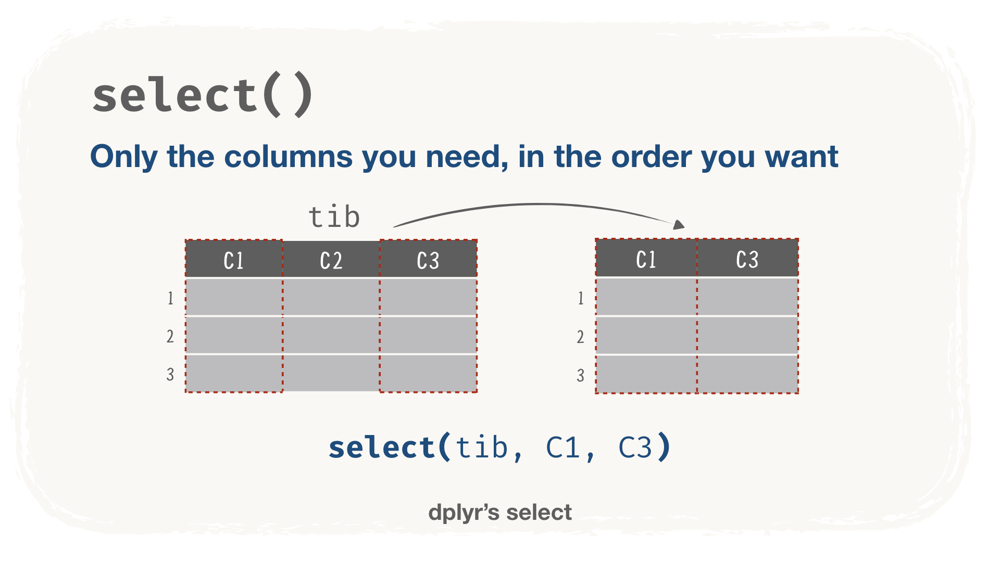{fig-alt="La fiche de select() : select(tib, C1, C3) ne garde que les colonnes C1 et C3 d'une table à trois colonnes." fig-align="center" width="80%"}


## Choisir des colonnes avec `select()`

👉 Utiliser `select` pour voir qui a joué contre qui au fil des années

```{r}
#| label: select-columns
#| output-location: column-fragment
wta_data %>%
  select(
    year, 
    winner_name, 
    loser_name)
```

## Fonctions d'aide à la sélection

::: {.content-box-marine}
Au lieu d'écrire tous les noms, on choisit les colonnes **dont le nom remplit une condition**.
:::

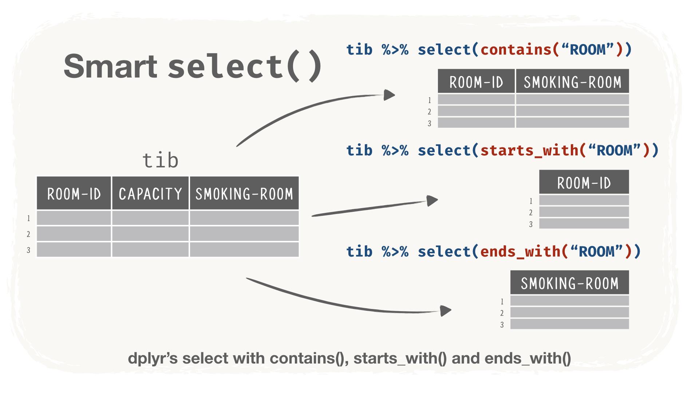{fig-alt="La fiche du select() astucieux : sur une table avec les colonnes room-id, capacity et smoking-room, contains(\"room\") garde room-id et smoking-room, starts_with(\"room\") garde room-id, et ends_with(\"room\") garde smoking-room." fig-align="center" width="80%"}

## Fonctions d'aide à la sélection

👉 `starts_with("winner")` ou `starts_with("loser")` pour toutes les informations sur les joueuses

```{r}
#| label: select-helpers
#| output-location: column-fragment
#| fig-alt: "Graphique vis_dat() des colonnes sélectionnées : year, puis les colonnes winner_ et loser_, toutes de type character."

wta_data %>%
  select(year, 
    starts_with("winner"), 
    starts_with("loser")) %>%
  vis_dat(warn_large_data = FALSE)
```

## Créer/transformer des colonnes avec `mutate()`

::: {.content-box-marine}
`dplyr::mutate()` pour **créer** ou **transformer** des colonnes
:::

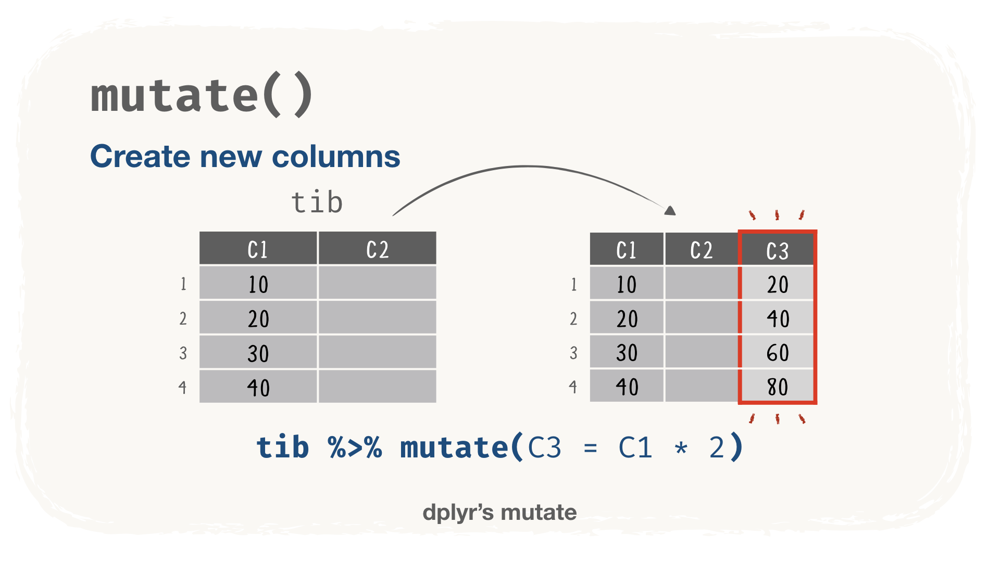{fig-alt="La fiche de mutate() : mutate(C3 = C1 * 2) ajoute une colonne C3 mise en évidence, qui contient le double des valeurs de C1." fig-align="center" width="80%"}

## Créer/transformer des colonnes avec `mutate()` {auto-animate="true"}

👉 Transformons `year` → **nombre**, `tourney_date` → **date** (`ymd()` de `{lubridate}`)

```{r}
#| label: slides-mutate-before
#| output-location: column-fragment
#| fig-alt: "Graphique vis_dat() des colonnes sélectionnées avant mutate() : year et les colonnes winner_ et tourney_ sont toutes de type character."
wta_data %>%
  select(
    year, 
    starts_with("winner"), 
    starts_with("tourney")
    ) %>% 
  vis_dat(warn_large_data = FALSE)
```


## Créer/transformer des colonnes avec `mutate()` {auto-animate="true"}

👉 Transformons `year` → **nombre**, `tourney_date` → **date** (`ymd()` de `{lubridate}`)

```{r}
#| label: slides-mutate-after
#| output-location: column
#| code-line-numbers: "|1,2,10-14"
#| fig-alt: "Graphique vis_dat() des colonnes sélectionnées après mutate() : year est maintenant numérique et tourney_date une date, les autres colonnes sont toujours de type character."
# 1. charger lubridate
library(lubridate)

wta_data %>%
  select(
    year, 
    starts_with("winner"), 
    starts_with("tourney")
    ) %>% 
# 2. faire les changements
  mutate(
    year = as.numeric(year),
    tourney_date = ymd(tourney_date)
    ) %>% 
# 3. visualiser les changements
  vis_dat(warn_large_data = FALSE)
```

## ⚠️ Rendre les changements permanents

::: {.content-box-marine}
Appliquer `mutate()` seul **ne modifie pas le jeu de données**.
:::

👉 Ce pipe **ne modifie pas** le contenu de `data` **de façon permanente**.

``` r
data %>% 
  mutate(...)
```
. . . 

::: {.content-box-marine}
En R, il faut **(ré)assigner** le résultat pour que les changements durent
:::

👉 Ce pipe, **oui**

``` r
data <- 
  data %>% 
  mutate(...)
```

## ⚠️ Rendre les changements permanents

👉 Gardons les nouveaux types de colonnes : on **réassigne** le résultat à `wta_data`

```{r}
#| label: mutate-types
wta_data <-
  wta_data %>%
  mutate(
    year = as.numeric(year),
    tourney_date = ymd(tourney_date))
```

. . .

Les changements sont maintenant là pour le reste de l'unité :

```{r}
#| label: slides-mutate-check
wta_data %>%
  select(year, tourney_date) %>%
  slice_head(n = 3)
```

## Filtrer des lignes avec `filter()`

::: {.content-box-marine}
`dplyr::filter()` pour garder les lignes qui **remplissent une condition logique**
:::

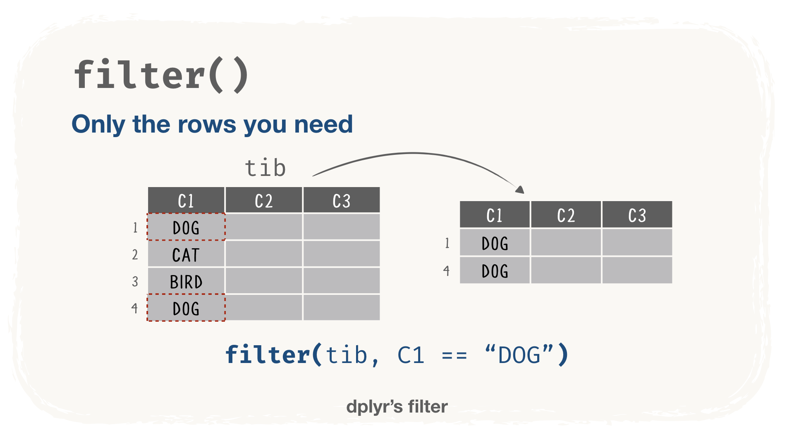{fig-alt="La fiche de filter() : filter(tib, C1 == \"DOG\") garde les lignes 1 et 4 d'une table dont les valeurs de C1 sont DOG, CAT, BIRD et DOG." fig-align="center" width="80%"}

## Filtrer des lignes avec `filter()`

👉 Ne garder que les matchs gagnés par Serena Williams

```{r}
#| label: filter-serena
#| output-location: column-fragment
wta_data %>%
  select(year, tourney_name, winner_name) %>%
  filter(winner_name == "Serena Williams")
```

::: fragment
::: {.content-box-marine}
⚠️ La comparaison utilise le **double** signe égal `==`. Le `=` simple assigne, p. ex. dans `mutate()`.
:::
:::

## `filter()` avec plusieurs conditions

👉 Victoires de Serena en Australie : **toutes** les conditions doivent être remplies

```{r}
#| label: filter-serena-australian
#| output-location: column-fragment
# 1. charger stringr
library(stringr)

wta_data %>%
  filter(
    # 2. première condition : la gagnante
    winner_name == "Serena Williams",
    # 3. deuxième condition : le tournoi
    str_detect(
      tourney_name,
      pattern = "Australian")) %>%

# 4. garder quelques colonnes
  select(year, tourney_name, winner_name)
```

::: fragment
::: {.callout-tip}
## Autres conditions

- `<`, `>=`, `&`, `|`, `%in%`
- Le support de cours contient une liste plus complète.
:::
:::

::: {.notes}
3) `str_detect()` de `{stringr}` renvoie `TRUE` quand le texte **contient le motif**. Cela attrape « Australian Open » et « Australian Championships ».

Le `<` sera nécessaire dans l'exercice 2.
:::

## Trier les observations avec `arrange()`

::: {.content-box-marine}
`dplyr::arrange()` pour **trier les lignes** selon les valeurs de certaines colonnes
:::

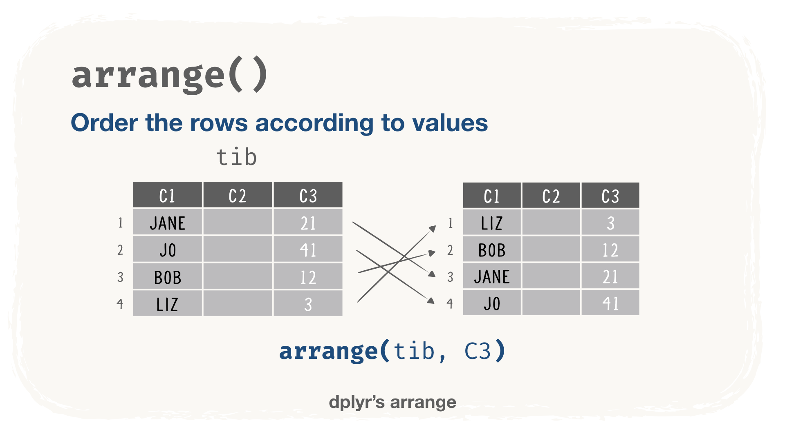{fig-alt="La fiche de arrange() : trier une table selon C3 réordonne ses lignes pour que les valeurs de C3 augmentent." fig-align="center" width="80%"}

## Trier les observations avec `arrange()`

👉 Quels sont les matchs les plus anciens du jeu de données ?

```{r}
#| label: arrange-year
#| output-location: column-fragment
wta_data %>%
  select(year, winner_name, tourney_name) %>%
  arrange(year)
```

::: {.notes}
Les nombres sont triés par ordre croissant, le texte par ordre alphabétique. `year` est un nombre parce que nous avons réassigné `wta_data`.
:::

## `arrange()` : plusieurs colonnes {auto-animate="true"}

👉 Trier par **année**, puis par **gagnante** au sein de chaque année

```{r}
#| label: arrange-two-columns
#| output-location: column-fragment
wta_data %>%
  select(year, winner_name, tourney_name) %>%
  arrange(year, winner_name)
```

## `arrange()` : plusieurs colonnes {auto-animate="true"}

👉 `desc()` inverse l'ordre : les gagnantes de Z à A au sein de chaque année

```{r}
#| label: arrange-desc
#| output-location: column-fragment
wta_data %>%
  select(year, winner_name, tourney_name) %>%
  arrange(year, desc(winner_name))
```

## C'est l'heure de l'exercice !

::: callout-important
## Au travail !

Ouvrez le notebook d'exercices `_exercises/exercise-notebook.qmd` et faites l'**[exercice 2](../_exercises/exercise-notebook.html#exercise-2)**. À tout de suite !
:::

## Produire des statistiques descriptives avec `summarise()`

::: {.content-box-marine}
`dplyr::summarise()` crée une **nouvelle table** avec des **résumés** des colonnes
:::

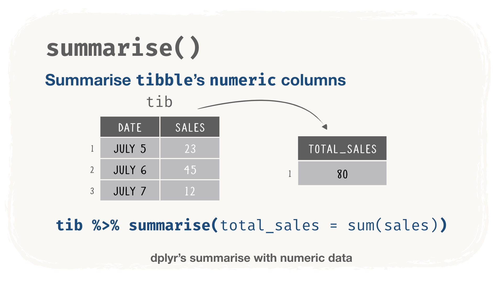{fig-alt="La fiche de summarise() : summarise(total_sales = sum(sales)) transforme trois lignes de ventes journalières (23, 45, 12) en une seule ligne avec total_sales 80." fig-align="center" width="80%"}

# Statistiques descriptives {.subsection .slides-only background-color="#425556"}

## Produire des statistiques descriptives avec `summarise()`

👉 Combien de matchs Serena a-t-elle gagnés en Australie ? `n()` **compte les lignes**

```{r}
#| label: summarise-serena-australian
#| output-location: column-fragment
wta_data %>%

# 1. garder les victoires de Serena en Australie
  filter(
    winner_name == "Serena Williams",
    str_detect(
      tourney_name,
      pattern = "Australian")) %>%

# 2. compter les lignes
  summarise(number_of_wins = n())
```

## Autres fonctions de résumé

| Statistique | Fonctions |
|:-----------------:|:-------------------------------|
| Tendance centrale | `mean()`, `median()` |
| Dispersion | `sd()`, `IQR()`, `mad()` |
| Étendue | `min()`, `max()`, `quantile()` |
| Total | `sum()` |
| Position | `first()`, `last()`, `nth()` |
| Comptage | `n()`, `n_distinct()` |
| Logique | `any()`, `all()` |

## Créer des groupes avec `group_by()`

::: {.content-box-marine}
`dplyr::group_by()` **regroupe** les lignes selon les valeurs d'une ou plusieurs colonnes
:::

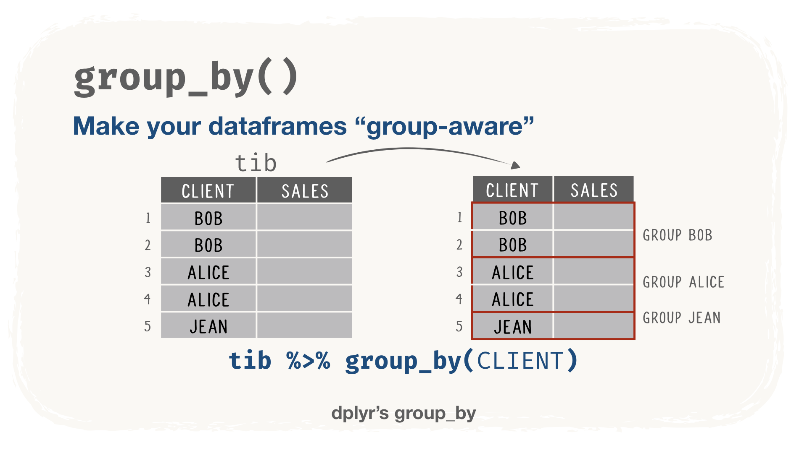{fig-alt="La fiche de group_by() : group_by(client) laisse la table inchangée mais la répartit en groupes, un pour chacun des clients Bob, Alice et Jean." fig-align="center" width="80%"}

## Créer des groupes avec `group_by()`

👉 Regrouper par gagnante : repérez la ligne `# Groups:`

```{r}
#| label: group-by-winner
#| render: !expr print
#| output-location: fragment
wta_data %>%
  group_by(winner_name)
```

. . . 

::: {.callout-important}
Les données ont l'air identiques, mais les calculs suivants se font **au sein** des groupes.
:::

::: {.notes}
Les données ont l'air identiques, mais les calculs suivants se font **au sein** des groupes.

`ungroup()` supprime les groupes : voir le support de cours.
:::

## `group_by()` `%>%` `summarise()`

::: {.content-box-marine}
`summarise()` après `group_by()` donne **une ligne par groupe**
:::

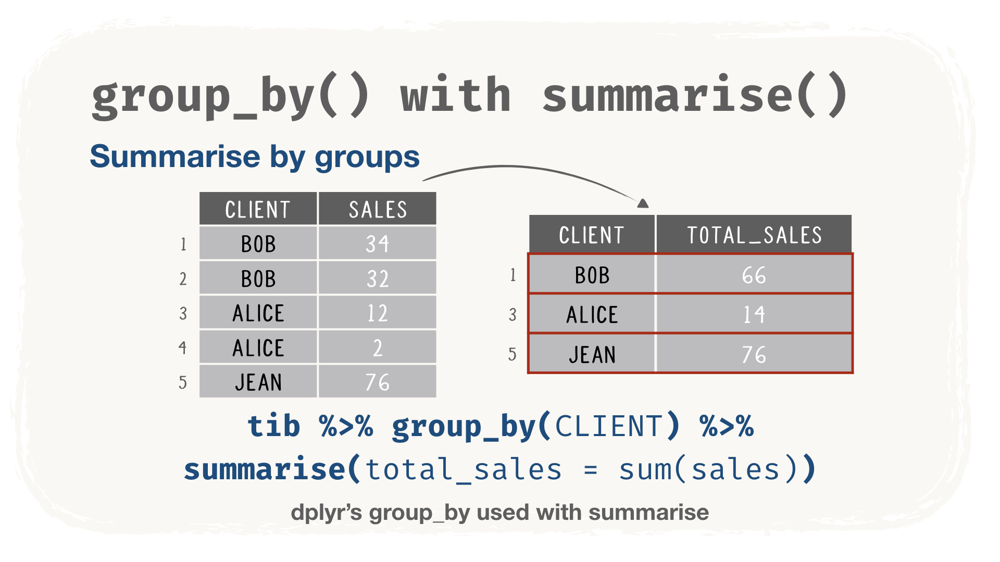{fig-alt="La fiche de group_by() avec summarise() : cinq lignes de ventes des clients Bob, Alice et Jean deviennent une ligne par client, avec des ventes totales de 66, 14 et 76." fig-align="center" width="80%"}

::: {.notes}
La figure garde l'ordre d'entrée et numérote les lignes du résultat 1, 3 et 5. En R, le résultat a les lignes 1 à 3, triées par client : Alice, Bob, Jean.
:::

## `group_by()` `%>%` `summarise()`

👉 Le nombre de victoires de **chaque** joueuse

```{r}
#| label: wins-per-player
#| output-location: column-fragment
wta_data %>%
  group_by(winner_name) %>%
  summarise(
    number_of_wins = n(),
    .groups = "drop")
```

::: {.notes}
`.groups = "drop"` renvoie une table **sans groupes**, comme si nous avions ajouté `ungroup()`. Un regroupement oublié est une source fréquente de surprises !
:::

## `group_by()` `%>%` `summarise()`

👉 Alors, **qui a le plus gagné** ? Triez le résultat avec `arrange()` et `desc()`

```{r}
#| label: wins-ranking
#| output-location: column-fragment
wta_data %>%
  group_by(winner_name) %>%
  summarise(
    number_of_wins = n(),
    .groups = "drop") %>%
  arrange(desc(number_of_wins))
```

## Regrouper selon plusieurs colonnes

👉 Les victoires de **chaque joueuse** dans **chaque tournoi**

```{r}
#| label: wins-per-player-tourney
wta_data %>%
  group_by(winner_name, tourney_name) %>%
  summarise(
    number_of_wins = n(),
    .groups = "drop")
```

## C'est l'heure de l'exercice !

::: callout-important
## Au travail !

Ouvrez le notebook d'exercices `_exercises/exercise-notebook.qmd` et faites l'**[exercice 3](../_exercises/exercise-notebook.html#exercise-3)**. À tout de suite !
:::

# Fusionner des données {.subsection background-color="#425556"}

## Empiler et joindre

::: {.content-box-marine}
Les vraies données sont souvent réparties dans **plusieurs tables liées** : on les **fusionne** pour obtenir l'information dont on a besoin
:::

::: {.incremental}
- **Empiler** des tables avec les mêmes colonnes : `bind_rows()`
- **Attacher** des tables qui partagent une colonne : les verbes `*_join()`
:::

## Trois jeux de données jouets

```{r}
#| label: toy-datasets
data_1 <- tibble(id = 1:3, var_1 = c(15, 13, 39))
data_2 <- tibble(id = c(4, 5), var_1 = 10)
data_3 <- tibble(id = 1:3, var_2 = c(10, 12, 14), var_3 = c(45, 20, 2))
```

::::: {.columns}
:::: {.column width="33%"}
```{r}
#| label: print-data-1
data_1
```
::::

:::: {.column width="33%"}
```{r}
#| label: print-data-2
data_2
```
::::

:::: {.column width="33%"}
```{r}
#| label: print-data-3
data_3
```
::::
:::::

## *Empiler* des jeux de données avec `bind_rows()`

👉 `data_1` et `data_2` : **mêmes colonnes**, **lignes différentes**

```{r}
#| label: bind-rows-data
#| output-location: column-fragment
data_1 %>%
  bind_rows(data_2)
```

::: fragment
::: {.content-box-marine}
Le côté gauche du pipe va **en haut**
:::
:::

## *Joindre* des jeux de données avec `left_join()`

::: {.content-box-marine}
`dplyr::left_join()` attache des colonnes en associant les lignes par une **clé de jointure**
:::

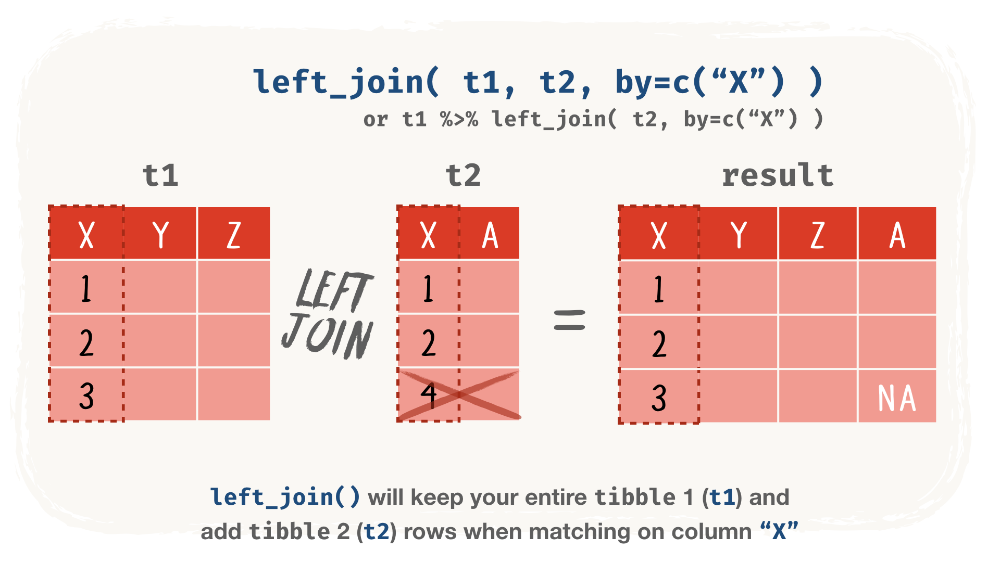{fig-alt="La fiche de left_join() : joindre les tables t1 et t2 par la colonne X garde toutes les lignes de t1 et ajoute la colonne A de t2. La ligne 4 de t2 n'a pas de correspondance et disparaît, et la ligne 3 de t1 n'a pas de correspondance dans t2 : elle reçoit NA dans la colonne A." fig-align="center" width="80%"}

## Comment fonctionne `left_join()`

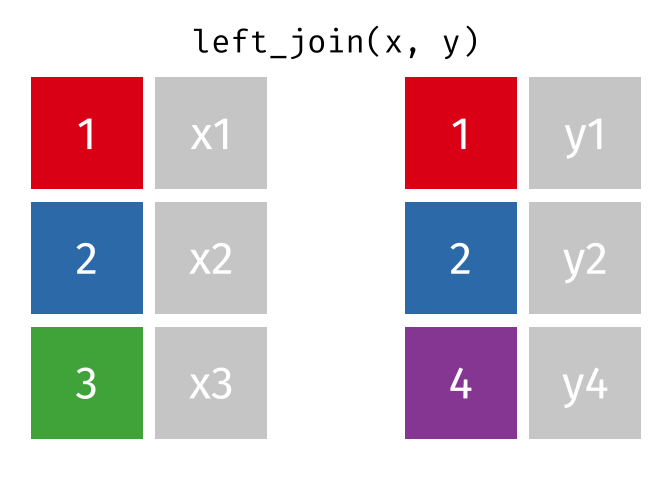{fig-alt="Animation de left_join(x, y) : les lignes de y sont associées aux lignes de x par leur colonne clé commune, les colonnes de y sont attachées à x, et les lignes de x sans correspondance reçoivent des valeurs manquantes." width="40%" fig-align="center"}

**Source :** Tidy Animated Verbs de [Garrick Aden-Buie](https://github.com/gadenbuie/tidyexplain)

::: fragment
::: {.content-box-marine}
Pourquoi « left » ? Il **garde toutes les lignes de la première** table (*à gauche*)
:::
:::

## `left_join()` avec une clé de jointure

👉 Empiler `data_1` et `data_2`, puis attacher les colonnes de `data_3`

```{r}
#| label: left-join-id
#| output-location: column-fragment
data_1 %>%

# 1. empiler les deux premières tables
  bind_rows(data_2) %>%

# 2. attacher data_3, en associant par id
  left_join(data_3, by = "id")
```

::: fragment

::: {.content-box-marine}
`data_3` n'a pas d'`id` 4 ni 5 : leurs nouvelles colonnes valent `NA`.
::: 

:::

::: {.notes}
Par défaut, la jointure utilise **toutes** les colonnes communes. `by` choisit la clé. Les versions récentes de `{dplyr}` acceptent aussi `by = join_by(id)`.

Il existe aussi `bind_cols()`, qui ne vérifie pas que les lignes correspondent : voir le support de cours.
:::

## Lignes de la deuxième table sans correspondance

👉 `data_4` : `data_3` plus une ligne avec `id = 8`, absente de `data_1`

:::: {.columns}
::: {.column width="50%"}
```{r}
#| label: data-4
data_4 <-
  bind_rows(
    data_3,
    tibble(id = 8, var_2 = 3, var_3 = 12))
data_4
```
:::

::: {.column width="50%" .fragment}

```{r}
#| label: left-join-unmatched
data_1 %>%
  left_join(data_4, by = "id")
```

:::
::::

:::{.fragment}
::: {.content-box-marine}
L'`id` 8 a disparu : seules les lignes de la **première** table sont gardées.
:::
:::

# Pivoter des données {.subsection background-color="#425556"}

## Tables longues vs. larges

::: {.incremental}
-   **Long** : chaque colonne est une *variable* → pour l'**analyse** (calculs, graphiques)
-   **Large** : certaines colonnes portent le nom de *valeurs* d'une variable → pour l'**affichage** dans les rapports
:::

```{r, echo = FALSE, fig.cap='Données au format large vs. au format long', fig.align='center', out.width = "70%", fig.alt="Les mêmes données sous forme de table large, avec une colonne id et une colonne pour chacun de x, y et z, et sous forme de table longue à trois colonnes : id, key (qui contient x, y ou z) et val."}
#| label: img-wide-long
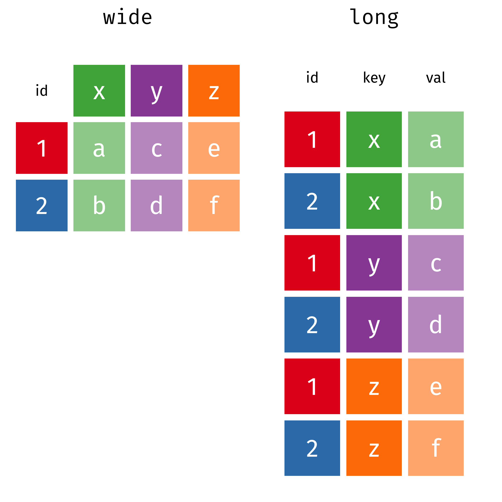
```

## `{tidyr}` : `pivot_longer()` et `pivot_wider()`

:::: {.columns}
::: {.column width="25%"}
```{r, echo = FALSE, fig.cap='Les balais de `{tidyr}` nous aideront à ranger nos données !', fig.align='center', out.width = "90%", fig.alt="Le logo hexagonal du package tidyr : des balais."}
#| label: img-tidyr-logo
knitr::include_graphics(path = "images/hex-tidyr.png")
```
:::

::: {.column width="75%"}
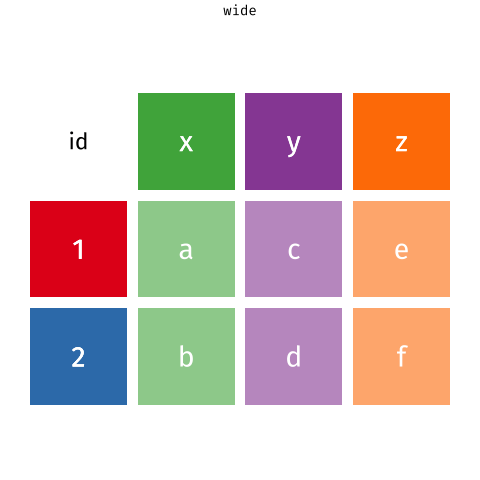{fig-alt="Animation d'une table large transformée en table longue avec pivot_longer(), puis de nouveau en table large avec pivot_wider()." width="480"}

Source : Tidy Animated Verbs de [Garrick Aden-Buie](https://github.com/gadenbuie/tidyexplain), modifié par [Mara Averick](https://twitter.com/dataandme)
:::
::::

## Pivoter au format long avec `pivot_longer()`

::: {.content-box-marine}
`tidyr::pivot_longer()` convertit des **colonnes en lignes**
:::

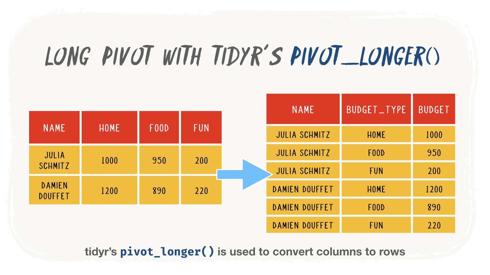{fig-alt="La fiche de pivot_longer() : une table de budget avec une ligne par personne et les colonnes home, food et fun devient une table avec une ligne par personne et par type de budget, et les colonnes name, budget_type et budget." fig-align="center" width="80%"}

## Comment écrire `pivot_longer()`

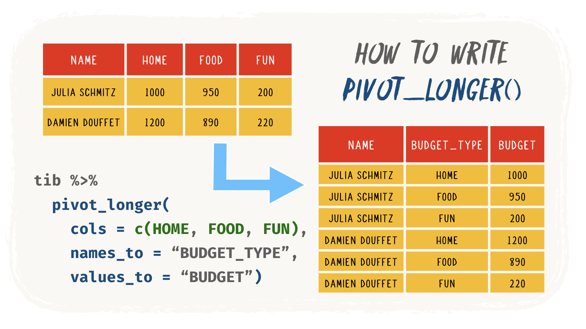{fig-alt="Le code de l'exemple de budget : pivot_longer(cols = c(home, food, fun), names_to = \"budget_type\", values_to = \"budget\"), à côté de la table large et de la table longue obtenue." fig-align="center" width="85%"}

## `pivot_longer()` : `cols`

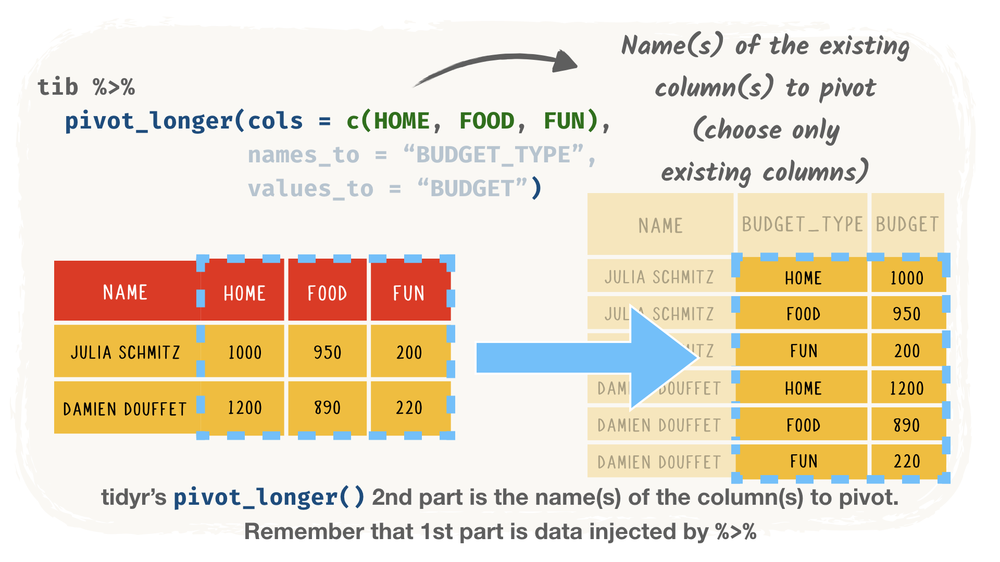{fig-alt="L'argument cols nomme les colonnes existantes à pivoter : home, food et fun sont mises en évidence dans la table large, et les colonnes budget_type et budget qu'elles deviennent, dans la table longue." fig-align="center" width="85%"}

## `pivot_longer()` : `names_to`

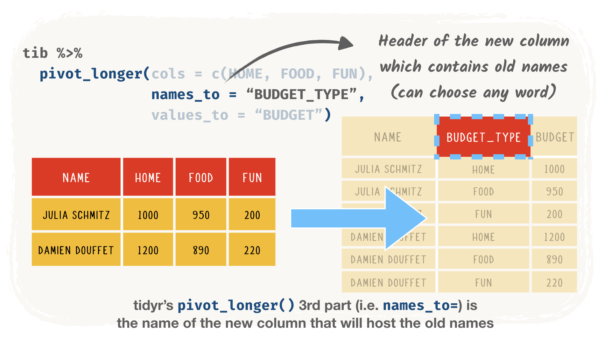{fig-alt="L'argument names_to est l'en-tête de la nouvelle colonne qui contient les anciens noms de colonnes, et peut être n'importe quel mot : budget_type est mis en évidence dans la table longue." fig-align="center" width="85%"}

## `pivot_longer()` : `values_to`

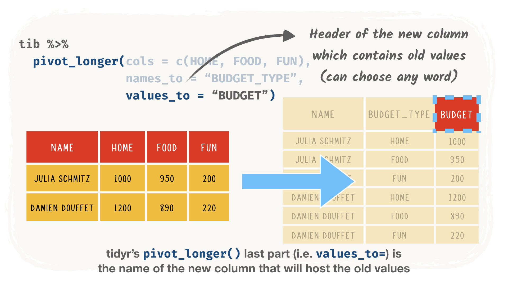{fig-alt="L'argument values_to est l'en-tête de la nouvelle colonne qui contient les anciennes valeurs, et peut être n'importe quel mot : budget est mis en évidence dans la table longue." fig-align="center" width="85%"}

## `pivot_longer()` : récapitulatif

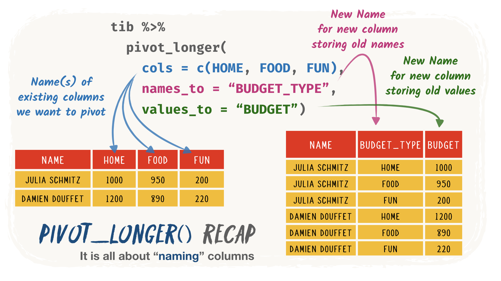{fig-alt="Récapitulatif de pivot_longer() : des flèches relient cols aux colonnes existantes home, food et fun, names_to à la nouvelle colonne budget_type, et values_to à la nouvelle colonne budget." fig-align="center" width="85%"}

## Du large au long

👉 Des prototypes mesurés à 3 instants : une colonne par instant

```{r}
#| label: data-5-wide
#| output-location: column-fragment
data_5_wide <-
  tibble(
    prototype = 1:5 ,
    t_1 = c(12,1,3,4,5),
    t_2 = c(13,0,3,6,3),
    t_3 = c(14,-1,3,8,1))
data_5_wide
```

## Du large au long

👉 Une colonne `timepoint` et une colonne `performance`

```{r}
#| label: pivot-longer
#| output-location: column-fragment
data_5_long <-
  data_5_wide %>%
  pivot_longer(
    # 1. toutes les colonnes sauf prototype
    cols = -c(prototype),
    # 2. où vont les anciens noms
    names_to = "timepoint",
    # 3. où vont les valeurs
    values_to = "performance"
  )

data_5_long
```

## Des instants plus propres

👉 Retirer le préfixe `t_` et faire des instants des **nombres**

```{r}
#| label: pivot-longer-clean
#| output-location: column-fragment
data_5_long <-
  data_5_wide %>%
  pivot_longer(
    cols = -c(prototype),
    names_to = "timepoint",
    values_to = "performance",
    # 1. retirer le préfixe `t_`
    names_prefix = "t_",
    # 2. convertir les instants en entiers
    names_transform = list(
      timepoint = as.integer)
  )

data_5_long
```

::: {.notes}
Les participant·e·s ont besoin de ces deux arguments dans l'exercice 5.
:::

## Les tables longues sont faites pour calculer

👉 La performance moyenne de chaque prototype

```{r}
#| label: average-performance
#| output-location: column-fragment
data_5_long %>%
  group_by(prototype) %>%
  summarise(
    average_performance = mean(performance),
    .groups = "drop")
```

## Pivoter au format large avec `pivot_wider()`

::: {.content-box-marine}
`tidyr::pivot_wider()` fait l'inverse : il convertit des **lignes en colonnes**
:::

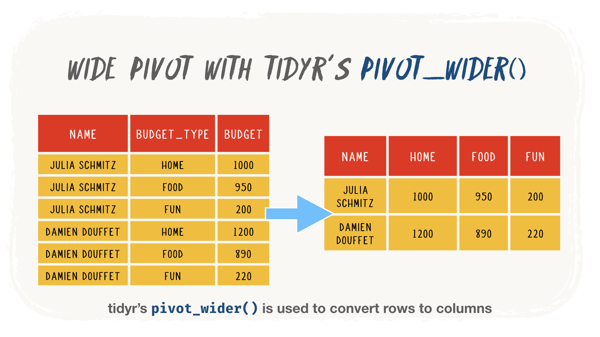{fig-alt="La fiche de pivot_wider() : une table de budget avec une ligne par personne et par type de budget devient une table avec une ligne par personne et les colonnes home, food et fun." fig-align="center" width="80%"}

## Comment écrire `pivot_wider()`

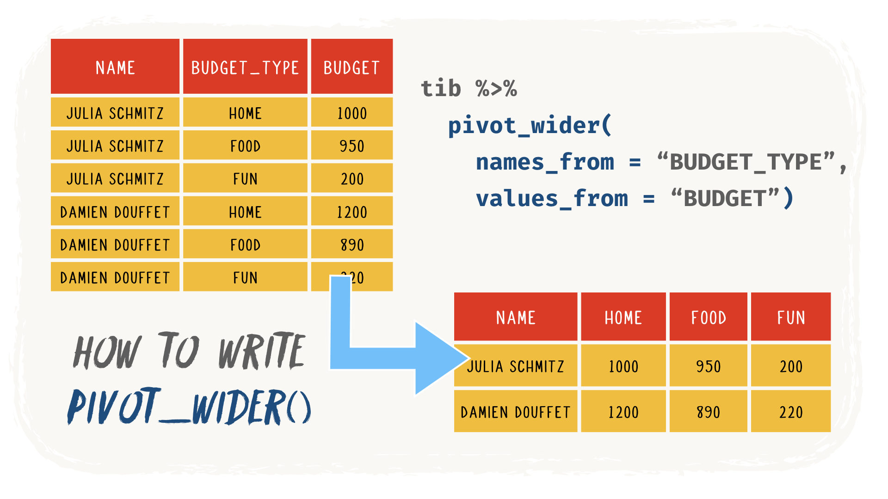{fig-alt="Le code de l'exemple de budget : pivot_wider(names_from = \"budget_type\", values_from = \"budget\"), à côté de la table longue et de la table large obtenue." fig-align="center" width="85%"}

## Du long au large

👉 **Rendements** de **cultures** par **pratique** : les valeurs répétées sont difficiles à lire

```{r}
#| label: data-6-long
data_6_long <-
  tibble(
    crop = c(rep("wheat", 3), rep("corn", 3), rep("quinoa",3)),
    practice = rep(c("Type 1", "Type 2", "Type 3"), 3),
    yield = c(12,65,85,98, 65, 45, 72, 67, 59)
    )
data_6_long
```

## Du long au large

👉 Une colonne par pratique : prête pour un rapport

```{r}
#| label: pivot-wider
#| output-location: column-fragment
data_6_long %>%
  pivot_wider(
    # 1. les noms des nouvelles colonnes
    names_from = practice,
    # 2. les valeurs des nouvelles colonnes
    values_from = yield)
```

::: {.notes}
Le support de cours montre comment mettre en forme cette table avec `{kableExtra}`.
:::

## C'est l'heure de l'exercice !

::: {.notes}
À la fin : mentionner le matériel bonus !
:::

::: callout-important
## Au travail !

Ouvrez le notebook d'exercices `_exercises/exercise-notebook.qmd` et faites les **[exercices 4](../_exercises/exercise-notebook.html#exercise-4) et [5](../_exercises/exercise-notebook.html#exercise-5)**. À tout de suite !
:::
