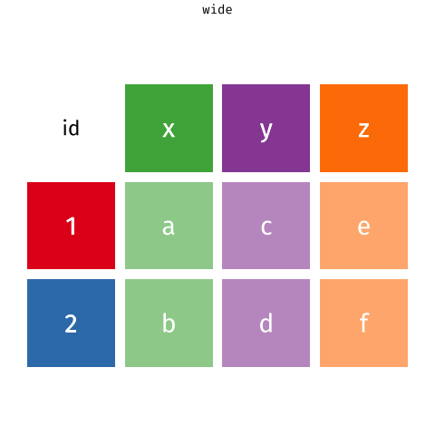

```{r setup, include= FALSE, message= FALSE, warning = FALSE}
knitr::opts_chunk$set(
  echo = TRUE, 
  message = FALSE,
  warning = FALSE,
  fig.align='center',
  fig.width = 16/2, 
  fig.height = 9/2,
  cache = FALSE)
```

```{r packs_load, include = FALSE}
library(tidyverse)
library(janitor)
library(DT)
```

```{css, echo=FALSE}
.blackbox {
  padding: 0.5em;
  background: white;
  color: black;
  border: 1px solid black;
  border-radius: 10px;
  text-align: center;
}
```

The second step in a data scientist's pipeline, is to **Tidy**, i.e. "clean" the data and prepare it for analysis.

-   In the `{tidyverse}` philosophy, this also involves **transforming** the data into **tidy** **tables** called `tibbles`

To get insight during the analysis stage, one needs to be able to **Transform** the data.

-   Both of these tasks involve the **manipulation of data,** a task often called as **Data Wrangling.**

{fig-alt="The data science pipeline: import, then tidy, then a loop of transform, visualise and model, then communicate. The tidy and transform steps are highlighted: data wrangling means preparing the data for further analysis."}

\
Some basic Data Wrangling tasks are:

-   **picking a column** from a table,

-   subsetting, i.e. **picking a set of rows,**

-   **transform and/or add columns** to a table

-   **order the rows** according to the values of a (set of) column(s)

-   **grouping** according to the values of a (set of) column(s) to perform analysis within the groups

-   computing **summary statistics** (centrality, dispersion, quantiles, etc. )

In R, and more specifically in the `{tidyverse}`, data manipulation is performed using the tools included in the packages `{dplyr}` and `{tidyr}.`

But more than tools, these packages provide a whole **grammar to manipulate data**.

# A Grammar for Data Manipulation {#DataManip}

The package `{dplyr}` offers a series of functions or *verbs* that help us **wrangle** data the same way we would use a plier to wrangle wires.

This representation is even in the logo!

```{r ,echo = FALSE, fig.cap='The pliers of `{dplyr}` will help us wrangle our data!', fig.alt="The hexagonal logo of the {dplyr} package, a pair of pliers.", fig.align='center', out.width = "30%"}
  knitr::include_graphics(
    path = "illustrations/hex-dplyr.png"
    )
```

Some of the *verbs* contained in `{dplyr}` are:

|           Verb            | Use                                                                                                 |
|:-----------------:|-----------------------------------------------------|
|        `select()`         | **pick a set of columns** from a `tibble`                                                           |
|        `filter()`         | **pick a set of rows**                                                                              |
|        `mutate()`         | **transform and add columns** to the `tibble`                                                       |
|        `arrange()`        | **order the rows** according to the values of a (set of) column(s)                                  |
|       `group_by()`        | **group** according to the values of a (set of) column(s) to perform calculations within the groups |
| `summarise()/summarize()` | to create a new `tibble` containing **summary statistics** for a set of columns                     |

::: callout-important
## Why "verbs"?

These functions are called *verbs* because, thanks to the **pipe** operator, they can be **written sequentially**, since:

-   Their **first argument** is the **name of the dataset**

-   The **remaining arguments** are the **names of the columns**

For example:

``` r
select(dataset, column_1, column_2)

# Is equivalent to:

dataset %>% select(column_1, column_2)

# you see that it reads like a sentence!
```

The whole **grammar** aspect comes from this natural-language-like approach to programming!
:::

## Inspecting Data

Right after importation, it is useful to **inspect** the data, to know:

-   what columns are contained in our dataset

-   what *types* are our columns i.e. if they are composed of

    -   numbers (`integers` or decimals, to be represented as `double` or `numeric`)

    -   strings (letters or strings of letters that amount to words like, well `"words"` )

    -   logical (`TRUE` or `FALSE`)

    -   missing observations (denoted as `NA` in R)

    -   dates/date times

For the illustrations, we will rely on the WTA dataset that you can import with `read_csv()`

::: callout-note
Notice that:

1.  The `path` points to the shared `data` folder of the workshop, one level up (`../data/`)

2.  The `path` is *fed* to `read_csv()` using the pipe operator (`%>%`)
:::

```{r}
library(readr)

wta_data <-
  "../data/wta_grand_slam_data.csv" %>% 
  read_csv(
    col_types = cols(.default = "c")
    ) 
```

::: {.callout-tip collapse="true"}
## A note on the extra arguments

You see that we have added some arguments to the extra arguments to avoid importing errors

-   We're setting the argument `col_types = cols(.default = "c"` where `"c"` stands for `character`.

-   This is because `read_csv()` "guesses" the type of each column (`numeric`, `character`, etc.) by **parsing the first 10000 lines**.

-   Since we have **a lot of missing observations in some columns**, this could yield errors when importing.
:::

::: panel-tabset
## Getting a slice

It's always useful to see the **first rows** of our data, to see whether they are well imported

In R, we can get a printed view of the **first row** with the function`slice_head()`

```{r}
slice_head(wta_data)
```

If we want to print more rows, we can set the argument `n` to a value (e.g. `n=6`)

```{r}
slice_head(wta_data, n=6)
```

-   Our data has been well imported, it appears!

## Getting a glimpse

We can get a **summary of the contents** using the function `glimpse()`.

```{r, eval = TRUE}
glimpse(wta_data)
```

As you can see:

-   there are many ( `r ncol(wta_data)` ) columns

-   most of the column names are prefixed with a descriptive enough prefix.

-   Here's a breakdown of the prefixes of the columns, we'll use in what follows.

| column / prefix | Content                                                                        |
|:-----------------:|:----------------------------------------------------|
|     `year`      | Year of the tournament the match took place                                    |
|   `tourney_*`   | Information related to the tournament (`id`, `name`, `surface`, ...)           |
|   `match_num`   | Number of match **within a tournament**                                        |
|   `winner_*`    | Information related to the winner of a given match (`id`, `name`, `hand`, ...) |
|    `loser_*`    | Information related to the loser of a given match (`id`, `name`, `hand`, ...)  |

## Getting the full picture

Alternatively, we can have a *graphical* view, using the function `vis_dat()` from the package `{visdat}`

-   The **colors** displays the **types** of the columns (character, numeric, date... )

-   The **gray** denotes **missing observations**.

```{r,  echo = TRUE, fig.cap = "A bird's-eye view of the WTA dataset using `vis_dat()`"}
library(visdat)
wta_data %>% 
  vis_dat(
    # `warn_large_data = FALSE` added to avoid warnings
    warn_large_data = FALSE
    )  
```

## Cleaning column names

The WTA column names are easy to work with. Files prepared by people are often less friendly: spaces, capital letters, units in brackets...

-   Let's import a small example, `team_bad_names.csv`:

```{r}
team <- read_csv("data/team_bad_names.csv")
team
```

-   To use a name like `First Name` in our code, we would have to wrap it in backticks every time: `` team$`First Name` ``

The function `clean_names()` from the package `{janitor}` **rewrites all the column names** in lower-case `snake_case`:

```{r}
library(janitor)
team %>% 
  clean_names()
```

::: callout-tip
## Why bother?

Clean names are **quicker to type** and **work without backticks**, and RStudio can **autocomplete** them. Call `clean_names()` once, right after importing, and the rest of your code stays simple.
:::
:::

## Picking columns with `select()`

The function `select()` helps **picking columns**.

We can **pick one column by its name**

-   such as the column `year`

```{r, eval = FALSE}
wta_data %>% 
  select(year)
```

To select more than one column, pass their names in our call to `select()`.

-   Say, we want to select information related to the **winners** and the **tourneys**

```{r, eval = FALSE}
wta_data %>% 
  select(year,tourney_id, tourney_name, winner_id, winner_name)
```

We can also pick the columns **whose names fulfill a condition**

This is done by means of so-called **selection helpers**.

-   For instance, let's use `starts_with()` to pick all the columns that **start with** the prefixes `tourney_` and `winner_`.

-   To make things even clearer, let's inspect the result with `vis_dat()`

```{r,  out.width ="80%", out.height="80%"}
wta_data %>% 
  select(year, starts_with("winner"), starts_with("tourney")) %>% 
  vis_dat(warn_large_data = FALSE)
```

::: {.callout-tip collapse="true"}
## Other Selection Helpers

Most of the other selection helpers have almost self-explanatory names, e.g.

| Selection Helper | Case use                                                                                                                                                                                                                     |
|:----------------:|:-----------------------------------------------------|
|  `ends_with()`   | selects according to a suffix                                                                                                                                                                                                |
|   `contains()`   | when we are looking for columns that contain a literal word or string                                                                                                                                                        |
|   `matches()`    | selects according to **patterns known as Regular expressions**. Some of the most essentials are described in the [cheatsheet of the package `{stringr}`](https://stat.ethz.ch/R-manual/R-devel/library/base/html/regex.html) |
|  `num_range()`   | which helps selecting columns that have numbers, e.g. `x01`, `x02`, ... we're interested in a range, e.g. `num_range("x", 10:15)`                                                                                            |

Other selection helpers apply to column names, such as `all_of()` `any_of()` and finally `where()` which selects according to functions
:::

## Transforming columns with `mutate()`

The `mutate()` verb allows us to **create new columns** or **transform existing ones**.

-   For instance, we imported all columns of the data set as `character`, but **`year` should be numerical** and **`tourney_date` should be dates**.

We **change column types** by **rewriting the columns** within a call to `mutate()` and the transforming function

-   We can use `as.numeric()` and the `ymd()` from the package `{lubridate}` to perform the transformation

<!-- -->

-   Again, to make things clearer, we use `vis_dat()`. Notice that `type` of the column `year` has switched from `character` to `numeric`, and column `tourney_date` has changed to `Date`.

```{r}
library(lubridate)

wta_data <- 
  wta_data %>% 
  mutate(
    year = as.numeric(year),
    tourney_date = ymd(tourney_date))
  
wta_data %>% 
  select(year, starts_with("winner"), starts_with("tourney")) %>%  
  vis_dat(warn_large_data = FALSE)
```

::: callout-important
## Making permanent changes to a table

Notice that we have *assigned* the the modified table into `wta_data`, thereby **rewriting the original table with our modifications.**

This is to **make modifications permanent**.

For instance , the following pipe **does not modify** the contents of `data`**permanently**

``` r
data %>% mutate(...)
```

The following pipe **does modify** the contents of `data`**permanently**

``` r
data <- data %>% mutate(...)
```
:::

## Sub-setting rows with `filter()`

We use the `filter()` function to **create subsets of a tibble according to logical conditions**.

These logical conditions apply to the values contained in a column and will **pick the rows fulfilling the condition**.

-   Say, for example, that we are interested in subsetting the matches won by the great Serena Williams.

-   We can use `filter()` to subset the rows that fulfill the condition `winner_name == 'Serena Williams'` as in:

```{r}
wta_data %>% 
  select(year, starts_with("winner"), starts_with("tourney")) %>% 
  filter(winner_name == "Serena Williams")
```

::: callout-important
## Assignment (`=`) vs Comparison (`==`)

-   **for the comparison, we've used the double equal sign `==`** .

-   this is to avoid ambiguities with the operation of assignment (e.g. what we do with `mutate()`)
:::

Naturally, we can **add many conditions** pertaining to the **same column or others**.

This will pick the rows fulfilling simultaneously the two established conditions

-   Let's suppose we are interested in analysing Serena's performance at the Australian tournaments,

-   we could select all the instances where `tourney_name` contains the pattern `"Australian"` with `str_detect()` from the package `{stringr}`

    -   `str_detect()` returns `TRUE` when the value of `tourney_name` contains the pattern `"Australian"`

```{r}
library(stringr)
wta_data %>%
  filter(
    winner_name == "Serena Williams", 
    str_detect(tourney_name, pattern = "Australian")) 

```

::: {.callout-tip collapse="true"}
## How to write logical conditions

-   Here's a quick rundown on how to write logical conditions in R

|       Logical Condition        |  Symbol  |
|:------------------------------:|:--------:|
|         *A equal to B*         | `A == B` |
|        *A less than B*         | `A < B`  |
| *A less than or equal to to B* | `A <= B` |
|       *A greater than B*       | `A > B`  |
|   *A greater or equal to B*    | `A >= B` |

-   One can also combine conditions into longer statements with the "and" and "or" bindings as in:

|       Logical Condition       |          Syntax           |
|:-----------------------------:|:-------------------------:|
| *Condition 1 AND Condition 2* | `ConditionA & ConditionB` |
| *Condition 1 OR Condition 2*  | `ConditionA | ConditionB` |

-   Finally, a very handy shortcut for multiple `OR` conditions is the `%in%` operator, which compares a value to the contents of a vector! For instance:

<!-- -->

    A == B | A == C | A == C  

is equivalent to:

    A %in% c(B, C, D)
:::

## Sort observations with `arrange()`

The verb `arrange()` allows you to **order observations** according to the values of columns of your data set.

If the ordering column is of **any number type**, they will be ordered in **increasing numerical order.**

```{r}
wta_data %>%
  select(year,  winner_name, tourney_name) %>% 
  arrange(year)
```

If the ordering column is of **type `character`**, the observations will be arranged in alphabetic order.

```{r}
wta_data %>%
  select(year, winner_name, tourney_name) %>% 
  arrange(winner_name)
```

Moreover, we can order your observations according to more than one column. The order in which you introduce this into `arrange()` is important.

`{dplyr}` will order **first** according to the name of the column you introduce first and then, by the second:

```{r}
wta_data %>%
  select(year, winner_name, tourney_name) %>% 
  arrange(year, winner_name)
```

By default, **`arrange()` sorts observations in *ascending* order**. We can order in *descending* order by enclosing the ordering column with the argument `desc()`

```{r}
wta_data %>%
  select(year, winner_name, tourney_name) %>% 
  arrange(year, desc(winner_name))
```

## Exercise Time!

::: callout-important
## Time to work!

Open the exercise notebook `_exercises/exercise-notebook.qmd` and do **[Exercise 2](../_exercises/exercise-notebook.html#exercise-2)**. See you there!
:::

## Producing summary statistics with `summarise()`

The function `summarise()` creates a new dataset that **contains summaries of the required columns**.

-   Let's say that we are interested in the **number of matches won** by **Serena Williams** in the **Australian** tournaments.

-   Once subsetted with `filter()`, we can **count the number of matches** with the counting function `n()`, which **computes the number of rows** as in:

```{r}
wta_data %>%
  filter(
    winner_name == "Serena Williams", 
    str_detect(tourney_name, pattern = "Australian")) %>% 
  summarise(number_of_wins = n())
```

Aside from `n()`, other useful functions can calculate various other summaries.

| Summary Statistic | Functions                      |
|:-----------------:|:-------------------------------|
|      Center       | `mean()`, `median()`           |
|      Spread       | `sd()`, `IQR()`, `mad()`       |
|       Range       | `min()`, `max()`, `quantile()` |
|     Position      | `first()`, `last()`, `nth()`   |
|       Count       | `n()`, `n_distinct()`          |
|      Logical      | `any()`, `all()`               |

## Creating groups with `group_by()`

Some analyses require that we **group the data** according to **single or multiple *grouping* factors** before performing calculations.

This can be achieved using `group_by()`.

-   For instance, let's group the dataset by `winner_name`:

```{r}
wta_data %>%
  group_by(winner_name)
```

-   the output in the console(or the preview) **reveals the grouping column**.

-   From now on, **all computations** will be done **within the groups defined by the column values**. (More on that in the next section!)

To remove a grouping structure, use the verb `ungroup()`:

```{r}
wta_data %>%
  group_by(winner_name) %>% 
  ungroup()
```

## Computing summaries within groups with `group_by()` `%>%` `summarise()`

As we said previously, **the call to `group_by()`** implies that **all the computations and some manipulations that come afterwards** will be **carried in the groups**.

This ties neatly with `summarise()` creating **summary statistics for the groups** defined by the different values of the column!

-   For illustration, let's count the **number of wins** of **every player** (not just Serena!)

    -   First, we call to `group_by(winner_name)`

    -   Then, **`summarise()`** and **`n()`** will **count the rows within the groups** defined by the values of the column `winner_name.`

    -   in this case, this yields the number of times each `winner_name` appears in the dataset.

```{r}
wta_data %>%
  group_by(winner_name) %>% 
  summarise(number_of_wins = n(), .groups = "drop")
```

::: callout-note
## What does `.groups = "drop"` do?

It tells `summarise()` to return a table **without any grouping**, exactly as if we had added `ungroup()` at the end. Get into the habit: a grouping that you forgot about is a common source of surprises in later computations.
:::

::: {.callout-tip collapse="true"}
## A shortcut for counting: `count()`

Counting the rows within groups is so common that `{dplyr}` has a shortcut for it. `count()` groups, counts and ungroups in one step:

```{r}
wta_data %>%
  count(winner_name, name = "number_of_wins")
```
:::

-   We can group via more than one column.
    -   Let's use this function to see **how many matches** were won by **each player** in **each tournament**. For this, we need to `group_by(winner_name, tourney_name)`:

```{r}
wta_data %>%
  group_by(winner_name, tourney_name) %>% 
  summarise(number_of_wins = n(), .groups = "drop")
```

### Exercise Time! {.unnumbered}

::: callout-important
## Time to work!

Open the exercise notebook `_exercises/exercise-notebook.qmd` and do **[Exercise 3](../_exercises/exercise-notebook.html#exercise-3)**. See you there!
:::

# Merging Data

In real situations, **information can be stored in many datasets linked to each other**.

In those cases, we would to **merge some of these datasets** to get the information we need for a given task.

The **most important** merging procedures are the **binding** and **joining**.

In R we can rely on the binding and joining *verbs* of `{dplyr}`.

|     Verb      | Use                                                                          |
|:-----------------:|-----------------------------------------------------|
| `bind_rows()` | merges two tibbles by **stacking them up** (one on top of the other)         |
|  `*_join()`   | **attaches** tibbles by **the columns they have in common** (joining *keys*) |

Let's create two toy datasets to understand these procedures.

-   The following code generates some tables, endowed with the columns `id`, `var_1`, `var_2` and `var_3`

```{r}
data_1 <- tibble(id = 1:3, var_1 = c(15, 13, 39))
data_2 <- tibble(id = c(4, 5), var_1 = 10)
data_3<- tibble(id = 1:3, var_2 = c(10, 12,14), var_3 = c(45,20, 2)) 
```

-   Let's print them to see their contents

```{r}
data_1
```

```{r}
data_2
```

```{r}
data_3
```

## *Stacking* data sets with `bind_rows()`

When two tables have the **same columns** but **different information**, they can be **merged by "stacking them up" one on top of the other**.

-   In R and with`{dplyr}`, we can use the *verb* `bind_rows()`.
-   If we use it within a pipe, the **left-hand side of the pipe** will be placed **on top** of the **right-hand side argument**.
-   For instance, the datasets `data_1` and `data_2` have the same column names, but different information (values for `id` and `var_1`). Hence, we can merge them with `bind_rows()`

```{r}
data_1 %>% 
  bind_rows(data_2)
```

-   As you can see, the values of `data_1` are on top of the values of `data_2`.

## *Joining* data sets with `left_join()`

If, on the other hand, two datasets **share the same row names** but **different columns** it is sometimes useful to merge them by **"attaching" their columns**

In R and with`{dplyr}`, we can use the joining *verbs*, which have the suffix `*_join`, e.g. `right_join(), left_join(), full_join()`

::: {.callout-warning collapse="true"}
## Wait! Isn't there a `bind_cols()`?

Yes there is! But, it's a function that does not ensure **row consistency**. We can illustrate some of the problems with an example

-   For example, `data_3` contains the same id's as `data_1`, hence we can attach the values of the columns `var_2` and `var_3` to have a more complete dataset.

```{r}
data_1 %>% 
  bind_cols(select(data_3, starts_with("var")))
```

Success! ... or is it?

There are a couple of drawbacks when using `bind_cols()`:

1.  **It does not verify the conformity of the rows**.

    For instance, a simple permutation in one of the datasets or the lack of conformity in terms of rows will entail problems.

    -   Let's see what happens when the data in `data_3` is permuted, e.g. in the descending order of `id`

    -   Carrying the merge with `bind_cols()` will yield an inconsistent result!

```{r}
data_3 <- data_3 %>% arrange(desc(id))
```

```{r}
data_1 %>% 
  bind_cols(select(data_3, starts_with("var")))
```

2.  The tibbles you want to merge **must have the same number of rows**.
    -   suppose we want to merge our three datasets to have all the information in one tibble.

    -   The first two can be merged using `bind_rows()`,

    -   Yet, when we attempt (wrongly!) to merge (the permutated!) `data_3`, we encounter error messages.

    -   This is because we have 5 rows in the first dataset and 3 in the second!

```{r, error=TRUE}
data_1 %>% 
  bind_rows(data_2) %>% 
  bind_cols(data_3)
```

Using the `*_join` verbs of `{dplyr}`, we ensure consistency of the rows.
:::

The `*_join` verbs merges two datasets and **ensure row consistency** by **relying on the common column(s)** also known as **the joining key(s)**.

In R and with `{dplyr}` we will use the `left_join()` verb.

-   In the animation below, we have two datasets, `x` and `y`.
-   They share the first column and some elements within it.
-   When joined, the non-shared elements of `y` are attached to `x` preserving the position of their shared elements

{fig-alt="Animation of left_join(x, y). x has ids 1, 2 and 3, y has ids 1, 2 and 4. The rows of y with ids 1 and 2 attach to the matching rows of x; id 3 keeps an NA for y, and id 4, which is not in x, is dropped."}

**Source:** [Garrick Aden-Buie's](https://twitter.com/grrrck) Tidy Animated Verbs

::: callout-important
## Why the "left" in `left_join()`?

A call to `left_join()` has the particularity that, other than joining the common elements, it also **preserves the non-shared elements of the first tibble**, i.e. the *left-hand side* tibble.
:::

**By default**, the join is performed using **all the columns shared by the data sets**,

That said, one can **specify a subset of columns to join** with the `by` argument.

-   Let's try joining our three datasets using the common column `id` as the **joining** **key**. It works!
-   Recent versions of `{dplyr}` also accept `by = join_by(id)`, which you may meet in other people's code.

```{r}
data_1 %>% 
  bind_rows(data_2) %>% 
  left_join(data_3, by = "id")
```

Let's see what happens when there's a non-common element.

-   We'll add a supplementary observation with `id=8` (not present in `data_1`) to `data_3`, thereby creating `data_4`.

```{r}
data_4 <- bind_rows(data_3, tibble(id = 8, var_2 = 3, var_3 = 12)) 
data_4
```

When applying `left_join()`, we obtain:

```{r}
data_1 %>% 
  left_join(data_4, by = "id")
```

# Pivoting Data

When distributed in tables, data can come in two ways:

-   **long** format, where all columns denote *variables*.
    -   These are useful for **analysis** (computations and visualisations).
-   **wide** format, where some columns are named after values of a categorical *variable*.
    -   They are mostly used to display tables in your reports.

```{r ,echo = FALSE, fig.cap='Wide-format, vs. Long-format data', fig.alt="The same data in two shapes. Wide: one row per id (1 and 2) and one column each for x, y and z. Long: three columns, id, key and val, with one row per combination of id and key, so six rows.", fig.align='center', out.width = "80%"}
  knitr::include_graphics("illustrations/original-dfs-tidy.png")
```

In R and with`{tidyr}`: to pivot a table, we use two functions: `pivot_longer()` and `pivot_wider()`.

```{r ,echo = FALSE, fig.cap='The brooms of `{tidyr}` will help us tidy our data!', fig.alt="The hexagonal logo of the {tidyr} package, two brooms.", fig.align='center', out.width = "30%"}
  knitr::include_graphics(
    path = "illustrations/hex-tidyr.png"
    )
```

In the animation below, we can overview how pivoting works.

{fig-alt="Animation of a table with ids 1 and 2 and columns x, y and z turning into a long table with columns id, key and val by pivot_longer(), and back into the wide table by pivot_wider()."}

Source: [Garrick Aden-Buie's]() Tidy Animated Verbs modified by [Mara Averick](https://twitter.com/dataandme)

## Pivoting into long-form with `pivot_longer()`

`pivot_longer()` has three main arguments:

|  Argument   | Use                                                                                        |
|:----------------:|:-----------------------------------------------------|
|   `cols`    | the **columns to convert** into a single column                                            |
| `names_to`  | the **name of a new column** where we the **names of the selected columns** will be stored |
| `values_to` | the **name of the column** where we will store **the values**                              |

This scenario can happen when we have **many measurements carried through time**.

-   Let's illustrate this with `data_wide`, a makeshift table containing observations of the performance of a series of machine prototypes observed at three timepoints: `t_1`, `t_2`, `t_3`

```{r}
data_5_wide <- 
  tibble(
    prototype = 1:5 ,
    t_1 = c(12,1,3,4,5),
    t_2 = c(13,0,3,6,3),
    t_3 = c(14,-1,3,8,1))
data_5_wide
```

-   Let's *pivot* this tibble in a *long-form*, by

    -   putting the timepoint names into a single column: `timepoint`

    -   placing the contents of the rows into a single column: `performance`

```{r}
data_5_long <- 
  data_5_wide %>% 
  pivot_longer(
    cols = -c(prototype), # means: selecting all but the prototype column
    names_to = "timepoint", 
    values_to = "performance"
  )

data_5_long
```

-   **\[optional\]** We can add a couple of optional arguments for a cleaner rendering

```{r}
data_5_long <- 
  data_5_wide %>% 
  pivot_longer(
    cols = -c(prototype),
    names_to = "timepoint", 
    values_to = "performance", 
    names_prefix = "t_", # to remove the `t_` prefix
    names_transform = list(timepoint = as.integer) # to transform 
  )

data_5_long
```

**Long-form tibbles** are **practical** to perform **computations and visualisations**.

-   For instance, let's compute the average performance for every prototype.

```{r}
data_5_long %>% 
  group_by(prototype) %>% 
  summarise(average_performance = mean(performance), .groups = "drop")
```

## Pivoting into wide-form with `pivot_wider()`

In a way, `pivot_wider()` performs the opposite operation as `pivot_longer()`.

The idea is to "*spread*" the values of a column and put them as column names (or columns).

Other than the `data`, which can be inserted via a `pipe`, its main arguments are:

|   Argument    | Use                                                                            |
|:-----------------:|:----------------------------------------------------|
| `names_from`  | the columns whose contents will become the names of the new columns            |
| `values_from` | the column from which the function will *fetch* the values for the new columns |

Wide-form tibbles are useful for **presentation** purposes, especially in written reports!

-   For illustration, let's see the following (makeshift) example.

-   Imagine that you're presented with a table containing the **average yields** of a **series of crops** according to various types of **agricultural practices**.

```{r}
data_6_long <- 
  tibble(
    crop = c(rep("wheat", 3), rep("corn", 3), rep("quinoa",3)), 
    practice = rep(c("Type 1", "Type 2", "Type 3"), 3), 
    yield = c(12,65,85,98, 65, 45, 72, 67, 59)
    )
data_6_long    
         
```

-   This does not look very succinct for presentation in a written report due to the repetition of the values in columns `crop` and `practice`.

-   Using `pivot_wider` and taking the column names from the `practice` and the values from `yield` makes for a more succinct table.

```{r}
data_6_long %>% 
  pivot_wider(names_from = practice, values_from = yield) 
```

> This table is presentation-ready!

-   We can pass it to `kable()` and take advantage of `{kableExtra}` to have an even better rendering.

```{r}
library(kableExtra)
data_6_long %>% 
  pivot_wider(names_from = practice, values_from = yield) %>% 
  kbl(caption = "Table 1: Yields of crops according to agricultural practices") %>%
  kable_classic(full_width = F, html_font = "Cambria")
```

### Exercise Time! {.unnumbered}

::: callout-important
## Time to work!

Open the exercise notebook `_exercises/exercise-notebook.qmd` and do **[Exercise 4](../_exercises/exercise-notebook.html#exercise-4) and [Exercise 5](../_exercises/exercise-notebook.html#exercise-5)**. See you there!
:::
