```{r setup, include = FALSE, message = FALSE, warning = FALSE}
knitr::opts_chunk$set(
  echo = TRUE,
  message = FALSE,
  warning = FALSE,
  fig.align = 'center',
  fig.width = 16/2,
  fig.height = 9/2,
  cache = FALSE)

# keep wide tibbles (e.g. the 45-column WTA data) on one slide
options(pillar.max_extra_cols = 0)
```

```{r packs_load, include = FALSE}
library(tidyverse)
library(janitor)
library(DT)
```

# Tidying and Transforming the data {.subsection background-color="#425556"}

## Wrangling: essential to tidy and transform the data {auto-animate="true"}


{fig-alt="The data science pipeline, with the Tidy and Transform steps highlighted: data wrangling covers both." width="70%" fig-align="center"}

## Wrangling: essential to tidy and transform the data {auto-animate="true"}


{fig-alt="The data science pipeline, with the Tidy and Transform steps highlighted: data wrangling covers both." width="60%" fig-align="center"}

::: {.incremental}
- **Tidy**: "cleaning" the data, making it ready for **analysis**
- Successively **Transform**: to refine our **understanding**
:::

::: {.fragment}

::: {.content-box-marine}
Both tasks require data manipulation, a.k.a. **data wrangling**.
:::

:::

## In this unit

::: {.incremental}
- **The grammar of Data Manipulation**:
  - The `{tidyverse}` functions to wrangle data
  - Compute summary statistics: 
    - in the dataset
    - by groups 
- **Merge**: combine multiple datasets
- **Reshape**: reshape it to get insight or prepare for analysis
:::

# A Grammar for Data Manipulation {#DataManip .subsection background-color="#425556"}

## A Grammar for Data Manipulation {.center}

::: {.content-box-marine}
Because we are dealing with **tabular data**, the possible manipulations are a set of systematised tasks
:::

## **Pick** columns from the table 

👉 Create a dataset with only columns `C1` and `C3`

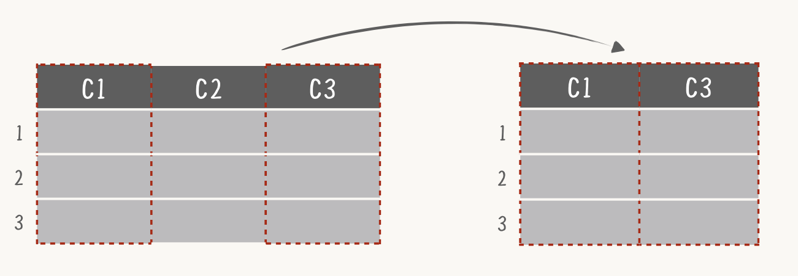{fig-alt="A table with columns C1, C2 and C3 becomes a table with only C1 and C3." fig-align="center" width="70%"}

## **Transform** or **add** columns

👉 Add a column `C3 = 2*C1`

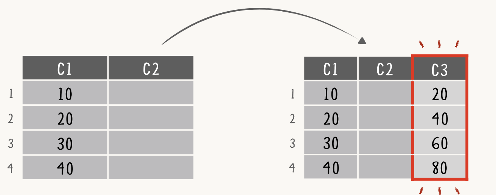{fig-alt="A table with columns C1 and C2 gains a highlighted column C3, holding twice the values of C1." fig-align="center" width="70%"}

## **Subset rows** according to a value in a column

👉 Filter only the rows where `C1 == "DOG"`

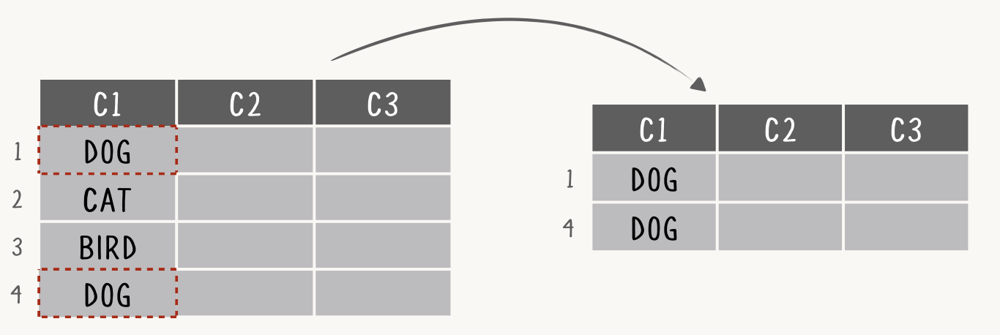{fig-alt="A table with C1 values DOG, CAT, BIRD and DOG becomes a table with only the two DOG rows." fig-align="center" width="70%"}

## **Order** the rows

👉 Arrange the rows according to the values of `C3`

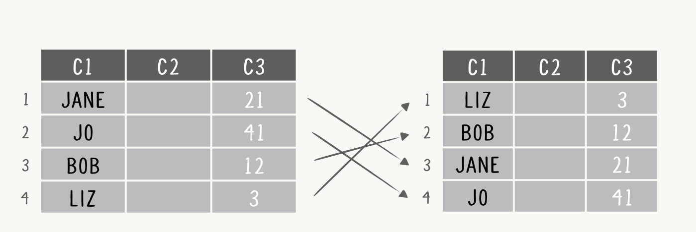{fig-alt="Four rows with C3 values 21, 41, 12 and 3 are reordered so that C3 increases: 3, 12, 21, 41." fig-align="center" width="70%"}

## Compute **summary statistics**


👉 The **sum of the `sales` column** over the whole dataset

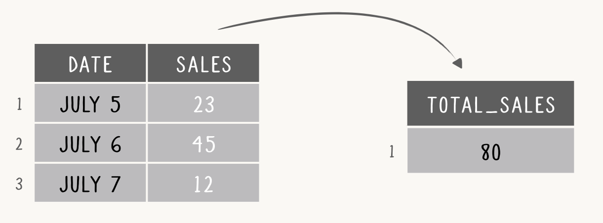{fig-alt="A table of three dates with sales of 23, 45 and 12 becomes a single row: total_sales, 80." fig-align="center" width="70%"}


## Compute **grouped** **summary statistics**

👉 The sum of the `sales` **per `client`**.

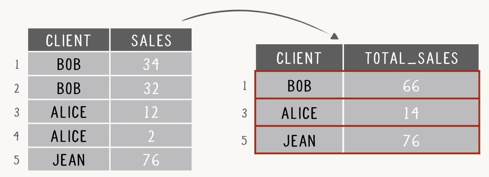{fig-alt="Five sales rows for clients Bob, Alice and Jean become one row per client with their total sales: 66, 14 and 76." fig-align="center" width="70%"}

The `client` becomes the **grouping** factor. 

## A Grammar for Data Manipulation {.center .smaller auto-animate="true"}

::: {.content-box-marine}
Because we are dealing with **tabular data**, the possible manipulations are a set of systematised tasks
:::

| Use                                                                                                 |
|-----------------------------------------------------| 
| **pick a set of columns** from a `tibble`                                                           |
| **transform and add columns** to the `tibble`                                                       |
| **subsets rows** according to the values of a column                                                |
| **order the rows** according to the values of a (set of) column(s)                                  |
| **group** according to the values of a (set of) column(s) to perform calculations within the groups |
| create a new table containing **summary statistics** for a set of columns                        |

. . . 

::: {.content-box-marine}
`{dplyr}` and `{tidyr}` are packages that provide a whole **grammar** to manipulate data.
:::


## A Grammar for Data Manipulation {.center .smaller auto-animate="true"}

::: {.content-box-marine}
`{dplyr}` and `{tidyr}` are packages that provide a whole **grammar** to manipulate data.
:::


:::: {.columns}

::: {.column width="25%"}

```{r, echo = FALSE, fig.cap="These pliers will help us wrangle our data!", fig.align='center', out.width = "90%", fig.alt="The hexagonal logo of the dplyr package: a pair of pliers."}
#| label: img-dplyr-logo
knitr::include_graphics(path = "images/hex-dplyr.png")
```
:::

::: {.column width="75%"}

|           Verb            | Use                                                                                                 |
|:-----------------:|-----------------------------------------------------| 
| `select()`    | **pick a set of columns** from a `tibble`                                                           |
| `mutate()`    | **transform and add columns** to the `tibble`                                                       |
| `filter()`    | **subsets rows** according to the values of a column                                                |
| `arrange()`   | **order the rows** according to the values of a (set of) column(s)                                  |
| `group_by()`  | **group** according to the values of a (set of) column(s) to perform calculations within the groups |
| `summarise()` | create a new `tibble` containing **summary statistics** for a set of columns                        |

:::


::::

## `{dplyr}`: Why _verbs_?

All the `{dplyr}` functions share a common structure

-   Their **first argument** is the **dataset**.
-   The **other arguments** relate to the **columns** on which we are operating

. . . 

::: {.content-box-marine}
With the **pipe** operator(s), the commands can **chain like sentences**:
:::

``` r
select(dataset, column_1, column_2)

# Is equivalent to:

dataset %>% select(column_1, column_2)

# you see that it reads like a sentence!
```

# 🎾 Let's practice wrangling in a real dataset {background-image="images/jim-sung-eQuMbR-0mco-unsplash.jpg" background-position="cover" background-opacity="0.4"}

## 🎾 The WTA dataset 

- `../data/wta_grand_slam_data.csv` contains the Women's Tennis data.
- one row per **Grand Slam match**.

Use readr to import it: 
```{r}
#| label: read-wta
#| output-location: column-fragment

# 1. attach the package
library(readr)   

# 2. assign data to an object
wta_data <-

  # 3. give the path through the pipe
  "../data/wta_grand_slam_data.csv" %>%
  
  # 4. use the function readr::read_csv()
  read_csv(

  # 5. set all columns as character
    col_types = cols(.default = "c")
    )

wta_data
```

::: {.notes}

3) The path goes **one level up**, to the `data` folder (`../data/`) and it is *fed* to `read_csv()` with the pipe `%>%`
5) to import every column as text (`"c"` for `character`). We do this because `read_csv()` *guesses* the types from the first 1000 lines. columns with many `NA` can be guessed wrong
:::

## 🎾 The columns of the WTA data

`r ncol(wta_data)` columns, grouped by **prefix**:

| column / prefix | Content                                                                        |
|:-----------------:|:----------------------------------------------------|
|     `year`      | Year of the tournament the match took place                                    |
|   `tourney_*`   | Information related to the tournament (`id`, `name`, `surface`, ...)           |
|   `match_num`   | Number of match **within a tournament**                                        |
|   `winner_*`    | Information related to the winner of a given match (`id`, `name`, `hand`, ...) |
|    `loser_*`    | Information related to the loser of a given match (`id`, `name`, `hand`, ...)  |

## 🔎 Inspecting Data


::: {.content-box-marine}
Right after importing, it's always useful to **inspect** your dataset. 
:::

::: fragment

- **Which columns** are in the dataset  
-  Their **types** (numbers, text, dates, ...) 
-  Where the **missing values** (`NA`) are
-  and any other feature (or problem!) in the data

:::

::: fragment
::: {.callout-tip}

## Some inspecting tools

::: {.incremental}
- check the first rows with `head()` or `dplyr::slice_head()`
- get a summary of the contents with `dplyr::glimpse()`
- a visual representation with `visdat::vis_dat()`
:::

:::
:::

## 🔎 Getting a `dplyr::glimpse()` {.scrollable}

-   One line per column: **name**, **type** and the first values

```{r}
#| label: glimpse-wta
glimpse(wta_data)
```


## 🔎 The full picture with `visdat::vis_dat()`

-   **Colours**: the column **types** · **Grey**: **missing** values

```{r, fig.cap = "A bird's-eye view of the WTA dataset using `visdat::vis_dat()`"}
#| label: vis-dat-wta
#| fig-alt: "vis_dat() plot of the WTA data: one vertical band per column, all coloured as character, with grey blocks marking missing values, which are frequent in some columns."
#| output-location: column-fragment
# 1. attach the package visdat
library(visdat)

wta_data %>%

# 2. use visdat::vis_dat()
  vis_dat(
    # 3. avoid warnings about large data
    warn_large_data = FALSE
    )
```

# The `{dplyr}` verbs in action {.subsection background-color="#425556"}

## Picking columns with `select()`

::: {.content-box-marine}
`dplyr::select()` to pick **one** or **several** columns by their name(s)
:::

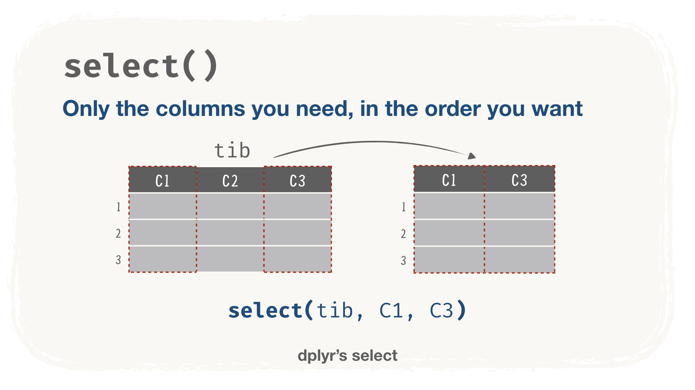{fig-alt="The select() card: select(tib, C1, C3) keeps only columns C1 and C3 of a three-column table." fig-align="center" width="80%"}


## Picking columns with `select()`

👉 use `select` to see who played against who over the years

```{r}
#| label: select-columns
wta_data %>%
  select(year, winner_name, loser_name)
```

## Selection helpers 

::: {.content-box-marine}
Instead of writing all the names, we pick the columns **whose names fulfil a condition**.
:::

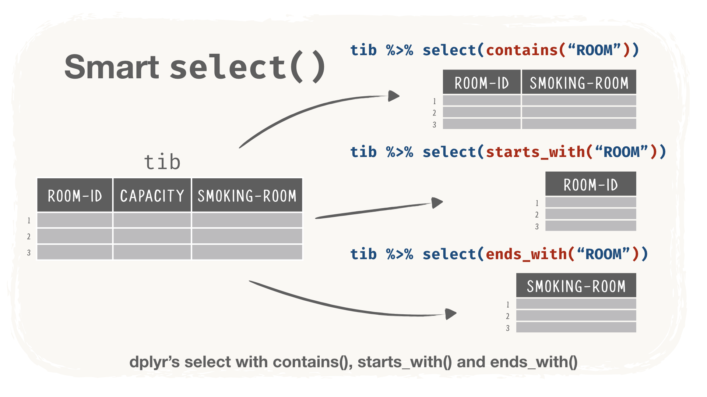{fig-alt="The smart select() card: on a table with columns room-id, capacity and smoking-room, contains(\"room\") keeps room-id and smoking-room, starts_with(\"room\") keeps room-id, and ends_with(\"room\") keeps smoking-room." fig-align="center" width="80%"}

## Selection helpers

👉 `starts_with("winner")` or `starts_with("loser")` to get all the player info

```{r}
#| label: select-helpers
#| output-location: column-fragment
#| fig-alt: "vis_dat() plot of the selected columns: year, then the winner_ and loser_ columns, all of type character."

wta_data %>%
  select(year, 
    starts_with("winner"), 
    starts_with("loser")) %>%
  vis_dat(warn_large_data = FALSE)
```

## Creating/Transforming columns with `mutate()`

::: {.content-box-marine}
`dplyr::mutate()` to **create** or **transform** columns
:::

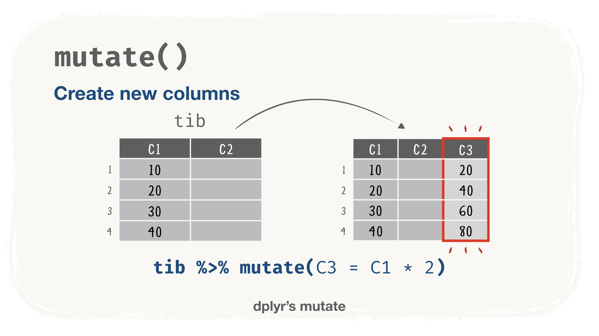{fig-alt="The mutate() card: mutate(C3 = C1 * 2) adds a highlighted column C3 holding twice the values of C1." fig-align="center" width="80%"}

## Creating/Transforming columns with `mutate()` {auto-animate="true"}

👉 Let's transform `year` → **number**, `tourney_date` → **date** (`ymd()` from `{lubridate}`)

```{r}
#| label: slides-mutate-before
#| output-location: column
#| fig-alt: "vis_dat() plot of the selected columns before mutate(): year, the winner_ columns and the tourney_ columns are all of type character."
wta_data %>%
  select(
    year, 
    starts_with("winner"), starts_with("tourney")
    ) %>% 
  vis_dat(warn_large_data = FALSE)
```


## Creating/Transforming columns with `mutate()` {auto-animate="true"}

👉 Let's transform `year` → **number**, `tourney_date` → **date** (`ymd()` from `{lubridate}`)

```{r}
#| label: slides-mutate-after
#| output-location: column
#| fig-alt: "vis_dat() plot of the selected columns after mutate(): year is now numeric and tourney_date is a date, the other columns are still character."
# 1. attach lubridate
library(lubridate)

wta_data %>%
  select(
    year, 
    starts_with("winner"), starts_with("tourney")
    ) %>% 
  
# 2. make the changes
  mutate(
    year = as.numeric(year),
    tourney_date = ymd(tourney_date)
    ) %>% 

  vis_dat(warn_large_data = FALSE)
```

## ⚠️ Making the changes permanent

::: {.content-box-marine}
Applying `mutate()` by itself **does not change the dataset**.
:::

👉 The following pipe **does not modify** the contents of `data` **permanently**.

``` r
data %>% 
  mutate(...)
```
. . . 

::: {.content-box-marine}
In R you need to **(re-)assign** to make your changes perennial
:::

👉  The following pipe **does**

``` r
data <- 
  data %>% 
  mutate(...)
```

## ⚠️ Making the changes permanent

👉 Let's keep the new column types: we **re-assign** the result to `wta_data`

```{r}
#| label: mutate-types
wta_data <-
  wta_data %>%
  mutate(
    year = as.numeric(year),
    tourney_date = ymd(tourney_date))
```

. . .

Now the changes are there for the rest of the unit:

```{r}
#| label: slides-mutate-check
wta_data %>%
  select(year, tourney_date) %>%
  slice_head(n = 3)
```

## Sub-setting rows with `filter()`

::: {.content-box-marine}
`dplyr::filter()` to keep the rows that **fulfil a logical condition**
:::

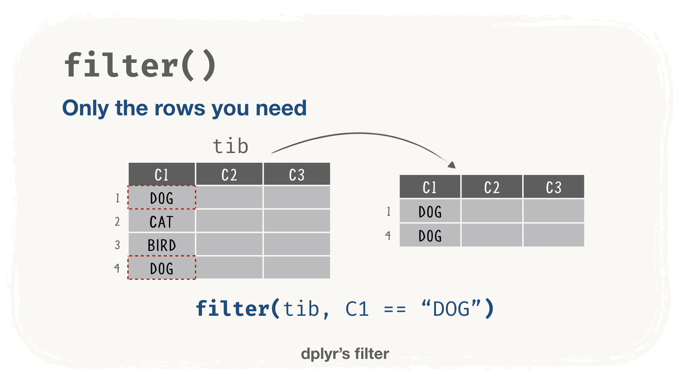{fig-alt="The filter() card: filter(tib, C1 == \"DOG\") keeps rows 1 and 4 of a table whose C1 values are DOG, CAT, BIRD and DOG." fig-align="center" width="80%"}

## Sub-setting rows with `filter()`

👉 Keep only the matches won by Serena Williams

```{r}
#| label: filter-serena
#| output-location: column-fragment
wta_data %>%
  select(year, tourney_name, winner_name) %>%
  filter(winner_name == "Serena Williams")
```

::: fragment
::: {.content-box-marine}
⚠️ Comparison uses the **double** equal sign `==`. The single `=` assigns, e.g. in `mutate()`.
:::
:::

## `filter()` with several conditions

👉 Serena's wins at the Australian tournaments: **all** conditions must hold

```{r}
#| label: filter-serena-australian
#| output-location: column-fragment
# 1. attach stringr
library(stringr)

wta_data %>%
  filter(
    # 2. first condition: the winner
    winner_name == "Serena Williams",
    # 3. second condition: the tournament
    str_detect(
      tourney_name,
      pattern = "Australian")) %>%

# 4. keep a few columns
  select(year, tourney_name, winner_name)
```

::: fragment
Other conditions: `<`, `>=`, `&`, `|`, `%in%`. The handout has the full list.
:::

::: {.notes}
3) `str_detect()` from `{stringr}` returns `TRUE` when the text **contains the pattern**. It catches "Australian Open" and "Australian Championships".

The `<` will be needed in Exercise 2.
:::

## Sort observations with `arrange()`

::: {.content-box-marine}
`dplyr::arrange()` to **order the rows** by the values of some columns
:::

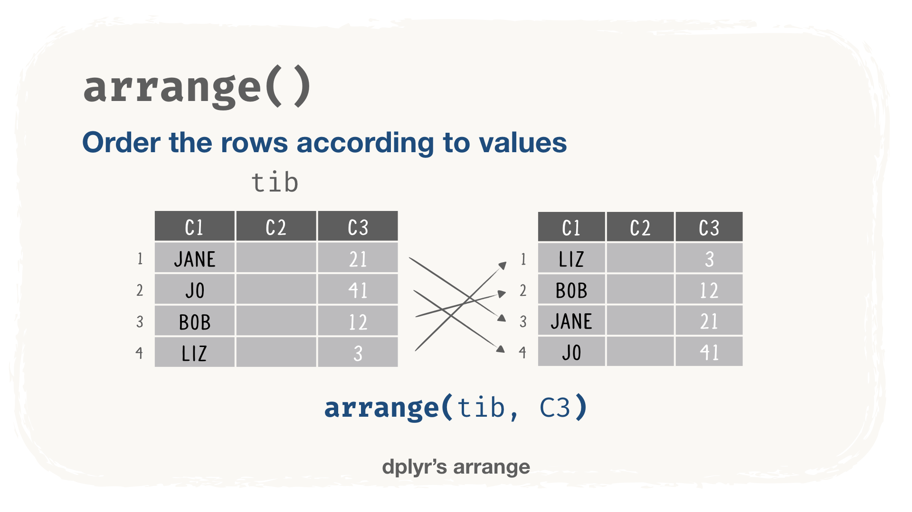{fig-alt="The arrange() card: arranging a table by C3 reorders its rows so that the values of C3 increase." fig-align="center" width="80%"}

## Sort observations with `arrange()`

👉 Which matches are the oldest in the dataset?

```{r}
#| label: arrange-year
#| output-location: column-fragment
wta_data %>%
  select(year, winner_name, tourney_name) %>%
  arrange(year)
```

::: {.notes}
Numbers are sorted in increasing order, text in alphabetical order. `year` is a number because we re-assigned `wta_data`.
:::

## `arrange()`: several columns {auto-animate="true"}

👉 Sort by **year**, then by **winner** within each year

```{r}
#| label: arrange-two-columns
#| output-location: column
wta_data %>%
  select(year, winner_name, tourney_name) %>%
  arrange(year, winner_name)
```

## `arrange()`: several columns {auto-animate="true"}

👉 `desc()` reverses the order: winners from Z to A within each year

```{r}
#| label: arrange-desc
#| output-location: column
wta_data %>%
  select(year, winner_name, tourney_name) %>%
  arrange(year, desc(winner_name))
```

## Exercise Time!

::: callout-important
## Time to work!

Open the exercise notebook `_exercises/exercise-notebook.qmd` and do **[Exercise 2](../_exercises/exercise-notebook.html#exercise-2)**. See you there!
:::

## Producing summary statistics with `summarise()`

::: {.content-box-marine}
`dplyr::summarise()` creates a **new table** with **summaries** of the columns
:::

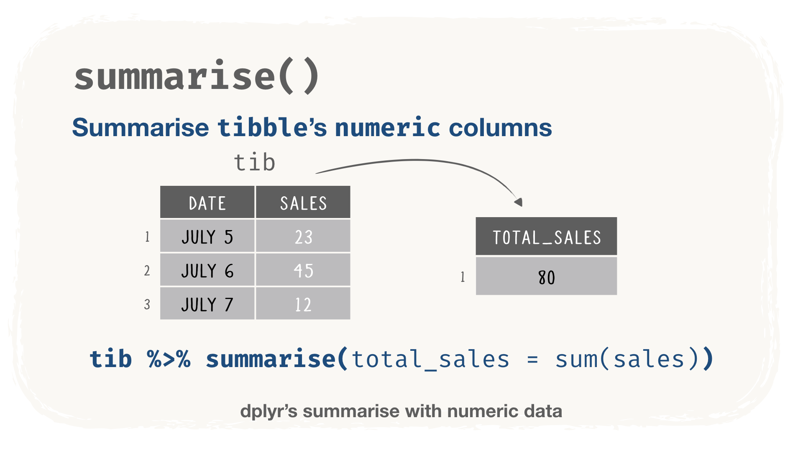{fig-alt="The summarise() card: summarise(total_sales = sum(sales)) turns three rows of daily sales (23, 45, 12) into a single row with total_sales 80." fig-align="center" width="80%"}

## Producing summary statistics with `summarise()`

👉 How many Australian matches did Serena win? `n()` **counts the rows**

```{r}
#| label: summarise-serena-australian
#| output-location: column-fragment
wta_data %>%

# 1. keep Serena's Australian wins
  filter(
    winner_name == "Serena Williams",
    str_detect(
      tourney_name,
      pattern = "Australian")) %>%

# 2. count the rows
  summarise(number_of_wins = n())
```

## Other summary functions

| Summary Statistic | Functions                      |
|:-----------------:|:-------------------------------|
|      Center       | `mean()`, `median()`           |
|      Spread       | `sd()`, `IQR()`, `mad()`       |
|       Range       | `min()`, `max()`, `quantile()` |
|       Total       | `sum()`                        |
|     Position      | `first()`, `last()`, `nth()`   |
|       Count       | `n()`, `n_distinct()`          |
|      Logical      | `any()`, `all()`               |

## Creating groups with `group_by()`

::: {.content-box-marine}
`dplyr::group_by()` **groups** the rows by the values of one or more columns
:::

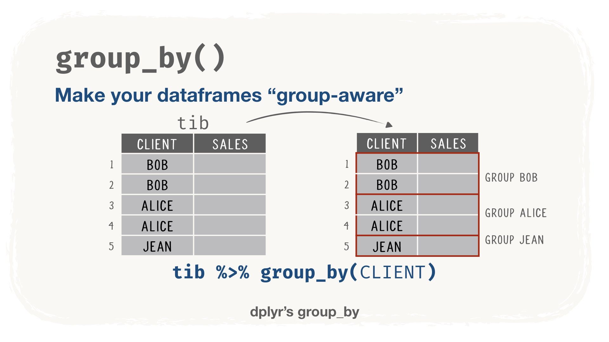{fig-alt="The group_by() card: group_by(client) leaves the table unchanged but makes it group-aware, with one group each for clients Bob, Alice and Jean." fig-align="center" width="80%"}

## Creating groups with `group_by()`

👉 Group the matches by winner, and look for the `# Groups:` line in the printout

```{r}
#| label: group-by-winner
#| render: !expr print
wta_data %>%
  group_by(winner_name)
```

::: {.notes}
The data looks the same, but later computations happen **within** the groups.

`ungroup()` removes the groups: see the handout.
:::

## `group_by()` `%>%` `summarise()`

::: {.content-box-marine}
`summarise()` after `group_by()` gives **one row per group**
:::

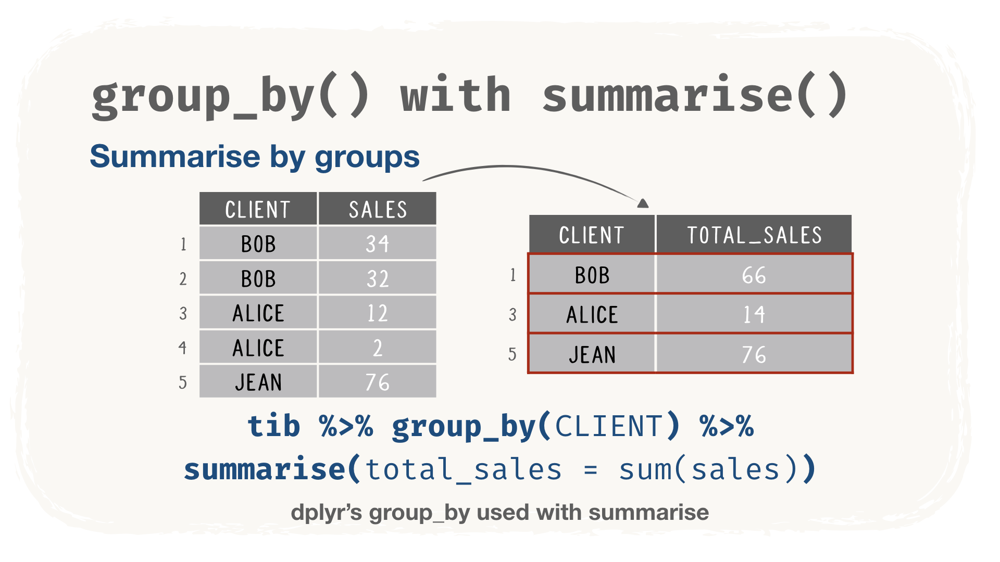{fig-alt="The card for group_by() with summarise(): five sales rows for clients Bob, Alice and Jean become one row per client, with total sales of 66, 14 and 76." fig-align="center" width="80%"}

::: {.notes}
The figure keeps the input order and labels the result rows 1, 3 and 5. In R the result has rows 1 to 3, sorted by client: Alice, Bob, Jean.
:::

## `group_by()` `%>%` `summarise()`

👉 The number of wins of **every** player

```{r}
#| label: wins-per-player
#| output-location: column-fragment
wta_data %>%
  group_by(winner_name) %>%
  summarise(
    number_of_wins = n(),
    .groups = "drop")
```

::: {.notes}
`.groups = "drop"` returns a table **without groups**, as if we had added `ungroup()`. A forgotten grouping is a common source of surprises!
:::

## `group_by()` `%>%` `summarise()`

👉 So, **who won the most**? Sort the result with `arrange()` and `desc()`

```{r}
#| label: wins-ranking
#| output-location: column-fragment
wta_data %>%
  group_by(winner_name) %>%
  summarise(
    number_of_wins = n(),
    .groups = "drop") %>%
  arrange(desc(number_of_wins))
```

## Grouping by several columns

👉 The wins of **each player** in **each tournament**

```{r}
#| label: wins-per-player-tourney
wta_data %>%
  group_by(winner_name, tourney_name) %>%
  summarise(
    number_of_wins = n(),
    .groups = "drop")
```

## Exercise Time!

::: callout-important
## Time to work!

Open the exercise notebook `_exercises/exercise-notebook.qmd` and do **[Exercise 3](../_exercises/exercise-notebook.html#exercise-3)**. See you there!
:::

# Merging Data {.subsection background-color="#425556"}

## Binding and joining

::: {.content-box-marine}
Real data is often split into **several linked tables**: we **merge** them to get the information we need
:::

::: {.incremental}
- **Stack** tables with the same columns: `bind_rows()`
- **Attach** tables that share a column: the `*_join()` verbs
:::

## Three toy datasets

```{r}
#| label: toy-datasets
data_1 <- tibble(id = 1:3, var_1 = c(15, 13, 39))
data_2 <- tibble(id = c(4, 5), var_1 = 10)
data_3 <- tibble(id = 1:3, var_2 = c(10, 12, 14), var_3 = c(45, 20, 2))
```

::::: {.columns}
:::: {.column width="33%"}
```{r}
#| label: print-data-1
data_1
```
::::

:::: {.column width="33%"}
```{r}
#| label: print-data-2
data_2
```
::::

:::: {.column width="33%"}
```{r}
#| label: print-data-3
data_3
```
::::
:::::

## *Stacking* data sets with `bind_rows()`

👉 `data_1` and `data_2`: **same columns**, **different rows**

```{r}
#| label: bind-rows-data
#| output-location: column-fragment
data_1 %>%
  bind_rows(data_2)
```

::: fragment
::: {.content-box-marine}
The left-hand side of the pipe goes **on top**
:::
:::

## *Joining* data sets with `left_join()`

::: {.content-box-marine}
`dplyr::left_join()` attaches columns, matching the rows by a **joining key**
:::

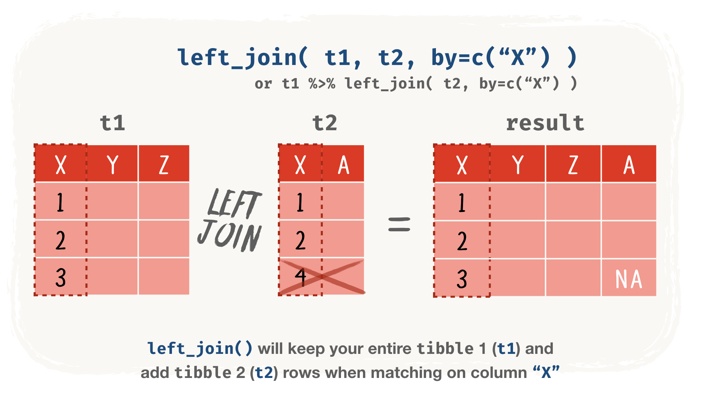{fig-alt="The left_join() card: joining tables t1 and t2 by column X keeps all the rows of t1 and adds column A from t2. Row 4 of t2 has no match and is dropped, and row 3 of t1 has no match in t2, so it gets NA in column A." fig-align="center" width="80%"}

## How `left_join()` works

{fig-alt="Animation of left_join(x, y): the rows of y are matched to the rows of x by their shared key column, the columns of y are attached to x, and the rows of x without a match get missing values." width="40%" fig-align="center"}

**Source:** [Garrick Aden-Buie's](https://github.com/gadenbuie/tidyexplain) Tidy Animated Verbs

::: fragment
::: {.content-box-marine}
Why "left"? It **keeps all the rows of the first** (*left-hand side*) **tibble**
:::
:::

## `left_join()` with a joining key

👉 Stack `data_1` and `data_2`, then attach the columns of `data_3`

```{r}
#| label: left-join-id
#| output-location: column-fragment
data_1 %>%

# 1. stack the first two tables
  bind_rows(data_2) %>%

# 2. attach data_3, matching on id
  left_join(data_3, by = "id")
```

::: fragment
`data_3` has no `id` 4 or 5: their new columns are `NA`.
:::

::: {.notes}
By default, the join uses **all** the shared columns. `by` picks the key. Recent versions of `{dplyr}` also accept `by = join_by(id)`.

There is also a `bind_cols()`, which doesn't check that the rows match: see the handout.
:::

## Rows of the second table without a match

👉 `data_4`: `data_3` plus a row with `id = 8`, which isn't in `data_1`

:::: {.columns}
::: {.column width="50%"}
```{r}
#| label: data-4
data_4 <-
  bind_rows(
    data_3,
    tibble(id = 8, var_2 = 3, var_3 = 12))
data_4
```
:::

::: {.column width="50%" .fragment}

```{r}
#| label: left-join-unmatched
data_1 %>%
  left_join(data_4, by = "id")
```

`id` 8 is gone: only the rows of the **first** table are kept.
:::
::::

# Pivoting Data {.subsection background-color="#425556"}

## Long vs wide tables

::: {.incremental}
-   **Long**: every column is a *variable* → for **analysis** (computations, plots)
-   **Wide**: some columns are named after *values* of a variable → for **display** in reports
:::

```{r, echo = FALSE, fig.cap='Wide-format vs. long-format data', fig.align='center', out.width = "70%", fig.alt="The same data as a wide table, with an id column and one column each for x, y and z, and as a long table with three columns: id, key (holding x, y or z) and val."}
#| label: img-wide-long
knitr::include_graphics("images/original-dfs-tidy.png")
```

## `{tidyr}`: `pivot_longer()` and `pivot_wider()`

:::: {.columns}
::: {.column width="25%"}
```{r, echo = FALSE, fig.cap='The brooms of `{tidyr}` will help us tidy our data!', fig.align='center', out.width = "90%", fig.alt="The hexagonal logo of the tidyr package: brooms."}
#| label: img-tidyr-logo
knitr::include_graphics(path = "images/hex-tidyr.png")
```
:::

::: {.column width="75%"}
{fig-alt="Animation of a wide table turned into a long table with pivot_longer(), and back into a wide table with pivot_wider()." width="480"}

Source: [Garrick Aden-Buie's](https://github.com/gadenbuie/tidyexplain) Tidy Animated Verbs, modified by [Mara Averick](https://twitter.com/dataandme)
:::
::::

## Pivoting into long-form with `pivot_longer()`

::: {.content-box-marine}
`tidyr::pivot_longer()` converts **columns to rows**
:::

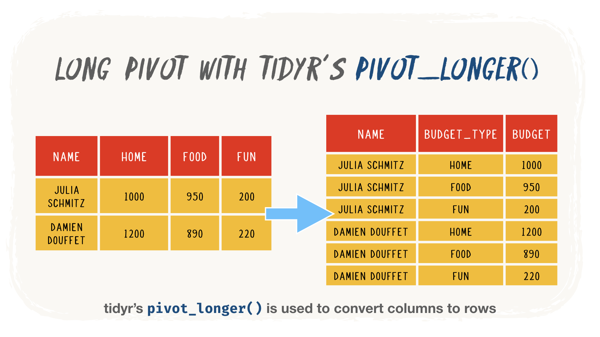{fig-alt="The pivot_longer() card: a budget table with one row per person and columns home, food and fun becomes a table with one row per person and budget type, and columns name, budget_type and budget." fig-align="center" width="80%"}

## How to write `pivot_longer()`

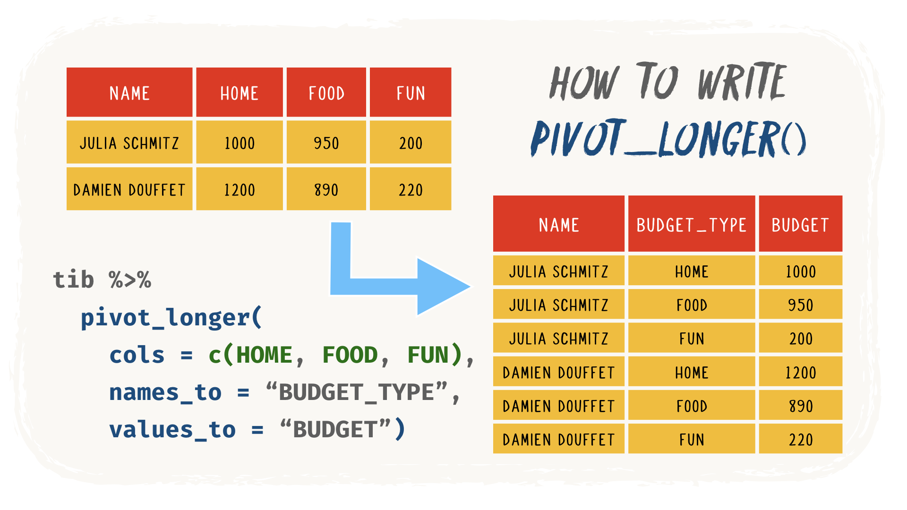{fig-alt="The code for the budget example: pivot_longer(cols = c(home, food, fun), names_to = \"budget_type\", values_to = \"budget\"), next to the wide table and the resulting long table." fig-align="center" width="85%"}

## `pivot_longer()`: `cols`

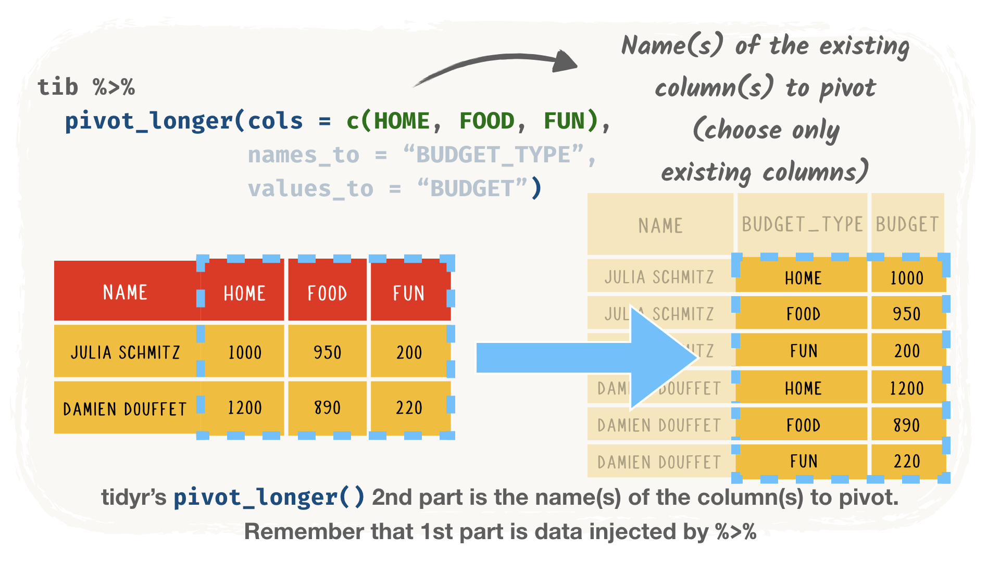{fig-alt="The cols argument names the existing columns to pivot: home, food and fun are highlighted in the wide table, and the budget_type and budget columns they become are highlighted in the long table." fig-align="center" width="85%"}

## `pivot_longer()`: `names_to`

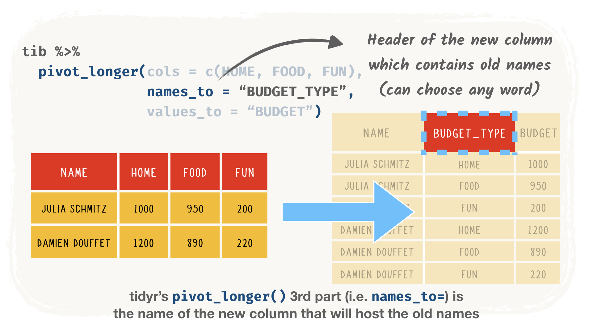{fig-alt="The names_to argument is the header of the new column that holds the old column names, and can be any word: budget_type is highlighted in the long table." fig-align="center" width="85%"}

## `pivot_longer()`: `values_to`

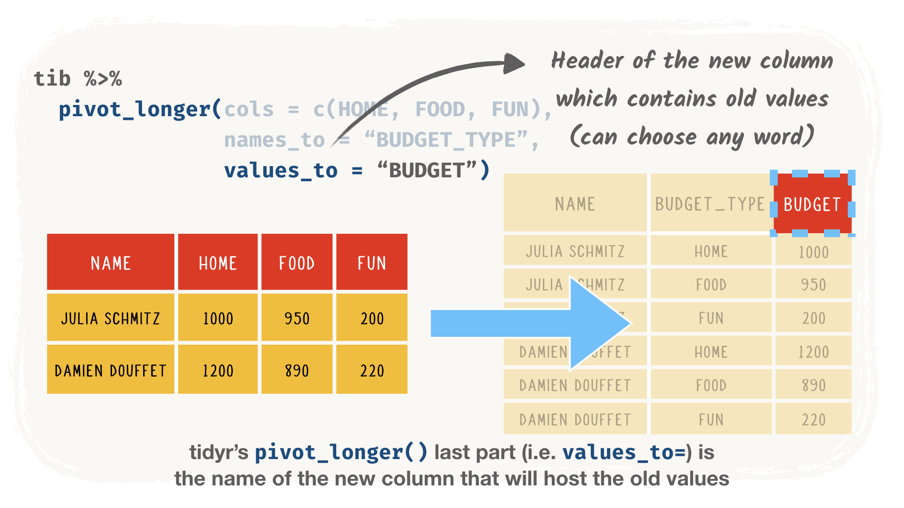{fig-alt="The values_to argument is the header of the new column that holds the old values, and can be any word: budget is highlighted in the long table." fig-align="center" width="85%"}

## `pivot_longer()`: recap

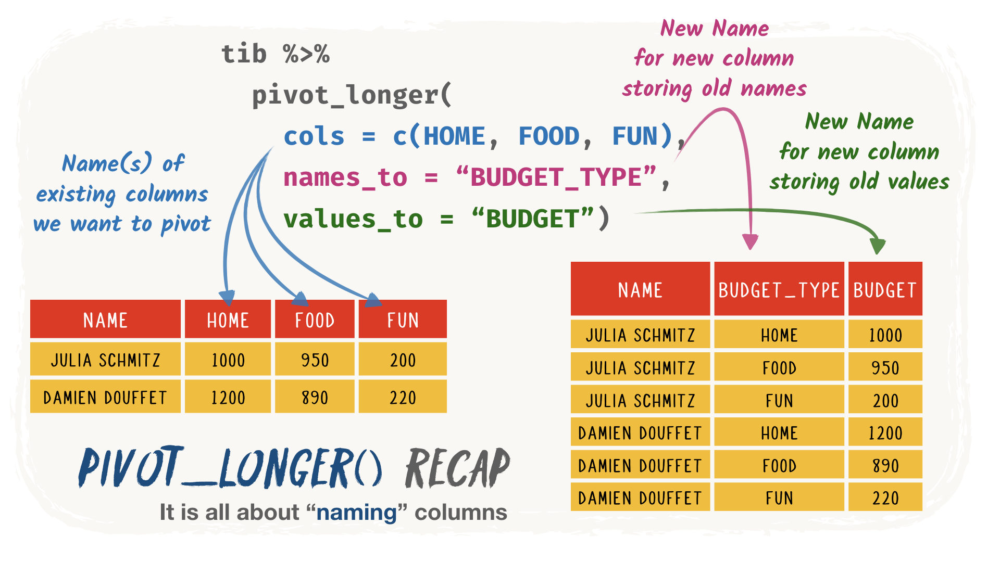{fig-alt="Recap of pivot_longer(): arrows link cols to the existing columns home, food and fun, names_to to the new budget_type column, and values_to to the new budget column." fig-align="center" width="85%"}

## From wide to long

👉 Prototypes measured at 3 timepoints: one column per timepoint

```{r}
#| label: data-5-wide
#| output-location: column-fragment
data_5_wide <-
  tibble(
    prototype = 1:5 ,
    t_1 = c(12,1,3,4,5),
    t_2 = c(13,0,3,6,3),
    t_3 = c(14,-1,3,8,1))
data_5_wide
```

## From wide to long

👉 One `timepoint` column and one `performance` column

```{r}
#| label: pivot-longer
#| output-location: column-fragment
data_5_long <-
  data_5_wide %>%
  pivot_longer(
    # 1. all the columns but prototype
    cols = -c(prototype),
    # 2. where the old names go
    names_to = "timepoint",
    # 3. where the values go
    values_to = "performance"
  )

data_5_long
```

## Cleaner timepoints

👉 Remove the `t_` prefix, and make the timepoints **numbers**

```{r}
#| label: pivot-longer-clean
#| output-location: column-fragment
data_5_long <-
  data_5_wide %>%
  pivot_longer(
    cols = -c(prototype),
    names_to = "timepoint",
    values_to = "performance",
    # 1. remove the `t_` prefix
    names_prefix = "t_",
    # 2. make the timepoints integers
    names_transform = list(
      timepoint = as.integer)
  )

data_5_long
```

::: {.notes}
Participants need these two arguments in Exercise 5.
:::

## Long tables are made for computing

👉 The average performance of every prototype

```{r}
#| label: average-performance
#| output-location: column-fragment
data_5_long %>%
  group_by(prototype) %>%
  summarise(
    average_performance = mean(performance),
    .groups = "drop")
```

## Pivoting into wide-form with `pivot_wider()`

::: {.content-box-marine}
`tidyr::pivot_wider()` does the opposite: it converts **rows to columns**
:::

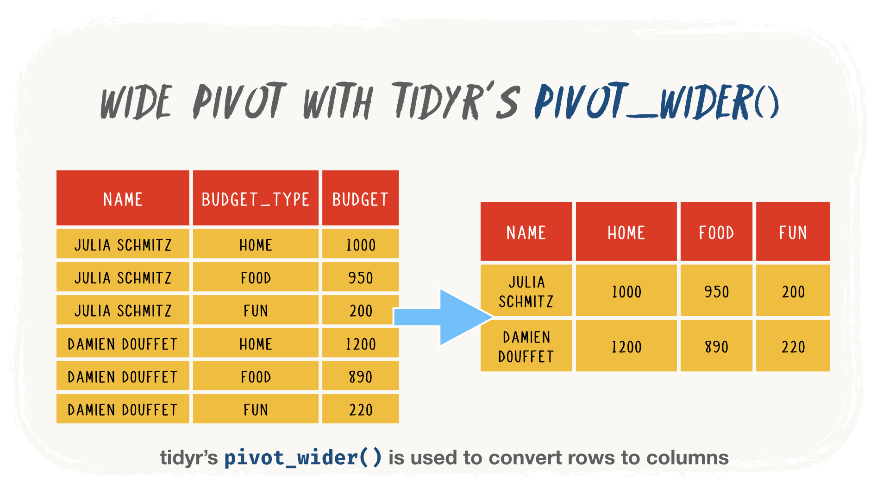{fig-alt="The pivot_wider() card: a budget table with one row per person and budget type becomes a table with one row per person and columns home, food and fun." fig-align="center" width="80%"}

## How to write `pivot_wider()`

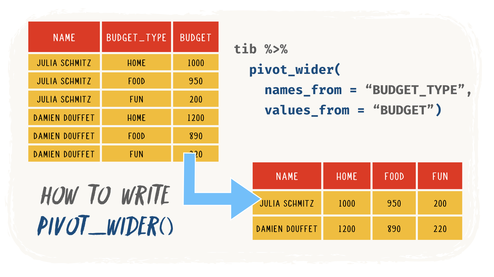{fig-alt="The code for the budget example: pivot_wider(names_from = \"budget_type\", values_from = \"budget\"), next to the long table and the resulting wide table." fig-align="center" width="85%"}

## From long to wide

👉 **Yields** of **crops** by **practice**: the repeated values are hard to read

```{r}
#| label: data-6-long
data_6_long <-
  tibble(
    crop = c(rep("wheat", 3), rep("corn", 3), rep("quinoa",3)),
    practice = rep(c("Type 1", "Type 2", "Type 3"), 3),
    yield = c(12,65,85,98, 65, 45, 72, 67, 59)
    )
data_6_long
```

## From long to wide

👉 One column per practice: ready for a report

```{r}
#| label: pivot-wider
#| output-location: column-fragment
data_6_long %>%
  pivot_wider(
    # 1. the names of the new columns
    names_from = practice,
    # 2. the values of the new columns
    values_from = yield)
```

::: {.notes}
The handout shows how to style this table with `{kableExtra}`.
:::

## Exercise Time!

::: {.notes}
At the end: mention the bonus material!
:::

::: callout-important
## Time to work!

Open the exercise notebook `_exercises/exercise-notebook.qmd` and do **[Exercise 4](../_exercises/exercise-notebook.html#exercise-4) and [Exercise 5](../_exercises/exercise-notebook.html#exercise-5)**. See you there!
:::
