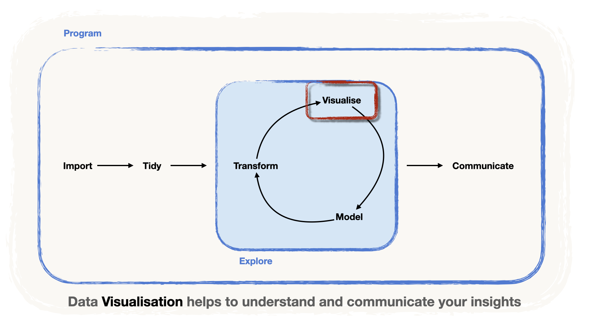

<!-- Translation of handout.qmd. Don't change the structure here: change handout.qmd, then port the changes (see README.md, "Translations"). -->

```{r setup, include=FALSE}
# Optionen für alle Chunks:
knitr::opts_chunk$set(
	echo = TRUE,
	message = FALSE,
	warning = FALSE,
	fig.align = 'center',
	fig.width = 16/2,
	fig.height = 9/2
)
library(tidyverse)
library(knitr)

```

{fig-alt="Die Data-Science-Pipeline: importieren, dann aufbereiten, dann eine Schleife aus transformieren, visualisieren und modellieren, dann kommunizieren. Der Schritt «visualisieren» ist hervorgehoben: Datenvisualisierung hilft, Erkenntnisse zu verstehen und zu kommunizieren." width="80%" fig-align="center"}

Wir lernen nun einen weiteren Schritt der Datenpipeline kennen: die Visualisierung.

-   Die Datenvisualisierung ist ein wichtiger Teil der Erkundungsschleife,
-   aber auch ein sehr wichtiges **Werkzeug, um Ergebnisse** klar und aussagekräftig **zu kommunizieren**.

Es gibt viele Ansätze, eine Grafik aus Daten zu erstellen. Heute konzentrieren wir uns auf den **Visualisierungsansatz**, der auf der **Grammatik der Datenvisualisierung** beruht und in R mit dem Paket `{ggplot2}` umgesetzt ist.

# Eine Grammatik der Datenvisualisierung

Die Grammatik der Grafik (siehe [Wilkinson, 2005](https://link.springer.com/book/10.1007/0-387-28695-0 "The Grammar of Graphics, Wilkinson 2005")) ist ein Versuch, die **Erstellung quantitativer Grafiken** zu **systematisieren** und zu **erweitern**. Die Idee ist, **Regeln** aufzustellen, ähnlich der **Grammatik einer natürlichen Sprache**.

So wie eine natürliche Sprache syntaktische Bausteine wie **Nomen**, **Adjektive**, **Verben** und **Adverbien** verwendet, um **Aussagen** zu bilden, stützt sich die Grammatik der Grafik auf Bausteine, nämlich:

-   **Daten**
-   **Ästhetiken**
-   **Geometrien**
-   **Themes**

Sehen wir uns diese Bausteine im Detail an.

#### **Die Daten** {.unnumbered}

Der **Datensatz** mit den **Variablen, die wir darstellen wollen**. Nehmen wir zur Illustration einen Datensatz mit drei Spalten: **Variable 1**, **Variable 2** und **Group** (A, B oder C).

```{r}
#| label: example-data
#| include: false
set.seed(123)
example_data <-
  tibble(x = runif(100, 0, 10) %>% round(digits = 2)) %>%
  mutate(group = c(rep("A", 30), rep("B", 40), rep("C", 30))) %>%
  mutate(
    y = round(4 * x + rnorm(100, sd = 4), digits = 2),
    y = case_when(
      group == "B" ~ y + 12,
      group == "C" ~ y - 5 * x + 12,
      .default = y
    )
  ) %>%
  rename(`Variable 1` = x, `Variable 2` = y, Group = group) %>%
  relocate(Group, `Variable 1`, `Variable 2`)
```

```{r}
#| label: example-data-table
#| echo: false
example_data %>%
  head() %>%
  kable()
```

#### **Ästhetische Elemente und ästhetisches Mapping** {.unnumbered}

Die **Merkmale der Grafik**, d. h. die Elemente der Grafik, die von den Daten abhängen sollen. Zum Beispiel:

-   die Achsen `x` oder `y`,
-   die Farbe (`color`) oder die Füllfarbe (`fill`) der gezeichneten Flächen oder Linien,
-   die Grösse (`size`) der Flächen.

Ein **ästhetisches Mapping** ist die Art, wie wir die **Variablen** unserer Daten mit der **Grafik verknüpfen**.

-   In unserer Illustration haben wir zwei numerische Variablen und eine kategoriale Variable.
-   Es ist sinnvoll, **die numerischen Variablen** den Achsen `x` und `y` **zuzuordnen** und die kategoriale Variable der Farbe (`color`).
-   Das ästhetische Mapping lautet also `x = Variable 1`, `y = Variable 2` und `color = Group`.

#### **Geometrien** {.unnumbered}

Die **Art der Grafik**, die wir zeigen wollen.

-   Hier möchten wir ein Streudiagramm, also wählen wir eine `point`-Geometrie mit `geom_point()`.
-   Weitere Möglichkeiten sind Linien (`line`), Flächen (`area`), Säulen (`col`umn), Balken (`bar`)…
-   Die Wahl hängt von der **Fragestellung** und der **Art der Variablen** ab.

#### **Themes** {.unnumbered}

Die ganze «Tinte», d. h. die rein kosmetischen Elemente der Grafik: die Titel, die Form der Achsen usw.

Mit diesen Elementen erstellen wir eine Grafik.

```{r}
#| label: example-plot
#| echo: false
#| fig-alt: "Streudiagramm von Variable 2 gegen Variable 1, nach Group eingefärbt: In jeder der Gruppen A, B und C liegen die Punkte auf einer Geraden, aber die Geraden unterscheiden sich zwischen den Gruppen."
# Daten
example_data %>%
  ggplot() +

# Ästhetisches Mapping
  aes(
    x = `Variable 1`,
    y = `Variable 2`,
    color = Group) +

# Geometrie
  geom_point() +

# Theme
  theme_minimal() #<4>
```

Aus dieser Grafik sehen wir:

1.  Es gibt einen klaren linearen Zusammenhang zwischen Variable 1 und Variable 2.
2.  Dieser Zusammenhang ist jedoch je nach Gruppe verschieden.

Sehen wir uns nun an, wie man in R mit `{ggplot2}` Grafiken nach der Grammatik der Grafik erstellt.

# Die Syntax von `{ggplot2}`

Das Paket, das im `{tidyverse}` den Ansatz der Grammatik der Grafik umsetzt, ist `{ggplot2}`.

::: callout-note
Es steckt sogar im Namen! Das «gg» steht für… **g**rammar of **g**raphics.
:::

Für die Illustrationen verwenden wir die Daten der Grand-Slam-Einzelspiele der Frauen von 1968 bis 2021, gespeichert in `wta_grand_slam_data.csv`.

```{r}
#| label: read-finals
#| code-fold: true
library(readr)
library(dplyr)

wta <-
  "../data/wta_grand_slam_data.csv" %>%
  read_csv()

finals <- wta %>%
  filter(round == "F")

head(finals)
```

::: callout-important

Wichtig ist zu verstehen, dass `{ggplot2}` mit **Informationsschichten** (*layers*) arbeitet.

-   Zuerst erstellen wir einen **Basisplot**, bestehend aus
    -   den **Daten** und…
    -   dem **ästhetischen Mapping**…
-   …dem wir dann die **Geometrien** hinzufügen…
-   …und danach alle kosmetischen Elemente und weiteren Schichten.
:::

# Streudiagramme mit `geom_point()`

> *Gibt es einen **Trend beim Alter** der Turniersiegerinnen über die **Jahre**?*

Wir laden das Paket wie gewohnt mit `library()`. Um dann die Basisschicht zu erstellen, rufen wir die Funktion `ggplot()` auf:

-   Wir legen die Daten mit `data = finals` fest.
-   Ausserdem bilden wir die `x`-Achse auf `year` und die `y`-Achse auf `winner_age` ab.

::: callout-important
Das **ästhetische Mapping** definieren wir mit der Funktion `aes(...)`.
:::

```{r}
#| label: base-plot-year-age
#| fig-alt: "Eine leere Grafik: Die Achsen year und winner_age sind gezeichnet, aber es gibt keine Datenpunkte."

# ggplot2 laden
library(ggplot2)

# einen Basisplot erstellen
ggplot(data = finals, # die Daten
       mapping = aes(
        x = year, # die x-Achse auf year abbilden
        y = winner_age) # die y-Achse auf winner_age abbilden
       )
```

> Noch nichts! Die Geometrie fehlt! Aber welche Geometrie sollen wir hinzufügen?

-   Beginnen wir mit **Punkten**: Wir wollen einen Punkt pro Beobachtung.
-   Wir legen die **Geometrie** mit `geom_point()` fest…
    -   …die wir mit dem Zeichen `+` **zu unserer Basisschicht hinzufügen** müssen.

::: callout-warning
In `{ggplot2}` fügen wir Schichten mit `+` statt mit `%>%` hinzu!
:::

```{r}
#| label: geom-point-year-age
#| fig-alt: "Streudiagramm des Alters der Siegerin gegen das Jahr für die Grand-Slam-Finals: kein allgemeiner Trend, aber einige Punkte reihen sich in kurzen Gruppen auf."

library(ggplot2)

ggplot(data = finals, # die Daten
       mapping = aes(
        x = year, # die x-Achse auf year abbilden
        y = winner_age) # die y-Achse auf winner_age abbilden
       ) +
  geom_point() # unsere gewählte Geometrie: Punkte
```

> Leider nicht sehr aufschlussreich.

-   Es gibt **keinen einheitlichen Trend** beim Alter der WTA-Siegerinnen über die Zeit.
-   Aber wir sehen **Gruppen** (*clusters*), d. h. Bereiche, in denen die Punkte auf einer Linie liegen.

> Könnte es Trends innerhalb einer Gruppe geben?

-   Um das zu prüfen, könnten wir eine kategoriale Variable auf die Ästhetik `color` abbilden.
-   Versuchen wir es mit `surface`, d. h. ob das Spiel auf Sand (Clay), Rasen (Grass) oder Hartplatz (Hard) gespielt wird.

```{r}
#| label: color-surface
#| fig-alt: "Dasselbe Streudiagramm des Alters der Siegerin gegen das Jahr, mit den Punkten nach Belag eingefärbt (Clay, Grass, Hard): immer noch kein einheitlicher Trend."

library(ggplot2)

ggplot(data = finals,
       mapping = aes(
        x = year,
        y = winner_age,
        color = surface)
       ) + # surface auf color abbilden
  geom_point()
```

> Die Punkte haben jetzt **Farben**… aber immer noch keinen einheitlichen Trend.
>
> Sollen wir es mit einer anderen Variable versuchen? Vielleicht entstehen diese Gruppen, weil **dieselbe Spielerin über viele Jahre gewinnt** und dabei **älter wird**.

-   Prüfen wir diese Vermutung, indem wir `winner_name` auf die Ästhetik `color` abbilden…

```{r fig.width=10, fig.height= 5}
#| label: color-winner
#| fig-alt: "Streudiagramm des Alters der Siegerin gegen das Jahr, mit einer Farbe pro Siegerin und ohne Legende: Punkte derselben Farbe reihen sich auf und steigen mit den Jahren an."

library(ggplot2)

ggplot(data = finals,
       mapping = aes(
        x = year,
        y = winner_age,
        color = winner_name) # winner_name auf color abbilden
        ) +
  geom_point() +
  theme(legend.position = "none") # 54 Spielerinnen: zu viele für eine lesbare Legende
```

> Voilà! Die meisten **Punkte derselben Farbe liegen auf einer Linie**: Das erklärt die Gruppen.

::: callout-note
Eine dritte Variable auf eine Ästhetik wie die Farbe abzubilden, hilft oft, Trends innerhalb von **Gruppen** zu entdecken.
:::

::: {.callout-tip collapse="true"}
## Beachten Sie die Chunk-Option!

Wir haben eine Grösse der Grafik in den Chunk-Optionen festgelegt (`fig.width=10, fig.height= 5`), weil wir **die Grafik vergrössern** wollen.

Wir haben auch **die Legende ausgeblendet**: Bei 54 verschiedenen Spielerinnen könnte niemand 54 Farben ihren Namen zuordnen. Hier müssen wir nur sehen, dass Punkte derselben Farbe auf einer Linie liegen.
:::

::: {.callout-note collapse="true"}
## Die Grafik nach Belag war nicht nutzlos

Sie sehen, dass es **vor 1977** weniger blaue Punkte gibt: Die Turniere wurden nur auf *Rasen* oder *Sand* gespielt, *Hartplätze* kamen erst nach diesem Jahr dazu.
:::

# Boxplots mit `geom_boxplot()`

> *Unterscheidet sich die Verteilung des Alters der Turniersiegerinnen zwischen den verschiedenen Belägen?*

Wir können nun **eine andere Frage** stellen und versuchen, sie mit einer **anderen Geometrie** zu beantworten. Boxplots sind eine gute Wahl, da sie **Verteilungen** gut **zusammenfassen**.

```{r}
#| label: base-plot-surface
#| fig-alt: "Eine leere Grafik mit surface (Clay, Grass, Hard) auf der x-Achse und winner_age auf der y-Achse."
ggplot(data = finals,
       mapping = aes(x = surface, # wir ändern das Mapping der x-Achse
                     y = winner_age))
```

Für die Boxplot-Geometrie fügen wir `geom_boxplot()` hinzu:

```{r}
#| label: geom-boxplot
#| fig-alt: "Boxplots des Alters der Siegerin nach Belag: Die Siegerinnen auf Rasen sind tendenziell älter, die auf Hartplatz jünger."
ggplot(data = finals,
       mapping = aes(x = surface,
                     y = winner_age)) +
  geom_boxplot() # die Geometrie für den Boxplot hinzufügen
```

::: {.callout-note collapse="true"}
## Woher kommen die Boxen?

Die Kennzahlen für die Boxplots (d. h. der Median, das obere und das untere Quartil) werden beim Zeichnen der Grafik aus den «rohen» Daten berechnet.
:::

> Voilà! Offenbar begünstigt der **Rasen** die **älteren Spielerinnen**, während die **jüngeren Spielerinnen** auf **Hartplätzen gewinnen**.
>
> (Wir können **vermuten**, dass der Ball auf **Rasen etwas langsamer** und auf **Hartplätzen schneller** ist, was die «physischeren», also jüngeren, Spielerinnen begünstigt!)

::: callout-warning
## Explorative Datenanalyse

Wenn wir die Daten so darstellen, erhalten wir einen guten Hinweis darauf, ob es Unterschiede zwischen den Kategorien gibt. Solche Grafiken dienen also der **Erkundung** der Zusammenhänge zwischen Variablen.

Um diese Zusammenhänge zu **bestätigen**, braucht es jedoch **mehr Arbeit**.

-   Zum Beispiel kann ein **statistischer Test** bestätigen, dass die beobachteten Unterschiede nicht zufällig sind.
-   (Dabei sollten wir bedenken, dass die Beobachtungen nicht ganz unabhängig voneinander sind!)
:::

# Weitere Geometrien `geoms_*` hinzufügen

Wie bereits erwähnt, arbeitet `{ggplot2}` mit **Informationsschichten**. In unseren Beispielen haben wir den **Basisplot** gezeichnet und dann **eine einzige Geometrie** hinzugefügt (Punkte oder Boxplot).

Konzentrieren wir uns auf den Vergleich des Alters der Siegerinnen zwischen den Belägen. Was, wenn wir mehr Information zeigen möchten? Zum Beispiel:

> -   Gibt es Unterschiede in der Anzahl Beobachtungen pro Kategorie?
> -   Gibt es Extremwerte?

Legen wir ***Punkte*** **über den Boxplot**, indem wir die Geometrie `geom_point()` hinzufügen:

```{r}
#| label: boxplot-points
#| fig-alt: "Boxplots des Alters der Siegerin nach Belag mit darübergelegten Punkten: Die Punkte stapeln sich auf einer einzigen senkrechten Linie pro Belag."
ggplot(data = finals,
       mapping = aes(x = surface,
                     y = winner_age)) +
  geom_boxplot() +
  geom_point() # eine neue Geometrie für dieselben Mappings hinzufügen
```

::: callout-warning
## Vorsicht vor Overplotting!

Jetzt haben wir ein kleines Visualisierungsproblem: **Overplotting**!

-   Overplotting entsteht, wenn **viele Punkte übereinander gezeichnet werden, sodass einzelne Punkte schwer zu erkennen sind.**
-   Das passiert oft, wenn wir Punkte über kategoriale Variablen zeichnen.
:::

Um die Falle des Overplottings zu vermeiden, «schütteln» wir die Punkte zufällig entlang der x-Achse. Dazu ändern wir die Geometrie zu `geom_jitter()`:

```{r}
#| label: boxplot-jitter
#| fig-alt: "Boxplots des Alters der Siegerin nach Belag mit gestreuten Punkten: Die Punkte sind zufällig seitlich verteilt, sodass die einzelnen Beobachtungen sichtbar sind."
ggplot(data = finals,
       mapping = aes(x = surface,
                     y = winner_age)) +
  geom_boxplot() +
  geom_jitter() # Jitter darüberlegen
```

Wir können den Jitter etwas anpassen, indem wir die Breite (`width`) der Streuung festlegen:

```{r}
#| label: boxplot-jitter-width
#| fig-alt: "Dieselbe Grafik mit schmalerem Jitter: Die Punkte bleiben nahe bei ihrer Box."
ggplot(data = finals,
       mapping = aes(x = surface,
                     y = winner_age)) +
  geom_boxplot() +
  geom_jitter(width = 0.2) # die Punkte etwas weniger streuen
```

::: callout-note
## Jede Schicht hat Argumente

Beachten Sie, dass wir das Argument `width` angepasst haben. Allgemein gilt: Jede Schicht ist eine Funktion, also hat sie Argumente!
:::

# Fallstudie: ein Balkendiagramm gestalten

Stellen wir eine andere Frage:

> *Wer hat die meisten Grand-Slam-Titel gewonnen*?

Erstellen wir zuerst den Datensatz, in dem wir die von jeder Spielerin gewonnenen Finals zählen, und sehen wir uns seine ersten Zeilen an.

::: callout-note
Setzen wir unsere Kenntnisse der **Datenaufbereitung** ein!
:::

```{r}
#| label: count-total-wins
total_wins <- finals %>%
  group_by(winner_name) %>%
  summarise(total_wins = n(), .groups = "drop") %>%
  arrange(desc(total_wins))

slice_head(total_wins, n = 6)
```

Mit `geom_col()` können wir daraus eine Grafik erstellen:

```{r}
#| label: geom-col-all
#| fig-alt: "Horizontales Balkendiagramm der Anzahl Titel aller 54 Siegerinnen, von oben nach unten in umgekehrter alphabetischer Reihenfolge: Die Namen überlappen sich und die Grafik ist schwer lesbar."
ggplot(data = total_wins,
       mapping = aes(x = total_wins,
                     y = winner_name)) +
  geom_col()
```

Zeit für etwas mehr Schliff mit den Werkzeugen von `{ggplot2}`!

## Die Balken ordnen

Im Moment sind die Balken in alphabetischer Reihenfolge von `winner_name` geordnet:

-   Das liegt daran, dass `winner_name` noch vom Typ `character` ist,
-   und `ggplot()` reagiert nicht auf unseren Aufruf von `arrange()`!

::: callout-important

Um die Balken zu ordnen, müssen wir für die Variable `winner_name` **eine neue Reihenfolge festlegen**. Dazu wandeln wir sie in einen `factor` um: einen Variablentyp **mit einer Reihenfolge**. Im `{tidyverse}` verwenden wir dafür das Paket `{forcats}`.
:::

Ordnen wir `winner_name` mit `forcats::fct_reorder()` nach `total_wins`:

```{r}
#| label: reorder-winners
library(forcats)

total_wins <- total_wins %>%
  # winner_name nach total_wins ordnen
  mutate(winner_name = fct_reorder(winner_name, total_wins))
```

Mit `glimpse()` sehen Sie, dass `winner_name` jetzt als Faktor (`fct`) gespeichert ist!

```{r}
#| label: total-wins-head-reordered
glimpse(total_wins)
```

Zeichnen wir die Grafik noch einmal…

```{r}
#| label: geom-col-ordered
#| fig-alt: "Dasselbe Balkendiagramm mit den Balken nach Anzahl Titel geordnet, von den meisten Titeln oben bis zu den wenigsten unten."
ggplot(data = total_wins,
       mapping = aes(x = total_wins,
                     y = winner_name)) +
  geom_col()
```

> Die Grafik ist schon viel lesbarer! …aber wie können wir sie verbessern?

## Unsere Botschaft fokussieren

Wir können uns zum Beispiel **auf die Top 20 konzentrieren**:

-   Dafür verwenden wir `slice_max()`…
-   …und übergeben das Ergebnis direkt an `ggplot()`,
-   so bleibt das ursprüngliche Tibble unverändert.

```{r}
#| label: top20-bars
#| fig-alt: "Geordnetes Balkendiagramm der Anzahl Titel der 20 erfolgreichsten Siegerinnen, angeführt von Serena Williams und Steffi Graf."
total_wins %>%
  slice_max(order_by = total_wins, n = 20) %>%
  ggplot(mapping = aes(x = total_wins,
                       y = winner_name)) +
  geom_col()
```

> Viel besser, die Grafik spricht fast für sich. Aber kümmern wir uns um die Achsen.

## Zeit für Kosmetik!

Zeit, einen Titel hinzuzufügen und die Achsennamen anzupassen. Dazu fügen wir unserer Grafik eine `labs()`-Schicht hinzu.

::: callout-note
Die Schicht `labs()` gehört zu den Schichten, die sich um die *kosmetischen* Aspekte der Grafik kümmern.
:::

```{r}
#| label: top20-labs
#| fig-alt: "Das Top-20-Balkendiagramm mit dem Titel «Serena Williams hat 23 Grand-Slam-Titel gewonnen», einem Untertitel, einer Beschriftung der x-Achse und einer Quellenangabe."
total_wins %>%
  slice_max(order_by = total_wins, n = 20) %>%
  ggplot(mapping = aes(x = total_wins,
                       y = winner_name)) +
  geom_col() +
  # Beschriftungen hinzufügen
  labs(title = "Serena Williams hat 23 Grand-Slam-Titel gewonnen",
       subtitle =  "Gefolgt von der legendären Steffi Graf mit 22 Titeln",
       x = "Anzahl Grand-Slam-Titel",
       y = "",
       caption = "Quelle: https://github.com/JeffSackmann")
```

> Jetzt können wir der Grafik ein anderes Theme geben.

::: callout-note
`{ggplot2}` bietet mehrere fertige Themes. Eine Liste finden Sie [hier](https://ggplot2.tidyverse.org/reference/ggtheme.html). Einige davon:

-   `theme_minimal()`: ein guter Ausgangspunkt
-   `theme_dark()`: wenn [Sie es dunkler wollen](https://youtu.be/v0nmHymgM7Y)
-   `theme_bw()`: um alles in Schwarz-Weiss zu sehen
-   `theme_classic()`

Die Vorschläge sehen Sie, wenn Sie `theme_` in die Konsole tippen.
:::

Wählen wir `minimal`…

```{r}
#| label: top20-theme-minimal
#| fig-alt: "Das beschriftete Top-20-Balkendiagramm mit theme_minimal(): kein grauer Hintergrund und helle Gitterlinien."
total_wins %>%
  slice_max(order_by = total_wins, n = 20) %>%
  ggplot(mapping = aes(x = total_wins,
                       y = winner_name)) +
  geom_col() +
  labs(title = "Serena Williams hat 23 Grand-Slam-Titel gewonnen",
       subtitle =  "Gefolgt von der legendären Steffi Graf mit 22 Titeln",
       x = "Anzahl Grand-Slam-Titel",
       y = "",
       caption = "Quelle: https://github.com/JeffSackmann") +
  # ein Theme hinzufügen
  theme_minimal()
```

## Wie wäre es mit etwas Farbe?

Geben wir unseren Balken Farbe. Wir können `fill = "lightblue"` verwenden…

```{r}
#| label: fill-in-aes
#| fig-alt: "Das Balkendiagramm mit fill = 'lightblue' innerhalb von aes(): Die Balken sind lachsrot, und eine Legende zeigt einen einzigen Eintrag mit der Bezeichnung lightblue."
total_wins %>%
  slice_max(order_by = total_wins, n = 20) %>%
  ggplot(mapping = aes(x = total_wins,
                       y = winner_name,
                       fill = "lightblue")) +
  geom_col() +
  labs(title = "Serena Williams hat 23 Grand-Slam-Titel gewonnen",
       subtitle =  "Gefolgt von der legendären Steffi Graf mit 22 Titeln",
       x = "Anzahl Grand-Slam-Titel",
       y = "",
       caption = "Quelle: https://github.com/JeffSackmann") +
  theme_minimal()
```

> Oh nein! Etwas stimmt nicht… Erraten Sie, was?

::: {.callout-warning collapse="true"}
## Was ist hier los?

-   Wenn wir `fill = "lightblue"` in den Aufruf von `aes()` schreiben, **bilden wir eine Variable** mit dem **einzigen Wert** `"lightblue"` auf die Füllfarbe (`fill`) der Balken ab…
-   …statt sie als **Parameter** festzulegen!
-   `ggplot()` versteht nicht, dass `"lightblue"` eigentlich eine Farbe ist, die wir setzen wollen.
-   Ein Mapping wäre sinnvoll, wenn die Farbe der Balken von der Anzahl `total_wins` abhängen soll.
-   Das erzeugt eine kontinuierliche Farbskala für die Farbe der Balken.

```{r}
#| label: fill-total-wins
#| fig-alt: "Das Balkendiagramm mit fill = total_wins innerhalb von aes(): Die Balken sind je nach Anzahl Titel entlang einer kontinuierlichen Blauskala schattiert, mit einer Farbbalken-Legende."
total_wins %>%
  slice_max(order_by = total_wins, n = 20) %>%
  ggplot(mapping = aes(x = total_wins,
                       y = winner_name,
                       fill = total_wins)) +
  geom_col() +
  labs(title = "Serena Williams hat 23 Grand-Slam-Titel gewonnen",
       subtitle =  "Gefolgt von der legendären Steffi Graf mit 22 Titeln",
       x = "Anzahl Grand-Slam-Titel",
       y = "",
       caption = "Quelle: https://github.com/JeffSackmann") +
  theme_minimal()
```
:::

Wenn wir allen Balken eine Farbe geben wollen, müssen wir das **ausserhalb von `aes()`** tun, d. h. **im `geom_*()`**:

```{r}
#| label: fill-outside-aes
#| fig-alt: "Das beschriftete Top-20-Balkendiagramm mit allen Balken in Hellblau und ohne Legende."
total_wins %>%
  slice_max(order_by = total_wins, n = 20) %>%
  ggplot(mapping = aes(x = total_wins,
                       y = winner_name)) +
  geom_col(fill = "lightblue") + # eine Farbe für alle Balken festlegen
  labs(title = "Serena Williams hat 23 Grand-Slam-Titel gewonnen",
       subtitle =  "Gefolgt von der legendären Steffi Graf mit 22 Titeln",
       x = "Anzahl Grand-Slam-Titel",
       y = "",
       caption = "Quelle: https://github.com/JeffSackmann") +
  theme_minimal()
```

# Fallstudie: mehr Variablen darstellen

Wir können uns fragen:

> *Hat Serena Williams auf allen Belägen mehr gewonnen als Steffi Graf?*

Wie können wir das visuell erkennen?

-   Zuerst brauchen wir einen Datensatz, der **die gewonnenen Finals pro Spielerin** und **pro Belag zählt**…
-   …dann versuchen wir, `surface` auf `fill` abzubilden…
-   …aber Achtung! Wir müssen **die Daten zuerst neu ordnen**, damit die Balken wieder geordnet sind.

::: callout-note
## Weitere praktische `{forcats}`-Tricks

-   `fct_infreq()` ordnet Faktoren nach Häufigkeit: Auf `winner_name` angewendet, ordnet es die Spielerinnen, ohne dass wir zählen müssen!
-   `fct_rev()` kehrt die Reihenfolge um, damit sie **absteigend** ist.

```{r}
#| label: wins-by-surface
total_wins_surface <- finals %>%
  mutate(winner_name = fct_rev(fct_infreq(winner_name))) %>% # die Namen der Siegerinnen neu ordnen
  group_by(winner_name, surface) %>%
  summarise(total_wins = n(), .groups = "drop") %>%
  arrange(surface, desc(total_wins))
```
:::

Um unsere Botschaft zu fokussieren, können wir unsere Top 20 verwenden. Ziehen wir die Namen der Top 20 aus dem Datensatz `total_wins`… und speichern sie im Vektor (`vector`) `top20`:

```{r}
#| label: top20-names
top20 <- total_wins %>%
  slice_max(order_by = total_wins, n = 20) %>%
  pull(winner_name)

top20
```

Jetzt können wir die Grafik zeichnen.

```{r}
#| label: stacked-by-surface
#| fig-alt: "Gestapeltes Balkendiagramm der Titel der Top-20-Siegerinnen, jeder Balken nach Füllfarbe in Clay, Grass und Hard aufgeteilt."
total_wins_surface %>%
  filter(winner_name %in% top20) %>%
  ggplot(mapping = aes(x = total_wins,
                         y = winner_name,
                         fill = surface)) +
  geom_col() +
  labs(
    title = "Serena Williams hat 23 Grand-Slam-Titel gewonnen",
    subtitle =  "Gefolgt von der legendären Steffi Graf mit 22 Titeln",
    x = "Anzahl Grand-Slam-Titel",
    y = "",
    caption = "Quelle: https://github.com/JeffSackmann"
  ) +
  theme_minimal()
```

> Wir sehen:
>
> -   Steffi Graf hat auf Sand mehr gewonnen als Serena Williams,
> -   und Serena hat auf Hartplatz mehr gewonnen.
>
> Aber auf Rasen ist der Vergleich sehr schwierig! Da gibt es klar Verbesserungspotenzial.

# Mehrere Mini-Grafiken erstellen

Um die Spielerinnen auf den verschiedenen Belägen zu vergleichen, können wir eine andere Strategie wählen: eine **Mini-Grafik pro Belag**. Dazu fügen wir eine `facet_wrap()`-Schicht hinzu.

::: callout-note
Die Mini-Grafiken heissen in *`R`* *«Facetten»* (*facets*).
:::

::: callout-important
Die Syntax ist etwas anders: Den Namen der Variable, die die Grafik in Facetten aufteilt, müssen wir in die Funktion `vars()` einschliessen.

```{r}
#| label: facets-by-surface
#| fig-alt: "Drei nebeneinanderliegende Balkendiagramme, eines pro Belag (Clay, Grass, Hard), jedes mit den Titeln der Top-20-Siegerinnen auf diesem Belag."
total_wins_surface %>%
  filter(winner_name %in% top20) %>%
  ggplot(mapping = aes(x = total_wins,
                         y = winner_name,
                         fill = surface)) +
  geom_col() +
  labs(
    title = "Serena Williams hat 23 Grand-Slam-Titel gewonnen",
    subtitle =  "Gefolgt von der legendären Steffi Graf mit 22 Titeln",
    x = "Anzahl Grand-Slam-Titel",
    y = "",
    caption = "Quelle: https://github.com/JeffSackmann"
  ) +
  theme_minimal() +
  facet_wrap(vars(surface)) # surface als Facetten-Variable verwenden
```
:::

Jetzt können wir die Legende ausblenden, da sie überflüssig ist.

::: {.callout-note collapse="true"}
## Auch die Farben sind überflüssig

Auch die Farben sind hier eher überflüssig, aber wir behalten sie aus persönlichem Geschmack; Sie dürfen sie gerne entfernen.
:::

```{r}
#| label: facets-no-legend
#| fig-alt: "Dieselben drei Facetten ohne Legende: Der Titel jeder Facette nennt ihren Belag."
total_wins_surface %>%
  filter(winner_name %in% top20) %>%
  ggplot(mapping = aes(x = total_wins,
                         y = winner_name,
                         fill = surface)) +
  geom_col() +
  labs(
    title = "Serena Williams hat 23 Grand-Slam-Titel gewonnen",
    subtitle =  "Gefolgt von der legendären Steffi Graf mit 22 Titeln",
    x = "Anzahl Grand-Slam-Titel",
    y = "",
    caption = "Quelle: https://github.com/JeffSackmann"
  ) +
  theme_minimal() +
  facet_wrap(vars(surface)) +
  theme(legend.position = "none") # die Legende entfernen
```

# Grafiken exportieren

Wenn Sie mit Ihren Grafiken zufrieden sind, ist es Zeit, sie zu exportieren. Am einfachsten geht das mit `ggsave()`, das standardmässig die zuletzt angezeigte Grafik speichert. Sie müssen also nur den gewünschten Dateinamen als Argument angeben:

```{r}
#| label: ggsave-default
#| eval: false
ggsave("wta_wins_by_surface.png")
```

Standardmässig übernimmt das Bild die Grösse des aktuellen Grafikfensters (in RStudio der Bereich *Plots*) und ändert sich daher von Computer zu Computer. Um die Grösse festzulegen, verwenden Sie die Argumente `width` und `height`, standardmässig in Zoll:

```{r}
#| label: ggsave-7x5
#| eval: false
ggsave("wta_wins_by_surface_7x5.png", width = 7, height = 5)
```

# Weitere Ressourcen

-   [Das Buch zu `{ggplot2}`](https://ggplot2-book.org)
-   [Spickzettel zu `{ggplot2}`](https://ggplot2.tidyverse.org)
-   [Erweiterungen von `{ggplot2}`](https://exts.ggplot2.tidyverse.org)
-   [R for data science](https://r4ds.had.co.nz)
-   [Lösungen zu den Übungen von R for data science](https://jrnold.github.io/r4ds-exercise-solutions/)

# Zeit für eine Übung! {.unnumbered}

::: {.callout-important icon="false"}
## An die Arbeit!

Öffnen Sie das Übungs-Notebook `_exercises/exercise-notebook.qmd` und lösen Sie **[Übung 6](../_exercises/exercise-notebook.html#exercise-6)**. Bis gleich!
:::
