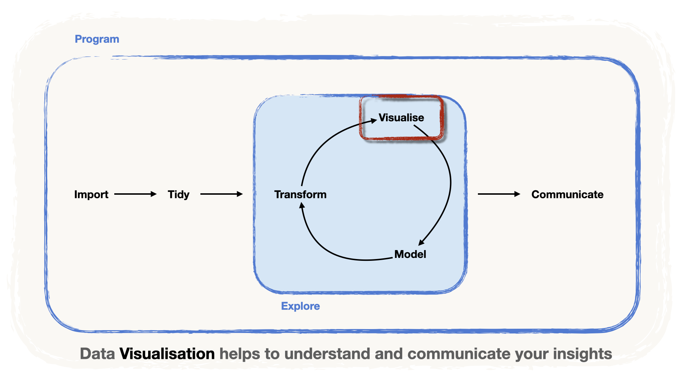

<!-- Translation of handout.qmd. Don't change the structure here: change handout.qmd, then port the changes (see README.md, "Translations"). -->

```{r setup, include=FALSE}
# Options pour tous les chunks :
knitr::opts_chunk$set(
	echo = TRUE,
	message = FALSE,
	warning = FALSE,
	fig.align = 'center',
	fig.width = 16/2,
	fig.height = 9/2
)
library(tidyverse)
library(knitr)

```

{fig-alt="Le pipeline de la data science : importer, puis préparer, puis une boucle transformer, visualiser et modéliser, puis communiquer. L'étape « visualiser » est mise en évidence : la visualisation de données aide à comprendre et à communiquer vos résultats." width="80%" fig-align="center"}

Nous allons maintenant découvrir une autre étape du pipeline de données : la visualisation.

-   La visualisation de données est une partie importante de la boucle d'exploration,
-   mais c'est aussi un **outil** très important **pour communiquer des résultats** de manière claire et parlante.

Il existe de nombreuses façons de créer un graphique à partir de données. Aujourd'hui, nous nous concentrons sur l'**approche de visualisation** qui repose sur la **grammaire de la visualisation de données**, mise en œuvre dans R par le package `{ggplot2}`.

# Une grammaire de la visualisation de données

La grammaire des graphiques (voir [Wilkinson, 2005](https://link.springer.com/book/10.1007/0-387-28695-0 "The Grammar of Graphics, Wilkinson 2005")) est une tentative de **systématiser** et d'**étendre** la **production de graphiques quantitatifs**. L'idée est de donner des **règles**, à l'image de la **grammaire d'une langue naturelle**.

Tout comme une langue naturelle utilise des éléments syntaxiques tels que les **noms**, les **adjectifs**, les **verbes** et les **adverbes** pour construire des **énoncés**, la grammaire des graphiques s'appuie sur des éléments, à savoir :

-   les **données**
-   les **esthétiques**
-   les **géométries**
-   les **thèmes**

Examinons ces éléments en détail.

#### **Les données** {.unnumbered}

Le **jeu de données** contenant les **variables que nous voulons représenter**. Prenons pour illustration un jeu de données à trois colonnes : **Variable 1**, **Variable 2** et **Group** (A, B ou C).

```{r}
#| label: example-data
#| include: false
set.seed(123)
example_data <-
  tibble(x = runif(100, 0, 10) %>% round(digits = 2)) %>%
  mutate(group = c(rep("A", 30), rep("B", 40), rep("C", 30))) %>%
  mutate(
    y = round(4 * x + rnorm(100, sd = 4), digits = 2),
    y = case_when(
      group == "B" ~ y + 12,
      group == "C" ~ y - 5 * x + 12,
      .default = y
    )
  ) %>%
  rename(`Variable 1` = x, `Variable 2` = y, Group = group) %>%
  relocate(Group, `Variable 1`, `Variable 2`)
```

```{r}
#| label: example-data-table
#| echo: false
example_data %>%
  head() %>%
  kable()
```

#### **Éléments esthétiques et mapping esthétique** {.unnumbered}

Les **caractéristiques du graphique**, c.-à-d. les éléments du graphique que nous voulons faire dépendre des données. Par exemple :

-   les axes `x` ou `y`,
-   la couleur (`color`) ou le remplissage (`fill`) des surfaces ou des lignes que nous dessinons,
-   la taille (`size`) des surfaces.

Un **mapping esthétique** est la façon dont nous **relions** les **variables** de nos données **au graphique**.

-   Dans notre illustration, nous avons deux variables numériques et une variable catégorielle.
-   Il est logique d'**associer les variables numériques** aux axes `x` et `y`, et d'**associer** la variable catégorielle à la couleur (`color`).
-   Le mapping esthétique serait donc `x = Variable 1`, `y = Variable 2` et `color = Group`.

#### **Géométries** {.unnumbered}

Le **type de graphique** que nous voulons afficher.

-   Ici, nous aimerions un nuage de points, nous choisissons donc une géométrie `point` avec `geom_point()`.
-   Il existe d'autres options : des lignes (`line`), des aires (`area`), des colonnes (`col`umn), des barres (`bar`)…
-   Le choix dépend de la **question de recherche** et de la **nature des variables**.

#### **Thèmes** {.unnumbered}

Toute l'« encre », c.-à-d. les éléments purement cosmétiques du graphique : les titres, la forme des axes, etc.

Avec ces éléments, créons un graphique.

```{r}
#| label: example-plot
#| echo: false
#| fig-alt: "Nuage de points de Variable 2 en fonction de Variable 1, coloré selon Group : dans chacun des groupes A, B et C, les points suivent une droite, mais les droites diffèrent d'un groupe à l'autre."
# Données
example_data %>%
  ggplot() +

# Mapping esthétique
  aes(
    x = `Variable 1`,
    y = `Variable 2`,
    color = Group) +

# Géométrie
  geom_point() +

# Thème
  theme_minimal() #<4>
```

Ce graphique nous montre que :

1.  Il y a un lien linéaire clair entre Variable 1 et Variable 2.
2.  Cependant, la nature de ce lien diffère selon les groupes.

Voyons maintenant comment construire des graphiques avec la grammaire des graphiques dans R, avec `{ggplot2}`.

# La syntaxe de `{ggplot2}`

Le package qui met en œuvre l'approche de la grammaire des graphiques dans le `{tidyverse}` est `{ggplot2}`.

::: callout-note
C'est même dans le nom ! Le « gg » signifie… **g**rammar of **g**raphics.
:::

Nous illustrons avec les données des matchs du simple dames du Grand Chelem de 1968 à 2021, enregistrées dans `wta_grand_slam_data.csv`.

```{r}
#| label: read-finals
#| code-fold: true
library(readr)
library(dplyr)

wta <-
  "../data/wta_grand_slam_data.csv" %>%
  read_csv()

finals <- wta %>%
  filter(round == "F")

head(finals)
```

::: callout-important

Une chose importante à comprendre : `{ggplot2}` fonctionne avec des **couches d'information** (*layers*).

-   D'abord, nous créons un **graphique de base**, composé
    -   des **données** et…
    -   du **mapping esthétique**…
-   …auquel nous ajoutons ensuite les **géométries**…
-   …puis tous les éléments cosmétiques et les autres couches.
:::

# Nuages de points avec `geom_point()`

> *Y a-t-il une **tendance dans l'âge** des gagnantes des tournois au fil des **années** ?*

Nous chargeons le package comme d'habitude, avec `library()`. Ensuite, pour construire la couche de base, nous appelons la fonction `ggplot()` :

-   Nous définissons les données avec `data = finals`.
-   Nous associons aussi l'axe `x` à `year` et l'axe `y` à `winner_age`.

::: callout-important
Pour définir le **mapping esthétique**, nous utilisons la fonction `aes(...)`.
:::

```{r}
#| label: base-plot-year-age
#| fig-alt: "Un graphique vide : les axes year et winner_age sont dessinés, mais il n'y a aucun point."

# charger ggplot2
library(ggplot2)

# créer un graphique de base
ggplot(data = finals, # les données
       mapping = aes(
        x = year, # associer l'axe x à year
        y = winner_age) # associer l'axe y à winner_age
       )
```

> Rien encore ! Il manque la géométrie ! Mais quelle géométrie ajouter ?

-   Commençons par ajouter des **points** : nous voulons un point par observation.
-   Nous définissons la **géométrie** avec `geom_point()`…
    -   …qu'il faut **ajouter à notre couche de base** avec le signe `+`.

::: callout-warning
Dans `{ggplot2}`, on ajoute les couches avec `+` et non avec `%>%` !
:::

```{r}
#| label: geom-point-year-age
#| fig-alt: "Nuage de points de l'âge de la gagnante en fonction de l'année pour les finales du Grand Chelem : aucune tendance d'ensemble, mais certains points s'alignent en petits groupes."

library(ggplot2)

ggplot(data = finals, # les données
       mapping = aes(
        x = year, # associer l'axe x à year
        y = winner_age) # associer l'axe y à winner_age
       ) +
  geom_point() # la géométrie choisie : des points
```

> Malheureusement, pas très parlant.

-   Il n'y a **pas de tendance uniforme** dans l'âge des gagnantes WTA au fil du temps.
-   Mais nous voyons des **groupes** (*clusters*), c.-à-d. des zones où les points s'alignent.

> Pourrait-il y avoir des tendances au sein d'un groupe ?

-   Pour le vérifier, nous pourrions associer une variable catégorielle à l'esthétique `color`.
-   Essayons avec `surface`, c.-à-d. si le match se joue sur terre battue (Clay), sur gazon (Grass) ou sur surface dure (Hard).

```{r}
#| label: color-surface
#| fig-alt: "Le même nuage de points de l'âge de la gagnante en fonction de l'année, avec les points colorés selon la surface (Clay, Grass, Hard) : toujours pas de tendance uniforme."

library(ggplot2)

ggplot(data = finals,
       mapping = aes(
        x = year,
        y = winner_age,
        color = surface)
       ) + # associer surface à color
  geom_point()
```

> Les points ont maintenant des **couleurs**… mais toujours pas de tendance uniforme.
>
> Faut-il essayer une autre variable ? Ces groupes viennent peut-être de la **même joueuse qui gagne pendant plusieurs années** tout en **prenant de l'âge**.

-   Testons cette hypothèse en associant `winner_name` à l'esthétique `color`…

```{r fig.width=10, fig.height= 5}
#| label: color-winner
#| fig-alt: "Nuage de points de l'âge de la gagnante en fonction de l'année, avec une couleur par gagnante et sans légende : les points de même couleur s'alignent et montent avec les années."

library(ggplot2)

ggplot(data = finals,
       mapping = aes(
        x = year,
        y = winner_age,
        color = winner_name) # associer winner_name à color
        ) +
  geom_point() +
  theme(legend.position = "none") # 54 joueuses : trop pour une légende lisible
```

> Voilà ! La plupart des **points de même couleur s'alignent** : c'est l'origine des groupes.

::: callout-note
Associer une troisième variable à une esthétique comme la couleur aide souvent à découvrir des tendances au sein de **groupes**.
:::

::: {.callout-tip collapse="true"}
## Regardez l'option du chunk !

Nous avons défini une dimension du graphique dans les options du chunk (`fig.width=10, fig.height= 5`) parce que nous voulons **agrandir le graphique**.

Nous avons aussi **masqué la légende** : avec 54 joueuses différentes, personne ne pourrait associer 54 couleurs à leurs noms. Ici, il suffit de voir que les points de même couleur s'alignent.
:::

::: {.callout-note collapse="true"}
## Le graphique par surface n'était pas inutile

On voit qu'**avant 1977** il y a moins de points bleus : les tournois se jouaient seulement sur *gazon* ou sur *terre battue*, et les surfaces *dures* ne sont arrivées qu'après cette année-là.
:::

# Boîtes à moustaches avec `geom_boxplot()`

> *La distribution de l'âge des gagnantes des tournois diffère-t-elle selon la surface ?*

Nous pouvons maintenant poser **une autre question** et tenter d'y répondre avec une **autre géométrie**. Les *boîtes à moustaches* (*boxplots*) sont un bon choix de géométrie, car elles **résument bien des distributions**.

```{r}
#| label: base-plot-surface
#| fig-alt: "Un graphique vide avec surface (Clay, Grass, Hard) sur l'axe x et winner_age sur l'axe y."
ggplot(data = finals,
       mapping = aes(x = surface, # nous changeons le mapping de l'axe x
                     y = winner_age))
```

Pour ajouter la géométrie des boîtes à moustaches, nous ajoutons `geom_boxplot()` :

```{r}
#| label: geom-boxplot
#| fig-alt: "Boîtes à moustaches de l'âge de la gagnante selon la surface : les gagnantes sur gazon ont tendance à être plus âgées, celles sur surface dure plus jeunes."
ggplot(data = finals,
       mapping = aes(x = surface,
                     y = winner_age)) +
  geom_boxplot() # ajouter la géométrie pour créer la boîte à moustaches
```

::: {.callout-note collapse="true"}
## D'où viennent les boîtes ?

Les statistiques nécessaires pour dessiner les boîtes (c.-à-d. la médiane, les quartiles supérieur et inférieur) sont calculées à partir des données « brutes » au moment de dessiner le graphique.
:::

> Voilà ! Il semble que le **gazon** favorise les **joueuses plus âgées**, alors que les **plus jeunes gagnent** sur **surface dure**.
>
> (On peut **supposer** que c'est parce que la balle est un peu **plus lente sur gazon** et **plus rapide sur surface dure**, ce qui favorise les joueuses plus « physiques », donc plus jeunes !)

::: callout-warning
## Analyse exploratoire des données

Représenter les données de cette façon donne une bonne indication sur l'existence de différences entre les catégories. De tels graphiques servent donc à **explorer** les liens entre variables.

Cependant, pour **confirmer** ces liens, **il faut plus de travail**.

-   Par exemple, un **test statistique** peut confirmer que les différences observées ne sont pas dues au hasard.
-   (Il faudrait alors tenir compte du fait que les observations ne sont pas entièrement indépendantes !)
:::

# Ajouter d'autres géométries `geoms_*`

Comme nous l'avons dit, `{ggplot2}` fonctionne avec des **couches d'information**. Dans nos exemples, nous avons dessiné le **graphique de base**, puis ajouté **une seule géométrie** (points ou boîte à moustaches).

Concentrons-nous sur la comparaison de l'âge des gagnantes selon la surface. Et si nous voulions donner plus d'information ? Par exemple :

> -   Le nombre d'observations diffère-t-il d'une catégorie à l'autre ?
> -   Y a-t-il des valeurs extrêmes ?

Ajoutons des ***points*** **par-dessus la boîte à moustaches**, avec la géométrie `geom_point()` :

```{r}
#| label: boxplot-points
#| fig-alt: "Boîtes à moustaches de l'âge de la gagnante selon la surface, avec les points dessinés par-dessus : les points s'empilent sur une seule ligne verticale par surface."
ggplot(data = finals,
       mapping = aes(x = surface,
                     y = winner_age)) +
  geom_boxplot() +
  geom_point() # ajouter une nouvelle géométrie pour les mêmes mappings
```

::: callout-warning
## Attention à la surimpression !

Nous voilà face à un petit défi de visualisation : la **surimpression** (*overplotting*) !

-   La surimpression se produit quand **beaucoup de points sont dessinés les uns sur les autres, si bien qu'il est difficile de distinguer chaque point.**
-   Cela arrive souvent quand on dessine des points sur des variables catégorielles.
:::

Pour éviter le piège de la surimpression, nous « secouons » les points au hasard le long de l'axe x. Pour cela, nous remplaçons la géométrie par `geom_jitter()` :

```{r}
#| label: boxplot-jitter
#| fig-alt: "Boîtes à moustaches de l'âge de la gagnante selon la surface, avec des points dispersés : les points sont décalés au hasard sur le côté, si bien que chaque observation est visible."
ggplot(data = finals,
       mapping = aes(x = surface,
                     y = winner_age)) +
  geom_boxplot() +
  geom_jitter() # ajouter une dispersion (jitter) par-dessus
```

Nous pouvons ajuster un peu la dispersion en définissant sa largeur (`width`) :

```{r}
#| label: boxplot-jitter-width
#| fig-alt: "Le même graphique avec une dispersion plus étroite : les points restent près de leur boîte."
ggplot(data = finals,
       mapping = aes(x = surface,
                     y = winner_age)) +
  geom_boxplot() +
  geom_jitter(width = 0.2) # disperser un peu moins les points
```

::: callout-note
## Chaque couche a des arguments

Remarquez que nous avons ajusté l'argument `width`. De manière générale, chaque couche est une fonction, elle a donc des arguments !
:::

# Étude de cas : personnaliser un diagramme en barres

Posons une autre question :

> *Qui a gagné le plus de titres du Grand Chelem* ?

Commençons par créer le jeu de données où nous comptons les finales gagnées par chaque joueuse, et regardons ses premières lignes.

::: callout-note
Utilisons nos compétences en **manipulation de données** !
:::

```{r}
#| label: count-total-wins
total_wins <- finals %>%
  group_by(winner_name) %>%
  summarise(total_wins = n(), .groups = "drop") %>%
  arrange(desc(total_wins))

slice_head(total_wins, n = 6)
```

Avec `geom_col()`, nous pouvons en faire un graphique :

```{r}
#| label: geom-col-all
#| fig-alt: "Diagramme en barres horizontales du nombre de titres des 54 gagnantes, en ordre alphabétique inverse de haut en bas : les noms se chevauchent et le graphique est difficile à lire."
ggplot(data = total_wins,
       mapping = aes(x = total_wins,
                     y = winner_name)) +
  geom_col()
```

Il est temps de lui donner un peu plus d'allure avec les outils de `{ggplot2}` !

## Ordonner les barres

Pour l'instant, les barres suivent l'ordre alphabétique de `winner_name` :

-   C'est parce que `winner_name` est encore de type `character`,
-   et que `ggplot()` ne tient pas compte de notre appel à `arrange()` !

::: callout-important

Pour ordonner les barres, nous devons **créer un nouvel ordre** pour la variable `winner_name`. Pour cela, nous la transformons en `factor` : un type de variable **doté d'un ordre**. Dans le `{tidyverse}`, nous utilisons le package `{forcats}`.
:::

Réordonnons `winner_name` selon `total_wins` avec `forcats::fct_reorder()` :

```{r}
#| label: reorder-winners
library(forcats)

total_wins <- total_wins %>%
  # ordonner winner_name selon total_wins
  mutate(winner_name = fct_reorder(winner_name, total_wins))
```

Avec `glimpse()`, vous voyez que `winner_name` est maintenant enregistré comme facteur (`fct`) !

```{r}
#| label: total-wins-head-reordered
glimpse(total_wins)
```

Redessinons le graphique…

```{r}
#| label: geom-col-ordered
#| fig-alt: "Le même diagramme en barres, avec les barres ordonnées selon le nombre de titres, du plus grand nombre en haut au plus petit en bas."
ggplot(data = total_wins,
       mapping = aes(x = total_wins,
                     y = winner_name)) +
  geom_col()
```

> Le graphique est déjà bien plus lisible ! …mais comment l'améliorer ?

## Cibler notre message

Nous pouvons par exemple décider de **nous concentrer sur le top 20** :

-   Pour cela, nous utilisons `slice_max()`…
-   …et transmettons son résultat directement à `ggplot()`,
-   ce qui évite de modifier le tibble d'origine.

```{r}
#| label: top20-bars
#| fig-alt: "Diagramme en barres ordonné du nombre de titres des 20 meilleures gagnantes, emmenées par Serena Williams et Steffi Graf."
total_wins %>%
  slice_max(order_by = total_wins, n = 20) %>%
  ggplot(mapping = aes(x = total_wins,
                       y = winner_name)) +
  geom_col()
```

> Bien mieux, le graphique parle presque de lui-même. Mais occupons-nous des axes.

## Place à la cosmétique !

Il est temps d'ajouter un titre et de corriger les noms des axes. Pour cela, nous ajoutons une couche `labs()` à notre graphique.

::: callout-note
La couche `labs()` fait partie des couches qui s'occupent des aspects *cosmétiques* du graphique.
:::

```{r}
#| label: top20-labs
#| fig-alt: "Le diagramme en barres du top 20 avec le titre « Serena Williams a remporté 23 titres du Grand Chelem », un sous-titre, un nom d'axe x et une mention de la source."
total_wins %>%
  slice_max(order_by = total_wins, n = 20) %>%
  ggplot(mapping = aes(x = total_wins,
                       y = winner_name)) +
  geom_col() +
  # ajouter des libellés
  labs(title = "Serena Williams a remporté 23 titres du Grand Chelem",
       subtitle =  "Suivie de la légendaire Steffi Graf avec 22 titres",
       x = "Nombre de titres du Grand Chelem",
       y = "",
       caption = "source : https://github.com/JeffSackmann")
```

> Nous pouvons maintenant donner un autre thème au graphique.

::: callout-note
`{ggplot2}` propose plusieurs thèmes prêts à l'emploi. Vous en trouverez une liste [ici](https://ggplot2.tidyverse.org/reference/ggtheme.html). En voici quelques-uns :

-   `theme_minimal()` : un bon point de départ
-   `theme_dark()` : si [vous le voulez plus sombre](https://youtu.be/v0nmHymgM7Y)
-   `theme_bw()` : pour tout voir en noir et blanc
-   `theme_classic()`

Vous verrez les propositions en tapant `theme_` dans la console.
:::

Optons pour `minimal`…

```{r}
#| label: top20-theme-minimal
#| fig-alt: "Le diagramme en barres du top 20 avec ses libellés et theme_minimal() : pas de fond gris et des lignes de grille claires."
total_wins %>%
  slice_max(order_by = total_wins, n = 20) %>%
  ggplot(mapping = aes(x = total_wins,
                       y = winner_name)) +
  geom_col() +
  labs(title = "Serena Williams a remporté 23 titres du Grand Chelem",
       subtitle =  "Suivie de la légendaire Steffi Graf avec 22 titres",
       x = "Nombre de titres du Grand Chelem",
       y = "",
       caption = "source : https://github.com/JeffSackmann") +
  # ajouter un thème
  theme_minimal()
```

## Et un peu de couleur ?

Donnons de la couleur à nos barres. Nous pouvons utiliser `fill = "lightblue"`…

```{r}
#| label: fill-in-aes
#| fig-alt: "Le diagramme en barres avec fill = 'lightblue' dans aes() : les barres sont rouge saumon, et une légende montre une seule clé intitulée lightblue."
total_wins %>%
  slice_max(order_by = total_wins, n = 20) %>%
  ggplot(mapping = aes(x = total_wins,
                       y = winner_name,
                       fill = "lightblue")) +
  geom_col() +
  labs(title = "Serena Williams a remporté 23 titres du Grand Chelem",
       subtitle =  "Suivie de la légendaire Steffi Graf avec 22 titres",
       x = "Nombre de titres du Grand Chelem",
       y = "",
       caption = "source : https://github.com/JeffSackmann") +
  theme_minimal()
```

> Oh non ! Quelque chose ne va pas… Devinez-vous quoi ?

::: {.callout-warning collapse="true"}
## Que se passe-t-il ?

-   En plaçant `fill = "lightblue"` dans l'appel à `aes()`, nous **associons une variable** à la **valeur unique** `"lightblue"` au remplissage (`fill`) des barres…
-   …au lieu de le fixer comme **paramètre** !
-   `ggplot()` ne comprend pas que `"lightblue"` est en fait une couleur que nous voulons fixer.
-   Un mapping aurait du sens si nous voulions que la couleur des barres dépende du nombre de `total_wins`.
-   Cela crée une échelle de couleurs continue, appliquée à la couleur des barres.

```{r}
#| label: fill-total-wins
#| fig-alt: "Le diagramme en barres avec fill = total_wins dans aes() : les barres sont nuancées le long d'une échelle continue de bleus selon le nombre de titres, avec une légende en barre de couleurs."
total_wins %>%
  slice_max(order_by = total_wins, n = 20) %>%
  ggplot(mapping = aes(x = total_wins,
                       y = winner_name,
                       fill = total_wins)) +
  geom_col() +
  labs(title = "Serena Williams a remporté 23 titres du Grand Chelem",
       subtitle =  "Suivie de la légendaire Steffi Graf avec 22 titres",
       x = "Nombre de titres du Grand Chelem",
       y = "",
       caption = "source : https://github.com/JeffSackmann") +
  theme_minimal()
```
:::

Pour donner une couleur à toutes nos barres, nous devons la fixer **en dehors d'`aes()`**, c.-à-d. **dans le `geom_*()`** :

```{r}
#| label: fill-outside-aes
#| fig-alt: "Le diagramme en barres du top 20 avec ses libellés, toutes les barres en bleu clair et sans légende."
total_wins %>%
  slice_max(order_by = total_wins, n = 20) %>%
  ggplot(mapping = aes(x = total_wins,
                       y = winner_name)) +
  geom_col(fill = "lightblue") + # fixer une couleur pour toutes les barres
  labs(title = "Serena Williams a remporté 23 titres du Grand Chelem",
       subtitle =  "Suivie de la légendaire Steffi Graf avec 22 titres",
       x = "Nombre de titres du Grand Chelem",
       y = "",
       caption = "source : https://github.com/JeffSackmann") +
  theme_minimal()
```

# Étude de cas : représenter plus de variables

Nous pouvons nous demander :

> *Serena Williams a-t-elle gagné plus que Steffi Graf sur toutes les surfaces ?*

Comment le voir visuellement ?

-   D'abord, il nous faut un jeu de données qui **compte les finales gagnées par joueuse** et **par surface**…
-   …puis nous essayons d'associer `surface` à `fill`…
-   …mais attention ! Nous devons d'abord **réordonner les données**, pour que les barres soient de nouveau ordonnées.

::: callout-note
## D'autres astuces pratiques de `{forcats}`

-   `fct_infreq()` ordonne les facteurs par fréquence : appliqué à `winner_name`, il ordonne les joueuses sans qu'il soit besoin de compter !
-   `fct_rev()` inverse l'ordre, pour le rendre **décroissant**.

```{r}
#| label: wins-by-surface
total_wins_surface <- finals %>%
  mutate(winner_name = fct_rev(fct_infreq(winner_name))) %>% # réordonner les noms des gagnantes
  group_by(winner_name, surface) %>%
  summarise(total_wins = n(), .groups = "drop") %>%
  arrange(surface, desc(total_wins))
```
:::

Pour cibler notre message, nous pouvons utiliser notre top 20. Extrayons les noms du top 20 du jeu de données `total_wins`… et enregistrons-les dans le vecteur (`vector`) `top20` :

```{r}
#| label: top20-names
top20 <- total_wins %>%
  slice_max(order_by = total_wins, n = 20) %>%
  pull(winner_name)

top20
```

Nous sommes prêts à dessiner.

```{r}
#| label: stacked-by-surface
#| fig-alt: "Diagramme en barres empilées des titres des 20 meilleures gagnantes, chaque barre étant divisée en clay, grass et hard par la couleur de remplissage."
total_wins_surface %>%
  filter(winner_name %in% top20) %>%
  ggplot(mapping = aes(x = total_wins,
                         y = winner_name,
                         fill = surface)) +
  geom_col() +
  labs(
    title = "Serena Williams a remporté 23 titres du Grand Chelem",
    subtitle =  "Suivie de la légendaire Steffi Graf avec 22 titres",
    x = "Nombre de titres du Grand Chelem",
    y = "",
    caption = "source : https://github.com/JeffSackmann"
  ) +
  theme_minimal()
```

> Nous voyons que :
>
> -   Steffi Graf a gagné plus que Serena Williams sur terre battue,
> -   et Serena a gagné plus sur surface dure.
>
> Mais sur gazon, la comparaison est très difficile ! Il y a clairement mieux à faire.

# Créer plusieurs mini-graphiques

Pour comparer les joueuses selon les surfaces, nous pouvons adopter une autre stratégie : créer un **mini-graphique par surface**. Pour cela, nous ajoutons une couche `facet_wrap()`.

::: callout-note
Dans *`R`*, les mini-graphiques s'appellent des *« facettes »* (*facets*).
:::

::: callout-important
La syntaxe est un peu différente : il faut entourer de la fonction `vars()` le nom de la variable qui divise le graphique en facettes.

```{r}
#| label: facets-by-surface
#| fig-alt: "Trois diagrammes en barres côte à côte, un par surface (Clay, Grass, Hard), chacun montrant les titres des 20 meilleures gagnantes sur cette surface."
total_wins_surface %>%
  filter(winner_name %in% top20) %>%
  ggplot(mapping = aes(x = total_wins,
                         y = winner_name,
                         fill = surface)) +
  geom_col() +
  labs(
    title = "Serena Williams a remporté 23 titres du Grand Chelem",
    subtitle =  "Suivie de la légendaire Steffi Graf avec 22 titres",
    x = "Nombre de titres du Grand Chelem",
    y = "",
    caption = "source : https://github.com/JeffSackmann"
  ) +
  theme_minimal() +
  facet_wrap(vars(surface)) # utiliser surface comme variable de facettage
```
:::

Nous pouvons maintenant masquer la légende, puisqu'elle est redondante.

::: {.callout-note collapse="true"}
## Les couleurs sont redondantes aussi

Les couleurs sont ici un peu redondantes elles aussi, mais nous les gardons par goût personnel ; libre à vous de les retirer.
:::

```{r}
#| label: facets-no-legend
#| fig-alt: "Les trois mêmes facettes sans légende : le titre de chaque facette indique sa surface."
total_wins_surface %>%
  filter(winner_name %in% top20) %>%
  ggplot(mapping = aes(x = total_wins,
                         y = winner_name,
                         fill = surface)) +
  geom_col() +
  labs(
    title = "Serena Williams a remporté 23 titres du Grand Chelem",
    subtitle =  "Suivie de la légendaire Steffi Graf avec 22 titres",
    x = "Nombre de titres du Grand Chelem",
    y = "",
    caption = "source : https://github.com/JeffSackmann"
  ) +
  theme_minimal() +
  facet_wrap(vars(surface)) +
  theme(legend.position = "none") # retirer la légende
```

# Exporter vos graphiques

Une fois satisfait·e de vos graphiques, il est temps de les exporter. Le plus simple est d'utiliser `ggsave()`, qui enregistre par défaut le dernier graphique affiché. Il suffit donc de lui donner en argument le nom de fichier voulu :

```{r}
#| label: ggsave-default
#| eval: false
ggsave("wta_wins_by_surface.png")
```

Par défaut, l'image prend la taille de la fenêtre graphique actuelle (dans RStudio, l'onglet *Plots*) : elle change donc d'un ordinateur à l'autre. Pour contrôler la taille, utilisez les arguments `width` et `height`, en pouces par défaut :

```{r}
#| label: ggsave-7x5
#| eval: false
ggsave("wta_wins_by_surface_7x5.png", width = 7, height = 5)
```

# Plus de ressources

-   [Le livre `{ggplot2}`](https://ggplot2-book.org)
-   [L'aide-mémoire `{ggplot2}`](https://ggplot2.tidyverse.org)
-   [Les extensions de `{ggplot2}`](https://exts.ggplot2.tidyverse.org)
-   [R for data science](https://r4ds.had.co.nz)
-   [Les solutions des exercices de R for data science](https://jrnold.github.io/r4ds-exercise-solutions/)

# C'est l'heure de l'exercice ! {.unnumbered}

::: {.callout-important icon="false"}
## Au travail !

Ouvrez le notebook d'exercices `_exercises/exercise-notebook.qmd` et faites l'**[exercice 6](../_exercises/exercise-notebook.html#exercise-6)**. À tout de suite !
:::
