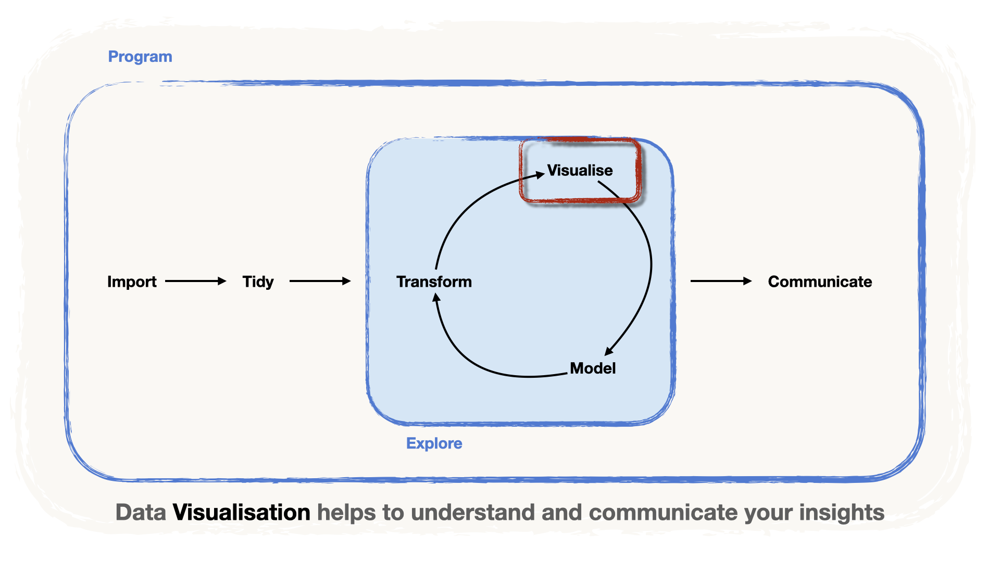
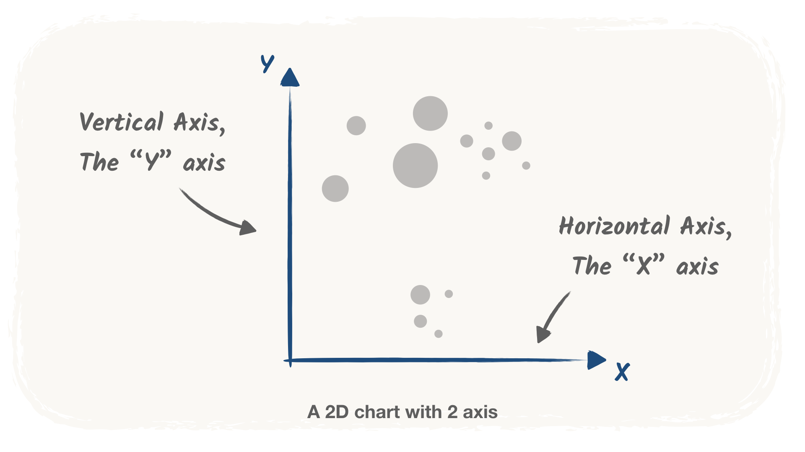
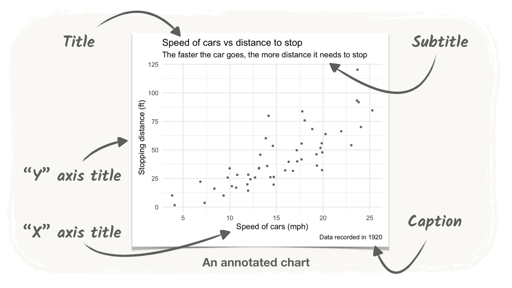
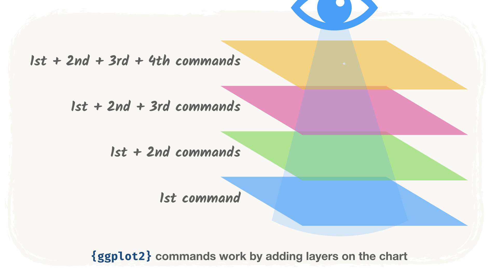

<!-- Translation of presentation.qmd. Don't change the structure here: change presentation.qmd, then port the changes (see README.md, "Translations"). -->

```{r setup, include=FALSE}
# Optionen für alle Chunks:
knitr::opts_chunk$set(
	echo = TRUE,
	message = FALSE,
	warning = FALSE,
	fig.align = 'center',
	fig.width = 16/2,
	fig.height = 9/2
)
library(tidyverse)
library(knitr)

# breite Tibbles auf einer Folie halten
options(pillar.max_extra_cols = 0)
```

## Visualisieren: erkunden und kommunizieren

{fig-alt="Die Data-Science-Pipeline: importieren, dann aufbereiten, dann eine Schleife aus transformieren, visualisieren und modellieren, dann kommunizieren. Der Schritt «visualisieren» ist hervorgehoben: Datenvisualisierung hilft, Erkenntnisse zu verstehen und zu kommunizieren." width="80%" fig-align="center"}

- Teil der **Erkundungsschleife**
- Ein **Werkzeug, um Ergebnisse** klar **zu kommunizieren**

. . .

Heute: die **Grammatik der Grafik**, mit `{ggplot2}`.

# Eine Grammatik der Datenvisualisierung {.subsection background-color="#425556"}

## Die Grammatik der Grafik

::: content-box-marine
Die Grammatik der Grafik ist eine Reihe von **Regeln**, nach denen Grafiken aufgebaut werden, ähnlich der Grammatik einer Sprache ([Wilkinson, 2005](https://link.springer.com/book/10.1007/0-387-28695-0 "The Grammar of Graphics, Wilkinson 2005"))
:::

. . .

> «Regeln, die Bedeutung schaffen»

. . .

::::: columns
::: {.column width="50%"}
| Wort      | Wortart              |
|-----------|----------------------|
| Regeln    | **Nomen**            |
| die       | **Relativpronomen**  |
| Bedeutung | **Akkusativobjekt**  |
| schaffen  | **Verb**             |
:::

::: {.column .fragment width="50%"}


| Grafik          |
|:----------------|
| **Daten**       |
| **Ästhetiken**  |
| **Geometrien**  |
| **Themes**      |

:::
:::::

## Daten

::: content-box-marine
Der **Datensatz** mit den **Variablen, die wir darstellen wollen**.
:::

**Zum Beispiel**: ein Datensatz mit drei Spalten

- `Variable 1` (numerisch)
- `Variable 2` (numerisch)
- `Group` (kategorial: `"A"`, `"B"` oder `"C"`).

## Daten

```{r}
#| label: example-data
#| include: false

set.seed(123)
example_data <-
  tibble(x = runif(100, 0, 10) %>% round(digits = 2)) %>%
  mutate(group = c(rep("A", 30), rep("B", 40), rep("C", 30))) %>%
  mutate(
    y = round(4 * x + rnorm(100, sd = 4), digits = 2),
    y = case_when(
      group == "B" ~ y + 12,
      group == "C" ~ y - 5 * x + 12,
      .default = y
    )
  ) %>%
  rename(`Variable 1` = x, `Variable 2` = y, Group = group) %>%
  relocate(Group, `Variable 1`, `Variable 2`)
```


```{r}
#| label: example-data-table
#| echo: false
example_data %>%
  head() %>%
  kable()
```

## Ästhetiken

::: content-box-marine
**Ästhetiken** (*aesthetics*) sind die Merkmale der Grafik, die von den Daten abhängen können
:::

. . .

- die Achsen `x` und `y`,
- die Farbe (`color`) oder die Grösse (`size`) eines Elements der Grafik

. . .

{fig-align="center" width="70%"}

## Ästhetisches Mapping

::: content-box-marine
Das **ästhetische Mapping** gibt an, welche **Variable** welchem **ästhetischen** Element der Grafik zugeordnet wird
:::

. . .

**Zum Beispiel**:

::: {.fragment}
- Zwei numerische Variablen können den Achsen zugeordnet werden
  - `Variable 1` $\rightarrow$ `x`
  - `Variable 2` $\rightarrow$ `y`
:::
::: {.fragment}
- die kategoriale Variable bestimmt die Farbe
  - `Group` $\rightarrow$ `color`
:::

## Geometrien

::: content-box-marine
**Geometrien** bestimmen die **Art der Grafik**
:::

. . .

| Geometrie       | Art der Grafik      |
|-----------------|---------------------|
| `point`         | Streudiagramme      |
| `line`          | Liniendiagramme     |
| `col`umn, `bar` | Balkendiagramme     |
| `area`          | Flächendiagramme    |

. . .


**Zum Beispiel**: eine `point`-Geometrie für ein **Streudiagramm**.

. . .

::: callout-tip
Die Wahl der Geometrie hängt von der **Fragestellung** und von der **Art der Variablen** ab
:::

## Themes

::: content-box-marine
Die rein kosmetische «Tinte» (Titel, Achsen, Beschriftungen, Achsennamen usw.) bildet das **Theme** der Grafik
:::

. . .

{fig-align="center" width="70%"}

## Alles zusammen

```{r}
#| label: example-plot
#| output-location: column-fragment
#| fig-alt: "Streudiagramm von Variable 2 gegen Variable 1, nach Group eingefärbt: In jeder der Gruppen A, B und C liegen die Punkte auf einer Geraden, aber die Geraden unterscheiden sich zwischen den Gruppen."
# Daten
example_data %>%
  ggplot() +

# Ästhetisches Mapping
  aes(
    x = `Variable 1`,
    y = `Variable 2`,
    color = Group) +

# Geometrie
  geom_point() +

# Theme
  theme_minimal() #<4>
```

. . .

> Ein klarer **linearer Zusammenhang** zwischen Variable 1 und Variable 2, aber er **unterscheidet sich zwischen den Gruppen**

# Die Syntax von `{ggplot2}` {.subsection background-color="#425556"}

## `{ggplot2}`: die Grammatik der Grafik in R {.center}

::: {.content-box-marine}
`{ggplot2}` setzt die Grammatik der Grafik in R um.

Das «gg» steht für… **g**rammar of **g**raphics. Es steckt sogar im Namen!
:::

## 🎾 WTA-Daten (für die Beispiele)

👉 Unsere Daten: Grand-Slam-Einzelspiele der Frauen, 1968–2021. Wir behalten die **Finals**.

```{r}
#| label: read-finals
#| output-location: column-fragment
library(readr)
library(dplyr)

wta <-
  "../data/wta_grand_slam_data.csv" %>%
  read_csv()

finals <- wta %>%
  filter(round == "F")

head(finals)
```


## Ein Aufbau in Schichten

::: {.callout-tip}

## `{ggplot2}`-Grafiken werden in Schichten (*layers*) aufgebaut

::: {.incremental}

1.  Ein **Basisplot**: die **Daten** und das **ästhetische Mapping**

2.  **+** die **Geometrien**

3.  **+** die **kosmetischen Elemente** und weitere Schichten

:::

:::

{width="70%" fig-align="center"}

# Streudiagramme mit `geom_point()` {.subsection background-color="#425556"}

## Streudiagramme mit `geom_point()` {.smaller auto-animate="true"}

> *Gibt es einen **Trend beim Alter** der Turniersiegerinnen über die **Jahre**?*

- Die Basisschicht: `ggplot()`, mit den Daten (`data`) und dem Mapping `aes(x = year, y = winner_age)`

. . .


```{r}
#| label: base-plot-year-age
#| output-location: column-fragment
#| fig-alt: "Eine leere Grafik: Die Achsen year und winner_age sind gezeichnet, aber es gibt keine Datenpunkte."

# ggplot2 laden
library(ggplot2)

# einen Basisplot erstellen
ggplot(data = finals, # die Daten
       mapping = aes(
        x = year, # die x-Achse auf year abbilden
        y = winner_age) # die y-Achse auf winner_age abbilden
       )
```


::: callout-tip
Das **ästhetische Mapping** definieren wir mit der Funktion `aes(...)`.
:::

. . .

> Noch nichts! Die Geometrie fehlt! Aber welche Geometrie sollen wir hinzufügen?

## Eine Geometrie mit `+` hinzufügen {.smaller auto-animate="true"}

> *Gibt es einen **Trend beim Alter** der Turniersiegerinnen über die **Jahre**?*

- Ein **Punkt** pro Beobachtung: `geom_point()`, mit `+` zur Basisschicht **hinzugefügt**

```{r}
#| label: geom-point-year-age
#| output-location: column-fragment
#| code-line-numbers: "7,8"
#| fig-alt: "Streudiagramm des Alters der Siegerin gegen das Jahr für die Grand-Slam-Finals: kein allgemeiner Trend, aber einige Punkte reihen sich in kurzen Gruppen auf."

library(ggplot2)

ggplot(data = finals, # die Daten
       mapping = aes(
        x = year, # die x-Achse auf year abbilden
        y = winner_age) # die y-Achse auf winner_age abbilden
       ) +
  geom_point() # unsere gewählte Geometrie: Punkte
```

::: callout-tip
In `{ggplot2}` fügen wir Schichten mit `+` statt mit `%>%` hinzu!
:::

. . .

> **Kein klarer Trend**, aber **Gruppen** von aufgereihten Punkten. Könnte es **Trends innerhalb von Gruppen** geben?


## Eine dritte Variable auf `color` abbilden {.smaller auto-animate="true"}

> Könnte es **Trends innerhalb von Gruppen** geben?

- Färben wir nach `surface` ein: Clay (Sand), Grass (Rasen) oder Hard (Hartplatz).

```{r}
#| label: color-surface
#| code-line-numbers: "7"
#| output-location: column-fragment
#| fig-alt: "Dasselbe Streudiagramm des Alters der Siegerin gegen das Jahr, mit den Punkten nach Belag eingefärbt (Clay, Grass, Hard): immer noch kein einheitlicher Trend."

library(ggplot2)

ggplot(data = finals,
       mapping = aes(
        x = year,
        y = winner_age,
        color = surface)
       ) + # surface auf color abbilden
  geom_point()
```

. . .

> Farben… aber **immer noch kein klarer Trend**.

## Eine Farbe pro Spielerin {.smaller auto-animate="true"}

> Sind die Gruppen **dieselbe Spielerin**, die über die Jahre gewinnt und dabei **älter wird**?

```{r fig.width=10, fig.height= 5}
#| label: color-winner
#| code-line-numbers: "7"
#| output-location: column-fragment
#| fig-alt: "Streudiagramm des Alters der Siegerin gegen das Jahr, mit einer Farbe pro Siegerin und ohne Legende: Punkte derselben Farbe reihen sich auf und steigen mit den Jahren an."

library(ggplot2)

ggplot(data = finals,
       mapping = aes(
        x = year,
        y = winner_age,
        color = winner_name) # winner_name auf color abbilden
        ) +
  geom_point() +
  theme(legend.position = "none") # 54 Spielerinnen: zu viele für eine lesbare Legende
```

. . .

> Voilà! Die meisten **Punkte derselben Farbe liegen auf einer Linie**: Das erklärt die Gruppen.

<!-- ## Was uns die Farben gezeigt haben {.smaller}

::: callout-note
Eine dritte Variable auf eine Ästhetik wie die Farbe abzubilden, hilft oft, Trends innerhalb von **Gruppen** zu entdecken.
:::

::: {.callout-tip collapse="true"}
## Beachten Sie die Chunk-Option!

Wir haben eine Grösse der Grafik in den Chunk-Optionen festgelegt (`fig.width=10, fig.height= 5`), weil wir **die Grafik vergrössern** wollen.

Wir haben auch **die Legende ausgeblendet**: Bei 54 verschiedenen Spielerinnen könnte niemand 54 Farben ihren Namen zuordnen. Hier müssen wir nur sehen, dass Punkte derselben Farbe auf einer Linie liegen.
:::

::: {.callout-note collapse="true"}
## Die Grafik nach Belag war nicht nutzlos

Sie sehen, dass es **vor 1977** weniger blaue Punkte gibt: Die Turniere wurden nur auf *Rasen* oder *Sand* gespielt, *Hartplätze* kamen erst nach diesem Jahr dazu.

DIESER ABSCHNITT PASST BESSER INS HANDOUT
::: -->


# Boxplots mit `geom_boxplot()` {.subsection background-color="#425556"}

## Boxplots mit `geom_boxplot()` {.smaller auto-animate="true"}

> *Gibt es einen Zusammenhang zwischen dem Alter (`age`) einer Turniersiegerin und dem Belag (`surface`)?*

- Eine neue Frage, eine neue Geometrie:

::: {.content-box-marine}
**Boxplots** fassen **Verteilungen** anhand ihrer Quartile zusammen
:::

. . .

- Zuerst der Basisplot, mit `surface` auf der `x`-Achse

```{r}
#| label: base-plot-surface
#| output-location: column
#| fig-alt: "Eine leere Grafik mit surface (Clay, Grass, Hard) auf der x-Achse und winner_age auf der y-Achse."
ggplot(data = finals,
       mapping = aes(x = surface, # wir ändern das Mapping der x-Achse
                     y = winner_age))
```

## `geom_boxplot()` hinzufügen {.smaller auto-animate="true"}

```{r}
#| label: geom-boxplot
#| output-location: column-fragment
#| fig-alt: "Boxplots des Alters der Siegerin nach Belag: Die Siegerinnen auf Rasen sind tendenziell älter, die auf Hartplatz jünger."
ggplot(data = finals,
       mapping = aes(x = surface,
                     y = winner_age)) +
  geom_boxplot() # die Geometrie für den Boxplot hinzufügen
```

<!-- ::: {.callout-tip collapse="true"} -->
<!-- ## Woher kommen die Boxen? -->
<!--  -->
<!-- Die Kennzahlen für die Boxplots (Median, oberes und unteres Quartil) werden beim Zeichnen der Grafik aus den «rohen» Daten berechnet. -->
<!-- ::: -->

. . .

> **Rasen** begünstigt **ältere** Siegerinnen, **Hartplätze** **jüngere**.

<!-- ## ⚠️ Erkunden ist nicht Bestätigen -->
<!--  -->
<!-- ::: callout-warning -->
<!-- ## Explorative Datenanalyse -->
<!--  -->
<!-- - Solche Grafiken **erkunden** die Zusammenhänge zwischen Variablen -->
<!-- - Um sie zu **bestätigen**, braucht es mehr Arbeit, z. B. einen **statistischen Test** -->
<!-- ::: -->
 <!-- das passt besser ins Handout -->

# Weitere Geometrien `geoms_*` hinzufügen {.subsection background-color="#425556"}

## Schicht auf Schicht {.smaller}

> *Wie viele Beobachtungen pro Belag? Gibt es Extremwerte?*

. . .

👉 Legen wir **Punkte** über die Boxplots.

```{r}
#| label: boxplot-points
#| output-location: column-fragment
#| fig-alt: "Boxplots des Alters der Siegerin nach Belag mit darübergelegten Punkten: Die Punkte stapeln sich auf einer einzigen senkrechten Linie pro Belag."
ggplot(data = finals,
       mapping = aes(x = surface,
                     y = winner_age)) +
  geom_boxplot() +
  geom_point() # eine neue Geometrie für dieselben Mappings hinzufügen
```

. . .

::: callout-warning
## Vorsicht vor Overplotting!

**Overplotting**: Viele Punkte werden **übereinander** gezeichnet. Häufig bei Punkten über einer kategorialen Variable.
:::

## `geom_jitter()`: die Punkte schütteln {.smaller auto-animate="true"}

👉 Bringen wir etwas Bewegung hinein!

```{r}
#| label: boxplot-jitter
#| output-location: column-fragment
#| fig-alt: "Boxplots des Alters der Siegerin nach Belag mit gestreuten Punkten: Die Punkte sind zufällig seitlich verteilt, sodass die einzelnen Beobachtungen sichtbar sind."
ggplot(data = finals,
       mapping = aes(x = surface,
                     y = winner_age)) +
  geom_boxplot() +
  geom_jitter() # Jitter darüberlegen
```

## 💡 Jede Schicht hat Argumente {.smaller auto-animate="true"}

Das Argument `width` legt fest, wie weit die Punkte streuen

```{r}
#| label: boxplot-jitter-width
#| output-location: column-fragment
#| code-line-numbers: "5"
#| fig-alt: "Dieselbe Grafik mit schmalerem Jitter: Die Punkte bleiben nahe bei ihrer Box."
ggplot(data = finals,
       mapping = aes(x = surface,
                     y = winner_age)) +
  geom_boxplot() +
  geom_jitter(width = 0.2) # die Punkte etwas weniger streuen
```

. . .

::: callout-tip
## Jede Schicht hat Argumente

Jede Schicht ist eine Funktion, also hat sie Argumente
:::

# Fallstudie: ein Balkendiagramm gestalten {.subsection background-color="#425556"}

## Wer hat die meisten Grand-Slam-Titel gewonnen? {.smaller}

Zählen wir die Siege mit unseren Kenntnissen der **Datenaufbereitung**!

. . .

```{r}
#| label: count-total-wins
total_wins <- finals %>%
  group_by(winner_name) %>%
  summarise(total_wins = n(), .groups = "drop") %>%
  arrange(desc(total_wins))

slice_head(total_wins, n = 6)
```

## Ein erstes Balkendiagramm mit `geom_col()` {.smaller}

```{r}
#| label: geom-col-all
#| output-location: column
#| fig-alt: "Horizontales Balkendiagramm der Anzahl Titel aller 54 Siegerinnen, von oben nach unten in umgekehrter alphabetischer Reihenfolge: Die Namen überlappen sich und die Grafik ist schwer lesbar."
ggplot(data = total_wins,
       mapping = aes(x = total_wins,
                     y = winner_name)) +
  geom_col()
```

Zeit für etwas mehr Schliff!

## Die Balken ordnen {.smaller}

- Die Balken stehen in **alphabetischer** Reihenfolge: `winner_name` ist noch `character`
- `ggplot()` ignoriert unser `arrange()`!

::: {.content-box-marine}
Wandeln Sie `winner_name` in einen `factor` um: einen Typ **mit einer Reihenfolge**. Im `{tidyverse}`: das Paket `{forcats}`.
:::

```{r}
#| label: reorder-winners
library(forcats)

total_wins <- total_wins %>%
  # winner_name nach total_wins ordnen
  mutate(winner_name = fct_reorder(winner_name, total_wins))
```

`winner_name` ist jetzt ein Faktor (`fct`):

```{r}
#| label: total-wins-head-reordered
glimpse(total_wins)
```

## Geordnete Balken {.smaller}

```{r}
#| label: geom-col-ordered
#| output-location: column
#| fig-alt: "Dasselbe Balkendiagramm mit den Balken nach Anzahl Titel geordnet, von den meisten Titeln oben bis zu den wenigsten unten."
ggplot(data = total_wins,
       mapping = aes(x = total_wins,
                     y = winner_name)) +
  geom_col()
```

> Die Grafik ist schon viel lesbarer! …aber wie können wir sie verbessern?

## Unsere Botschaft fokussieren {.smaller}

- Die **Top 20** mit `slice_max()` behalten und direkt an `ggplot()` übergeben
- Die ursprüngliche Tabelle bleibt unverändert

```{r}
#| label: top20-bars
#| output-location: column
#| fig-alt: "Geordnetes Balkendiagramm der Anzahl Titel der 20 erfolgreichsten Siegerinnen, angeführt von Serena Williams und Steffi Graf."
total_wins %>%
  slice_max(order_by = total_wins, n = 20) %>%
  ggplot(mapping = aes(x = total_wins,
                       y = winner_name)) +
  geom_col()
```

> Viel besser, die Grafik spricht fast für sich. Aber kümmern wir uns um die Achsen.

## Zeit für Kosmetik! {.smaller}

- Ein Titel und Achsennamen, mit einer `labs()`-Schicht

::: callout-note
Die Schicht `labs()` gehört zu den Schichten, die sich um die *kosmetischen* Aspekte der Grafik kümmern.
:::

```{r}
#| label: top20-labs
#| output-location: column
#| fig-alt: "Das Top-20-Balkendiagramm mit dem Titel «Serena Williams hat 23 Grand-Slam-Titel gewonnen», einem Untertitel, einer Beschriftung der x-Achse und einer Quellenangabe."
total_wins %>%
  slice_max(order_by = total_wins, n = 20) %>%
  ggplot(mapping = aes(x = total_wins,
                       y = winner_name)) +
  geom_col() +
  # Beschriftungen hinzufügen
  labs(title = "Serena Williams hat 23 Grand-Slam-Titel gewonnen",
       subtitle =  "Gefolgt von der legendären Steffi Graf mit 22 Titeln",
       x = "Anzahl Grand-Slam-Titel",
       y = "",
       caption = "Quelle: https://github.com/JeffSackmann")
```

## Fertige Themes {.smaller}

::: callout-note
`{ggplot2}` bietet mehrere fertige Themes. Eine Liste finden Sie [hier](https://ggplot2.tidyverse.org/reference/ggtheme.html). Einige davon:

- `theme_minimal()`: ein guter Ausgangspunkt
- `theme_dark()`: wenn [Sie es dunkler wollen](https://youtu.be/v0nmHymgM7Y)
- `theme_bw()`: um alles in Schwarz-Weiss zu sehen
- `theme_classic()`

Die Vorschläge sehen Sie, wenn Sie `theme_` in die Konsole tippen.
:::

## Wählen wir `minimal` {.smaller}

```{r}
#| label: top20-theme-minimal
#| output-location: column
#| fig-alt: "Das beschriftete Top-20-Balkendiagramm mit theme_minimal(): kein grauer Hintergrund und helle Gitterlinien."
total_wins %>%
  slice_max(order_by = total_wins, n = 20) %>%
  ggplot(mapping = aes(x = total_wins,
                       y = winner_name)) +
  geom_col() +
  labs(title = "Serena Williams hat 23 Grand-Slam-Titel gewonnen",
       subtitle =  "Gefolgt von der legendären Steffi Graf mit 22 Titeln",
       x = "Anzahl Grand-Slam-Titel",
       y = "",
       caption = "Quelle: https://github.com/JeffSackmann") +
  # ein Theme hinzufügen
  theme_minimal()
```

## Wie wäre es mit etwas Farbe? {.smaller}

Versuchen wir `fill = "lightblue"`…

```{r}
#| label: fill-in-aes
#| output-location: column
#| fig-alt: "Das Balkendiagramm mit fill = 'lightblue' innerhalb von aes(): Die Balken sind lachsrot, und eine Legende zeigt einen einzigen Eintrag mit der Bezeichnung lightblue."
total_wins %>%
  slice_max(order_by = total_wins, n = 20) %>%
  ggplot(mapping = aes(x = total_wins,
                       y = winner_name,
                       fill = "lightblue")) +
  geom_col() +
  labs(title = "Serena Williams hat 23 Grand-Slam-Titel gewonnen",
       subtitle =  "Gefolgt von der legendären Steffi Graf mit 22 Titeln",
       x = "Anzahl Grand-Slam-Titel",
       y = "",
       caption = "Quelle: https://github.com/JeffSackmann") +
  theme_minimal()
```

> Oh nein! Etwas stimmt nicht… Erraten Sie, was?

## Was ist hier los? {.smaller .scrollable}

::: {.callout-warning collapse="true"}
## Was ist hier los?

- Wenn wir `fill = "lightblue"` in den Aufruf von `aes()` schreiben, **bilden wir eine Variable** mit dem **einzigen Wert** `"lightblue"` auf die Füllfarbe (`fill`) der Balken ab…
- …statt sie als **Parameter** festzulegen!
- `ggplot()` versteht nicht, dass `"lightblue"` eigentlich eine Farbe ist, die wir setzen wollen.
- Ein Mapping wäre sinnvoll, wenn die Farbe der Balken von der Anzahl `total_wins` abhängen soll.
- Das erzeugt eine kontinuierliche Farbskala für die Farbe der Balken.

```{r}
#| label: fill-total-wins
#| output-location: column
#| fig-alt: "Das Balkendiagramm mit fill = total_wins innerhalb von aes(): Die Balken sind je nach Anzahl Titel entlang einer kontinuierlichen Blauskala schattiert, mit einer Farbbalken-Legende."
total_wins %>%
  slice_max(order_by = total_wins, n = 20) %>%
  ggplot(mapping = aes(x = total_wins,
                       y = winner_name,
                       fill = total_wins)) +
  geom_col() +
  labs(title = "Serena Williams hat 23 Grand-Slam-Titel gewonnen",
       subtitle =  "Gefolgt von der legendären Steffi Graf mit 22 Titeln",
       x = "Anzahl Grand-Slam-Titel",
       y = "",
       caption = "Quelle: https://github.com/JeffSackmann") +
  theme_minimal()
```
:::

## Eine Farbe festlegen: ausserhalb von `aes()` {.smaller}

- Um **allen** Balken eine Farbe zu geben, legen Sie sie **im `geom_*()`** fest, ausserhalb von `aes()`

```{r}
#| label: fill-outside-aes
#| output-location: column
#| fig-alt: "Das beschriftete Top-20-Balkendiagramm mit allen Balken in Hellblau und ohne Legende."
total_wins %>%
  slice_max(order_by = total_wins, n = 20) %>%
  ggplot(mapping = aes(x = total_wins,
                       y = winner_name)) +
  geom_col(fill = "lightblue") + # eine Farbe für alle Balken festlegen
  labs(title = "Serena Williams hat 23 Grand-Slam-Titel gewonnen",
       subtitle =  "Gefolgt von der legendären Steffi Graf mit 22 Titeln",
       x = "Anzahl Grand-Slam-Titel",
       y = "",
       caption = "Quelle: https://github.com/JeffSackmann") +
  theme_minimal()
```

# Fallstudie: mehr Variablen darstellen {.subsection background-color="#425556"}

## Hat Serena auf allen Belägen mehr gewonnen als Steffi? {.smaller}

- Die gewonnenen Finals **pro Spielerin** und **pro Belag** zählen, dann `surface` auf `fill` abbilden
- Aber zuerst die Spielerinnen wieder **ordnen**

::: callout-note
## Weitere praktische `{forcats}`-Tricks

- `fct_infreq()` ordnet Faktoren nach Häufigkeit: Auf `winner_name` angewendet, ordnet es die Spielerinnen, ohne dass wir zählen müssen!
- `fct_rev()` kehrt die Reihenfolge um, damit sie **absteigend** ist.

```{r}
#| label: wins-by-surface
total_wins_surface <- finals %>%
  mutate(winner_name = fct_rev(fct_infreq(winner_name))) %>% # die Namen der Siegerinnen neu ordnen
  group_by(winner_name, surface) %>%
  summarise(total_wins = n(), .groups = "drop") %>%
  arrange(surface, desc(total_wins))
```
:::

## Die Top 20 als Vektor {.smaller}

`pull()` zieht die Namen der Top 20 in den Vektor `top20`

```{r}
#| label: top20-names
top20 <- total_wins %>%
  slice_max(order_by = total_wins, n = 20) %>%
  pull(winner_name)

top20
```

## Titel nach Belag {.smaller}

```{r}
#| label: stacked-by-surface
#| output-location: column
#| fig-alt: "Gestapeltes Balkendiagramm der Titel der Top-20-Siegerinnen, jeder Balken nach Füllfarbe in Clay, Grass und Hard aufgeteilt."
total_wins_surface %>%
  filter(winner_name %in% top20) %>%
  ggplot(mapping = aes(x = total_wins,
                         y = winner_name,
                         fill = surface)) +
  geom_col() +
  labs(
    title = "Serena Williams hat 23 Grand-Slam-Titel gewonnen",
    subtitle =  "Gefolgt von der legendären Steffi Graf mit 22 Titeln",
    x = "Anzahl Grand-Slam-Titel",
    y = "",
    caption = "Quelle: https://github.com/JeffSackmann"
  ) +
  theme_minimal()
```

- Steffi Graf hat auf **Sand** mehr gewonnen, Serena auf **Hartplatz**
- Aber **Rasen** ist sehr schwer zu vergleichen!

# Mehrere Mini-Grafiken erstellen {.subsection background-color="#425556"}

## Eine Mini-Grafik pro Belag: `facet_wrap()` {.smaller}

- Die Spielerinnen **Belag für Belag** vergleichen
- Die Mini-Grafiken heissen **Facetten**: Die Facetten-Variable kommt in `vars()`

::: callout-important
```{r}
#| label: facets-by-surface
#| output-location: column
#| fig-alt: "Drei nebeneinanderliegende Balkendiagramme, eines pro Belag (Clay, Grass, Hard), jedes mit den Titeln der Top-20-Siegerinnen auf diesem Belag."
total_wins_surface %>%
  filter(winner_name %in% top20) %>%
  ggplot(mapping = aes(x = total_wins,
                         y = winner_name,
                         fill = surface)) +
  geom_col() +
  labs(
    title = "Serena Williams hat 23 Grand-Slam-Titel gewonnen",
    subtitle =  "Gefolgt von der legendären Steffi Graf mit 22 Titeln",
    x = "Anzahl Grand-Slam-Titel",
    y = "",
    caption = "Quelle: https://github.com/JeffSackmann"
  ) +
  theme_minimal() +
  facet_wrap(vars(surface)) # surface als Facetten-Variable verwenden
```
:::

## Die überflüssige Legende ausblenden {.smaller}

::: {.callout-note collapse="true"}
## Auch die Farben sind überflüssig

Auch die Farben sind hier eher überflüssig, aber wir behalten sie aus persönlichem Geschmack; Sie dürfen sie gerne entfernen.
:::

```{r}
#| label: facets-no-legend
#| output-location: column
#| fig-alt: "Dieselben drei Facetten ohne Legende: Der Titel jeder Facette nennt ihren Belag."
total_wins_surface %>%
  filter(winner_name %in% top20) %>%
  ggplot(mapping = aes(x = total_wins,
                         y = winner_name,
                         fill = surface)) +
  geom_col() +
  labs(
    title = "Serena Williams hat 23 Grand-Slam-Titel gewonnen",
    subtitle =  "Gefolgt von der legendären Steffi Graf mit 22 Titeln",
    x = "Anzahl Grand-Slam-Titel",
    y = "",
    caption = "Quelle: https://github.com/JeffSackmann"
  ) +
  theme_minimal() +
  facet_wrap(vars(surface)) +
  theme(legend.position = "none") # die Legende entfernen
```

# Grafiken exportieren {.subsection background-color="#425556"}

## `ggsave()` speichert die letzte Grafik

- Geben Sie einfach einen **Dateinamen** an:

```{r}
#| label: ggsave-default
#| eval: false
ggsave("wta_wins_by_surface.png")
```

- Die Grösse richtet sich nach Ihrem **Plots-Bereich** und ändert sich daher von Computer zu Computer. Legen Sie sie mit `width` und `height` fest (in Zoll):

```{r}
#| label: ggsave-7x5
#| eval: false
ggsave("wta_wins_by_surface_7x5.png", width = 7, height = 5)
```

# Weitere Ressourcen {.subsection background-color="#425556"}

## Um weiterzugehen

- [Das Buch zu `{ggplot2}`](https://ggplot2-book.org)
- [Spickzettel zu `{ggplot2}`](https://ggplot2.tidyverse.org)
- [Erweiterungen von `{ggplot2}`](https://exts.ggplot2.tidyverse.org)
- [R for data science](https://r4ds.had.co.nz)
- [Lösungen zu den Übungen von R for data science](https://jrnold.github.io/r4ds-exercise-solutions/)

# Zeit für eine Übung! {.unnumbered .subsection background-color="#425556"}

## An die Arbeit!

::: {.callout-important icon="false"}
## An die Arbeit!

Öffnen Sie das Übungs-Notebook `_exercises/exercise-notebook.qmd` und lösen Sie [**Übung 6**](../_exercises/exercise-notebook.html#exercise-6). Bis gleich!
:::
