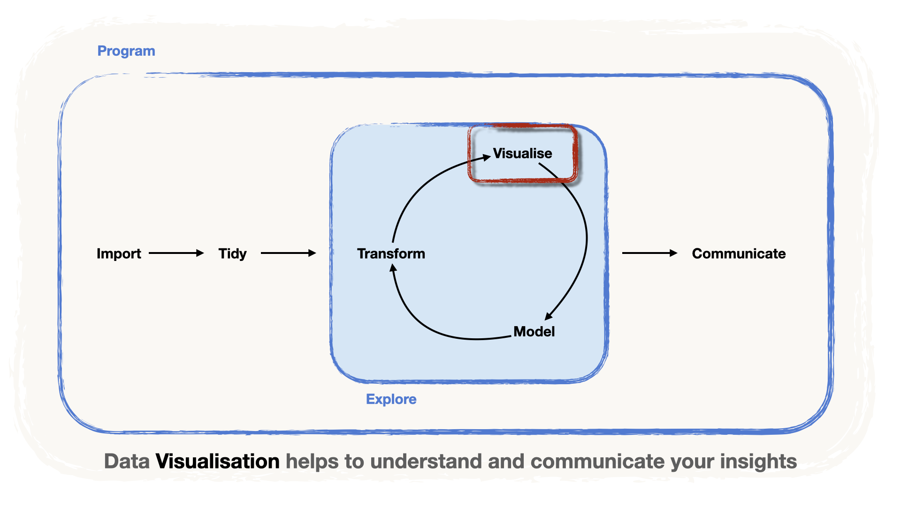
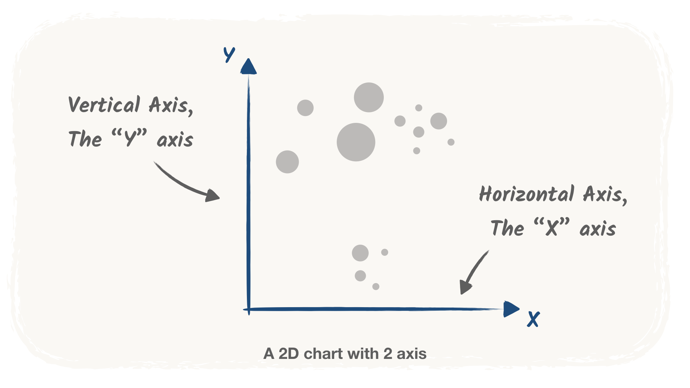
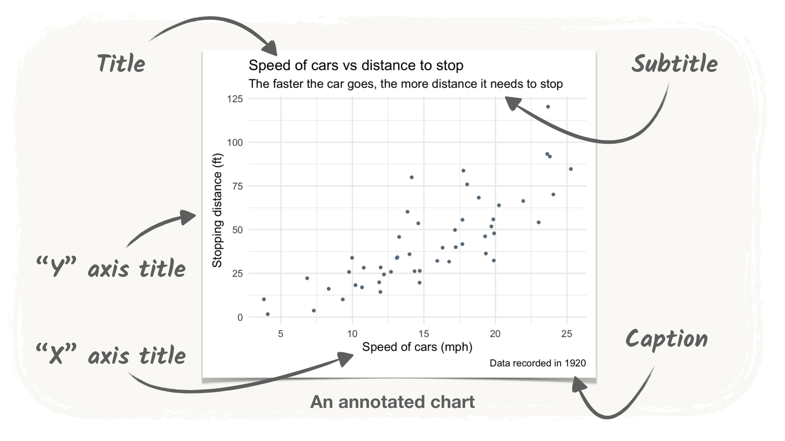
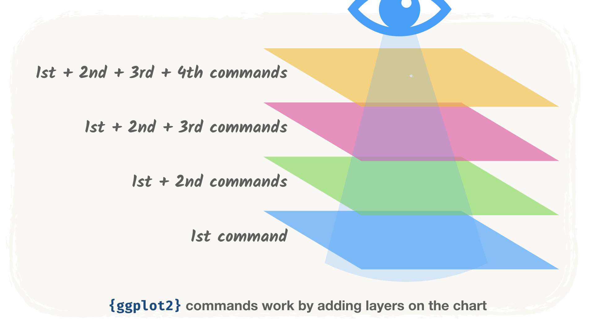

<!-- Translation of presentation.qmd. Don't change the structure here: change presentation.qmd, then port the changes (see README.md, "Translations"). -->

```{r setup, include=FALSE}
# Options pour tous les chunks :
knitr::opts_chunk$set(
	echo = TRUE,
	message = FALSE,
	warning = FALSE,
	fig.align = 'center',
	fig.width = 16/2,
	fig.height = 9/2
)
library(tidyverse)
library(knitr)

# garder les tibbles larges sur une seule diapositive
options(pillar.max_extra_cols = 0)
```

## Visualiser : explorer et communiquer

{fig-alt="Le pipeline de la data science : importer, puis préparer, puis une boucle transformer, visualiser et modéliser, puis communiquer. L'étape « visualiser » est mise en évidence : la visualisation de données aide à comprendre et à communiquer vos résultats." width="80%" fig-align="center"}

- Fait partie de la boucle d'**exploration**
- Un **outil pour communiquer** clairement les résultats

. . .

Aujourd'hui : la **grammaire des graphiques**, avec `{ggplot2}`.

# Une grammaire de la visualisation de données {.subsection background-color="#425556"}

## La grammaire des graphiques

::: content-box-marine
La grammaire des graphiques est un ensemble de **règles** pour construire des graphiques, à l'image de la grammaire d'une langue ([Wilkinson, 2005](https://link.springer.com/book/10.1007/0-387-28695-0 "The Grammar of Graphics, Wilkinson 2005"))
:::

. . .

> « des règles qui créent du sens »

. . .

::::: columns
::: {.column width="50%"}
| Mot    | Nature                            |
|--------|-----------------------------------|
| règles | **Nom**                           |
| qui    | **Pronom relatif**                |
| créent | **Verbe**                         |
| sens   | **Complément d'objet direct**     |
:::

::: {.column .fragment width="50%"}


| Graphiques       |
|:-----------------|
| **données**      |
| **esthétiques**  |
| **géométries**   |
| **thèmes**       |

:::
:::::

## Données

::: content-box-marine
Le **jeu de données** avec les **variables à représenter**.
:::

**Par exemple** : un jeu de données à trois colonnes

- `Variable 1` (numérique)
- `Variable 2` (numérique)
- `Group` (catégorielle : `"A"`, `"B"` ou `"C"`).

## Données

```{r}
#| label: example-data
#| include: false

set.seed(123)
example_data <-
  tibble(x = runif(100, 0, 10) %>% round(digits = 2)) %>%
  mutate(group = c(rep("A", 30), rep("B", 40), rep("C", 30))) %>%
  mutate(
    y = round(4 * x + rnorm(100, sd = 4), digits = 2),
    y = case_when(
      group == "B" ~ y + 12,
      group == "C" ~ y - 5 * x + 12,
      .default = y
    )
  ) %>%
  rename(`Variable 1` = x, `Variable 2` = y, Group = group) %>%
  relocate(Group, `Variable 1`, `Variable 2`)
```


```{r}
#| label: example-data-table
#| echo: false
example_data %>%
  head() %>%
  kable()
```

## Esthétiques

::: content-box-marine
Les **esthétiques** (*aesthetics*) sont les caractéristiques du graphique qui peuvent dépendre des données
:::

. . .

- les axes `x` et `y`,
- la couleur (`color`) ou la taille (`size`) d'un élément du graphique

. . .

{fig-align="center" width="70%"}

## Mapping esthétique

::: content-box-marine
Le **mapping esthétique** indique quelle **variable** va vers quel élément **esthétique** du graphique
:::

. . .

**Par exemple** :

::: {.fragment}
- Deux variables numériques peuvent être associées aux axes
  - `Variable 1` $\rightarrow$ `x`
  - `Variable 2` $\rightarrow$ `y`
:::
::: {.fragment}
- la variable catégorielle détermine la couleur
  - `Group` $\rightarrow$ `color`
:::

## Géométries

::: content-box-marine
Les **géométries** sont le **type de graphique** à utiliser
:::

. . .

| Géométrie       | Type de graphique      |
|-----------------|------------------------|
| `point`         | nuages de points       |
| `line`          | graphiques en lignes   |
| `col`umn, `bar` | diagrammes en barres   |
| `area`          | graphiques en aires    |

. . .


**Par exemple** : une géométrie `point` pour construire un **nuage de points**.

. . .

::: callout-tip
Le choix de la géométrie dépend de la **question** et de la **nature des variables**
:::

## Thèmes

::: content-box-marine
toute l'« encre » purement cosmétique (titres, axes, légendes, noms des axes, etc.) forme le **thème** du graphique
:::

. . .

{fig-align="center" width="70%"}

## Tout assembler

```{r}
#| label: example-plot
#| output-location: column-fragment
#| fig-alt: "Nuage de points de Variable 2 en fonction de Variable 1, coloré selon Group : dans chacun des groupes A, B et C, les points suivent une droite, mais les droites diffèrent d'un groupe à l'autre."
# Données
example_data %>%
  ggplot() +

# Mapping esthétique
  aes(
    x = `Variable 1`,
    y = `Variable 2`,
    color = Group) +

# Géométrie
  geom_point() +

# Thème
  theme_minimal() #<4>
```

. . .

> Un **lien linéaire** clair entre Variable 1 et Variable 2, mais il **diffère selon les groupes**

# La syntaxe de `{ggplot2}` {.subsection background-color="#425556"}

## `{ggplot2}` : la grammaire des graphiques dans R {.center}

::: {.content-box-marine}
`{ggplot2}` met en œuvre la grammaire des graphiques dans R.

Le « gg » signifie… **g**rammar of **g**raphics. C'est même dans le nom !
:::

## 🎾 Données WTA (pour les exemples)

👉 Nos données : les matchs du simple dames du Grand Chelem, 1968–2021. Nous gardons les **finales**.

```{r}
#| label: read-finals
#| output-location: column-fragment
library(readr)
library(dplyr)

wta <-
  "../data/wta_grand_slam_data.csv" %>%
  read_csv()

finals <- wta %>%
  filter(round == "F")

head(finals)
```


## Une construction en couches

::: {.callout-tip}

## Les graphiques `{ggplot2}` se construisent en couches (*layers*)

::: {.incremental}

1.  Un **graphique de base** : les **données** et le **mapping esthétique**

2.  **+** les **géométries**

3.  **+** les **éléments cosmétiques** et d'autres couches

:::

:::

{width="70%" fig-align="center"}

# Nuages de points avec `geom_point()` {.subsection background-color="#425556"}

## Nuages de points avec `geom_point()` {.smaller auto-animate="true"}

> *Y a-t-il une **tendance dans l'âge** des gagnantes des tournois au fil des **années** ?*

- La couche de base : `ggplot()`, avec les données (`data`) et le mapping `aes(x = year, y = winner_age)`

. . .


```{r}
#| label: base-plot-year-age
#| output-location: column-fragment
#| fig-alt: "Un graphique vide : les axes year et winner_age sont dessinés, mais il n'y a aucun point."

# charger ggplot2
library(ggplot2)

# créer un graphique de base
ggplot(data = finals, # les données
       mapping = aes(
        x = year, # associer l'axe x à year
        y = winner_age) # associer l'axe y à winner_age
       )
```


::: callout-tip
Pour définir le **mapping esthétique**, nous utilisons la fonction `aes(...)`.
:::

. . .

> Rien encore ! Il manque la géométrie ! Mais quelle géométrie ajouter ?

## Ajouter une géométrie avec `+` {.smaller auto-animate="true"}

> *Y a-t-il une **tendance dans l'âge** des gagnantes des tournois au fil des **années** ?*

- Un **point** par observation : `geom_point()`, **ajouté** à la couche de base avec `+`

```{r}
#| label: geom-point-year-age
#| output-location: column-fragment
#| code-line-numbers: "7,8"
#| fig-alt: "Nuage de points de l'âge de la gagnante en fonction de l'année pour les finales du Grand Chelem : aucune tendance d'ensemble, mais certains points s'alignent en petits groupes."

library(ggplot2)

ggplot(data = finals, # les données
       mapping = aes(
        x = year, # associer l'axe x à year
        y = winner_age) # associer l'axe y à winner_age
       ) +
  geom_point() # la géométrie choisie : des points
```

::: callout-tip
Dans `{ggplot2}`, on ajoute les couches avec `+` et non avec `%>%` !
:::

. . .

> **Pas de tendance claire**, mais des **groupes** de points alignés. Pourrait-il y avoir des **tendances au sein de groupes** ?


## Associer une troisième variable à `color` {.smaller auto-animate="true"}

> Pourrait-il y avoir des **tendances au sein de groupes** ?

- Colorons selon `surface` : Clay (terre battue), Grass (gazon) ou Hard (dur).

```{r}
#| label: color-surface
#| code-line-numbers: "7"
#| output-location: column-fragment
#| fig-alt: "Le même nuage de points de l'âge de la gagnante en fonction de l'année, avec les points colorés selon la surface (Clay, Grass, Hard) : toujours pas de tendance uniforme."

library(ggplot2)

ggplot(data = finals,
       mapping = aes(
        x = year,
        y = winner_age,
        color = surface)
       ) + # associer surface à color
  geom_point()
```

. . .

> Des couleurs… mais **toujours pas de tendance claire**.

## Une couleur par joueuse {.smaller auto-animate="true"}

> Les groupes seraient-ils la **même joueuse** qui gagne au fil des années, en **prenant de l'âge** ?

```{r fig.width=10, fig.height= 5}
#| label: color-winner
#| code-line-numbers: "7"
#| output-location: column-fragment
#| fig-alt: "Nuage de points de l'âge de la gagnante en fonction de l'année, avec une couleur par gagnante et sans légende : les points de même couleur s'alignent et montent avec les années."

library(ggplot2)

ggplot(data = finals,
       mapping = aes(
        x = year,
        y = winner_age,
        color = winner_name) # associer winner_name à color
        ) +
  geom_point() +
  theme(legend.position = "none") # 54 joueuses : trop pour une légende lisible
```

. . .

> Voilà ! La plupart des **points de même couleur s'alignent** : c'est l'origine des groupes.

<!-- ## Ce que les couleurs nous ont appris {.smaller}

::: callout-note
Associer une troisième variable à une esthétique comme la couleur aide souvent à découvrir des tendances au sein de **groupes**.
:::

::: {.callout-tip collapse="true"}
## Regardez l'option du chunk !

Nous avons défini une dimension du graphique dans les options du chunk (`fig.width=10, fig.height= 5`) parce que nous voulons **agrandir le graphique**.

Nous avons aussi **masqué la légende** : avec 54 joueuses différentes, personne ne pourrait associer 54 couleurs à leurs noms. Ici, il suffit de voir que les points de même couleur s'alignent.
:::

::: {.callout-note collapse="true"}
## Le graphique par surface n'était pas inutile

On voit qu'**avant 1977** il y a moins de points bleus : les tournois se jouaient seulement sur *gazon* ou sur *terre battue*, et les surfaces *dures* ne sont arrivées qu'après cette année-là.

CETTE SECTION EST MIEUX DANS LE SUPPORT DE COURS
::: -->


# Boîtes à moustaches avec `geom_boxplot()` {.subsection background-color="#425556"}

## Boîtes à moustaches avec `geom_boxplot()` {.smaller auto-animate="true"}

> *Y a-t-il un lien entre l'âge (`age`) d'une gagnante de tournoi et la surface (`surface`) ?*

- Une nouvelle question, une nouvelle géométrie :

::: {.content-box-marine}
Les **boîtes à moustaches** (*boxplots*) résument des **distributions** à partir de leurs quartiles
:::

. . .

- D'abord, le graphique de base, avec `surface` sur l'axe `x`

```{r}
#| label: base-plot-surface
#| output-location: column
#| fig-alt: "Un graphique vide avec surface (Clay, Grass, Hard) sur l'axe x et winner_age sur l'axe y."
ggplot(data = finals,
       mapping = aes(x = surface, # nous changeons le mapping de l'axe x
                     y = winner_age))
```

## Ajouter `geom_boxplot()` {.smaller auto-animate="true"}

```{r}
#| label: geom-boxplot
#| output-location: column-fragment
#| fig-alt: "Boîtes à moustaches de l'âge de la gagnante selon la surface : les gagnantes sur gazon ont tendance à être plus âgées, celles sur surface dure plus jeunes."
ggplot(data = finals,
       mapping = aes(x = surface,
                     y = winner_age)) +
  geom_boxplot() # ajouter la géométrie pour créer la boîte à moustaches
```

<!-- ::: {.callout-tip collapse="true"} -->
<!-- ## D'où viennent les boîtes ? -->
<!--  -->
<!-- Les statistiques nécessaires pour dessiner les boîtes (la médiane, les quartiles supérieur et inférieur) sont calculées à partir des données « brutes » au moment de dessiner le graphique. -->
<!-- ::: -->

. . .

> Le **gazon** favorise les gagnantes **plus âgées**, les surfaces **dures** les **plus jeunes**.

<!-- ## ⚠️ Explorer n'est pas confirmer -->
<!--  -->
<!-- ::: callout-warning -->
<!-- ## Analyse exploratoire des données -->
<!--  -->
<!-- - De tels graphiques **explorent** les liens entre variables -->
<!-- - Pour les **confirmer**, il faut plus de travail, p. ex. un **test statistique** -->
<!-- ::: -->
 <!-- c'est mieux dans le support de cours -->

# Ajouter d'autres géométries `geoms_*` {.subsection background-color="#425556"}

## Des couches sur des couches {.smaller}

> *Combien d'observations par surface ? Des valeurs extrêmes ?*

. . .

👉 Ajoutons des **points** par-dessus les boîtes à moustaches.

```{r}
#| label: boxplot-points
#| output-location: column-fragment
#| fig-alt: "Boîtes à moustaches de l'âge de la gagnante selon la surface, avec les points dessinés par-dessus : les points s'empilent sur une seule ligne verticale par surface."
ggplot(data = finals,
       mapping = aes(x = surface,
                     y = winner_age)) +
  geom_boxplot() +
  geom_point() # ajouter une nouvelle géométrie pour les mêmes mappings
```

. . .

::: callout-warning
## Attention à la surimpression !

**Surimpression** (*overplotting*) : beaucoup de points dessinés **les uns sur les autres**. Fréquent avec des points sur une variable catégorielle.
:::

## `geom_jitter()` : secouer les points {.smaller auto-animate="true"}

👉 Secouons un peu tout ça !

```{r}
#| label: boxplot-jitter
#| output-location: column-fragment
#| fig-alt: "Boîtes à moustaches de l'âge de la gagnante selon la surface, avec des points dispersés : les points sont décalés au hasard sur le côté, si bien que chaque observation est visible."
ggplot(data = finals,
       mapping = aes(x = surface,
                     y = winner_age)) +
  geom_boxplot() +
  geom_jitter() # ajouter une dispersion (jitter) par-dessus
```

## 💡 Chaque couche a des arguments {.smaller auto-animate="true"}

L'argument `width` règle l'étendue de la dispersion des points

```{r}
#| label: boxplot-jitter-width
#| output-location: column-fragment
#| code-line-numbers: "5"
#| fig-alt: "Le même graphique avec une dispersion plus étroite : les points restent près de leur boîte."
ggplot(data = finals,
       mapping = aes(x = surface,
                     y = winner_age)) +
  geom_boxplot() +
  geom_jitter(width = 0.2) # disperser un peu moins les points
```

. . .

::: callout-tip
## Chaque couche a des arguments

Chaque couche est une fonction, elle a donc des arguments
:::

# Étude de cas : personnaliser un diagramme en barres {.subsection background-color="#425556"}

## Qui a gagné le plus de titres du Grand Chelem ? {.smaller}

Utilisons nos compétences en **manipulation de données** pour compter les victoires !

. . .

```{r}
#| label: count-total-wins
total_wins <- finals %>%
  group_by(winner_name) %>%
  summarise(total_wins = n(), .groups = "drop") %>%
  arrange(desc(total_wins))

slice_head(total_wins, n = 6)
```

## Un premier diagramme en barres avec `geom_col()` {.smaller}

```{r}
#| label: geom-col-all
#| output-location: column
#| fig-alt: "Diagramme en barres horizontales du nombre de titres des 54 gagnantes, en ordre alphabétique inverse de haut en bas : les noms se chevauchent et le graphique est difficile à lire."
ggplot(data = total_wins,
       mapping = aes(x = total_wins,
                     y = winner_name)) +
  geom_col()
```

Il est temps de lui donner un peu plus d'allure !

## Ordonner les barres {.smaller}

- Les barres sont dans l'ordre **alphabétique** : `winner_name` est encore de type `character`
- `ggplot()` ignore notre `arrange()` !

::: {.content-box-marine}
Transformez `winner_name` en `factor` : un type **doté d'un ordre**. Dans le `{tidyverse}` : le package `{forcats}`.
:::

```{r}
#| label: reorder-winners
library(forcats)

total_wins <- total_wins %>%
  # ordonner winner_name selon total_wins
  mutate(winner_name = fct_reorder(winner_name, total_wins))
```

`winner_name` est maintenant un facteur (`fct`) :

```{r}
#| label: total-wins-head-reordered
glimpse(total_wins)
```

## Des barres ordonnées {.smaller}

```{r}
#| label: geom-col-ordered
#| output-location: column
#| fig-alt: "Le même diagramme en barres, avec les barres ordonnées selon le nombre de titres, du plus grand nombre en haut au plus petit en bas."
ggplot(data = total_wins,
       mapping = aes(x = total_wins,
                     y = winner_name)) +
  geom_col()
```

> Le graphique est déjà bien plus lisible ! …mais comment l'améliorer ?

## Cibler notre message {.smaller}

- Garder le **top 20** avec `slice_max()`, transmis directement à `ggplot()`
- La table d'origine reste inchangée

```{r}
#| label: top20-bars
#| output-location: column
#| fig-alt: "Diagramme en barres ordonné du nombre de titres des 20 meilleures gagnantes, emmenées par Serena Williams et Steffi Graf."
total_wins %>%
  slice_max(order_by = total_wins, n = 20) %>%
  ggplot(mapping = aes(x = total_wins,
                       y = winner_name)) +
  geom_col()
```

> Bien mieux, le graphique parle presque de lui-même. Mais occupons-nous des axes.

## Place à la cosmétique ! {.smaller}

- Un titre et des noms d'axes, avec une couche `labs()`

::: callout-note
La couche `labs()` fait partie des couches qui s'occupent des aspects *cosmétiques* du graphique.
:::

```{r}
#| label: top20-labs
#| output-location: column
#| fig-alt: "Le diagramme en barres du top 20 avec le titre « Serena Williams a remporté 23 titres du Grand Chelem », un sous-titre, un nom d'axe x et une mention de la source."
total_wins %>%
  slice_max(order_by = total_wins, n = 20) %>%
  ggplot(mapping = aes(x = total_wins,
                       y = winner_name)) +
  geom_col() +
  # ajouter des libellés
  labs(title = "Serena Williams a remporté 23 titres du Grand Chelem",
       subtitle =  "Suivie de la légendaire Steffi Graf avec 22 titres",
       x = "Nombre de titres du Grand Chelem",
       y = "",
       caption = "source : https://github.com/JeffSackmann")
```

## Des thèmes prêts à l'emploi {.smaller}

::: callout-note
`{ggplot2}` propose plusieurs thèmes prêts à l'emploi. Vous en trouverez une liste [ici](https://ggplot2.tidyverse.org/reference/ggtheme.html). En voici quelques-uns :

- `theme_minimal()` : un bon point de départ
- `theme_dark()` : si [vous le voulez plus sombre](https://youtu.be/v0nmHymgM7Y)
- `theme_bw()` : pour tout voir en noir et blanc
- `theme_classic()`

Vous verrez les propositions en tapant `theme_` dans la console.
:::

## Optons pour `minimal` {.smaller}

```{r}
#| label: top20-theme-minimal
#| output-location: column
#| fig-alt: "Le diagramme en barres du top 20 avec ses libellés et theme_minimal() : pas de fond gris et des lignes de grille claires."
total_wins %>%
  slice_max(order_by = total_wins, n = 20) %>%
  ggplot(mapping = aes(x = total_wins,
                       y = winner_name)) +
  geom_col() +
  labs(title = "Serena Williams a remporté 23 titres du Grand Chelem",
       subtitle =  "Suivie de la légendaire Steffi Graf avec 22 titres",
       x = "Nombre de titres du Grand Chelem",
       y = "",
       caption = "source : https://github.com/JeffSackmann") +
  # ajouter un thème
  theme_minimal()
```

## Et un peu de couleur ? {.smaller}

Essayons `fill = "lightblue"`…

```{r}
#| label: fill-in-aes
#| output-location: column
#| fig-alt: "Le diagramme en barres avec fill = 'lightblue' dans aes() : les barres sont rouge saumon, et une légende montre une seule clé intitulée lightblue."
total_wins %>%
  slice_max(order_by = total_wins, n = 20) %>%
  ggplot(mapping = aes(x = total_wins,
                       y = winner_name,
                       fill = "lightblue")) +
  geom_col() +
  labs(title = "Serena Williams a remporté 23 titres du Grand Chelem",
       subtitle =  "Suivie de la légendaire Steffi Graf avec 22 titres",
       x = "Nombre de titres du Grand Chelem",
       y = "",
       caption = "source : https://github.com/JeffSackmann") +
  theme_minimal()
```

> Oh non ! Quelque chose ne va pas… Devinez-vous quoi ?

## Que se passe-t-il ? {.smaller .scrollable}

::: {.callout-warning collapse="true"}
## Que se passe-t-il ?

- En plaçant `fill = "lightblue"` dans l'appel à `aes()`, nous **associons une variable** à la **valeur unique** `"lightblue"` au remplissage (`fill`) des barres…
- …au lieu de le fixer comme **paramètre** !
- `ggplot()` ne comprend pas que `"lightblue"` est en fait une couleur que nous voulons fixer.
- Un mapping aurait du sens si nous voulions que la couleur des barres dépende du nombre de `total_wins`.
- Cela crée une échelle de couleurs continue, appliquée à la couleur des barres.

```{r}
#| label: fill-total-wins
#| output-location: column
#| fig-alt: "Le diagramme en barres avec fill = total_wins dans aes() : les barres sont nuancées le long d'une échelle continue de bleus selon le nombre de titres, avec une légende en barre de couleurs."
total_wins %>%
  slice_max(order_by = total_wins, n = 20) %>%
  ggplot(mapping = aes(x = total_wins,
                       y = winner_name,
                       fill = total_wins)) +
  geom_col() +
  labs(title = "Serena Williams a remporté 23 titres du Grand Chelem",
       subtitle =  "Suivie de la légendaire Steffi Graf avec 22 titres",
       x = "Nombre de titres du Grand Chelem",
       y = "",
       caption = "source : https://github.com/JeffSackmann") +
  theme_minimal()
```
:::

## Fixer une couleur : en dehors d'`aes()` {.smaller}

- Pour donner une couleur à **toutes** les barres, fixez-la **dans le `geom_*()`**, en dehors d'`aes()`

```{r}
#| label: fill-outside-aes
#| output-location: column
#| fig-alt: "Le diagramme en barres du top 20 avec ses libellés, toutes les barres en bleu clair et sans légende."
total_wins %>%
  slice_max(order_by = total_wins, n = 20) %>%
  ggplot(mapping = aes(x = total_wins,
                       y = winner_name)) +
  geom_col(fill = "lightblue") + # fixer une couleur pour toutes les barres
  labs(title = "Serena Williams a remporté 23 titres du Grand Chelem",
       subtitle =  "Suivie de la légendaire Steffi Graf avec 22 titres",
       x = "Nombre de titres du Grand Chelem",
       y = "",
       caption = "source : https://github.com/JeffSackmann") +
  theme_minimal()
```

# Étude de cas : représenter plus de variables {.subsection background-color="#425556"}

## Serena a-t-elle gagné plus que Steffi sur toutes les surfaces ? {.smaller}

- Compter les finales gagnées **par joueuse** et **par surface**, puis associer `surface` à `fill`
- Mais d'abord, **réordonner** à nouveau les joueuses

::: callout-note
## D'autres astuces pratiques de `{forcats}`

- `fct_infreq()` ordonne les facteurs par fréquence : appliqué à `winner_name`, il ordonne les joueuses sans qu'il soit besoin de compter !
- `fct_rev()` inverse l'ordre, pour le rendre **décroissant**.

```{r}
#| label: wins-by-surface
total_wins_surface <- finals %>%
  mutate(winner_name = fct_rev(fct_infreq(winner_name))) %>% # réordonner les noms des gagnantes
  group_by(winner_name, surface) %>%
  summarise(total_wins = n(), .groups = "drop") %>%
  arrange(surface, desc(total_wins))
```
:::

## Le top 20, sous forme de vecteur {.smaller}

`pull()` extrait les noms du top 20 dans le vecteur `top20`

```{r}
#| label: top20-names
top20 <- total_wins %>%
  slice_max(order_by = total_wins, n = 20) %>%
  pull(winner_name)

top20
```

## Titres par surface {.smaller}

```{r}
#| label: stacked-by-surface
#| output-location: column
#| fig-alt: "Diagramme en barres empilées des titres des 20 meilleures gagnantes, chaque barre étant divisée en clay, grass et hard par la couleur de remplissage."
total_wins_surface %>%
  filter(winner_name %in% top20) %>%
  ggplot(mapping = aes(x = total_wins,
                         y = winner_name,
                         fill = surface)) +
  geom_col() +
  labs(
    title = "Serena Williams a remporté 23 titres du Grand Chelem",
    subtitle =  "Suivie de la légendaire Steffi Graf avec 22 titres",
    x = "Nombre de titres du Grand Chelem",
    y = "",
    caption = "source : https://github.com/JeffSackmann"
  ) +
  theme_minimal()
```

- Steffi Graf a gagné plus sur **terre battue**, Serena plus sur surface **dure**
- Mais le **gazon** est très difficile à comparer !

# Créer plusieurs mini-graphiques {.subsection background-color="#425556"}

## Un mini-graphique par surface : `facet_wrap()` {.smaller}

- Comparer les joueuses **surface par surface**
- Les mini-graphiques s'appellent des **facettes** : la variable de facettage va dans `vars()`

::: callout-important
```{r}
#| label: facets-by-surface
#| output-location: column
#| fig-alt: "Trois diagrammes en barres côte à côte, un par surface (Clay, Grass, Hard), chacun montrant les titres des 20 meilleures gagnantes sur cette surface."
total_wins_surface %>%
  filter(winner_name %in% top20) %>%
  ggplot(mapping = aes(x = total_wins,
                         y = winner_name,
                         fill = surface)) +
  geom_col() +
  labs(
    title = "Serena Williams a remporté 23 titres du Grand Chelem",
    subtitle =  "Suivie de la légendaire Steffi Graf avec 22 titres",
    x = "Nombre de titres du Grand Chelem",
    y = "",
    caption = "source : https://github.com/JeffSackmann"
  ) +
  theme_minimal() +
  facet_wrap(vars(surface)) # utiliser surface comme variable de facettage
```
:::

## Masquer la légende redondante {.smaller}

::: {.callout-note collapse="true"}
## Les couleurs sont redondantes aussi

Les couleurs sont ici un peu redondantes elles aussi, mais nous les gardons par goût personnel ; libre à vous de les retirer.
:::

```{r}
#| label: facets-no-legend
#| output-location: column
#| fig-alt: "Les trois mêmes facettes sans légende : le titre de chaque facette indique sa surface."
total_wins_surface %>%
  filter(winner_name %in% top20) %>%
  ggplot(mapping = aes(x = total_wins,
                         y = winner_name,
                         fill = surface)) +
  geom_col() +
  labs(
    title = "Serena Williams a remporté 23 titres du Grand Chelem",
    subtitle =  "Suivie de la légendaire Steffi Graf avec 22 titres",
    x = "Nombre de titres du Grand Chelem",
    y = "",
    caption = "source : https://github.com/JeffSackmann"
  ) +
  theme_minimal() +
  facet_wrap(vars(surface)) +
  theme(legend.position = "none") # retirer la légende
```

# Exporter vos graphiques {.subsection background-color="#425556"}

## `ggsave()` enregistre le dernier graphique

- Donnez-lui simplement un **nom de fichier** :

```{r}
#| label: ggsave-default
#| eval: false
ggsave("wta_wins_by_surface.png")
```

- La taille suit votre **onglet Plots**, elle change donc d'un ordinateur à l'autre. Fixez-la avec `width` et `height` (en pouces) :

```{r}
#| label: ggsave-7x5
#| eval: false
ggsave("wta_wins_by_surface_7x5.png", width = 7, height = 5)
```

# Plus de ressources {.subsection background-color="#425556"}

## Pour aller plus loin

- [Le livre `{ggplot2}`](https://ggplot2-book.org)
- [L'aide-mémoire `{ggplot2}`](https://ggplot2.tidyverse.org)
- [Les extensions de `{ggplot2}`](https://exts.ggplot2.tidyverse.org)
- [R for data science](https://r4ds.had.co.nz)
- [Les solutions des exercices de R for data science](https://jrnold.github.io/r4ds-exercise-solutions/)

# C'est l'heure de l'exercice ! {.unnumbered .subsection background-color="#425556"}

## Au travail !

::: {.callout-important icon="false"}
## Au travail !

Ouvrez le notebook d'exercices `_exercises/exercise-notebook.qmd` et faites l'[**exercice 6**](../_exercises/exercise-notebook.html#exercise-6). À tout de suite !
:::
