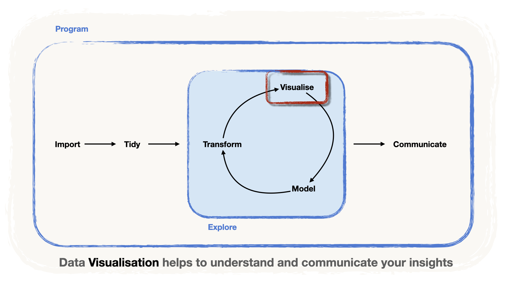

```{r setup, include=FALSE}
# Set options for all chunks:
knitr::opts_chunk$set(
	message = FALSE,
	warning = FALSE
)
library(tidyverse)
library(knitr)
```

We will now discover another step in the data pipeline, the visualisation part.

-   Data visualisation is an important part of the data exploration loop,

-   But it is also very important as a **tool to communicate results** in a clear and meaningful way.



There are many approaches to creating a data plot.

Today, we'll focus on the **visualisation approach** that relies on the **Grammar of Data** **Visualisation**, implemented in R via the package `{ggplot2}`.

# A Grammar for Data Visualisation

The Grammar of Graphics (see [Wilkinson, 2005](https://link.springer.com/book/10.1007/0-387-28695-0 "The Grammar of Graphics, Wilkinson 2005")) is an attempt to **systematise** and **expand** the **production of quantitative graphics**.

The idea is to give **rules** akin to the **grammar of Natural Language**.

Much like the *natural language*, that uses syntactic components such as:

-   **nouns,**

-   **adjectives,**

-   **verbs,**

-   **adverbs**

to build **statements,** the grammar of graphics relies also on components, namely:

-   **data**

-   **aesthetics**

-   **geometries**

-   **themes**

Let's explore in detail these components:

#### **The Data** {.unnumbered}

The **dataset** containing the **variables we want to plot.**

-   Let's consider for illustration a dataset with three columns: **Variable 1**, **Variable 2** and **Group** (A, B or C)

```{r}
#| include = FALSE
set.seed(123)
example_data <- 
  tibble(x = runif(100, 0, 10) %>% round(digits = 2)) %>% 
  mutate(group = c(rep("A", 30), rep("B", 40), rep("C", 30))) %>% 
  mutate(
    y = 4*x + rnorm(sd = 4,  100) %>% round(digits  = 2),
    y = case_when(
      group == "B" ~ y + 12,
      group == "C" ~ y - 5*x +12, 
      TRUE  ~ y
  )) %>% 
  rename(`Variable 1` = x, `Variable 2` = y, Group = group) %>% 
  relocate(Group, `Variable 1`, `Variable 2`)
```

```{r}
#| echo = FALSE
example_data %>% 
  head() %>% 
  kable()
```

#### **Aesthetic elements and aesthetic mappings** {.unnumbered}

The **features of the graphic**, i.e. the elements of the plot we want to make data-dependent.

For instance:

-   The `x` or `y` axes,

-   The `color` or the `fill`ing of the areas or lines we'll draw,

-   The `size` of the areas

An **Aesthetic** **Mapping** is the way we **link** the **Variables** in our data **to the plot**

-   In our illustration, we have two numeric variables and one categorical,

-   it would make sense to:

    -   **map the numeric variables** to the `x` and `y` axis.

    -   **map** the categorical variable to the `color`

-   Hence the aesthetic mapping would be

    -   `x = Variable 1`

    -   `y = Variable 2`

    -   `color = Group`

#### **Geometries** {.unnumbered}

The **type of plot** we want to display

-   Here, we'd like a scatterplot, hence we choose a `point` geometry with `geom_point()`
-   Other options include `line` s, `area` , `col`umn, `bar` ...
-   The choice depends on the **research question** and the **nature of the variables**

#### **Themes** {.unnumbered}

All the "ink", i.e. the purely cosmetic elements of the graphic

-   The titles, the shape of the axes etc.

With these elements, let's make a plot.

```{r}
#| echo = FALSE
example_data %>% 
  ggplot(aes(x = `Variable 1`, y = `Variable 2`, color = Group))+
  geom_point()+ 
  theme_minimal()
```

From this plot, we can see that:

1.  There's clear linear link between Variable 1 and Variable 2.
2.  However, the nature of this link is different across the groups.

Now let's see how we can construct plots with the grammar of graphics in R with `{ggplot2}`

# `{ggplot2}` syntax

The package that implements the Grammar of graphics approach to Data Visualisation in the `{tidyverse}` is `{ggplot2}`

::: callout-note
It's even in the name! the 'gg' stands for... **g**rammar of **g**raphics.
:::

We will make illustrations with the data on women's Grand Slam singles matches from 1968 to 2021, stored in `wta_grand_slam_data.csv`.

```{r}
#| code-fold: true
library(readr)
library(dplyr)

wta <- 
  "../data/wta_grand_slam_data.csv" %>% 
  read_csv() 

finals <- wta %>% 
  filter(round == "F")

head(finals)
```

We attach the the package as usual, using `library()`

```{r}
library(ggplot2) 
```

::: callout-important
One important thing to understand is that `{ggplot2}` works with **layers of information.**

-   First, we create a **base plot** made of

    -   **data** and...

    -   the **aesthetic mappings** ...

-   ... to which then we add the **geometries ...**

-   ... and then, all the cosmetic elements and other layers.
:::

::: panel-tabset
## Scatterplots with `geom_point()`

> Let's explore ***if there is a trend in the age** of the tournament winners over the **years***

-   To construct the base layer, we make a call inside the `ggplot()` function,

    -   We define the `data` using `data = finals`

    -   We also map the `x` axis to `year` and the `y` axis to `winner age`.

::: callout-important
To define the **aesthetic mapping** we rely on the function `aes(...)`
:::

```{r}
# create a base plot

ggplot(data = finals, # the data
       mapping = aes(x = year, # mapping the x-axis to year
                     y = winner_age) # mapping the y-axis to winner age
       ) 
```

> Nothing yet! The geometry is missing!\
> \
> But what geometry should we add?

-   Let's start by adding **points.** We want one point for every observation.

-   We define the **geometry** as `geom_point()`\...

    -   which we need to **add** it **to our base layer** using the `+` sign

::: callout-warning
In `{ggplot2}` we use the `+` instead of the `%>%` sign to add layers!
:::

```{r}

ggplot(data = finals,
       mapping = aes(x = year,
                     y = winner_age)) +
  geom_point() # our geometry of choice: points
```

> Not very informative, unfortunately.

-   There is **no uniform trend** in the age of the wta winners in time.
-   But we see that there are **clusters** i.e. areas where the points align.

> Could there be trends within a group?

-   To asses this we could map a categorical variable to the `color` aesthetic

-   Let's try with `surface` i.e. whether the match is played on Clay, Grass or a Hard surface

```{r}

ggplot(data = finals,
       mapping = aes(x = year,
                     y = winner_age,
                     color = surface)) + # mapping surface to color
  geom_point()

```

> The points now have **colors**...
>
> ...but still no uniform trend.\
> \
> Should we try with another variable?\
> \
> Perhaps these clusters are due to the **same player winning over many years** and at the same time **getting older**.

-   Let's test this conjecture by mapping the `winner_name` to the `color` aesthetic...

```{r fig.width=10, fig.height= 5}
ggplot(data = finals,
       mapping = aes(x = year,
                     y = winner_age,
                     color = winner_name)) + #mapping winner name to color
  geom_point() 
```

> Voilà!\
> \
> Most **points with the same color align**, indicating the source of the clusters.

::: callout-note
Often, mapping a third variable to an aesthetic such as color can help us discover trends within **groups**.
:::

::: {.callout-tip collapse="true"}
## Look at the chunk option!

We have defined a dimension of the chart in the options (`fig.width=10, fig.height= 5`) because we want to **enlarge the plot**

(the legend will also take up a lot of space, after all!)
:::

::: {.callout-note collapse="true"}
The work on the first chart is not useless, though.\
\
You can see that **before 1977**, there are less blue points,

Hence, tournaments were played only on *grass* or *clay* and *hard* surfaces arrived only after that year.
:::

## Boxplots with `geom_boxplot()`

We can now ask **another question** and try to respond using a **different geometry**:

> *Is there a difference in the distribution of the tournament winner's age across the different surfaces?*

-   A good choice of `geometry` would be to use *boxplots*, since they constitute good **summaries of distributions**.

```{r}
ggplot(data = finals,
       mapping = aes(x = surface, # we change the mapping of the x axis
                     y = winner_age)) 
```

-   To add the boxplot geometry, we add `geom_boxplot()`.

```{r}

ggplot(data = finals,
       mapping = aes(x = surface,
                     y = winner_age)) +
  geom_boxplot() # adding the geometry to create the boxplot

```

::: {.callout-note collapse="true"}
It is important to note that the summary statistics that are needed to plot the boxplots (i.e. median, upper and lower quartile) are computed from the "raw" data when drawing the plot.
:::

> Voilà!\
> \
> It appears that the **grass surface** tends to favor the **older players**, whereas the **younger players win** in **hard surfaces**.
>
> (We can **conjecture** that this is because the ball is a bit **slower in grass**, and **faster in hard surfaces**, favoring the more "physical", hence younger, players!)

::: callout-warning
## Exploratory Data Analysis

Plotting the data this way can give us a good hint on whether there are differences in the different categories.

Hence they work as an **exploration** of the links between variables.

However, in order to **confirm** these links, **more work is needed**.

-   For instance, a **statistical test** can confirm that the differences we see are not due to chance

-   (In that case, we should be mindful of the fact that the numerical variables are not entirely independent!)
:::
:::

# Adding more geometries `geoms_*`

As we mentioned before, `{ggplot2}` works with **layers of information**

In our examples, we have drawn the **base plot** and then added **one single** **geometry** (point or boxplot).

Let's focus on the comparison of the winners' ages across surfaces.

What if we wanted to give more information?, For instance:

> -   Are there differences in the number of observations in each category?
>
> -   Do we have extreme values?

-   Let's add ***points*** **on top of the boxplot**, by adding the `geom_point()` geometry:

```{r}

ggplot(data = finals,
       mapping = aes(x = surface,
                     y = winner_age)) +
  geom_boxplot() +
  geom_point() # added a new geometry representation for the same mappings
```

::: callout-warning
## Careful with Overplotting!

Now we have a little visualisation challenge: **overplotting**!

-   Overplotting happens when **many points are drawn on top of each other, making difficult to see individual points.**

-   This happens often when we draw points over categorical variables, specially if the sample is small
:::

To avoid the trap of overplotting, we will "shake" the points randomly along the x-axis.

-   We do this by changing the geometry to `geom_jitter()`

```{r}

ggplot(data = finals,
       mapping = aes(x = surface,
                     y = winner_age)) +
  geom_boxplot() +
  geom_jitter() # added a jitter on top
```

-   We can adjust a bit the jitter, by defining the `width` of the spread.

```{r}

ggplot(data = finals,
       mapping = aes(x = surface,
                     y = winner_age)) +
  geom_boxplot() +
  geom_jitter(width = 0.2) # spreading the points a little less
```

::: callout-note
## Every layer has Arguments

Notice that we've adjusted the argument `width`

In general, every layer is a function, hence it has arguments!
:::

# Case study: Customising a bar chart

Let's ask a different question:

> *Who won the most Grand Slam titles*?

-   Let's start by creating the dataset where we count the finals won by each player.

::: callout-note
Let's use our **Data Wrangling** skills!
:::

```{r}
total_wins <- finals %>% 
  group_by(winner_name) %>% 
  summarise(total_wins = n()) %>% 
  arrange(desc(total_wins)) %>% 
  ungroup()
```

-   Our dataset looks like this:

```{r}
slice_head(total_wins, n = 6)
```

-   And we can use `geom_col()` to create a plot:

```{r}
ggplot(data = total_wins, 
       mapping = aes(x = total_wins,
                     y = winner_name)) +
  geom_col()
```

Time to give it a bit more flair with the tools in `{ggplot2}`!

::: panel-tabset
## Ordering the bars

Currently, the bars are ordered in the alphabetical order of the `winner_name`

-   This is because `winner_name` is still of type `character`

-   And `ggplot()` is not sensitive to our call to `arrange()`!

::: callout-important
To order the bars, we need to **create a new order** for the variable `winner_name`.

For this, we will transform it into a `factor`: a variable type **endowed with an order**

In the `{tidyverse}` we use the package `{forcats}`.
:::

-   Let's reorder `winner name` according to the `total_wins` with `forcats::fct_reorder()`

```{r}
library(forcats)

total_wins <- total_wins %>% 
  # we reorder the winner_name by total wins
  mutate(winner_name = fct_reorder(winner_name, total_wins)) 
```

-   See that now winner_name is stored as a factor (`fctr`)!

```{r}
slice_head(total_wins, n = 6) 
```

-   Let's plot again...

```{r}
ggplot(data = total_wins, 
       mapping = aes(x = total_wins,
                     y = winner_name)) +
  geom_col()
```

> The plot is already much more readable!
>
> ... but how can we improve it?

## Focusing our message

For instance, we can decide to **focus on the top 20**

-   For this, we can use `slice_max()` ...

-   ... and feed it directly to the `ggplot()`.

-   (thus we avoid modifying the original tibble)

```{r}
total_wins %>% 
  slice_max(order_by = total_wins, n=20) %>% 
  ggplot(mapping = aes(x = total_wins,
                       y = winner_name)) +
  geom_col()
```

> Much better, the plot almost speaks by itself
>
> But let's fix those axes

## Cosmetic time!

It is time to add a title and fix the axes names.

-   We will add a `labs()` layer to our plot to do so.

::: callout-note
The `labs()` layer is part of the layers that help with the *cosmetic* aspects of the plot.
:::

```{r}
total_wins %>% 
  slice_max(order_by = total_wins, n=20) %>% 
  ggplot(mapping = aes(x = total_wins,
                       y = winner_name)) +
  geom_col() +
  #adding labels
  labs(title = "Serena Williams won 23 Grand Slam titles",
       subtitle =  "Followed by the legendary Steffi Graf with 22 titles",
       x = "Number of Grand Slam titles",
       y = "",
       caption = "source: https://github.com/JeffSackmann")
```

> Now we can give a different theme to the plot.

::: callout-note
`{ggplot2}` has multiple ready-to-use themes.

You can see [here](https://ggplot2.tidyverse.org/reference/ggtheme.html) a list of them. Some of them are:

-   `theme_minimal()`: a good starting point
-   `theme_dark()`: if [you want it darker](https://youtu.be/v0nmHymgM7Y)
-   `theme_bw()` : to see things in black and white
-   `theme_classic()`

You can see the proposals if you type `theme_` in your console.
:::

-   Let's go `minimal`...

```{r}
total_wins %>% 
  slice_max(order_by = total_wins, n=20) %>% 
  ggplot(mapping = aes(x = total_wins,
                       y = winner_name)) +
  geom_col() +
  labs(title = "Serena Williams won 23 Grand Slam titles",
       subtitle =  "Followed by the legendary Steffi Graf with 22 titles",
       x = "Number of Grand Slam titles",
       y = "",
       caption = "source: https://github.com/JeffSackmann") +
  # adding a theme
  theme_minimal()
```

## How about some color?

Let's give color to our bars.

-   We can use `fill="lightblue"` ...

```{r}
total_wins %>% 
  head(n=20) %>% 
  ggplot(mapping = aes(x = total_wins,
                       y = winner_name,
                       fill = "lightblue")) +
  geom_col() +
  labs(title = "Serena Williams won 23 Grand Slam titles",
       subtitle =  "Followed by the legendary Steffi Graf with 22 titles",
       x = "Number of Grand Slam titles",
       y = "",
       caption = "source: https://github.com/JeffSackmann") +
  theme_minimal()

```

> Oh no! Something is wrong...
>
> Can you guess what?

::: {.callout-warning collapse="true"}
## What's going on?

-   When we place `fill="lightblue"` in the call to `aes()`, we are **mapping a variable** with the **single value** `"lightblue"` to the `fill` of the bars....

-   ... and not as a **parameter!**

-   `ggplot()` does not understand that blue is actually a color we want to set.

-   This mapping would work if we wanted to make the color of the bars dependent on the number of `total_wins`.

-   This creates a continuous color scale that is applied to the color of the bars.

```{r}
total_wins %>% 
  head(n=20) %>% 
  ggplot(mapping = aes(x = total_wins,
                       y = winner_name,
                       fill = total_wins)) +
  geom_col() +
  labs(title = "Serena Williams won 23 Grand Slam titles",
       subtitle =  "Followed by the legendary Steffi Graf with 22 titles",
       x = "Number of Grand Slam titles",
       y = "",
       caption = "source: https://github.com/JeffSackmann") +
  theme_minimal()
```
:::

-   If we want to set a color to all our bars, we need to do it **outside the** `aes()`

-   i.e. **inside the `geom_*()`**

```{r}
total_wins %>% 
  head(n=20) %>% 
  ggplot(mapping = aes(x = total_wins,
                       y = winner_name)) + 
  geom_col(fill = "lightblue") + # setting a colour for all the bars
  labs(title = "Serena Williams won 23 Grand Slam titles",
       subtitle =  "Followed by the legendary Steffi Graf with 22 titles",
       x = "Number of Grand Slam titles",
       y = "",
       caption = "source: https://github.com/JeffSackmann") +
  theme_minimal()
```
:::

# Case Study: Plotting more variables

We can ask ourselves:

> *Did Serena Williams win more than Steffi Graf on all surfaces?*

How can we see this visually?

-   First, we need to create the dataset **count the total of finals won by player** and **by surface**...

-   ... and then try to map the `surface` to `fill`...

-   ...but! We need to **reorder the data first** so that the bars are ordered again.

::: callout-note
## Other nifty `{forcats}` tricks

-   `fct_infreq()` orders factors by frequency.

-   When applied to `winner_name` we order them without the need to count!

-   `fct_rev()` reverses the order, to make it **descending**

```{r}
total_wins_surface <- finals %>% 
  mutate(winner_name = fct_rev(fct_infreq(winner_name))) %>% #reordering the winner names
  group_by(winner_name, surface) %>% 
  summarise(total_wins = n()) %>% 
  arrange(surface, -total_wins) %>% 
  ungroup()
```
:::

To focus our message, we can use our top 20.

-   Let's extract the names in the top 20 from the `total_wins` dataset...

-   ... and store them in the `vector` `top20`

```{r}
top20 <- total_wins %>% 
  slice_max(order_by = total_wins, n=20) %>% 
  pull(winner_name)

top20
```

Now we're ready to plot.

```{r}
total_wins_surface %>%
  filter(winner_name %in% top20) %>% 
  ggplot(mapping = aes(x = total_wins, 
                         y = winner_name,
                         fill = surface)) +
  geom_col() +
  labs(
    title = "Serena Williams won 23 Grand Slam titles",
    subtitle =  "Followed by the legendary Steffi Graf with 22 titles",
    x = "Number of Grand Slam titles",
    y = "",
    caption = "source: https://github.com/JeffSackmann"
  ) +
  theme_minimal()
```

> We can see that :
>
> -   Steffi Graf won more than Serena Williams on clay
>
> -   and Serena won more on hard surfaces
>
> But for the Grass, it is very difficult to compare!
>
> Clearly there's room for improvement

# Creating multiple mini-plots

We can use a different strategy to compare the players across different surfaces best: create a **mini-plot for each surface**.

-   This will also allow us to add the number on top of the bars without overcrowding the plot.

<!-- -->

-   To do so, we can add a `facet_wrap()` layer.

::: callout-note
The mini plots in *`R`* are called *"facets"*.
:::

::: callout-important
The syntax is slightly different

we need to wrap the variable name that we want to use to divide into facets into the function `vars()`.

```{r}
total_wins_surface %>%
  filter(winner_name %in% top20) %>% 
  ggplot(mapping = aes(x = total_wins, 
                         y = winner_name,
                         fill = surface)) +
  geom_col() +
  labs(
    title = "Serena Williams won 23 Grand Slam titles",
    subtitle =  "Followed by the legendary Steffi Graf with 22 titles",
    x = "Number of Grand Slam titles",
    y = "",
    caption = "source: https://github.com/JeffSackmann"
  ) +
  theme_minimal() +
  facet_wrap(vars(surface)) # using surface as a faceting variable
```
:::

-   We can now hide the legend since it's redundant

::: {.callout-note collapse="true"}
Also, the colors here are a bit redundant, but we keep them just for personal taste; feel free to remove them.
:::

```{r}
total_wins_surface %>%
  filter(winner_name %in% top20) %>% 
  ggplot(mapping = aes(x = total_wins, 
                         y = winner_name,
                         fill = surface)) +
  geom_col() +
  labs(
    title = "Serena Williams won 23 Grand Slam titles",
    subtitle =  "Followed by the legendary Steffi Graf with 22 titles",
    x = "Number of Grand Slam titles",
    y = "",
    caption = "source: https://github.com/JeffSackmann"
  ) +
  theme_minimal() +
  facet_wrap(vars(surface)) +
  theme(legend.position = "none") #removing the legend
```

# Exporting your plots

Once you are happy with your plots, it is time to export them.

-   The easiest way is by using `ggsave()`, which, by default, saves the last plot that you displayed. So basically, you just need to provide the file name you want as argument.

```{r}
#| eval: false
ggsave("wta_wins_by_surface.png")
```

-   By default, the image takes the size of the current plotting window (in RStudio, the *Plots* pane), so it changes from one computer to another. To control the size, use the `width` and `height` arguments, in inches by default.

```{r}
#| eval: false
ggsave("wta_wins_by_surface_7x5.png", width = 7, height = 5)
```

# More resources

-   [`{ggplot2}` book](https://ggplot2-book.org)
-   [`{ggplot2}` cheatsheet](https://ggplot2.tidyverse.org)
-   [`{ggplot2}` extensions](https://exts.ggplot2.tidyverse.org)
-   [R for data science](https://r4ds.had.co.nz)
-   [R for data science exercise solutions](https://jrnold.github.io/r4ds-exercise-solutions/)

# Exercise Time! {.unnumbered}

::: {.callout-important icon="false"}
## Time to work!

Open the exercise notebook `_exercises/exercise-notebook.qmd` and do **[Exercise 6](../_exercises/exercise-notebook.html#exercise-6)**. See you there!
:::
