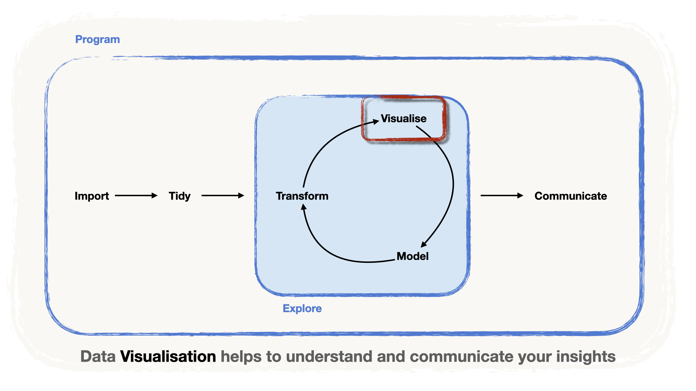
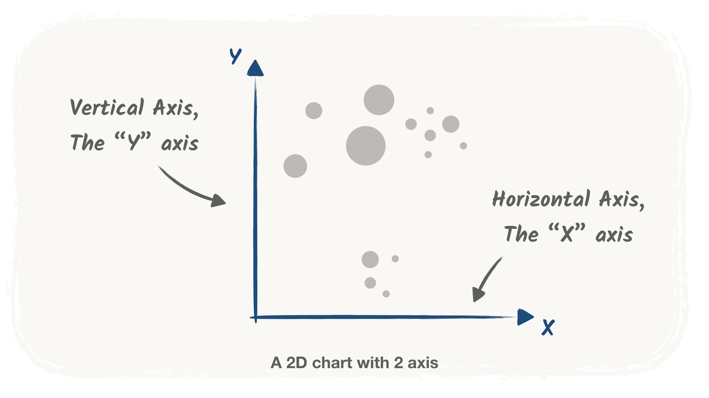
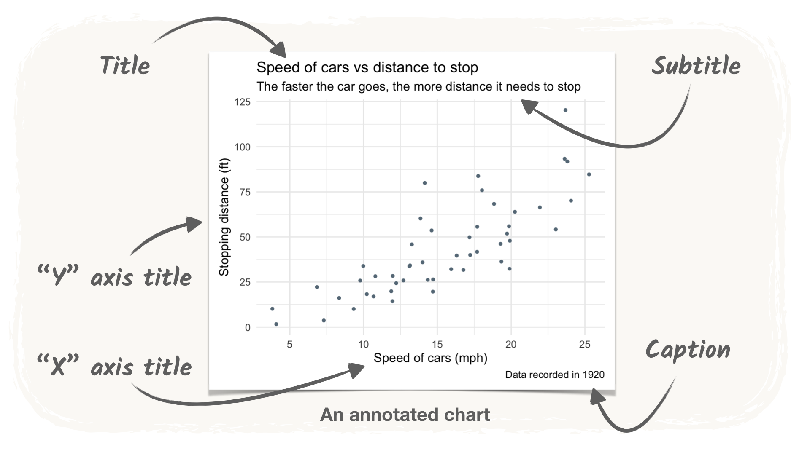
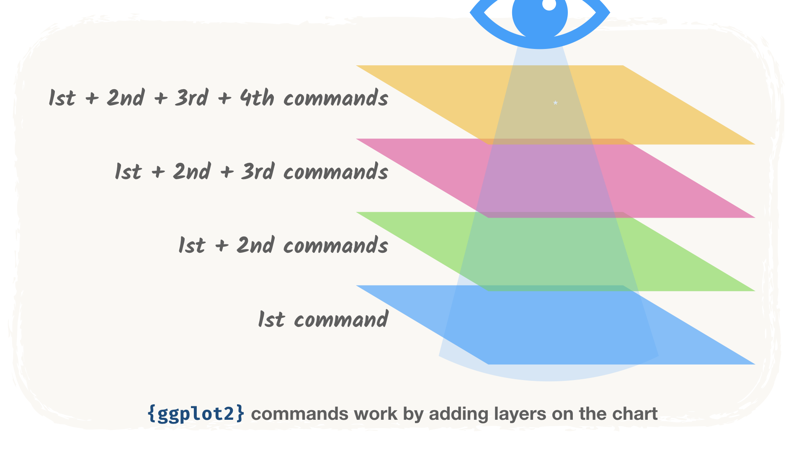

```{r setup, include=FALSE}
# Set options for all chunks:
knitr::opts_chunk$set(
	echo = TRUE,
	message = FALSE,
	warning = FALSE,
	fig.align = 'center',
	fig.width = 16/2,
	fig.height = 9/2
)
library(tidyverse)
library(knitr)

# keep wide tibbles on one slide
options(pillar.max_extra_cols = 0)
```

## Visualise: explore and communicate

{fig-alt="The data science pipeline: import, then tidy, then a loop of transform, visualise and model, then communicate. The visualise step is highlighted: data visualisation helps to understand and communicate your insights." width="80%" fig-align="center"}

- Part of the **exploration** loop
- A **tool to communicate** results clearly

. . .

Today: the **grammar of graphics**, with `{ggplot2}`.

# A Grammar for Data Visualisation {.subsection background-color="#425556"}

## The grammar of graphics

::: content-box-marine
The grammar of graphics is a series of **rules** used to build graphics, akin to the grammar of a language ([Wilkinson, 2005](https://link.springer.com/book/10.1007/0-387-28695-0 "The Grammar of Graphics, Wilkinson 2005"))
:::

. . .

> "rules that create meaning"

. . .

::::: columns
::: {.column width="50%"}
| Word    | Part of speech       |
|---------|----------------------|
| rules   | **Noun**             |
| that    | **Relative pronoun** |
| create  | **Verb**             |
| meaning | **Direct object**    |
:::

::: {.column .fragment width="50%"}


| Graphics       |
|:---------------|
| **data**       |
| **aesthetics** |
| **geometries** |
| **themes**     |

:::
:::::

## Data

::: content-box-marine
The **dataset** with the **variables to plot**.
:::

**For example**: a dataset containing three columns

- `Variable 1` (Numeric)
- `Variable 2` (Numeric)
- `Group` (Categorical:`"A"`, `"B"` or `"C"`).

## Data

```{r}
#| label: example-data
#| include: false

set.seed(123)
example_data <-
  tibble(x = runif(100, 0, 10) %>% round(digits = 2)) %>%
  mutate(group = c(rep("A", 30), rep("B", 40), rep("C", 30))) %>%
  mutate(
    y = round(4 * x + rnorm(100, sd = 4), digits = 2),
    y = case_when(
      group == "B" ~ y + 12,
      group == "C" ~ y - 5 * x + 12,
      .default = y
    )
  ) %>%
  rename(`Variable 1` = x, `Variable 2` = y, Group = group) %>%
  relocate(Group, `Variable 1`, `Variable 2`)
```


```{r}
#| label: example-data-table
#| echo: false
example_data %>%
  head() %>%
  kable()
```

## Aesthetics

::: content-box-marine
**Aesthetics** are the features of the graphic that can depend on the data
:::

. . .

- `x`, `y` axes,
- the `color` or the `size` of an element in the chart

. . .

{fig-align="center" width="70%"}

## Aesthetic mappings

::: content-box-marine
**Aesthetic mapping** indicate which **variable** goes to which **aesthetic** element of the chart
:::

. . .

**For example**:

::: {.fragment}
- Two numeric variables can be mapped to the axes
  - `Variable 1` $\rightarrow$ `x`
  - `Variable 2` $\rightarrow$ `y`
:::
::: {.fragment}
- the categorical variable changes the colour
  - `Group` $\rightarrow$ `color`
:::

## Geometries

::: content-box-marine
**Geometries** are the **type of plot** to use
:::

. . .

| Geometry        | Type of plot |
|-----------------|--------------|
| `point`         | scatterplots |
| `line`          | lineplot     |
| `col`umn, `bar` | barplots     |
| `area`          | area charts  |

. . .


**For example**: use a `point` geometry to build a **scatterplot**.

. . .

::: callout-tip
The choice of the geometry depends on the **question** and on the **nature of the variables**
:::

## Themes

::: content-box-marine
all the purely cosmetic "ink" (titles, axes, captions, axes names etc) are the **Theme** of the chart
:::

. . .

{fig-align="center" width="70%"}

## Putting it together

```{r}
#| label: example-plot
#| output-location: column-fragment
#| fig-alt: "Scatter plot of Variable 2 against Variable 1, coloured by Group: in each of the groups A, B and C the points follow a straight line, but the lines differ between groups."
# Data
example_data %>%     
  ggplot() +
  
# Aesthetic mapping
  aes(
    x = `Variable 1`,
    y = `Variable 2`, 
    color = Group) + 

# Geometry
  geom_point() + 

# Theme
  theme_minimal() #<4>
```

. . .

> A clear **linear link** between Variable 1 and Variable 2, but it **differs across the groups**

# `{ggplot2}` syntax {.subsection background-color="#425556"}

## `{ggplot2}`: the grammar of graphics in R {.center}

::: {.content-box-marine}
`{ggplot2}` implements the grammar of graphics in R. 

The 'gg' stands for... **g**rammar of **g**raphics. It's even in the name!
:::

## 🎾 WTA Data (for the examples)

👉 Our data: women's Grand Slam singles matches, 1968–2021. We keep the **finals**.

```{r}
#| label: read-finals
#| output-location: column-fragment
library(readr)
library(dplyr)

wta <-
  "../data/wta_grand_slam_data.csv" %>%
  read_csv()

finals <- wta %>%
  filter(round == "F")

head(finals)
```


## A layered constructions

::: {.callout-tip}

## `{ggplot2}` plots are built in layers

::: {.incremental}

1.  A **base plot**:  the **data** and the **aesthetic mappings**

2.  **+** the **geometries**

3.  **+** the **cosmetic elements** and other layers

:::

:::

{width="70%" fig-align="center"}

# Scatterplots with `geom_point()` {.subsection background-color="#425556"}

## Scatterplots with `geom_point()` {.smaller auto-animate="true"}

> *Is there a **trend in the age** of the tournament winners over the **years**?*

- The base layer: `ggplot()`, with the `data` and the mapping `aes(x = year, y = winner_age)`

. . .


```{r}
#| label: base-plot-year-age
#| output-location: column-fragment
#| fig-alt: "An empty plot: the axes year and winner_age are drawn, but there are no data points."

# attach ggplot2
library(ggplot2)

# create a base plot
ggplot(data = finals, # the data
       mapping = aes(
        x = year, # mapping the x-axis to year
        y = winner_age) # mapping the y-axis to winner age
       )
```


::: callout-tip
To define the **aesthetic mapping**, we rely on the function `aes(...)`.
:::

. . . 

> Nothing yet! The geometry is missing! But what geometry should we add?

## Adding a geometry with `+` {.smaller auto-animate="true"}

> *Is there a **trend in the age** of the tournament winners over the **years**?*

- One **point** per observation: `geom_point()`, **added** to the base layer with `+`

```{r}
#| label: geom-point-year-age
#| output-location: column-fragment
#| code-line-numbers: "7,8"
#| fig-alt: "Scatter plot of winner age against year for the Grand Slam finals: no overall trend, but some points line up in short clusters."

library(ggplot2)

ggplot(data = finals, # the data
       mapping = aes(
        x = year, # mapping the x-axis to year
        y = winner_age) # mapping the y-axis to winner age
       ) + 
  geom_point() # our geometry of choice: points
```

::: callout-tip
In `{ggplot2}` we use the `+` instead of the `%>%` sign to add layers!
:::

. . . 

> **No clear trend**, but **clusters** of aligned points. Could there be **trends within groups?*** 


## Mapping a third variable to `color` {.smaller auto-animate="true"}

> Could there be **trends within groups?**

- Let's colour by `surface`: Clay, Grass or Hard.

```{r}
#| label: color-surface
#| code-line-numbers: "7" 
#| output-location: column-fragment
#| fig-alt: "The same scatter plot of winner age against year, with the points coloured by surface (Clay, Grass, Hard): still no uniform trend."

library(ggplot2)

ggplot(data = finals,
       mapping = aes(
        x = year,
        y = winner_age,
        color = surface)
       ) + # mapping surface to color
  geom_point()
```

. . . 

> Colours... but **still no clear trend**.

## One colour per player {.smaller auto-animate="true"}

> Are the clusters the **same player** winning over the years, and **getting older**?

```{r fig.width=10, fig.height= 5}
#| label: color-winner
#| code-line-numbers: "7" 
#| output-location: column-fragment
#| fig-alt: "Scatter plot of winner age against year, with one colour per winner and no legend: points of the same colour line up, rising with the years."

library(ggplot2)

ggplot(data = finals,
       mapping = aes(
        x = year,
        y = winner_age,
        color = winner_name) # mapping winner name to color
        ) + 
  geom_point() +
  theme(legend.position = "none") # 54 players: too many for a readable legend
```

. . . 

> Voilà! Most **points with the same color align**, indicating the source of the clusters.

<!-- ## What we learnt from the colours {.smaller}

::: callout-note
Often, mapping a third variable to an aesthetic such as color can help us discover trends within **groups**.
:::

::: {.callout-tip collapse="true"}
## Look at the chunk option!

We have defined a dimension of the chart in the chunk options (`fig.width=10, fig.height= 5`) because we want to **enlarge the plot**.

We have also **hidden the legend**: with 54 different players, nobody could match 54 colours to their names. Here, we only need to see that points of the same colour line up.
:::

::: {.callout-note collapse="true"}
## The surface plot wasn't useless

You can see that **before 1977** there are fewer blue points: tournaments were played only on *grass* or *clay*, and *hard* surfaces arrived only after that year.

THIS SECTION IS BETTER IN THE HANDOUT 
::: -->


# Boxplots with `geom_boxplot()` {.subsection background-color="#425556"}

## Boxplots with `geom_boxplot()` {.smaller auto-animate="true"}

> *Is there a relationship between the `age` of a tournament winner and the `surface`?*

- A new question, a new geometry: 

::: {.content-box-marine}
**Boxplots** summarise **distributions** from their quartiles
:::

. . . 

- First, the base plot, with `surface` on the `x` axis

```{r}
#| label: base-plot-surface
#| output-location: column
#| fig-alt: "An empty plot with surface (Clay, Grass, Hard) on the x axis and winner_age on the y axis."
ggplot(data = finals,
       mapping = aes(x = surface, # we change the mapping of the x axis
                     y = winner_age))
```

## Adding `geom_boxplot()` {.smaller auto-animate="true"}

```{r}
#| label: geom-boxplot
#| output-location: column-fragment
#| fig-alt: "Boxplots of winner age by surface: the winners on grass tend to be older, the winners on hard courts younger."
ggplot(data = finals,
       mapping = aes(x = surface,
                     y = winner_age)) +
  geom_boxplot() # adding the geometry to create the boxplot
```

<!-- ::: {.callout-tip collapse="true"} -->
<!-- ## Where do the boxes come from? -->
<!--  -->
<!-- The summary statistics needed to draw the boxplots (i.e. the median, the upper and lower quartiles) are computed from the "raw" data when drawing the plot. -->
<!-- ::: -->

. . . 

> **Grass** favours **older** winners, **hard** surfaces **younger** ones.

<!-- ## ⚠️ Exploring is not confirming -->
<!--  -->
<!-- ::: callout-warning -->
<!-- ## Exploratory Data Analysis -->
<!--  -->
<!-- - Plots like these **explore** the links between variables -->
<!-- - To **confirm** them, more work is needed, e.g. a **statistical test** -->
<!-- ::: -->
 <!-- this is better in the handout -->

# Adding more geometries `geoms_*` {.subsection background-color="#425556"}

## Layers on layers {.smaller}

> *How many observations per surface? Any extreme values?* 

. . . 

👉 Let's add **points** on top of the boxplots.

```{r}
#| label: boxplot-points
#| output-location: column-fragment
#| fig-alt: "Boxplots of winner age by surface with the points drawn on top: the points pile up on a single vertical line per surface."
ggplot(data = finals,
       mapping = aes(x = surface,
                     y = winner_age)) +
  geom_boxplot() +
  geom_point() # adding a new geometry for the same mappings
```

. . .

::: callout-warning
## Careful with Overplotting!

**Overplotting**: many points drawn **on top of each other**. Common with points over a categorical variable.
:::

## `geom_jitter()`: shake the points {.smaller auto-animate="true"}

👉 Let's shake things up a bit!

```{r}
#| label: boxplot-jitter
#| output-location: column-fragment
#| fig-alt: "Boxplots of winner age by surface with jittered points: the points are spread randomly sideways, so the individual observations are visible."
ggplot(data = finals,
       mapping = aes(x = surface,
                     y = winner_age)) +
  geom_boxplot() +
  geom_jitter() # added a jitter on top
```

## 💡 Every layer has arguments {.smaller auto-animate="true"}

The argument `width` sets how far the points spread

```{r}
#| label: boxplot-jitter-width
#| output-location: column-fragment
#| code-line-numbers: "5"
#| fig-alt: "The same plot with a narrowe` kr jitter: the points stay close to their box."
ggplot(data = finals,
       mapping = aes(x = surface,
                     y = winner_age)) +
  geom_boxplot() +
  geom_jitter(width = 0.2) # spreading the points a little less
```

. . . 

::: callout-tip
## Every layer has Arguments

Every layer is a function, hence it has arguments
:::

# Case study: Customising a bar chart {.subsection background-color="#425556"}

## Who won the most Grand Slam titles? {.smaller}

Let's use our **Data Wrangling** skills to count the wins!

. . .

```{r}
#| label: count-total-wins
total_wins <- finals %>%
  group_by(winner_name) %>%
  summarise(total_wins = n(), .groups = "drop") %>%
  arrange(desc(total_wins))

slice_head(total_wins, n = 6)
```

## A first bar chart with `geom_col()` {.smaller}

```{r}
#| label: geom-col-all
#| output-location: column
#| fig-alt: "Horizontal bar chart of the number of titles of all 54 winners, in reverse alphabetical order from top to bottom: the names overlap and the chart is hard to read."
ggplot(data = total_wins,
       mapping = aes(x = total_wins,
                     y = winner_name)) +
  geom_col()
```

Time to give it a bit more flair!

## Ordering the bars {.smaller}

- Bars are in **alphabetical** order: `winner_name` is still `character`
- `ggplot()` ignores our `arrange()`!

::: {.content-box-marine}
Turn `winner_name` into a `factor`: a type **with an order**. In the `{tidyverse}`: the package `{forcats}`.
:::

```{r}
#| label: reorder-winners
library(forcats)

total_wins <- total_wins %>%
  # we reorder the winner_name by total wins
  mutate(winner_name = fct_reorder(winner_name, total_wins))
```

`winner_name` is now a factor (`fct`):

```{r}
#| label: total-wins-head-reordered
glimpse(total_wins)
```

## Ordered bars {.smaller}

```{r}
#| label: geom-col-ordered
#| output-location: column
#| fig-alt: "The same bar chart with the bars ordered by number of titles, from the most titles at the top to the fewest at the bottom."
ggplot(data = total_wins,
       mapping = aes(x = total_wins,
                     y = winner_name)) +
  geom_col()
```

> The plot is already much more readable! ...but how can we improve it?

## Focusing our message {.smaller}

- Keep the **top 20** with `slice_max()`, fed directly to `ggplot()`
- The original table stays unchanged

```{r}
#| label: top20-bars
#| output-location: column
#| fig-alt: "Ordered bar chart of the number of titles of the top 20 winners, led by Serena Williams and Steffi Graf."
total_wins %>%
  slice_max(order_by = total_wins, n = 20) %>%
  ggplot(mapping = aes(x = total_wins,
                       y = winner_name)) +
  geom_col()
```

> Much better, the plot almost speaks for itself. But let's fix those axes.

## Cosmetic time! {.smaller}

- A title and axis names, with a `labs()` layer

::: callout-note
The `labs()` layer is part of the layers that help with the *cosmetic* aspects of the plot.
:::

```{r}
#| label: top20-labs
#| output-location: column
#| fig-alt: "The top-20 bar chart with the title 'Serena Williams won 23 Grand Slam titles', a subtitle, an x-axis label and a source caption."
total_wins %>%
  slice_max(order_by = total_wins, n = 20) %>%
  ggplot(mapping = aes(x = total_wins,
                       y = winner_name)) +
  geom_col() +
  #adding labels
  labs(title = "Serena Williams won 23 Grand Slam titles",
       subtitle =  "Followed by the legendary Steffi Graf with 22 titles",
       x = "Number of Grand Slam titles",
       y = "",
       caption = "source: https://github.com/JeffSackmann")
```

## Ready-made themes {.smaller}

::: callout-note
`{ggplot2}` has multiple ready-to-use themes. You can see a list of them [here](https://ggplot2.tidyverse.org/reference/ggtheme.html). Some of them are:

- `theme_minimal()`: a good starting point
- `theme_dark()`: if [you want it darker](https://youtu.be/v0nmHymgM7Y)
- `theme_bw()`: to see things in black and white
- `theme_classic()`

You can see the proposals if you type `theme_` in your console.
:::

## Let's go `minimal` {.smaller}

```{r}
#| label: top20-theme-minimal
#| output-location: column
#| fig-alt: "The labelled top-20 bar chart with theme_minimal(): no grey background and light grid lines."
total_wins %>%
  slice_max(order_by = total_wins, n = 20) %>%
  ggplot(mapping = aes(x = total_wins,
                       y = winner_name)) +
  geom_col() +
  labs(title = "Serena Williams won 23 Grand Slam titles",
       subtitle =  "Followed by the legendary Steffi Graf with 22 titles",
       x = "Number of Grand Slam titles",
       y = "",
       caption = "source: https://github.com/JeffSackmann") +
  # adding a theme
  theme_minimal()
```

## How about some color? {.smaller}

Let's try `fill = "lightblue"`...

```{r}
#| label: fill-in-aes
#| output-location: column
#| fig-alt: "The bar chart with fill = 'lightblue' inside aes(): the bars are salmon-red, and a legend shows a single key labelled lightblue."
total_wins %>%
  slice_max(order_by = total_wins, n = 20) %>%
  ggplot(mapping = aes(x = total_wins,
                       y = winner_name,
                       fill = "lightblue")) +
  geom_col() +
  labs(title = "Serena Williams won 23 Grand Slam titles",
       subtitle =  "Followed by the legendary Steffi Graf with 22 titles",
       x = "Number of Grand Slam titles",
       y = "",
       caption = "source: https://github.com/JeffSackmann") +
  theme_minimal()
```

> Oh no! Something is wrong... Can you guess what?

## What's going on? {.smaller .scrollable}

::: {.callout-warning collapse="true"}
## What's going on?

- When we place `fill = "lightblue"` in the call to `aes()`, we are **mapping a variable** with the **single value** `"lightblue"` to the `fill` of the bars...
- ...and not setting it as a **parameter!**
- `ggplot()` does not understand that `"lightblue"` is actually a color we want to set.
- A mapping would make sense if we wanted the color of the bars to depend on the number of `total_wins`.
- This creates a continuous color scale, applied to the color of the bars.

```{r}
#| label: fill-total-wins
#| output-location: column
#| fig-alt: "The bar chart with fill = total_wins inside aes(): the bars are shaded along a continuous blue scale according to the number of titles, with a colour-bar legend."
total_wins %>%
  slice_max(order_by = total_wins, n = 20) %>%
  ggplot(mapping = aes(x = total_wins,
                       y = winner_name,
                       fill = total_wins)) +
  geom_col() +
  labs(title = "Serena Williams won 23 Grand Slam titles",
       subtitle =  "Followed by the legendary Steffi Graf with 22 titles",
       x = "Number of Grand Slam titles",
       y = "",
       caption = "source: https://github.com/JeffSackmann") +
  theme_minimal()
```
:::

## Setting a colour: outside `aes()` {.smaller}

- To give **all** the bars one colour, set it **inside the `geom_*()`**, outside `aes()`

```{r}
#| label: fill-outside-aes
#| output-location: column
#| fig-alt: "The labelled top-20 bar chart with all the bars in light blue and no legend."
total_wins %>%
  slice_max(order_by = total_wins, n = 20) %>%
  ggplot(mapping = aes(x = total_wins,
                       y = winner_name)) +
  geom_col(fill = "lightblue") + # setting a colour for all the bars
  labs(title = "Serena Williams won 23 Grand Slam titles",
       subtitle =  "Followed by the legendary Steffi Graf with 22 titles",
       x = "Number of Grand Slam titles",
       y = "",
       caption = "source: https://github.com/JeffSackmann") +
  theme_minimal()
```

# Case Study: Plotting more variables {.subsection background-color="#425556"}

## Did Serena win more than Steffi on all surfaces? {.smaller}

- Count the finals won **by player** and **by surface**, then map `surface` to `fill`
- But first, **reorder** the players again

::: callout-note
## Other nifty `{forcats}` tricks

- `fct_infreq()` orders factors by frequency: applied to `winner_name`, it orders the players without the need to count!
- `fct_rev()` reverses the order, to make it **descending**.

```{r}
#| label: wins-by-surface
total_wins_surface <- finals %>%
  mutate(winner_name = fct_rev(fct_infreq(winner_name))) %>% #reordering the winner names
  group_by(winner_name, surface) %>%
  summarise(total_wins = n(), .groups = "drop") %>%
  arrange(surface, desc(total_wins))
```
:::

## The top 20, as a vector {.smaller}

`pull()` extracts the names of the top 20 into the vector `top20`

```{r}
#| label: top20-names
top20 <- total_wins %>%
  slice_max(order_by = total_wins, n = 20) %>%
  pull(winner_name)

top20
```

## Titles by surface {.smaller}

```{r}
#| label: stacked-by-surface
#| output-location: column
#| fig-alt: "Stacked bar chart of the titles of the top 20 winners, with each bar split into clay, grass and hard by fill colour."
total_wins_surface %>%
  filter(winner_name %in% top20) %>%
  ggplot(mapping = aes(x = total_wins,
                         y = winner_name,
                         fill = surface)) +
  geom_col() +
  labs(
    title = "Serena Williams won 23 Grand Slam titles",
    subtitle =  "Followed by the legendary Steffi Graf with 22 titles",
    x = "Number of Grand Slam titles",
    y = "",
    caption = "source: https://github.com/JeffSackmann"
  ) +
  theme_minimal()
```

- Steffi Graf won more on **clay**, Serena more on **hard** surfaces
- But **grass** is very hard to compare!

# Creating multiple mini-plots {.subsection background-color="#425556"}

## One mini-plot per surface: `facet_wrap()` {.smaller}

- Compare the players **surface by surface**
- Mini-plots are called **facets**: the faceting variable goes into `vars()`

::: callout-important
```{r}
#| label: facets-by-surface
#| output-location: column
#| fig-alt: "Three side-by-side bar charts, one per surface (Clay, Grass, Hard), each showing the titles of the top 20 winners on that surface."
total_wins_surface %>%
  filter(winner_name %in% top20) %>%
  ggplot(mapping = aes(x = total_wins,
                         y = winner_name,
                         fill = surface)) +
  geom_col() +
  labs(
    title = "Serena Williams won 23 Grand Slam titles",
    subtitle =  "Followed by the legendary Steffi Graf with 22 titles",
    x = "Number of Grand Slam titles",
    y = "",
    caption = "source: https://github.com/JeffSackmann"
  ) +
  theme_minimal() +
  facet_wrap(vars(surface)) # using surface as a faceting variable
```
:::

## Hiding the redundant legend {.smaller}

::: {.callout-note collapse="true"}
## The colours are redundant too

The colors here are a bit redundant as well, but we keep them just for personal taste; feel free to remove them.
:::

```{r}
#| label: facets-no-legend
#| output-location: column
#| fig-alt: "The same three facets without the legend: each facet title names its surface."
total_wins_surface %>%
  filter(winner_name %in% top20) %>%
  ggplot(mapping = aes(x = total_wins,
                         y = winner_name,
                         fill = surface)) +
  geom_col() +
  labs(
    title = "Serena Williams won 23 Grand Slam titles",
    subtitle =  "Followed by the legendary Steffi Graf with 22 titles",
    x = "Number of Grand Slam titles",
    y = "",
    caption = "source: https://github.com/JeffSackmann"
  ) +
  theme_minimal() +
  facet_wrap(vars(surface)) +
  theme(legend.position = "none") #removing the legend
```

# Exporting your plots {.subsection background-color="#425556"}

## `ggsave()` saves the last plot

- Just give it a **file name**:

```{r}
#| label: ggsave-default
#| eval: false
ggsave("wta_wins_by_surface.png")
```

- The size follows your **Plots pane**, so it changes between computers. Fix it with `width` and `height` (in inches):

```{r}
#| label: ggsave-7x5
#| eval: false
ggsave("wta_wins_by_surface_7x5.png", width = 7, height = 5)
```

# More resources {.subsection background-color="#425556"}

## To go further

- [`{ggplot2}` book](https://ggplot2-book.org)
- [`{ggplot2}` cheatsheet](https://ggplot2.tidyverse.org)
- [`{ggplot2}` extensions](https://exts.ggplot2.tidyverse.org)
- [R for data science](https://r4ds.had.co.nz)
- [R for data science exercise solutions](https://jrnold.github.io/r4ds-exercise-solutions/)

# Exercise Time! {.unnumbered .subsection background-color="#425556"}

## Time to work!

::: {.callout-important icon="false"}
## Time to work!

Open the exercise notebook `_exercises/exercise-notebook.qmd` and do [**Exercise 6**](../_exercises/exercise-notebook.html#exercise-6). See you there!
:::