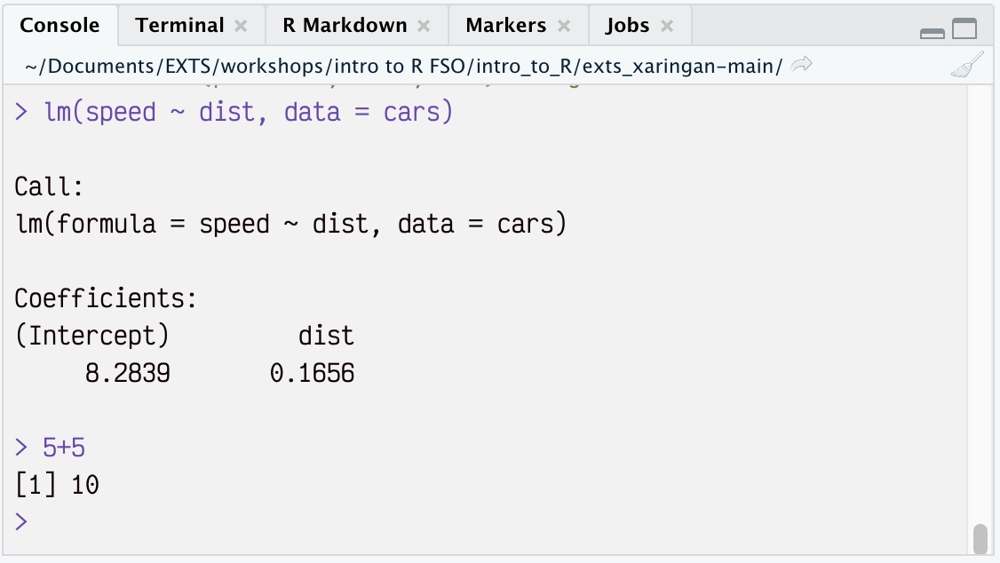
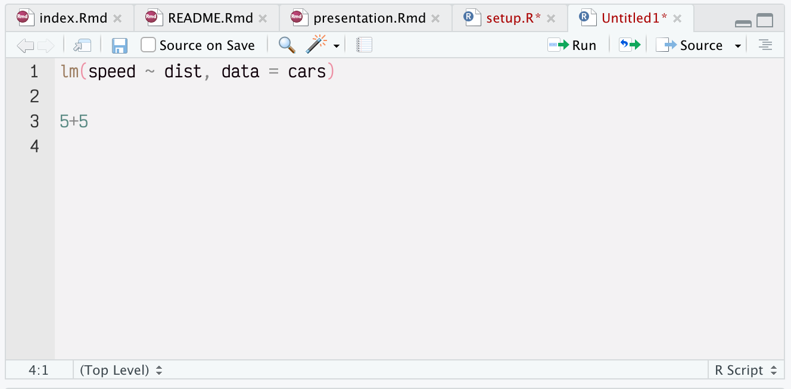

```{r echo=FALSE}
knitr::opts_chunk$set(
	message = FALSE,
	warning = FALSE,
	echo = FALSE
)
```

```{r include=FALSE}
library(tidyverse)
library(knitr)
```

Great work! Now that you have your Renku environment set-up, here are a couple of steps to kickstart your R and Rstudio experience.

# RStudio IDE

The first thing you'll see when you initialise your Renku session is the Rstudio **I**ntegrated **D**evelopment **E**nvironment. It is program that allows you to interact with R and develop your code in a comfortable and efficient manner.

As you can see it is composed in a set of windows. called **Panes**. We will often work with two of them in particular: namely, the *Source Code Editor* and the *Console*

```{r}
#| fig-align: center
include_graphics("img/rstudio_ide.png")
```

## Console

**R** is a **programming language**.

As such, we write **code** that **instructs the computer** to do things with our data.

In the **Console** we can **interact with R directly**.

-   By typing a line of code and pressing `Enter`. R immediately *executes* the instructions, i.e. *runs* the code.

::: {.callout-note icon="false"}
### Illustration {.unnumbered}

In the following illustration, the user has instructed R to fit a linear model to the dataset `cars`.

```{r}
#| fig-align: center

```
:::

::: {.callout-important icon="false"}
### Exercise {.unnumbered}

The simplest operations we can do in R are *basic arithmetic*. As an exercise, type the following instructions in the console and hit `Enter` to execute.

```{r}
#| echo: true
5 + 5
```

```{r}
#| echo: true
30 / 6
```
:::

\newpage

## Scripts

In real settings **we'll run a lot of instructions** to perform our analyses, so it might be tedious to rely only on the console only. Moreover, once the R session is closed (e.g. **when we quit the Rstudio IDE**), the **code** that was run **is not available anymore**, i.e. **once it's gone, it's gone.** The code is not *stored*.

Because of these two reasons, we have to *store* our instructions in a file. That file is called **a script** or the **source code**. These scripts **contain all our code, stored in a simple text file**. Hence we always have a **record of all steps of our data pipeline**.

-   In the Rstudio IDE, we can create a new script:

    -   by hitting `Shift`+`Ctrl`+`N` or

    -   by selecting `File` -\> `New File` -\> `R Script` in the menu at the top

-   Within a script, we can run the complete code or parts of it from this file by **selecting the line(s)** and hitting

    -   **the button Run** at the top of the pane

    -   **the keys `Crtl`**+`Enter`

-   To save your script you can hit the save button on top, and select the directory (folder) where you want to store it in your computer.

::: {.callout-note icon="false"}
### Illustration {.unnumbered}

In the following illustration, the user has created a small script with the code fit a linear model to the dataset `cars`. Additionally, they've added a line with a computation.

```{r}
#| fig-align: center

```
:::

::: {.callout-important icon="false"}
### Exercise {.unnumbered}

-   Create a small script that replicates the previous illustration, i.e. computing `5+5` and then (in another line) `30/6`.

-   Try to execute them using the `Run` button or the keyboard shortcut.

-   Save the script.
:::

\newpage

# First steps in R: A fancy calculator

## Storing data in variables

Computer languages work with the notion of environmental **variables.**\
\
Think of variables as *boxes*, where you store a value. These values can be `numeric`like `5` or a *string* composed of a series of `character`s like `"FSO"`.\
\
If you want to store a value in a variable, use the `<-` **assignment operator**

-   To type the operator, you can type `<` and then `-.`

-   Additionally using the shortcut `alt`+`-`.

::: {.callout-note icon="false"}
### Illustration {.unnumbered}

Let's store the value `5` into the variable `my_single_value` :

```{r}
#| echo: true
my_single_value <- 5
```

If you run the code above, **R will not print** the result, but just **bind the value** `5` to a variable called `my_single_value`.

If you want to **see** what's kept in `my_single_value`, type the name and run to **print**:

```{r}
#| echo: true

my_single_value <- 5

my_single_value

```

We can store many things in variables, example a collection of values (a `vector`):

```{r}
#| echo: true

a_collection_of_values <- c(1, 2, 3)

a_collection_of_values
```
:::

\newpage

## Working with variables

We can do calculations with variables just like we did with actual values

::: {.callout-note icon="false"}
### Illustration {.unnumbered}

Let's add the value of 5 to the value stored in `my_single_value`

```{r}
#| echo: true

my_single_value + 5

```

We can also do maths with complete vectors. For instance, multiplying the contents of `a_collection_of_values` times the content of `my_single_value`

```{r}
#| echo: true
#| 
a_collection_of_values * my_single_value
```
:::

\newpage

## Commenting

Finally, by prefixing text, or code with a hash (`#`) the not be evaluated by **R.**

-   This is useful to write *comments* and *document* your code.

::: {.callout-note icon="false"}
### Illustration {.unnumbered}

The following code produces a result

```{r}
#| echo: true
5 + 5
```

By prefixing it with the hash, we stop it from running

```{r}
#| echo: true
# 5 + 5
```

This operation helps us *comment* our code, i.e. give written explanations of what a section does.

```{r}
#| echo: true

# Here I want to calculate what 500 over 300 is:

500 / 300
```
:::

::: {.callout-important icon="false"}
## Exercise

As an exercise, try to create a script with all the commands you've seen.

-   Execute some basic arithmetic operations

-   Add comments to document your code.

-   Store it somewhere in the session with a descriptive name
:::
